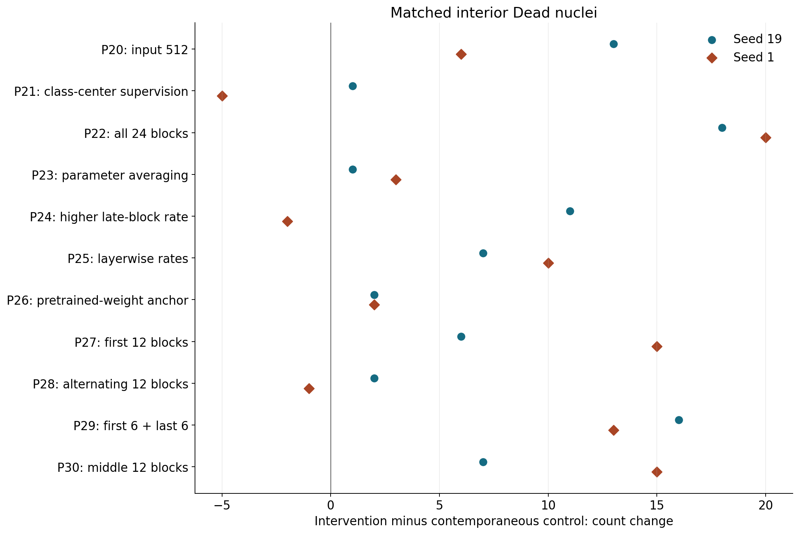
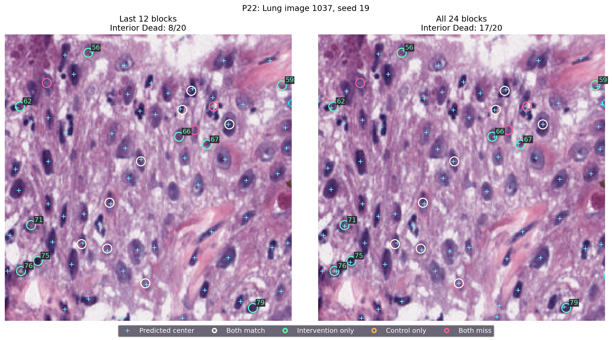
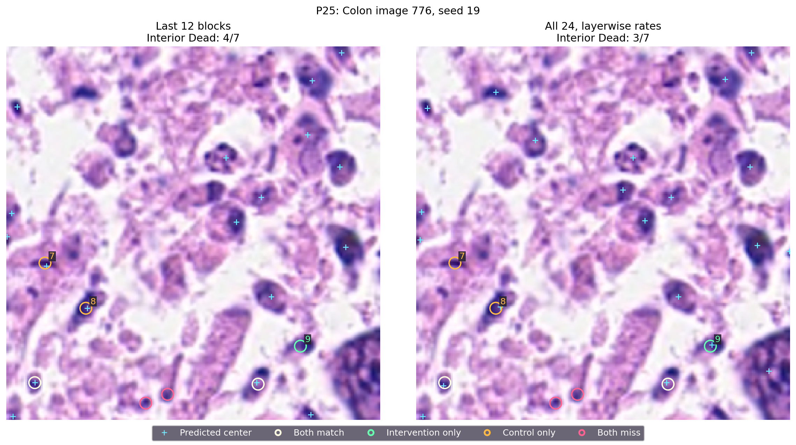
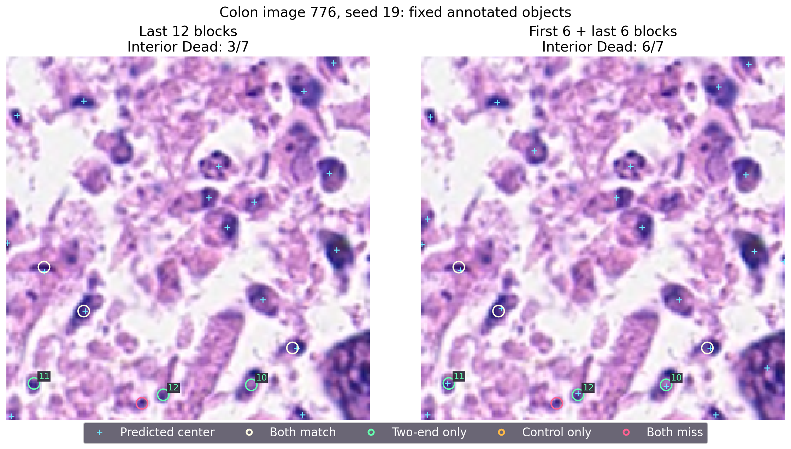
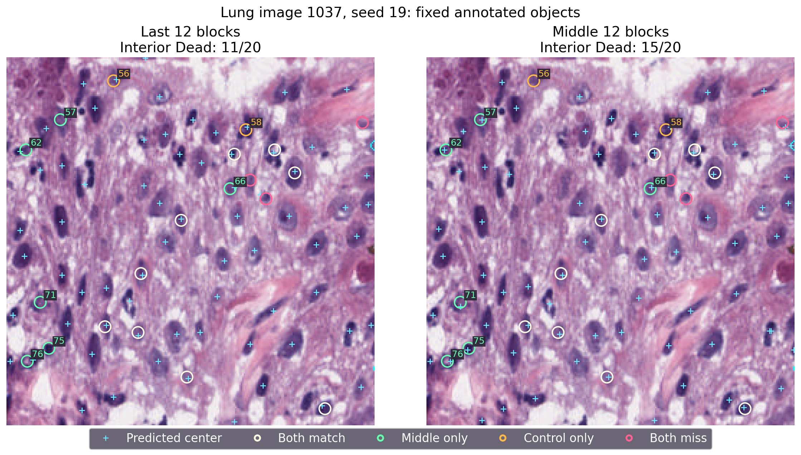
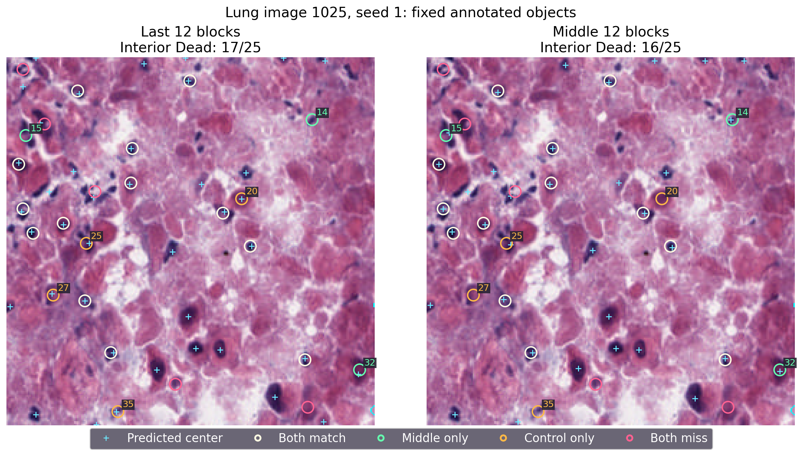
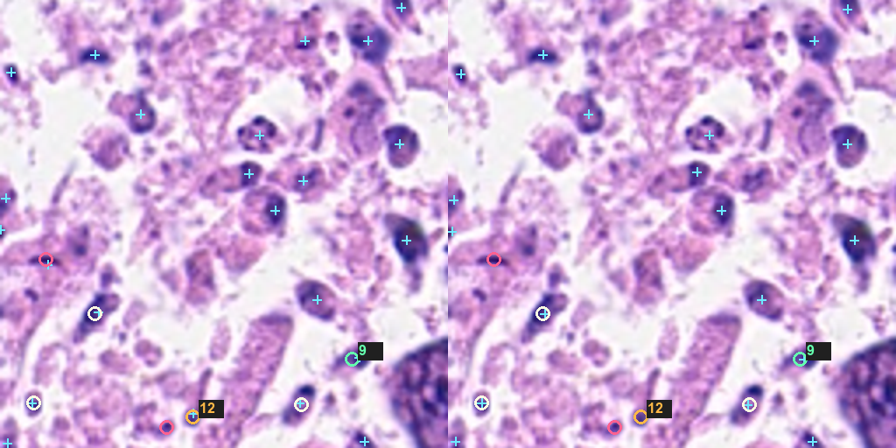

# 从真实细胞核看研究进展：第八阶段中文导读：细胞核中心检测

本报告以阶段报告 7 为起点，重点介绍 P27 至 P31，并回顾与这些实验直接相关的 P20 至 P26。

## 怎样读一张结果图

组织图中左侧为同期对照，右侧为新方案。青色十字是全部预测点。白环表示两组都找到的目标核；绿环表示新方案新增；橙环表示对照找到而新方案丢失；粉环表示两组均漏检。编号对应同一个标注核。模型预测中心与标注中心距离不超过原生三像素，才计为一对一匹配。

训练使用第一折内 2,134 张图像，开发评估使用保留的 522 张，共 12,250 个核。目标为内部 Dead 核，即轮廓不触及边界的凋亡或坏死核，共 145 个，集中在十一张图中。两种子重复相同图像上的训练。固定样例按标注分层选取，坐标和原始结果一起保存。

## 哪些尝试最有价值

P22 训练全部二十四层，增加 18／20 个目标匹配，并增加 738／753 个总体匹配。P25 采用全层分层学习率，增加 741／512 个总体匹配、减少 510／544 个额外点，目标收益为 7／10。P29 在相同训练参数量下选择前六层加后六层，增加 16／13 个目标匹配。P30 选择中间十二层，总体召回提高 5.29／4.21 个百分点，精确率提高 3.19／3.07 个百分点。

其余实验也帮助区分了不同问题。更大输入 P20 带来目标收益和约 4.3 倍训练成本；类别辅助监督 P21 同时减少正确和额外预测；参数平均 P23 的变化较小；提高后层学习率 P24 对目标的收益在种子间反向；预训练参数约束 P26 牺牲总体匹配；交错层 P28 恢复较高训练覆盖却没有稳定增加目标检测。训练得更充分、预测点更少或可训练参数更多，各自只能说明部分现象。

## 同一枚小核可以在多个方案中被恢复

看左下角编号 75：它只有 44 像素面积，对照最近预测距离为 21.40 像素，新方案为 1.41。原来空缺的位置出现了靠近标注的预测。图中另一枚小核 67 也被找到，20.62→2.24。P22 使该图目标匹配由 8／20 提高至 17／20。小核 75 在 P25、P27、P29、P30 的种子 19 中同样得到恢复，形成可追踪的共同对象收益。

再看结肠中的对象 7，位于 (148,26)：对照距离 2.24 像素，新方案 28.84，附近原有预测消失。对象 9 则被恢复，39.05→1.41。该图最终由 4／7 降至 3／7。对象 7 在 P22 和 P25 的两个种子中都丢失，说明总体提高可以伴随特定对象的重复损失。

## 改变训练层位置会改变恢复区域

前六层加后六层方案在下方组织带找到对象 10、11、12，整图由 3／7 提高至 6／7。对象 12 的距离由 80.66 降至 1.00；种子 1 也恢复它。这枚面积 104 平方像素的核曾在 P22 种子 19 中丢失。同一标注随训练层配置改变而反向，提供了研究特征适配位置的具体线索。

## P30 的收益由哪些核组成

中间十二层使该图由 11／20 增至 15／20。小核 75 再次恢复，13.60→1.41；上方浅色圆核 57 变化 11.66→1.00。同时对象 56 丢失附近预测，2.24→22.02；对象 58 则移动到 3.61 像素，刚好超出三像素半径。恢复、消失和定位移动是可以直接从保存坐标核实的三种事件。

小核 14 位于 (43,212)，面积 31 平方像素，种子 1 中由 41.98→1.00 像素，新增匹配；相同核在种子 19 中由 2.00→41.98，丢失匹配。该图两个种子的总体结果均减少一个目标核，但涉及的具体对象不同。两次训练因此需要同时阅读总体变化和对象身份。

P30 肺组织净增 5／9，结肠净增 3／6，宫颈各减一个。结肠图像 1482 改善后仍有 32／33 个目标核未找到。最终目标召回为 53.79%／54.48%，精确率为 71.95%／72.00%，原要求为 60%／75%。原完整判定在两个种子中均为 false，这一固定中间层方案已按原规则收尾。四次训练均完成 130 轮，共 17.44 GPU 小时；纯训练较对照增加约 10%，峰值显存约 4.44 GiB。

## P31：增加归一化后找到了哪些核？

最新实验在检测细胞核中心的部分加入分组归一化：模型先按通道组调整每张图像的特征，再学习合适的缩放和偏移。两个随机种子的死亡核分别从 65 增至 73、从 68 增至 70；全部核匹配分别减少 140 和增加 6。分组归一化模型在训练集找到约 99.6%／99.7% 的核，在开发评估集中找到约 58.2%／59.3% 的全部标注核。

两幅图各找到 7 个死亡核中的 4 个，但绿色的对象 9 被找到，橙色的对象 12 却丢失了附近的预测。种子 1 的同一张图从 4 个增加到 6 个，两个对象都被找到。这说明总体数字和实际找到的是哪些细胞核需要一起看。
