# 第八阶段报告：细胞核中心检测（P27–P31）

本报告以阶段报告 7 为起点，重点介绍 P27 至 P31，并回顾与这些实验直接相关的 P20 至 P26。

## 数据、指标与研究顺序

UNI 是预先在病理图像上训练的图像模型；编码器是把图像转换为可供检测使用的特征的部分。训练中，每次实际送入模型四张图，再累计四次计算后更新一次参数，等效于每次更新使用十六张图。焦点损失是一种强调难以识别位置的训练误差；解码是将中心预测图转换成具体预测点的步骤。每轮从相同的预训练 UNI 权重开始，分别使用随机种子 19 和 1 训练对照及新方案。训练集为 PanNuke 第一折内的 2,134 张图像，开发评估集为同折保留的 522 张图像，包含 12,250 个标注细胞核。最终结果均使用第 130 轮检查点。除明确指定的干预外，图像增强、物理批量 4、有效批量 16、按对象数归一化的焦点损失和预测点解码保持一致。P20 改变输入尺寸，P25 同时改变编码器训练深度和学习率。

模型输出一张不分类型的细胞核中心图。预测中心与标注中心在原生图像三像素半径内进行一对一匹配。总体召回率为匹配数除以全部标注核数；精确率为匹配数除以全部预测点数；额外点为没有匹配到标注的预测点。标注类别用于评估分层。内部 Dead 核指轮廓完整位于图像边界内的凋亡或坏死核，共 145 个，分布在十一张图像中；其中原生面积小于 67 平方像素的小核子集有 32 个。

这些实验沿用同一开发评估集，后续方案依据此前结果逐步形成。主要比较采用每轮自身的成对对照，因为不同轮次会重新训练对照模型。两个种子刻画相同图像上的训练随机性；图像层面的不确定性使用原按组织类别分别对同一批图像重复抽样 1,000 次，每次比较同一图像上两组的差值，以估计该差值的变化范围。项目的正式实例分割三划分评估另按最后检查点规范执行。

## 十二组实验分别改变了什么

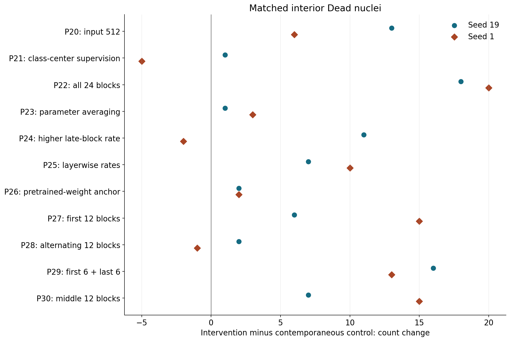

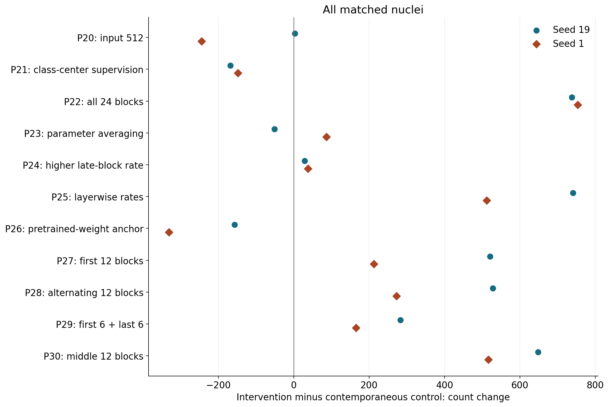

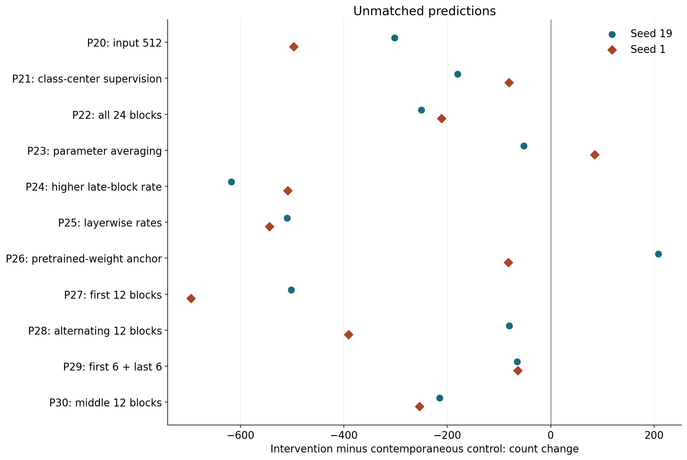

| 干预方案 | Dead 匹配，种子 19／1 | 总体匹配 | 额外点 |
|---|---:|---:|---:|
| P20，增大输入图像 | +13／+6 | +3／−244 | −302／−497 |
| P21，类别中心辅助监督 | +1／−5 | −168／−148 | −180／−81 |
| P22，全部二十四层适配 | +18／+20 | +738／+753 | −250／−211 |
| P23，训练参数平均 | +1／+3 | −51／+87 | −52／+85 |
| P24，提高后层学习率 | +11／−2 | +29／+38 | −618／−509 |
| P25，全层分层学习率 | +7／+10 | +741／+512 | −510／−544 |
| P26，预训练参数约束 | +2／+2 | −157／−331 | +208／−82 |
| P27，前十二层适配 | +6／+15 | +521／+213 | −502／−696 |
| P28，交错十二层适配 | +2／−1 | +528／+273 | −80／−391 |
| P29，前六层加后六层 | +16／+13 | +283／+165 | −65／−64 |
| P30，中间十二层适配 | +7／+15 | +648／+516 | −215／−254 |
| P31，检测头分组归一化 | +8／+2 | −140／+6 | −307／−89 |

P20 通过更大输入找到了额外目标核，纯训练时间约为对照的 4.3 倍；总体匹配在种子 19 中几乎不变，在种子 1 中下降。P21 的类别辅助目标同时减少了正确匹配和额外点。P23 参数平均对目标核的影响较小，总体收益方向不一致。P24 较高的后层学习率删除了较多额外点，但目标核变化在两个种子间反向。这几轮区分了两种行为：恢复原来漏掉的核，以及减少预测输出。

P22、P25 和多数组编码器位置实验在两个种子中都提高了总体覆盖，目标核收益却相差较大。P26 向预训练参数施加约束，每种子增加两个目标匹配，同时减少 157／331 个总体匹配。P28 相较 P27 恢复了较高训练覆盖，但目标变化只有 +2／−1。训练集覆盖、可训练参数量和训练层数因此只能解释部分结果；逐组织、逐对象分析进一步显示了哪些变化能够重复。

## P22：全深度适配带来的显著目标核恢复

P22 将 UNI 全部二十四层设为可训练，保持原编码器学习率，对照训练最后十二层。目标核增加 18／20 个，总体匹配增加 738／753 个，额外点减少 250／211 个。最终内部 Dead 覆盖为 85／145 和 82／145，即 58.62%／56.55%；精确率为 72.84%／73.36%。这是这十二组固定方案中最强的双种子目标核净收益。纯训练时间约为对照的 1.43／1.42 倍，峰值训练显存由约 4.05 增至 6.75 GiB；四个完成任务共使用约 21.48 GPU 小时。

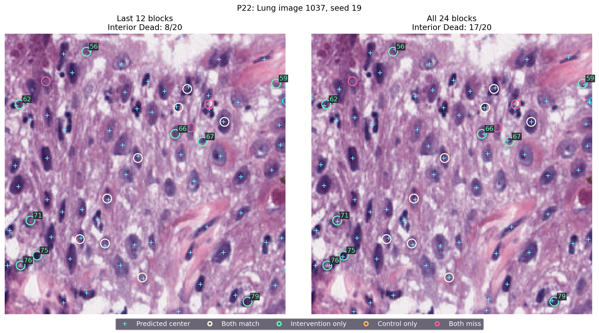

该图的内部 Dead 匹配由 8／20 增至 17／20。对象 75 位于行、列坐标 (202,29)，面积 44 平方像素，是左下密集组织中的小核；最近预测距离由 21.40 降至 1.41 像素。对象 67 位于 (98,180)，面积 65 平方像素，距离由 20.62 降至 2.24。该图两个预先定义的小目标核均被恢复。对象 66、71、76、79 也新增附近预测，覆盖不同大小和空间位置。对象 56、62 则由 3.16 像素移入三像素范围。九个收益因此包含两类事件：原来没有近邻预测的位置出现预测，以及已有近邻点的定位改善。

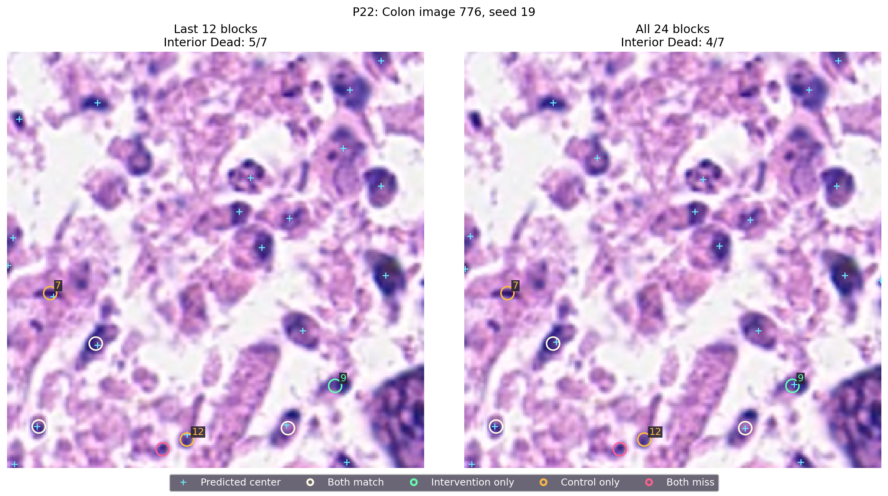

结肠图像 776 的目标匹配由 5／7 降至 4／7。对象 9 位于 (205,201)，面积 191 平方像素，最近距离由 38.42 降至 1.41；对象 7 位于 (148,26)，距离由 2.83 增至 30.02；下方组织带中的对象 12 位于 (238,110)，由 3.00 增至 62.39。肺组织的显著恢复与结肠图像中已有预测的丢失同时存在。该图与其余固定样例均按标注分层预先选取。

种子 1 同样恢复肺组织图像 1037 中的小核 75 和对象 66、71；该图由 10／20 增至 15／20，具体为六个新增与一个丢失。结肠对象 7 在两个种子中均丢失。种子 19 中，肺组织 1037 贡献九个净收益，宫颈组织 1756 贡献七个，两图合计占全体十八个净收益中的十六个。结果解释因此需要同时呈现总体变化与贡献集中的具体图像。

## P25：总体检测改善与肺、结肠差异

P25 同时训练全部二十四层并采用分层学习率，第 b 层初始学习率为 3e-5 × 0.95^(23−b)。总体匹配增加 741／512 个，额外点减少 510／544 个，精确率达到 74.44%／74.24%，接近固定的 75% 要求。目标收益为 +7／+10，最终找到 76／145 和 75／145 个内部 Dead 核。肺组织贡献 +9／+8，结肠组织贡献 −7／−6。含有 49 个目标核的结肠图像 1482，由 15 降至 9 个匹配、由 14 降至 10 个匹配。这组深度和学习率的联合干预改善了部分组织中的检测，同时加重了集中结肠图像的目标漏检。

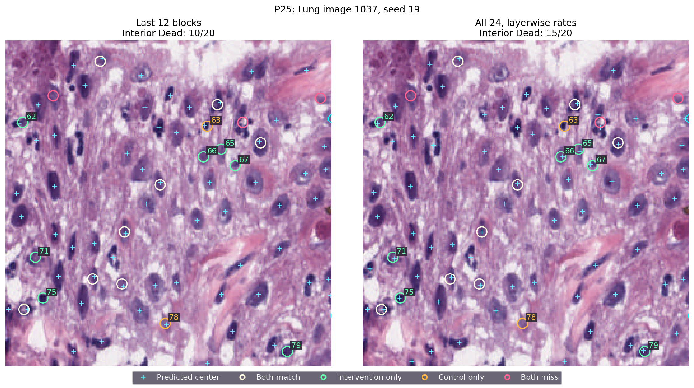

该图由 10／20 增至 15／20。小核 67、75 的距离分别变化 20.62→2.24 和 15.00→1.00 像素；对象 66 变化 20.62→1.00。这些标注位置在 P22 中也得到改善。另一方面，对象 63 位于 (67,158)，由 2.24 增至 19.80；对象 78 位于 (222,125)，由 1.41 增至 23.26。同一图内的新增覆盖与已有覆盖丢失并存。

该图由 4／7 降至 3／7。对象 7 再次丢失附近预测，距离 2.24→28.84；对象 9 被恢复，39.05→1.41。对象 8 位于 (179,54)，由 1.00 移至 3.16，跨过匹配边界。种子 1 也丢失对象 7，并丢失左下组织带中的对象 11。重复的对象变化将组织间差异落实到了相同的标注位置。

P25 两种子的训练集内部 Dead 覆盖均达到 649／656，开发评估集小目标核覆盖则为 10／32 和 12／32。纯训练耗时约为对照的 1.41／1.42 倍，峰值显存约 6.75 GiB，四任务共 19.99 GPU 小时。较强的训练覆盖和总体精确率，仍留下了围绕稀有目标核的跨图像迁移问题。

## P27–P29：相同参数量下的训练层位置

P27 训练前十二层，P28 训练交错的十二层，P29 训练前六层加后六层。三者均保留 151,179,264 个可训练编码器参数和 3,294,657 个检测头参数。前层通过后续冻结层接收梯度；层编号从 0 开始，同期对照训练第 12–23 层。干预改变了特征层级中的可训练路径。

P27 的两种子分别由 72→78 和 65→80/145 个目标匹配，增加 6／15 个目标匹配、减少 502／696 个额外点，训练总体召回却降至 88.80%／87.82%。P28 将训练召回恢复至约 96.3%，增加 528／273 个总体匹配，目标变化仅为 +2／−1。P29 的两种子分别由 65→81 和 67→80/145 个目标匹配，增加 16／13 个目标匹配，两个种子的原成对自助区间下界均为正；其总体收益 +283／+165 小于 P27 和 P30。总体覆盖、精确率与稀有对象恢复对训练位置表现出不同响应。

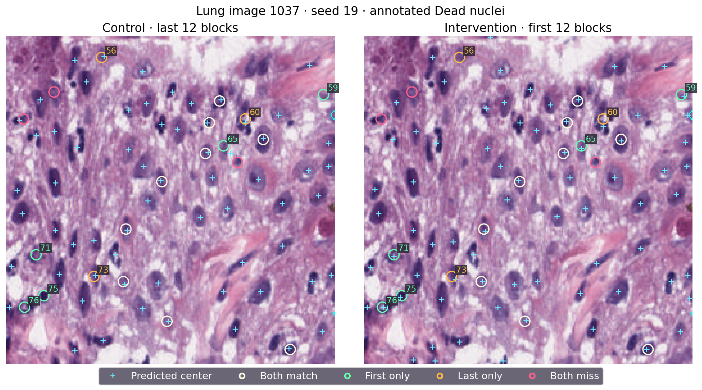

前十二层方案将该图由 12／20 提高至 14／20。对象 71、75、76 在左下区域恢复预测，距离分别变化 21.02→1.00、20.81→1.41、12.00→1.00；三者在种子 1 中也新增匹配。图上方的对象 56 在两个种子中均丢失，种子 19 为 2.24→21.00。对象 73 位于 (187,68)，两个种子均由 1.41 移至 3.61，跨过匹配边界。重复的左下恢复与重复的定位损失共同组成该图收益。

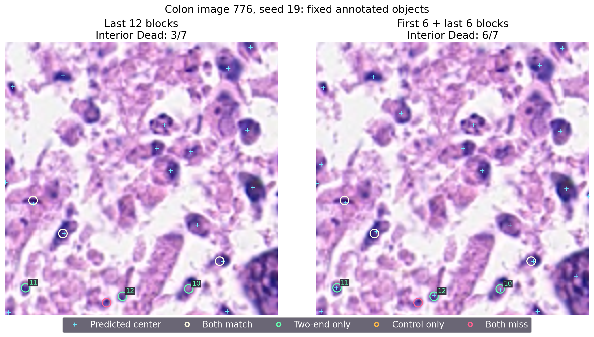

P29 将该图由 3／7 提高至 6／7。对象 10 (231,172)、11 (230,19)、12 (238,110) 的距离分别变化 41.23→1.00、28.02→1.00、80.66→1.00。对象 12 在种子 1 中也被恢复，61.52→2.00；其面积 104 平方像素，大于预定义的小核面积上限。该对象曾在 P22 种子 19 中丢失，相同标注位置在不同训练层配置下出现反向结果。

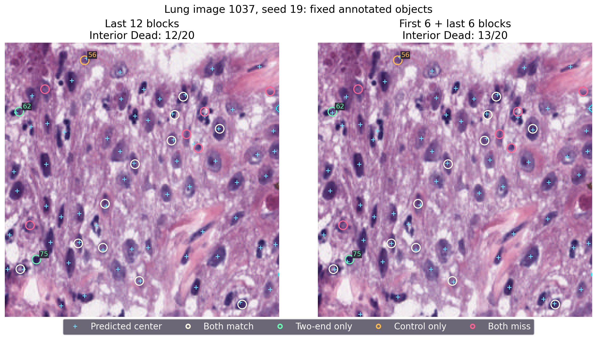

前六层加后六层将该图由 12／20 提高至 13／20。小核 75 被恢复，15.00→2.83；对象 62 由 3.16 移至 1.00。对象 56 由 2.83 移至 3.61，在两个种子中均丢失匹配。小核 75 的恢复在 P22、P25、P27、P29 的种子 19 中重复出现，定位损失的具体对象则随方案变化。P29 种子 19 的纯训练时间增加 21.24%，显存由约 4.05 增至 4.84 GiB；种子 1 的计时包含较长的 Lustre 等待，原记录保留了训练、保存与整体完成的分别耗时。

## P28：交错训练十二层的结果

P28 在 24 层编码器中隔一层训练一层，保持与最后十二层对照相同的可训练参数量。种子 19 的内部死亡核为 68→70/145，全部核为 7,177→7,705；种子 1 分别为 72→71/145 和 7,361→7,634。精确率从 69.23%／69.07% 升至 71.24%／72.44%。肺组织目标核变化 +6／0，结肠为 −4／−1。

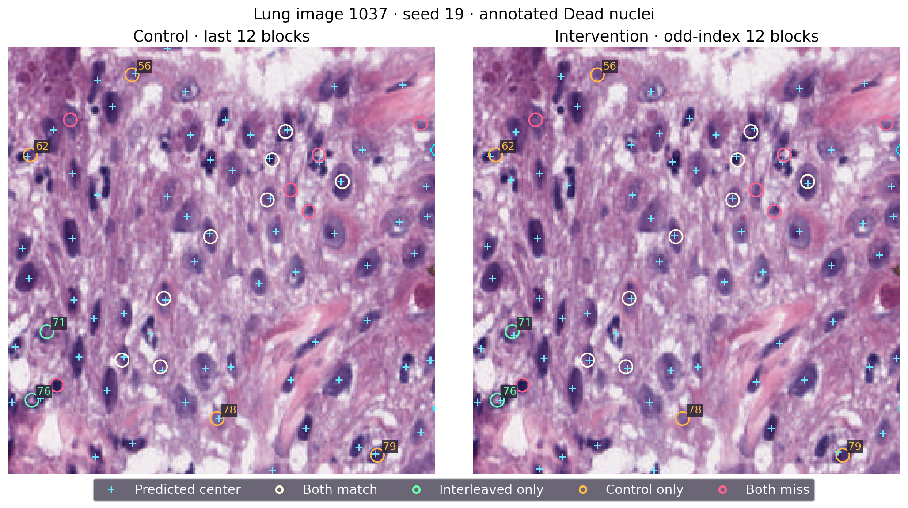

此图从 12/20 降至 10/20。对象 71（170，23）的最近预测由 21.02 降至 2.24 像素，而对象 56（16，74）由 2.24 增至 22.02；对象 62 从 2.24 移至 3.16，跨过三像素匹配边界。这些具体变化与总体图像数量一起解释了交错层结果。

## P30：中间十二层适配的完整结果

P30 将可训练范围从第 12–23 层改为第 6–17 层，编码器及检测头参数量、学习率和训练计划保持一致。数组 55746187 四项均正常完成，包含连续 130 轮训练和最后检查点开发评估；调度总耗时为 17.4389 GPU 小时。

| 运行 | 内部 Dead | 小 Dead | 总体匹配 | 预测点 | 召回率 | 精确率 |
|---|---:|---:|---:|---:|---:|---:|
| 种子 19，最后十二层 | 71／145 | 9／32 | 7,246 | 10,539 | 59.151% | 68.754% |
| 种子 19，中间十二层 | 78／145 | 14／32 | 7,894 | 10,972 | 64.441% | 71.947% |
| 种子 1，最后十二层 | 64／145 | 8／32 | 7,338 | 10,647 | 59.902% | 68.921% |
| 种子 1，中间十二层 | 79／145 | 13／32 | 7,854 | 10,909 | 64.114% | 71.996% |

新方案增加 433／262 个预测点，同时增加 648／516 个正确匹配，因此额外点减少 215／254 个。总体召回提高 5.2898／4.2122 个百分点，精确率提高 3.1926／3.0748 个百分点。两个种子的小 Dead 匹配均增加五个。内部 Dead 召回提高 4.8276／10.3448 个百分点，原 95% 成对区间为 [−0.9091,+9.6552] 和 [+1.8987,+18.3673] 个百分点。

原判定要求两个种子同时满足全部条件：足够支持量、最终 Dead 召回至少 0.60、提高至少 0.05、自助区间下界严格为正、精确率至少 0.75，以及相对质量与非退化条件。P30 两种子的支持量、相对质量和非退化检查通过；种子 19 的提高为 0.048276，区间下界跨零。新方案最终目标召回 53.79%／54.48%、精确率 71.95%／72.00%，低于绝对要求。两种子均未达到原定的完整条件，原判定和独立复算一致，这一固定中间十二层方案按原规则完成收尾。

## P30 的组织分布、敏感性与计算成本

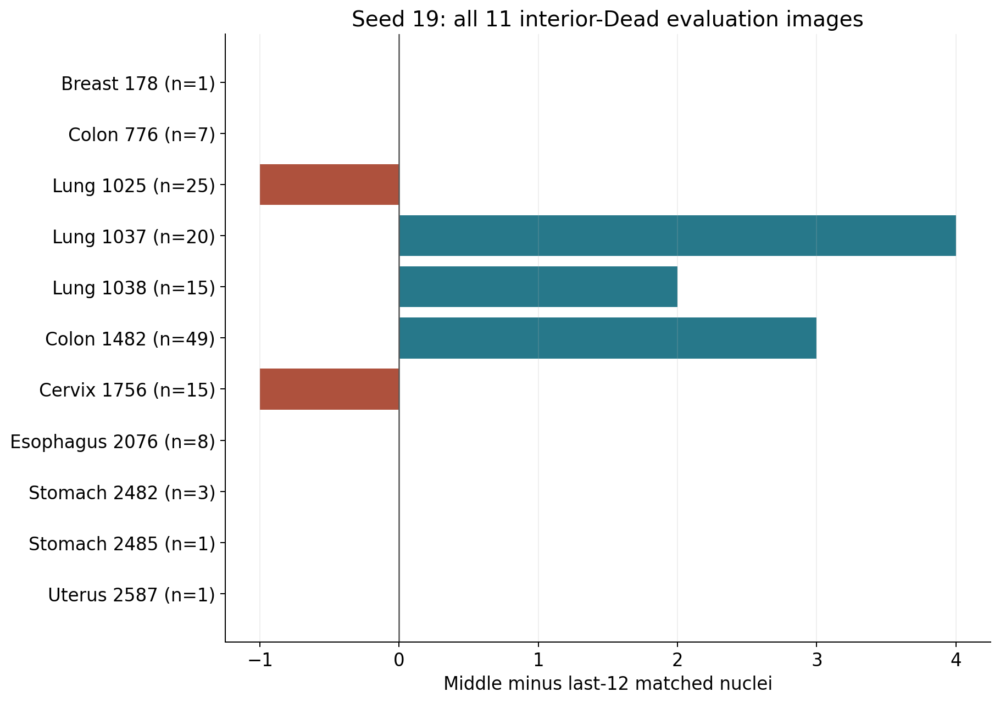

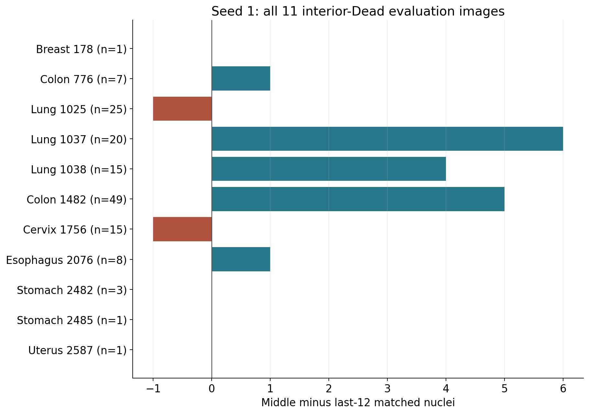

肺组织贡献 +5／+9，结肠贡献 +3／+6，宫颈在两个种子中均减少一个。肺组织 1037 增加四／六个，1038 增加二／四个，结肠 1482 增加三／五个；肺组织 1025 在两个种子中均减少一个。结肠 1482 最终找到 17／49 和 16／49 个目标，仍有 32／33 个未覆盖。其净收益减少了集中图像中的漏检，同时保留了清晰的后续改善空间。

种子 19 有三张目标图像净增、两张净减、六张不变；种子 1 有五张净增、两张净减、四张不变。逐次移除一张目标阳性图像进行描述性敏感性计算，召回收益范围分别为 2.40–6.67 和 7.20–13.33 个百分点。收益符号在任一单图移除后均保留；原自助区间继续刻画完整固定图像集合的重抽样不确定性。

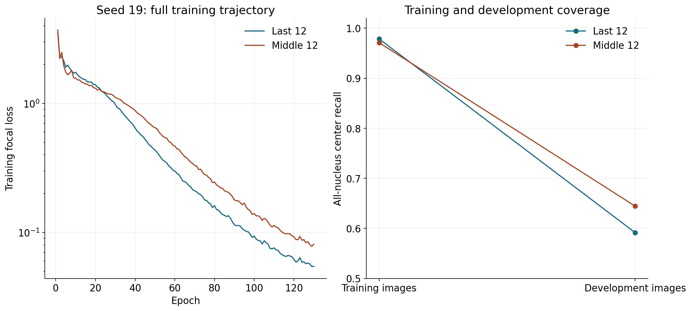

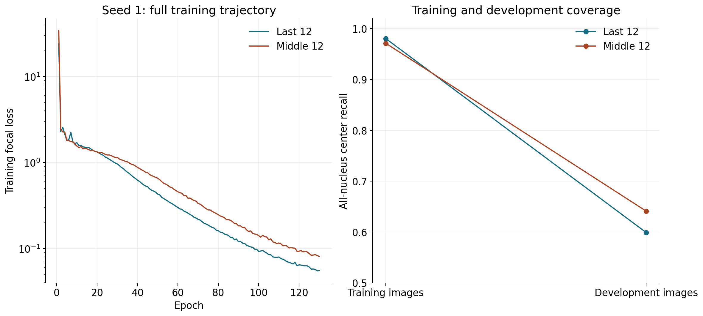

训练总体召回变化 97.85%→97.10% 和 98.05%→97.12%。种子 19 的纯训练时间为 14,457.50 与 15,957.59 秒；种子 1 为 14,509.86 与 15,957.90 秒，增加约 10.4% 和 10.0%。峰值训练显存由约 4.05 增至 4.44 GiB。中间层适配在相同参数量下，以适中的实测成本带来了较广泛的开发集检测收益；冻结层前后的梯度路径变化仍会影响计算。

## P30 固定对象：新增、丢失和种子变化

八张预先固定的开发样例包含 53 个内部 Dead 核。种子 19 共同找到 29 个、新增八个、丢失五个、两组均漏检十一；种子 1 对应为 26、十一、五、十一，净增 +3／+6。绿色环表示仅新方案找到，橙色环表示仅对照找到，白色表示共同找到，粉色表示共同漏检，青色十字为模型预测点。对象编号、行列坐标与匹配记录均随报告保存。

该图由 11／20 提高至 15／20。小核 75 位于 (202,29)，面积 44 平方像素，距离变化 13.60→1.41；该左下标注位置在多种此前方案中也被恢复。对象 57 位于 (43,37)，是一枚邻近较深色组织的浅色圆核，距离由 11.66 降至 1.00。对象 62、66、71、76 也新增匹配。对象 56 位于 (16,74)，由 2.24 增至 22.02；对象 58 位于 (50,166)，由 2.24 增至 3.61。前者附近留下较大预测空隙，后者通过位置变化跨过匹配边界。

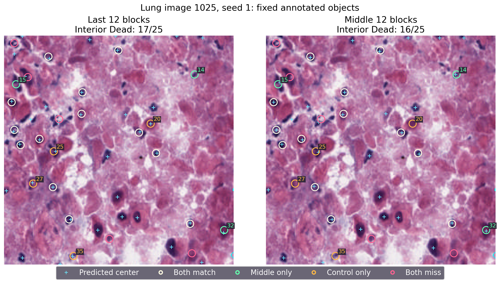

该图由 17／25 降至 16／25，具体为三个新增、四个丢失。小核 14 位于 (43,212)，面积 31 平方像素，最近距离由 41.98 降至 1.00。对象 15 (54,13) 由 13.45 降至 2.83，对象 32 (217,245) 由 3.16 移至 1.00。对象 20 (98,163)、27 (165,32)、35 (246,77) 丢失附近预测，最近距离分别增至 15.62、21.21、15.65。对象 25 (129,55) 由 2.00 移至 3.16，刚好跨出匹配范围。相同小核 14 在种子 19 中反向变化，2.00→41.98。该对象具体展示了训练随机性，而这张图的总体净减在两个种子中重复出现。

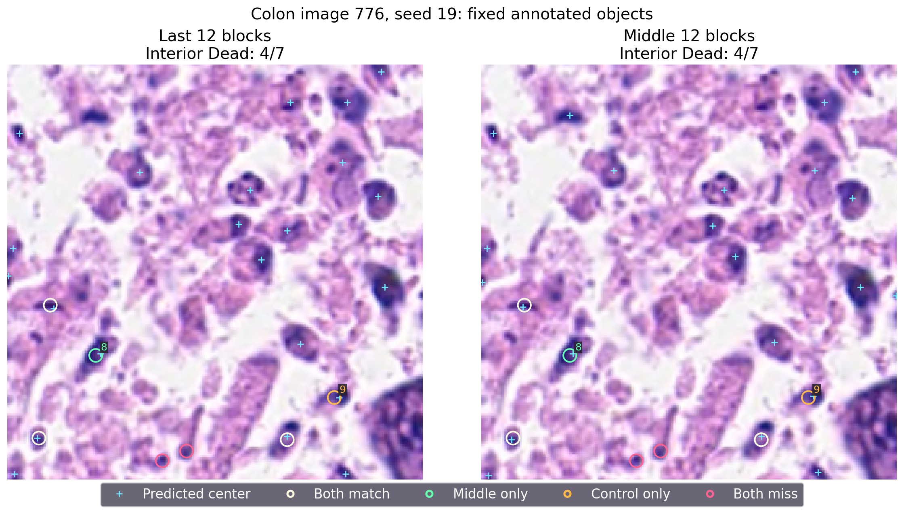

该图保持 4／7，但对象 8 (179,54) 新增，3.16→2.24；对象 9 (205,201) 丢失，3.00→3.16。两者都靠近匹配边界。种子 1 恢复对象 9，整图升至 5／7。相同的种子 19 计数因此包含了不同对象之间的交换。保存的坐标直接刻画预测点出现、消失和移动；后续机制研究可通过完整概率图和中间特征统计进一步测量中心分数及峰值选择。

## P31：在检测头中加入分组归一化

P31 将八个分组归一化模块加入细胞核中心检测头；这种方法在每张图像中按通道分组计算均值和方差，再使用可学习的缩放与偏移调整特征。对照使用原检测头，两组都训练编码器最后十二层，新增参数 2,816 个。模型、数据、训练轮数和中心匹配规则与同期对照相同。四次训练均完成 130 轮，以下使用最后一轮检查点。

| 随机种子与方案 | 内部死亡核匹配 | 小死亡核匹配 | 全部核匹配 | 全部预测点 | 精确率 |
|---|---:|---:|---:|---:|---:|
| 19，对照 | 65/145 | 7/32 | 7,274 | 10,536 | 69.04% |
| 19，分组归一化 | 73/145 | 6/32 | 7,134 | 10,089 | 70.71% |
| 1，对照 | 68/145 | 9/32 | 7,256 | 10,437 | 69.52% |
| 1，分组归一化 | 70/145 | 9/32 | 7,262 | 10,354 | 70.14% |

两个种子分别多找到 8 和 2 个内部死亡核，全部核匹配分别减少 140 和增加 6；未匹配预测点分别减少 307 和 89。训练集全部核召回率从 97.59%／97.81% 提升至 99.56%／99.73%。开发评估集死亡核召回率变化为 +5.52／+1.38 个百分点，按图像配对、组织分层的 95% 自助抽样区间分别为 [+3.49,+9.38] 和 [−4.30,+4.32] 个百分点。原定双种子判定综合目标召回、精确率及配对区间，两种子的完整结果均未达到该条件。

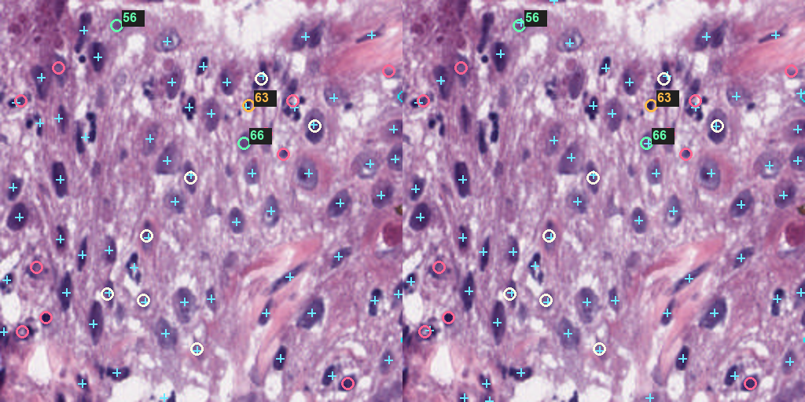

这张肺组织图像从 8/20 增至 9/20。对象 56 的标注中心在（行 16，列 74），最近预测点距离由 21.21 降至 2.24 像素；对象 66（91，155）由 19.65 降至 1.00。对象 63（67，158）则由 2.24 增至 20.52 像素，原有匹配消失。图中可观察到预测点出现和消失；距离按已保存的预测坐标计算。

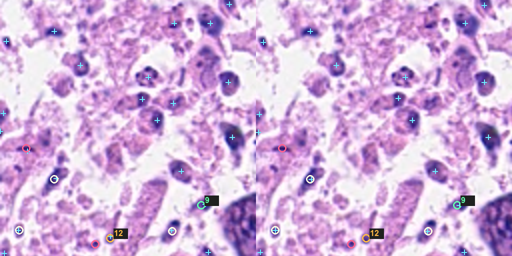

该图两组均找到 4/7 个目标，但对象发生交换：对象 9（205，201）由 4.12 移至 2.00 像素，进入匹配范围；对象 12（238，110）由 2.00 增至 61.40 像素，附近预测消失。种子 1 中这两个对象均新增匹配，图像由 4/7 增至 6/7。相同的图像总数可以包含不同对象的变化。

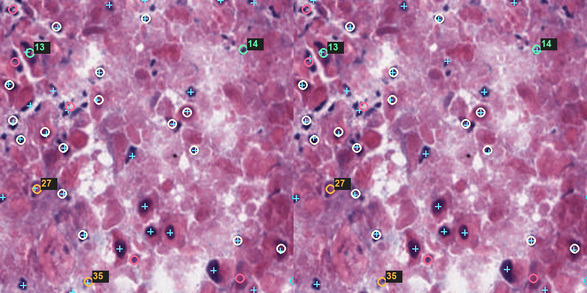

这张图保持 18/25：面积 31 平方像素的对象 14（43，212）从最近点距离 41.98 降至 1.00，对象 13 从 3.16 降至 2.24；对象 27 和 35 则分别从 2.24、1.41 增至 21.59、41.01。原始图像和预测坐标显示新增与丢失，造成这些变化的模型内部过程需要另行测量。

## 结果保存、报告复现与后续检查

P30 回收核验 117 个小文件，其中包含 48 张最终 PNG，部署沿用 514 个已核验源码文件。此次保存十三张 P30 分析图、新绘八张 P22／P25 大幅图，以及原对象匹配与图像来源记录。八个 P30 大检查点的大小和原保存记录均保留，后续保存工作包括独立重算大文件哈希与外部归档。P31 四次运行的小型结果与原始保存清单逐项核对。

详细英文、详细中文和中文导读均从 LaTeX 编译。统计图使用 PGFPlots，组织图使用真实保存的原始像素和预测坐标；源码、构建命令、逐页渲染检查、报告所用的 P31 评估记录、选定图像及其坐标一并交付；P30 原始记录和收据见已有结果目录。P31 的 92 个小型结果文件已核对 SHA256；大型检查点保留原保存清单。
