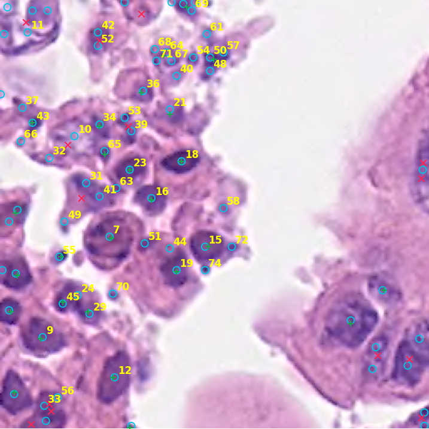
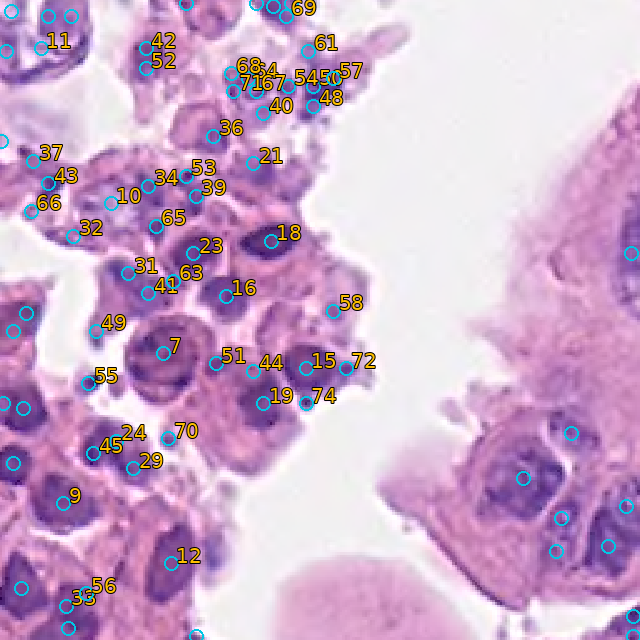
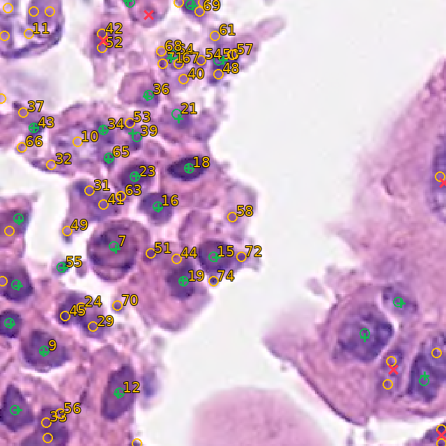
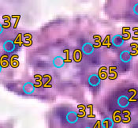
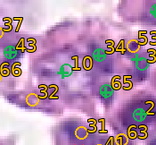
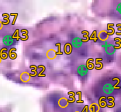

# 细胞核中心定位：同一颗核为何时有时无——阶段报告 9 中文导读

本阶段沿着一个具体问题展开：模型已经在图里产生了一个点，怎样判断它是否真的找到了核？我们分别检查图像对齐、点的位置、分数和筛选。下面用实验图与同一颗核的坐标解释结果。

P34 四组评估均已完成；全层模型种子 1 的补跑完成了两种读出各 12 轮，并核验了保存文件。P35、P36、P38 也已完成。 全层模型可通过改变对齐找回一部分漏检。平移训练模型有许多位置有效但分数偏低的预测点，质量筛选可以减少额外点，也会删掉部分正确点。

1.  图像相对 16 像素小块的位置会改变预测

2.  原分数低于阈值的点也可能接近核中心

3.  多个对齐给出相似位置，可以帮助筛选

4.  保护原来找到的核，再评价新增候选

# 先读懂图里的点和数字

青色圈代表从人工标注核区域计算的中心；绿色加号代表成功匹配的预测点；红叉代表没有得到一对一匹配的额外点。P38
图还用黄色圈标记漏检核。坐标 (y,x)
的第一个数是上下位置，第二个数是左右位置。

预测距标注中心不超过 3 像素才可匹配，每个核只分配一个点。核内距离 3.16
像素的点也会被计为额外点。因此，红叉既可能在背景，也可能在真实核内。

| 指标     | 一个例子                               |
|:---------|:---------------------------------------|
| 召回率   | 100 个核找到 70 个：70%                |
| 精度     | 90 个预测点中 70 个匹配：77.8%         |
| 分数阈值 | 0.5 表示只保留分数至少 0.5 的点        |
| 支持数   | 15 种平移中有 11 种在附近给出点：11/15 |

数据包含 522 张开发图像、12,250 个核，145
个不接触图像边界的死亡核。死亡类包括凋亡和坏死核。两种子是两次独立训练的随机编号
19 和 1。

编码器是把图像变成特征的 24 层模型。“全层适配”训练全部 24
层，自身对照只训练后 12
层；“平移训练”让训练图像每次随机移动，自身对照保留原增强。每项实验与自己的对照比较。

P34 学习把已有点移向标注中心；P35 改变图像对齐；P36
选择分数阈值并汇总位置；D37 解释漏检类别；P38
在更多低分数候选中学习筛选。

# P34 结果：移动修正带来的新增与丢失接近

[统计图源码（图见 PDF）](figs/p34_movement_zh.tex)

带平移读出、移动并合并后：对照种子 19 新增 158、丢失 173；对照种子 1
新增 172、丢失 182；全层种子 19 新增 172、丢失 158。净变化分别为
−15、−10、+14。全层种子 19 的内部死亡核从 85 变为 83。

[统计图源码（图见 PDF）](figs/p34_offset_zh.tex)

全层模型种子 1 的原增强读出已完成 12 轮并保存权重。带平移的读出首轮耗时 1,400.3 秒，超过 1,300 秒上限，作业退出前只写出首轮损失。复核 522 张开发图像的单精度原预测得到 7,933 个匹配、10,804 个预测点，其中 84/145 个内部死亡核匹配。这组数值是位移修正前的基线。完整成对比较仍需完成带平移读出的 12 轮训练和同口径评估。

# P35 结果：训练图像的高检出依赖原对齐

[统计图源码（图见 PDF）](figs/p35_alignment_zh.tex)

训练图像原对齐约 97% 到 99%，其他对齐约 67% 到
73%；开发图像原与其他对齐均约 61% 到
68%。同一批训练核只移动几像素，就从近乎全部检出降到接近开发图像水平。

## 逐核发现

中心区域开发核中，约 86% 到 89% 至少在一种对齐下匹配；约 51% 到 61%
仅在部分对齐下匹配。换对齐确实能找回单次预测漏掉的对象，多次预测提供了互补的位置候选。

这些比例逐核利用标注检查“有没有一种对齐可匹配”；实际输出仍要从所有候选中选择。

P35 的对齐分析限定在图像中央，P34 和后面的 P36 整体检出统计覆盖全部 522 张开发图像的标注核。

# P36 的阈值结果：平移模型的大量点分数偏低

[统计图源码（图见 PDF）](figs/p36_shift_threshold_zh.tex)

两个平移模型都在训练图像上选择了 0.2。开发核匹配数从 4,771、4,600 增到
8,463、8,542，召回率从 38.95%、37.55% 增到 69.09%、69.73%。新增
3,692、3,942 个匹配，保存点重放中原匹配没有丢失。内部死亡核从 44、44
增到 101、99。

[统计图源码（图见 PDF）](figs/p36_threshold_precision_zh.tex)

接纳低分数点扩大覆盖，同时精度从约 86% 降到约
66%。因此下一步要研究哪些新增点是真正漏检核的中心，哪些是背景、偏离或重复预测。

# 结肠图像 1482：降低阈值找回密集区域中的核

平移训练模型，种子 19，75
个标注核。原解码匹配 12 个，阈值 0.2 匹配 26 个，位置汇总匹配 18 个。

青色：标注中心；绿色加号：匹配；红叉：额外点。黄色数字用于和对象坐标表对应。

# 结肠图像 1482：分数不足与持续漏检的差别

## 死亡核 7：已有合适位置，分数略低

中心 (141,65)，面积 504 像素。原对齐 3 像素内最高峰分数 0.486，低于
0.5，高于训练选择的 0.2。下调阈值找回该核；12
种平移对齐也能匹配，位置汇总距离为 1.90 像素。

## 死亡核 51：保存范围内没有近中心点

中心 (145,86)，面积 67 像素。全层模型和平移模型在所有对齐、0.1
保存下限下都没有 3 像素内可匹配点。原对齐 6
像素内也没有已记录峰。这个对象需要新的位置或图像信息来产生合适候选。

## 死亡核 55：更小的核仍可以找到

中心 (153,35)，面积 57 像素，比对象 51 更小。平移模型原分数为
0.575，汇总距中心 1.11
像素，可以匹配；全层模型漏检。图中小核的外观与相邻结构并不相同，面积只是描述困难的一项特征。

# D37 结果：两类模型的主要漏检来源不同

[统计图源码（图见 PDF）](figs/d37_misses_zh.tex)

白色填充、全部 12,250 个开发核。全层种子 19 原漏检 4,271 个，2,476
个可换对齐匹配，占 58.0%；401 个仅低分数匹配，占 9.4%；2
个涉及分配竞争；1,392 个无近中心保存点。平移种子 19 原漏检 7,479
个，对应为 2,104、4,141、0、1,234。

## 研究意义

全层模型主要从换对齐获得候选；平移模型主要从接纳低分数点获得候选。两个种子重复了这一差异，因此
P38 选择同时使用分数、位置支持和位置离散程度来筛选低分数候选。

第 5 类按“分数至少 0.1、距中心不超过 3
像素”的实际记录条件定义。远处的核内点和更低分数响应另属需要进一步测量的信息。

# P38：把低分数点组成候选，再学习质量

## 问题与对照

P36 的低阈值单图找到了更多核，高阈值汇总给出更高精度。P38 接纳已有记录中
≥0.1
的点，比较“仅按支持数筛选”和“学习六项特征的质量评分”。两者使用完全相同的候选组，因此可以单独观察质量评分的作用。

## 具体操作

只用镜像填充的 15
个平移对齐，原对齐排除。按分数从高到低访问预测点，在距离首个点 4
像素内归到同组；每个对齐只贡献组内最高分点，避免一张图重复贡献多个峰。输出位置为这些点的平均坐标。

1.  保存点：15 个对齐，分数 ≥0.1

2.  4 像素归组；每个对齐只贡献一次

3.  相同候选组 → 支持数筛选 / 学习质量筛选

4.  筛选后重新一对一匹配，记录新增与丢失

检测器权重与保存点保持冻结，P38 只训练很小的候选评分模型。SLURM CPU 作业
55918618 已在 291 秒内完成，8 个模型和 8 张固定图保存完毕。

# P38：质量评分输入的六个量

| 输入             | 直白解释                                 |
|:-----------------|:-----------------------------------------|
| 最高分数的 logit | 组内最强原检测分数，经 log(p/(1−p)) 转换 |
| 平均分数的 logit | 组内平均原分数的同样转换                 |
| 支持比例         | 给出候选的对齐数 ÷ 有效对齐数            |
| 位置离散程度     | 各点到组平均位置的均方距离开平方         |
| 分数标准差       | 不同对齐的分数波动多大                   |
| 最高分减平均分   | 是否只有一个对齐特别高分                 |

逻辑回归把六个量加权组合，再用 sigmoid 得到 0 到 1
的质量分。训练标签来自候选组与标注的一对一分配：被分配到核的组记
1，其余记 0。拟合前按训练子集均值与标准差归一化特征；系数使用固定强度 1
的平方惩罚，降低过大权重。

原检测分数回答“这里像不像中心”；质量分回答“这样的候选组在训练记录中是否能匹配核”。两者来自不同模型。质量模型应用时仅读取保存点的数值与坐标。

# P38 结果：平移模型的额外点有所减少

[统计图源码（图见 PDF）](figs/p38_extra_zh.tex)

相对同一候选组的支持数筛选，种子 19、1 的额外点分别减少 676、377
个；匹配核数分别减少 166、增加 4 个。精度从 68.23%、67.92% 提高到
71.99%、70.17%，死亡核匹配从 105、101 变为 98、99。

质量学习减少了一部分额外候选，种子 19
同时损失真实核。报告另与按同一流程分别校准的对照比较，检验检测器训练本身带来的差异。

# P38 结肠图像 1482：补回候选与质量筛选

平移训练模型，种子 19。75
个标注核。高分数汇总找到 18 个、额外 6 个；低分支持数找到 28 个、额外 7
个；质量筛选找到 26 个、额外 5 个。

青色圆圈标注中心；黄色圆圈标记未匹配核；绿色加号为匹配点；红叉为额外点。

# P38 结肠图像：两个正确候选，一保留一删除

## 保留：死亡核 7

中心 (141,65)。低分数归组后，最近组得到 15/15 个对齐支持，质量分为
0.91579，距标注中心 1.89 像素。选定质量阈值为 0.5，候选保留并匹配。

## 删除：死亡核 10

中心 (81,44)。候选距中心只有 1.69 像素，有 11/15 个对齐支持，质量分却为
0.30811。支持数规则保留它，质量规则把它删除。这是筛选造成的真实召回损失：点的位置已经足够准确，但六项特征组合给出的分数较低。

标注核 10

支持数：保留

质量分：删除

| 对象 | 支持  | 质量分  | 中心误差 | 质量结果 |
|:-----|:------|:--------|:---------|:---------|
| 7    | 15/15 | 0.91579 | 1.89     | 匹配     |
| 10   | 11/15 | 0.30811 | 1.69     | 删除     |

两个误差单位均为像素。质量分与原检测分数不同；质量阈值是在训练图像上选出的。对象
51 仍漏检，最近候选组中心距它 20.14 像素，适当的近中心候选仍待产生。

# 本阶段形成的解释与下一步具体问题

| 实际发现                         | 对下一步的用处                   |
|:---------------------------------|:---------------------------------|
| 训练原对齐高检出，换对齐明显下降 | 学习跨对齐稳定的位置信息         |
| 核内强峰可能离中心超过 3 像素    | 分开测量存在与定位               |
| 平移模型有大量低分数有效点       | 把分数解释纳入检测方法           |
| 多次位置稳定仍可能共同偏离       | 支持数和共同偏移一起检查         |
| 质量筛选减少额外点也损失真核     | 保留原点，学习补充候选的新增收益 |

下一项工作先用保存点诊断额外候选落在哪里：已有匹配核内、未匹配核内、标注区域外。再比较训练和开发图像中，给定同一分数或支持水平时的匹配比例。由这些结果决定需要加入形态信息、修正位置，还是改进中心不确定性的表示。

### P34 两种子补跑结果

补跑的全层模型种子 1 在 522 张开发图像中，原预测匹配 7,933 个核；使用带平移训练的位移读出并合并邻近点后匹配 7,909 个，新增 142 个匹配、丢失 166 个。145 个内部死亡核中，匹配数由 84 降至 83。全层种子 19 则新增 172 个、丢失 158 个，净增 14 个；两种子的内部死亡核匹配分别下降 2 个和 1 个。标注中心处位移误差的中位数分别为 1.47 和 1.51 像素，90 分位数分别为 4.37 和 4.46 像素。已有点移动后既可能进入三像素匹配范围，也可能离开；这解释了新增与丢失并存的观察。上述统计为重复使用的第一划分开发集中心检测结果。
