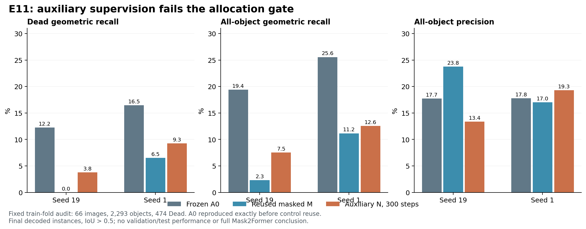

# E11：辅助监督小实验未通过扩量门

2026-10-17。E11 已按用户批准的设计完成；两种子的原门、A0 护栏均失败，未启动大规模训练。这里的 audit 来自训练 fold，且原 E7 模型见过这些图，不能作为验证集或测试集成绩。

## 结果与决策

唯一改动是对初始查询及三层输出分别计算原分类/掩码损失，再以四阶段等权平均监督。保留 E10 的预测掩码注意力、全局初始化、冻结像素特征、最终层解码。两原模型种子各 300 步、batch 2；64 张 fit、66 张 audit，与历史对照一致。

| 指标（audit，%） | seed19 A0 | seed19 M/E10 | seed19 N/E11 | seed1 A0 | seed1 M/E10 | seed1 N/E11 |
|---|---:|---:|---:|---:|---:|---:|
| Dead 几何召回 | 12.24 | 0.00 | 3.80 | 16.46 | 6.54 | 9.28 |
| 全体几何召回 | 19.41 | 2.31 | 7.54 | 25.56 | 11.16 | 12.56 |
| 全体精确率 | 17.74 | 23.77 | 13.36 | 17.78 | 17.03 | 19.32 |
| Dead typed F1 | 4.10 | 0.00 | 0.78 | 9.95 | 4.93 | 6.42 |
| raw Dead 掩码召回 | 35.86 | 30.38 | 31.22 | 37.34 | 20.25 | 23.21 |

N 相对 M 的 Dead 召回增加 3.80／2.74 个百分点，均未达到预注册的至少 5 个百分点；seed19 的精确率同时下降 10.41 个百分点。更明显的失败是 fit 全体召回只有 8.69%／11.65%，远低于 80% 的可拟合性门。N 相对 A0 的全体召回下降 11.86／13.00 个百分点，A0 护栏也未通过。关闭这个准确配方，不追加步数、种子或阈值筛选。

## 如何解释

辅助监督在本预算下恢复了 E10 的部分输出，但不足以恢复冻结原模型；这不能证明完整 Mask2Former 方法无效，也不能把欠拟合归因于单一组件。E9、E10、E11 连续改变初始化、注意力和监督位置，仍未达到基本训练图拟合要求，继续扩大同类查询头训练缺乏实证支持。

对代码的结构分析显示，原生像素特征 F 有 64 通道，掩码投影为仿射 W F+b，原始掩码为 eᵀ(W F+b)/√128。在实数运算下，查询向量或投影变化不会突破固定 F 的仿射函数族；它们仍可改变优化难度和实际数值结果。两原检查点的 [W,b]（128×65）数值秩均为 65，条件比约 7.30／8.76。因此原投影没有显示出简单的数值秩瓶颈。此观察不是分割性能上界，也没有证明固定特征不足；bf16 舍入和最终像素竞争进一步限制这种代数分析的解释范围。

下一项提出的 E12 是可拟合性诊断：固定 16 张训练图与原始投影后的掩码特征，给每个 GT 实例独立自由掩码向量，检验绕过查询学习后是否能拟合目标。GT 提供实例身份及数量，因此不能把诊断结果当成方法精确率、泛化表现或扩量门通过。高拟合是存在性证据；有限 300 步下的低拟合不能证明表达不可能。E12 具体实验仍等待用户批准，本报告没有实施 E12。

## 验证与溯源

独立脚本从逐图计数重新计算所有比例和门控；A0/G/M 与 E10 保存结果完全一致，固定图组及检查点哈希一致。fit 共 2,025 个实例、493 个 Dead；audit 共 2,293 个实例、474 个 Dead。四阶段权重均为 0.25，日志总损失与分项平均一致。真实 bf16 路径在训练前后固定 fit/audit 图上均逐位等同 E10 最终层输出；冻结特征哈希保持一致。

TDD 实际经历 5 RED → 5 GREEN，LM1/LM2 定向检查各 5 项通过。LM1 隐藏 CUDA 的完整回归：**512 passed, 3 skipped, 19073 warnings，329.43 秒，exit 0**。跳过项和警告保留于完整日志，未通过依赖升级消除。GPU 探针正常 exit 0，223.09 秒，PyTorch 峰值 reserved 2.0215 GiB；该值是本进程统计，不是整卡占用。

- 结果 SHA256：`8e9c81ba393f7fcec19a14692191edb4382a666eaf870cec6a24a502ea0d55ed`。
- driver：`640601daa003de78564063b6f208714b57f7272ecdde0b7ccee569dcd5c07225`。
- 设计：`3c9f1992377fbfe671411775e169b38ee5b75afe1cba2829fa52051699b04a35`。
- 主分支 `research/set-mask-e6`，commit `fd98c5f0a7618ed2e1cd454bfbc4dda36a336a3b`；隔离工作树 `research/set-mask-e7-schedule`，源 commit `c6d9b58ff080a3686ea760c05c533a2f62f51ac8`。未提交或发布 Git。
- LM2 原始结果：`/data6/jinxinhao/bdd26/ops/e11_aux_20261017/results`；日志、退出码及启动身份保留于上级目录。
- LM1 回收、CPU 日志及交接：`/data7/jinxinhao/bdd26/ops/e11_aux_20261017`。
- 全程复用既有 broker，无新 SSH；本实验仅使用 LM2 GPU7。未使用 LM1 GPU，GPU2 禁用约束继续有效。

本地配套文件：[原始结果](results.json)、[独立核算](independent_verification.json)、[矩阵审计](mask_basis_audit.json)、[完整回归日志](full_cpu.log)、[GPU 日志](probe.log)、[交接记录](HANDOFF.json)。

设计动机参考 [Mask2Former 官方多阶段预测实现](https://github.com/facebookresearch/Mask2Former/blob/main/mask2former/modeling/transformer_decoder/mask2former_transformer_decoder.py)；本实验不是完整复现。
