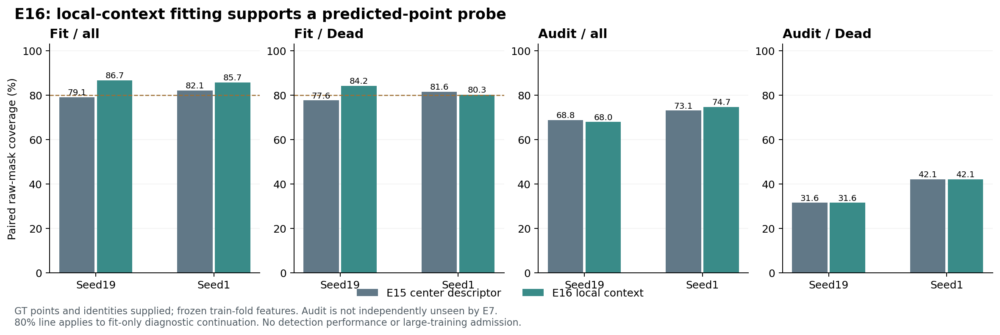

# E16：局部点条件掩码拟合条件通过，实际检测尚待验证

2026-10-17。两种子GT点拟合继续条件通过，只支持下一项预测点小实验；**不是方法质量门通过，没有大规模训练**。

E16将E15的单点特征改为九个固定位置的局部特征：dy/dx∈{−4,0,4}，边界钳制，行优先拼接576通道并加入点xy，MLP输入578维。其余维持E15：原E7Q两种子、冻结模型与原掩码基、同16图/8fit8audit、300步、循环单图、AdamW3e−4、原5BCE+5Dice和点相对二次项。归一化仅用fit点描述子。输入层参数随维度增加，结果是此表示包的证据，不能单独宣称局部上下文的因果收益。

| 最终paired raw-mask覆盖（IoU>.5，%） | seed19 E15 | seed19 E16 | seed1 E15 | seed1 E16 |
|---|---:|---:|---:|---:|
| fit全体（196） | 79.08 | **86.73** | 82.14 | **85.71** |
| fit Dead（76） | 77.63 | **84.21** | 81.58 | **80.26** |
| audit全体（253） | 68.77 | 67.98 | 73.12 | 74.70 |
| audit Dead（19） | 31.58 | 31.58 | 42.11 | 42.11 |

fit四个预注册端点均≥80%，继续条件成立；audit Dead没有改善，泛化信号仍弱。两组E7均见过，audit本轮虽不拟合，也不能作为独立验证集。输入GT点、身份和数量，所以不能报告检测精确率或把上述覆盖与实际推理性能混列。

## 规模限制与解释

事后固定大小分箱显示：fit的76个Dead中12个面积<64像素，audit的19个Dead中11个<64。audit的6个面积<16像素Dead，两种子均0/6拟合成功；16–63像素的5个Dead成功0/5与1/5，而64–255像素成功5/7与6/7。小对象的失败值得关注，但支持很小，分箱是描述性分析，不新增质量门、筛选图组或证明唯一原因。

与E12的独立自由向量拟合相比，共享点读出仍有学习和迁移差距；相对二次项提供位置约束，但不保证小核形状或预测点稳健。下一项E17保留本读出并增加原生点热图/分类头，在推理时只用预测点，验证检测、类别筛选、掩码和像素竞争后的实际质量。其新小实验门在计算前固定：两种子fit最终全体召回≥80%，audit Dead较同图A0至少+5个百分点，整体召回/精确率/Dead typed F1不降。不能把E16拟合条件替代这项门，更不能替代正式train/val的质量/成本门。

## 核验与溯源

独立逐对象核算全部组别/类别初始与最终统计、GT身份、固定图组和检查点一致性，均通过。E12/E15冻结掩码基哈希相同；训练前后输入与特征不变。均值/std为576维，归一化源码只使用fit点，audit不参与；未声称独立重建未保存的原始统计。point_logits与native_mask_loss和E15的AST完全相同。TDD3RED→3GREEN，LM2同样3项通过；未改指标或HoVer-Net，没有重跑完整回归。

GPU exit0，47.53秒，PyTorch峰值reserved1.4102GiB。LM2GPU5，启动前73,309MiB实际空闲，无LM1GPU、新SSH、包升级或Git发布。历史完成控制PID920854、startticks1066305605，仅供溯源。

结果SHA256=`9b70fb76c535d8028c03f3f1bfa6e15164fdd4d814d48254befb654b8ae93c3a`，driver=`250fd5bb14b929f864c758a1293064c9e488ff783457a75c2c19996f62622b5d`，设计=`f6ad2cca9300ae9d1bfd4a2e999b370239773e562e8f540aa3a576bef3383a1f`。

LM2原始`/data6/jinxinhao/bdd26/ops/e16_context_20261017`；LM1回收同名ops目录。主分支`research/set-mask-e6`/`fd98c5f0a7618ed2e1cd454bfbc4dda36a336a3b`；隔离源`research/set-mask-e7-schedule`/`c6d9b58ff080a3686ea760c05c533a2f62f51ac8`。配套：原始数据 (`results.json`, local-only artifact)、独立核算 (`independent_verification.json`, local-only artifact)。
