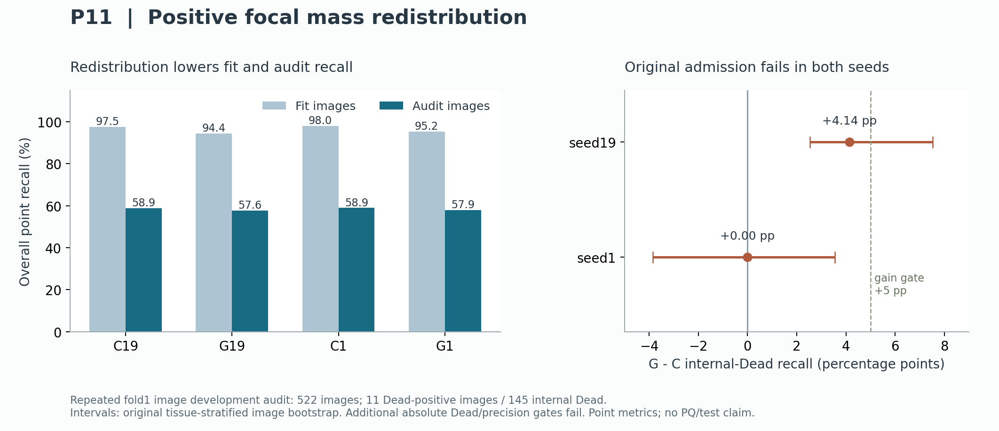

# 2026-10-24 三机进度与实验分析

时间口径：America/New_York。机器状态为本轮实时检查，约06:46 EDT；不是历史记录推断。

## 当前结论

P11 已完成，原始准入判定为 **false（两个种子均失败）**。下一轮 P12 冻结为“解码器 stem 后、概率0.2的通道 dropout”与原始对照的匹配实验。P11 的局部正向信号不构成方法成功，也不允许扩展原 Phase B 或掩码阶段。

## 三台机器

|机器|本项目进度|资源与安排|
|---|---|---|
|LM1|未发现本项目训练进程；权威源码、结果分析和文档在此维护|/data7约4.4GiB可用，根分区约2.3GiB；不在此新增训练或保存大型checkpoint|
|LM2|未发现本项目训练进程；既有Globus服务保留|/data6约18GiB可用，根分区约1.8GiB；GPU4检查时空闲，但本轮计算放在Expanse|
|Expanse|P11数组55244166四任务全部COMPLETED/0:0，stderr均为空|已有my260606其他作业保留；P12使用独立目录和SLURM资源|

Windows→LM1 broker的SSH PID14596、LM2 SSH2303516、Expanse master1391366均在检查时存活可用。两条broker的连接/TCP/认证计数均为1，复用现有通道，未重启。Windows首次10013为本机权限问题；提升本机只读查询权限后确认连接有效。PID只作本次证据，未来必须重新核实。

## P11 最后检查点结果

C为原始精确中心焦点损失；G把每张图相同的正项系数总质量分布到原Gaussian支持，负项、分母、模型、增强与训练预算保持不变。每臂每种子均全新训练130epochs，仅使用固定fold1 fit2134/audit522。

|种子|C内部Dead召回|G内部Dead召回|G−C|原始配对95%CI|C/G总体召回|C/G候选精度|
|---|---:|---:|---:|---|---|---|
|19|0.468966|0.510345|+0.041379|[+0.025381, +0.075310]|0.588816/0.576490|0.692692/0.700040|
|1|0.462069|0.462069|+0.000000|[-0.038462, +0.035398]|0.589224/0.578612|0.699961/0.705063|

两个种子都未达到内部Dead召回≥.60、提升≥.05和精度≥.75；seed1还未满足bootstrap下界严格大于0。相对精度/总体召回护栏、支持样本量和非退化门通过，无法抵消主要门失败。seed19的CI为正只能作为该种子的开发观察。原判定门和bootstrap程序未改。

|运行|拟合集总体召回|拟合集Dead召回|审计小Dead命中/32|候选数|纯训练小时|训练峰值GiB|
|---|---:|---:|---:|---:|---:|---:|
|C/19|0.975259|0.952744|8/32|10413|4.029|4.047|
|G/19|0.943631|0.896341|8/32|10088|4.014|4.047|
|C/1|0.980046|0.958841|7/32|10312|4.046|4.047|
|G/1|0.951774|0.907012|8/32|10053|4.031|4.047|

所有运行均无512候选上限饱和。G降低了拟合集和审计集总体召回，候选精度略升；这更像一个需要记录的取舍，不能写成稳定修复。C/G优化目标不同，不能用原始loss数值大小比较模型质量。四任务SLURM累计占用16小时54分40秒，纯训练时间与含评估/保存的作业时间分开记录。

40个小文件共2,985,074bytes已回收至LM1，36个payload的SHA256和大小与保存清单一致；四个配置、数据/UNI权重身份、精确cohort和130epoch连续日志校验通过。多GB checkpoint保留在Expanse，本轮未重新下载或独立重哈希它们。

## 跨轮分析与 P12 的理由

P4稠密前景辅助、P5原生网格细化、P6负项Gaussian带宽、P7 RGB增益、P8按图归一化、P9 Dead中心权重4、P10缩小编码器适配范围、P11正项质量重分配均未通过原门。每轮都有新的匹配对照，不能将不同轮C拼成配对重复实验或据此排名挑选“最佳种子”。

|轮次|固定干预|内部Dead召回变化：seed19 / seed1|原始双种子门|
|---|---|---|---|
|P4|稠密前景BCE辅助|−.027586 / +.006897|失败|
|P5|匹配容量的原生网格细化|.000000 / −.006897|失败|
|P6|较宽的负项抑制Gaussian|+.020690 / +.020690|失败|
|P7|RGB增益增强|+.034483 / −.013793|失败|
|P8|按图归一化|−.034483 / −.048276|失败|
|P9|Dead中心正项权重4|+.006897 / +.048276|失败|
|P10|last4代替last12编码器适配|+.027586 / −.013793|失败|
|P11|原Gaussian支持上正项质量重分配|+.041379 / .000000|失败|

这些是各轮自身匹配对照差值；cohort虽相同，运行和控制不同，不能视为独立统计重复或跨轮因果排序。

反复出现C拟合集召回约.98、审计集约.59，说明在已测预算中存在明显拟合—审计落差，尚不足以确证因果。P12选择单一固定训练期正则化干预：原始PointHead的stem ReLU之后加入一次Dropout2d(p=.2)，推理关闭；参数数量、编码器last12适配、原损失和样本权重不变。它与P10减少可训练编码器块、P7输入颜色扰动和P11改监督目标不同。

C/R×seed19/1，各130epochs、最后checkpoint、原decode与准入门。失败或不确定就关闭该概率/位置/预算配方，不追加概率/位置搜索、种子、epoch或阈值菜单。继续不读取fold2/fold3，不扩原PhaseB或掩码阶段。

## 验证与可复现性

独立设计审查提醒并落实：替换head不推进初始化RNG；逐有效步比较对照的梯度、参数、AdamW和CPU/CUDA RNG；dropout观测排除ReLU本身的零值。CPU基线139passed/12.46s，先确认缺少P12模块导致RED，再实现后152passed/14.98s。导入路径、py_compile和git diff检查通过。

独立代码审查发现提交收据任务1/3沿用旧G臂名，已在生成器和最终脚本修正为R；其余未见重大问题。审查是静态检查，真实V100 smoke仍是正式提交前必要条件。未改metrics/HoVer-Net，按项目要求运行专项检查；历史5个dense_votes失败如实保留，没有宣称完整套件全绿。

训练源码提交：42796455efce6a5d71439b79fc9599c8883b7a60；LM1分支research/proposal-p12，目录/data7/jinxinhao/bdd26/ops/worktrees/p12_20261024。没有merge/push、清理旧结果或升级依赖。

## 首次 smoke 失败及验证修正

首次 smoke **55251178 FAILED/1:0**，152项节点测试通过，真实随机性见证在“两次训练logits应不同”的断言失败。CPU边界复现确认：dropout特征差异约1.914、FP32输出差异约.003826，但临时输出头保留−4.595偏置，BF16将logits全部舍入到−4.59375。该失败属于验证读出设计，不能作为dropout失效或科学实验负结果。

对同一临时见证，仅将其bias置零以免BF16抹平微小差异；正式训练器完全不变。回归测试在旧代码下确实失败，修复后P3–P12共153项通过（17.01秒）。原失败日志和快照保留；第二次验证使用全新project/scratch后缀p12_20261024_02和ops/p12_development_20261024_r2。新封存提交77cfa9ac17b278c67b750762191e6bdd5b9b4cc9；与4279645相比科学训练器diff为空，未改变数据、损失、初始化、dropout位置/概率或预算。

## 结果适用边界

以上是3像素点匹配开发指标，不是PQ、测试成绩或官方三split结果。审计图像已多轮重复用于开发，内部Dead只有11张阳性图/145个对象，其中80%位于5张Lung/Colon图。图像bootstrap不建立患者独立性，也不校正连续假设选择。Lustre project/scratch仍需外部归档，不应当作永久备份。

Expanse运行遵循当前[SDSC官方指南](https://www.sdsc.edu/systems/expanse/user_guide.html)，所有训练/验证均通过SLURM，登录节点仅执行轻量文件与提交操作；本轮已核对allocation、分区/QoS、现有队列、df和用户/组quota。

## P12 提交状态

正式数组 **55251406** 已于 **2026-10-24T07:20:40.533905-04:00（EDT）** 单次提交。任务0/1/2/3对应C19/R19/C1/R1，并发上限2；每任务1V100、4CPU、32GiB、12小时、Lustre、no-requeue，最大48GPU小时。提交不代表训练完成。

V100 smoke **55251401** 已COMPLETED/0:0，stderr为空，153项节点专项检查通过；真实两次有效更新的梯度/参数/AdamW/CPU与CUDA RNG与原始P3对照逐位一致，R训练随机、同state推理一致、冻结参数不变、last/final重载和跨臂配置拒绝通过。训练dropout非零输入丢弃比例为C=0.00000、R=0.20033；保守1.5倍时间估计C/R=6.996/6.960小时，均低于12小时，仍非正式训练完工保证。

源码manifest：35748e383fa57d626c3c8a03fc09871627872c19599d2a3003559a1845bb1a3d。project：/expanse/lustre/projects/jhu159/xjin10/bdd26/p12_20261024_02；scratch：/expanse/lustre/scratch/xjin10/temp_project/bdd26/p12_20261024_02。结果按A_<C/R>_s<19/1>子目录保存，日志slurm-<array>_<task>.out/.err。小结果后续回收LM1，checkpoint保持Expanse原件。禁止重新运行once-only提交脚本；任何未知结果先查guard/receipt/sacct，不重放。

下一步：四任务完成后核验0:0、130epochs、保存清单及输入/cohort/config身份，套用原F1=C/T1=R门；未通过则关闭固定dropout配方，不自动扩阶段。

## 组织分解补充（描述性）

Lung 的 G−C 内部 Dead 命中变化为 +3/+2，Colon 为 −1/−5；seed1的总体零增益包含不同组织的正负抵消。seed19在Cervix/Lung/Stomach分别+3/+3/+2，在Colon/Esophagus各−1，共净增6个；seed1净增0个。总体核命中减少151/130个。部分组织只有1张Dead阳性图，不能据此建立组织特异性改善。详细计数见 P11_TISSUE_APPENDIX.md，原门不变。

