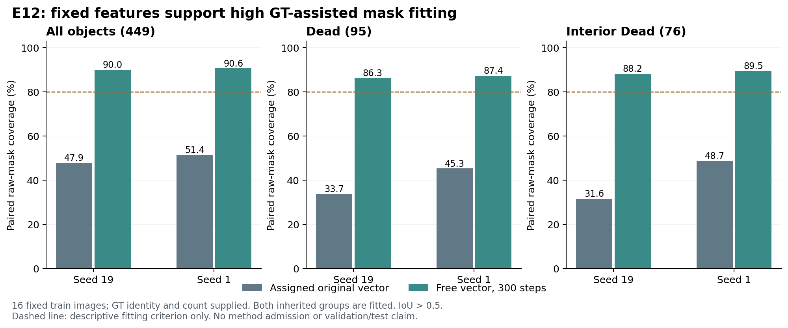

# E12：固定掩码特征具有较高的 GT 辅助可拟合性

2026-10-17。两原模型种子的诊断判据通过，**方法扩量门未通过**。结果来自固定的16张训练图；每个 GT 实例拥有独立可优化向量，实例身份、数量和拟合目标均已提供，不能作为模型检测成绩。

| 固定特征上的 paired raw-mask 覆盖（IoU > .5） | seed19 初始 | seed19 300步 | seed1 初始 | seed1 300步 |
|---|---:|---:|---:|---:|
| 全体449实例 | 47.88% | **89.98%** | 51.45% | **90.65%** |
| Dead 95实例 | 33.68% | **86.32%** | 45.26% | **87.37%** |
| 内部Dead 76实例 | 31.58% | **88.16%** | 48.68% | **89.47%** |

最终全体平均 IoU 为 .7465／.7618，Dead 为 .7104／.7282。预注册的两种子全体与 Dead 均至少80%拟合覆盖条件成立。这里的初始值是原 Hungarian 分配查询与对应 GT 的原始掩码，既不是512查询中最优掩码召回，也不是最终像素竞争后的召回。

## 解释与下一步

这是存在性证据：这些固定图上的大部分实例，可以被原模型冻结的掩码特征与独立向量表示。它削弱了“现有特征普遍无法表达这些实例，因此只能更换像素特征”的解释。这个有限样本、GT辅助的证据没有证明特征充分、最优或可泛化，更没有确定查询学习失败的唯一原因；仍有约9–10%全体实例和约13%Dead未达到IoU门槛。

结合 E11 的低拟合集召回，下一项 E13 检验一个单独假设：只冻结原掩码投影，是否能通过稳定掩码特征基帮助查询学习。E13保持E11注意力、四阶段平均损失、初始化、原64/66图组、两种子和300步；用E11 N作匹配对照，沿用原质量门和A0护栏。此决定在E13计算前已记录设计；用户明确授权同预算小实验自主迭代。

## 协议与独立验证

图组按既有 E9 哈希顺序，从 fit/audit 各取前4张Dead阳性和前4张阴性：fit=[273,1105,1394,1058,965,2508,2161,1034]；audit=[1407,88,1177,1170,2511,2471,784,2473]。两个继承图组在本诊断中均参与拟合，audit一词只表示历史组名。原E7 Q最后检查点seed19/1，模型全部冻结，bf16前向后的原128通道投影特征转FP32，原始分配查询向量初始化。

每图独立拟合300步，AdamW lr=.1, betas=(.9,.999), wd=0，损失为原5BCE+5平滑Dice，16对象分块并按对象数精确归一化。没有学习率菜单、最佳中途结果选择或权重保存；只报告最终300步。模型梯度为空，特征哈希前后相同，初始原始掩码 logits 逐位一致。独立脚本从449条对象记录重新计算全部汇总，重建16图选择并核对E11逐图GT计数、原检查点哈希和跨种子对象身份，全部通过。

TDD：4项缺失功能测试失败后4项通过；LM2同样4项通过。未修改指标或HoVer-Net，采用定向验证，本轮没有重新运行完整回归。GPU任务exit0，96.01秒，PyTorch峰值reserved1.5215GiB；这是本进程统计。使用LM2GPU5，未使用任何LM1GPU，未创建新SSH或升级依赖。

结果SHA256：`94d0f68bf930328b155c4c4d2043f3bc6c570e724a5cbaf5719d28263f81c6d3`。driver=`dc095f7cf06d1019504a9443aca2af54cc5e861b8470036f45452b8d776d8741`，设计=`dcab66b003359934e89ad634e126d02f2ea8afbe41b65adc82d39dcd3d06131a`。

LM2原始产物：`/data6/jinxinhao/bdd26/ops/e12_free_20261017/`；LM1回收：`/data7/jinxinhao/bdd26/ops/e12_free_20261017/recovered/`。主分支`research/set-mask-e6`/`fd98c5f0a7618ed2e1cd454bfbc4dda36a336a3b`，实现源`research/set-mask-e7-schedule`/`c6d9b58ff080a3686ea760c05c533a2f62f51ac8`。无Git提交或发布。

配套：[原始对象数据](results.json)、[独立验证](independent_verification.json)、[启动身份](launch.json)。历史完成控制PID817497、startticks1066176941，仅供溯源，不能据此终止进程。
