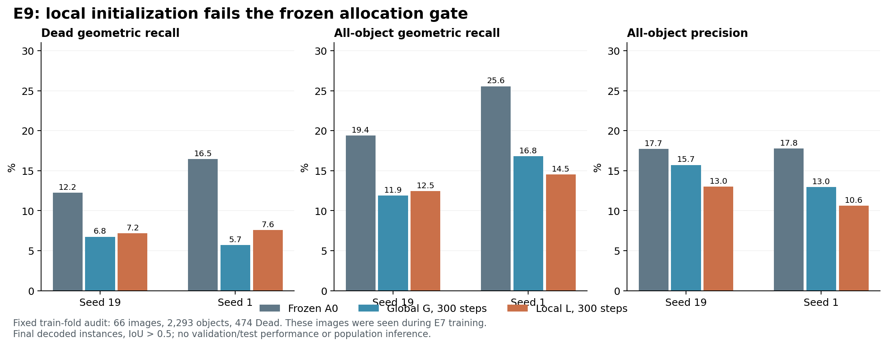

# 研究进度复核与 E9 实验分析

日期：2026-10-17，America/New_York。LM1 为主记录，LM2 承载本轮小型计算。本文中的 E6/E7 数字来自本轮重读的正式结果记录；E8b 跨种子交集由本轮重新读取逐对象 JSON 独立计算。它们不是新的测试集成绩。

## 已有结果及其含义

|实验|当前证据|研究决策|
|---|---|---|
|E5 特征融合门控|内部 Dead 匹配变化均值 −.003374，95% CI [−.014273,+.007486]；Dead PQ +.017897|主门失败；不能用次要端点代替主门|
|E6 全局查询掩码|Q/B mPQ .102699/.481432，内部 Dead 匹配变化 −.507422|当前查询配方大幅退化|
|E7 慢学习率衰减|Q/B mPQ .087958/.472939，内部 Dead 匹配变化 −.528340，95% CI [−.589426,−.468664]|更慢衰减没有挽救配方；有效成本通过不改变质量失败|
|E8a 固定分类头平衡 CE|拟合准确率 95.17%/97.58%；审计前景准确率 −7.69/−6.87 个百分点；最终召回仅 +2.20/+2.47 个百分点|关闭这套分类头配方，不能扩大同一配方|
|E8b 全部 Dead 阳性训练图|967 个 Dead，任意原始掩码匹配 35.57%/36.40%，最终正确分型匹配 2.79%/12.20%|空间表征、分类与输出竞争均需区分|

E6/E7 使用 split1 的 fold1 训练和 fold2 开发验证、固定两个种子和最后检查点，无 TTA。E8a/E8b 仅用训练图，是机制证据。不能将这几种统计口径混成一张方法排行榜。

### 1. 问题已超出稀有类重加权

E7 的五类和 19 个组织指标都低于匹配密集基线，说明当前 Q 配方首先存在全局实例预测退化。Dead 更差是重要现象，但把原因全部归为类别稀缺，会遗漏普遍的实例表示与优化问题。E8a 的高拟合准确率同时伴随审计退化，进一步削弱了“只要把背景 CE 权重改好就能扩量”的判断。

这一结论只关闭具体配方。不能推广为集合预测无效、特征线性不可分或所有重加权无效；现有实验并未检验这些宽泛命题。

### 2. 两个种子共享大量未覆盖对象，种子差异也确实存在

从 E8b 的逐对象 `(image,gt_id)` 键重新对齐，共 967 个对象：

|端点|两个种子均成功|至少一个成功|两个种子均失败|
|---|---:|---:|---:|
|任意原始掩码 IoU>.5|181|515|452|
|最终几何实例 IoU>.5|26|236|731|

原始匹配有 452/967（46.74%）在两个种子均未成功；这支持进一步检验空间表征，而不能把全部潜力都记在分类头名下。最终实例只有 26 个共同匹配，提示种子敏感的输出选择也很明显。

“至少一个种子成功”使用了 GT 和两个模型，是描述性交集，不是可部署集成性能。两种子并非独立抽样的人群，不能由交集直接计算患者层面的显著性，也不能对没有检出的对象断言其生物学难度。

对两个种子进一步联合分组：212 个对象在原始和最终阶段都曾成功，303 个只在原始阶段曾成功，24 个只在最终阶段曾成功，428 个两阶段均未成功。总数 `212+303+24+428=967`。其中 24 个反例再次说明像素竞争可以修正部分轮廓，原始阈值掩码覆盖不是任意最终解码的严格上界；303 个对象则支持继续研究候选筛选和输出竞争。上述分组仍然使用 GT，不能当成部署性能或可相加的因果收益。

内部对象的原始匹配为 281/801 与 292/801，最终几何匹配为 94/801 与 134/801；边界不是唯一解释。分类背景拒绝、类别错分和像素竞争相互作用，阶段计数相减不构成独立因果贡献。

### 3. 成本通过与合并率下降都不能替代质量门

E7 有效 Q/B 延迟比分别 .738576/.764427，说明当前实现可以较快运行；同时 mPQ 仍严重落后。合并率下降伴随召回和 bPQ 下降，也可能来自实例消失或轮廓损坏。研究目标应是满足原质量和成本约束的改进，不能为了开始大规模训练而降低准入门。

### 4. 新文献提供设计动机，不能代替本项目验证

[Anchor DETR](https://arxiv.org/abs/2109.07107) 将查询与锚点关联；[DAB-DETR](https://arxiv.org/abs/2201.12329) 用动态框坐标提供空间先验。这些工作支持检验查询空间信息的合理性，但研究对象和完整架构均不同。本轮 E9 只增加局部内容初始化，并不等同于实现这些方法，也没有证据预先保证其适用于 PanNuke。

## 已批准并执行的 E9

用户已在本聊天批准 E9 小实验。冻结设计见 [DESIGN.md](../superpowers/specs/2026-10-17-local-query-probe-design.md)。

唯一干预是在查询进入第一层前加入固定 16×32 空间网格池化的本图局部特征，复用已有投影，无额外参数。G 使用原全局查询，L 使用局部内容；两臂均从同一 E7 Q 最后检查点出发，仅更新整个查询头。编码器和像素解码器冻结，原损失、匹配和完整解码保持。这样能检验局部内容是否比共同的查询头继续优化更有价值。

训练标签决定抽样：全部 65 张 Dead 阳性图，以及固定哈希排序选出的 65 张 Dead 阴性图。拟合组 64 图，审计组 66 图，原图不重叠；两组都含 Dead 阳性与阴性。原模型曾见过全部这些训练图，因此审计组仍不是独立验证集。

每种子两臂各 300 步、batch2，固定 AdamW 和学习率，无调参菜单、无中间检查点选择、无权重输出。门要求两个种子分别同时满足：L 拟合最终几何召回≥.80；审计相对 G 的 Dead 召回至少 +5 个百分点；总体召回、精度和 Dead 分型 F1 不下降。完整解码与误检约束可避免只看“保留更多候选”的虚假进步。

E9 通过只允许提出完整 train/val 对照设计。它不等同于方法质量门通过，更不自动授权三 split 确认。失败则关闭这个具体局部初始化配方，不追加步数或种子。

## E9 最终结果：两个种子均失败

有效运行退出0，runner 用时320.06秒，峰值保留显存2.02GiB；这包含多种操作，并非可比推理成本基准。逐图计数、分组、优化终点与分配门已独立重算。两种子各覆盖同一批拟合2025对象/493Dead、审计2293对象/474Dead，内部Dead合计801。

以下全部为**训练图审计**，不是开发验证或测试成绩；百分比为最终完整解码后的对象级指标。

|种子|臂|拟合总体召回|审计 Dead 召回|审计总体召回|审计精度|审计 Dead 分型 F1|
|---|---|---:|---:|---:|---:|---:|
|19|A0 冻结原模型|19.60%|12.24%|19.41%|17.74%|4.10%|
|19|G 共同继续优化|12.69%|6.75%|11.91%|15.73%|6.35%|
|19|L 局部初始化|13.43%|7.17%|12.47%|13.01%|7.34%|
|1|A0 冻结原模型|25.19%|16.46%|25.56%|17.78%|9.95%|
|1|G 共同继续优化|17.58%|5.70%|16.83%|12.97%|3.28%|
|1|L 局部初始化|16.89%|7.59%|14.52%|10.64%|1.82%|

相对 G，L 的审计 Dead 召回增加+0.42/+1.90个百分点，均未达到+5个百分点；精度分别下降−2.72/−2.33个百分点。seed1总体召回与Dead分型F1也下降。两种子拟合召回仅13.43%/16.89%，远低于80%门槛。因此 `promising=false`，关闭这套局部内容初始化小实验，不安排其扩量训练。

更重要的是，两臂继续优化都比A0更差：L相对A0的审计总体召回下降−6.93/−11.03个百分点、Dead召回下降−5.06/−8.86个百分点。只比较L−G会掩盖共同优化造成的退化，不能把“优于一个已经退化的对照”当作恢复成功。

这并未隔离退化的唯一原因：冻结像素特征、每步batch2、64图无增强循环、300步预算、原匹配与损失共同定义了本实验范围；它不能否定其他局部机制或端到端训练。记录的第1/100/300步来自不同小批次，不能把它们直接当作同一输入上的连续学习曲线。下一步若改变注意力机制，仍须保留冻结A0参照，防止被退化的G对照误导。

原始结果：`ops/e9_local_20261017/corrected/results.json`；独立复核：`ops/e9_local_20261017/corrected/independent_verification.json`。有效结果SHA256：`cc2ff1eaeb5a5e407c2c6041a0137fe648e720114194d1d8efd0ddb0de27cd33`；有效driver：`8432b771d2fe1b69b1633d748659a668ddad7095146f597ddd5a0e06d3df51f1`。固定设计哈希与启动前一致。

## 验证与待完成事项

先行测试实际经历 5 个预期失败；实现后 LM1 5 passed，LM2 5 passed。测试覆盖原分支逐位复现、网格行列顺序、真实梯度更新与冻结特征保持、无交叉且有阳性/阴性覆盖的分组、拒绝误检换召回和单种子通过。

**当前源码最终完整回归：501 passed、3 skipped、19,073 warnings，333.71秒，退出0。** 前一轮499passed/3skipped记录保留；新增空图修复与两项测试后重新执行全量测试。未修改指标或HoVer-Net、未升级依赖。有效GPU运行及逐图复核均完成；图已渲染并目视核验。

执行中已发现并保留两项运行问题：LM2 完整回归在 `test_lkcell.py` 收集阶段缺少 `monai`（退出2），故改在 LM1 现有 monai1.3.2 环境完成；未安装或升级任何包。首个 E9 GPU 尝试在 A0 只读评估的空标注图上，因 NumPy 空数组默认浮点类型发生 TypeError（退出1），尚未进入优化循环。新增两项空图/边界统计回归，经历2RED→全部7GREEN，LM1/LM2均已核验。修正版只显式指定布尔类型，使用新的 `corrected/` 输出目录和来源哈希，不改变科学设计；见 [运行修正](../../ops/e9_local_20261017/corrected/code/RUNTIME_AMENDMENT.md)。这些运行错误不构成科学阴性。

## 结果驱动的后续分岔

下一步取决于完整结果，不因机器空闲而自动扩量：

- 若两臂都无法达到拟合门，当前冻结像素特征与查询头组合仍未证明足够可拟合。优先区分原始掩码不足与最终解码损失，再设计空间约束或像素特征共同学习的单一干预；不能把失败解读成“局部方法均无效”。
- 若局部臂拟合成功、审计失败，应优先处理跨图像稳定性和特征适配；不能靠继续拟合同一批图或选更好中间步骤声称解决。
- 若召回通过而精度/分型失败，应研究掩码质量评分、重复候选和实例竞争，同时保留阴性图与严格误检约束；不放宽当前门槛。
- 若所有训练集分配门通过，再形成与密集基线、原全局查询对照的完整 train/val 设计。只有其后原质量、严格指标、合并和成本门都通过，才值得分配更大的确认预算。

空间约束的一个候选是 [Mask2Former 的 masked attention](https://arxiv.org/abs/2112.01527)，其注意力在预测掩码区域内抽取局部特征；这与 E9 只加局部初始内容不同。目前仅作为文献支持的备选设计，没有实现、运行或宣称改进。

已在聊天提出 E10 具体方案并等待确认：仅加入逐层预测掩码约束注意力，恢复原全局查询初始化，保留冻结像素特征、原损失与最终解码。固定图组、两个种子、300步和原门保持，核验后复用E9的G对照以避免重复计算。还应保留A0参照，要求候选避免低于冻结A0的审计质量；不能利用已经变弱的G制造通过。没有批准、实现或启动E10，也未启动完整train/val或大规模训练。
