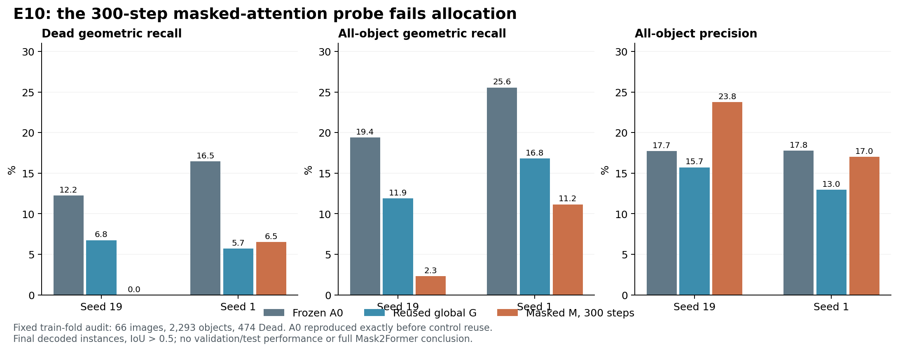

# E10：逐层预测掩码约束注意力实验

2026-10-17，America/New_York。用户已明确批准本轮有界实验。本轮只使用 fold1 训练图；下述审计图原先已被 E7 训练看到，不是独立验证或测试成绩。

## 决策

E10 两个种子的原分配门均失败，独立的冻结 A0 质量护栏也均失败。关闭本轮“冻结像素特征、原查询初始化与损失、300步、仅加入逐层掩码约束注意力”的配方，不追加种子或步数，不启动其完整 train/val 或大规模训练。这一结论不否定完整 Mask2Former 或从头端到端训练。

有效运行退出0；两种子都先精确复现了 E9 的 A0 全部逐图结果，才复用 G 对照。G 没有重复训练。全部逐图计数、指标和停止门已经独立重算。

## 实际改变及对照

M 保持原全局查询初始化。在三个 cross-attention 层各自开始前，用当前查询和已有掩码头预测低分辨率掩码：原生掩码特征双线性缩至32×32，float32点积生成掩码logits；logit<0的位置被屏蔽。布尔掩码停止梯度；全屏蔽的查询行恢复全局注意力，避免无有效位置。self-attention、FFN、位置、归一化、损失、Hungarian匹配、最终解码及阈值均保持。

依据是 [Mask2Former 论文](https://arxiv.org/abs/2112.01527) 与[官方实现](https://github.com/facebookresearch/Mask2Former/blob/main/mask2former/modeling/transformer_decoder/mask2former_transformer_decoder.py)的逐层预测掩码约束机制。本轮没有加入其完整多尺度、逐层辅助监督或整个官方训练配方，不能以此声称复现或否定了完整方法。

A0 为冻结原 E7 Q；G 为 E9 同初始化、同训练条件下继续优化原全局查询头的固定结果；M 仅训练掩码约束查询头。编码器、像素解码器、tissue状态冻结并处于eval；查询头也保持eval以统一关闭dropout，参数梯度正常更新。

两种子19/1使用相同64张拟合图、66张审计图，均包含Dead阳性与阴性，原图无交叉。拟合2025对象/493Dead，审计2293对象/474Dead。每种子仅M运行300步、batch2、固定AdamW、无调度器；只分析第300步，无中间检查点选择，无权重或特征缓存输出。完整冻结协议见 [DESIGN.md](../superpowers/specs/2026-10-17-masked-query-probe-design.md)。

## 完整解码结果

|种子|臂|拟合总体召回|审计Dead召回|审计总体召回|审计精度|审计Dead分型F1|审计最终实例数|
|---|---|---:|---:|---:|---:|---:|---:|
|19|A0|19.60%|12.24%|19.41%|17.74%|4.10%|2508|
|19|G（复用）|12.69%|6.75%|11.91%|15.73%|6.35%|1736|
|19|M|3.36%|0.00%|2.31%|23.77%|0.00%|223|
|1|A0|25.19%|16.46%|25.56%|17.78%|9.95%|3296|
|1|G（复用）|17.58%|5.70%|16.83%|12.97%|3.28%|2976|
|1|M|10.72%|6.54%|11.16%|17.03%|4.93%|1503|

原门要求两种子均满足：拟合最终总体召回≥80%；审计M−G Dead召回≥5个百分点；审计总体召回、精度、Dead分型F1均不下降。实际M−G分别为：

|指标变化（百分点）|seed19|seed1|
|---|---:|---:|
|Dead召回|−6.75|+0.84|
|总体召回|−9.59|−5.67|
|精度|+8.04|+4.06|
|Dead分型F1|−6.35|+1.65|

拟合召回仅3.36%/10.72%，两个种子原门均不通过。A0护栏是单独报告的保守条件，没有改写E9历史门：M不得低于冻结A0的四项审计质量；实际两种子同样失败。因此 `original_gate=false, a0_guard=false, promising=false`。

## 深入分析

**精度增加伴随输出和召回损失。** seed19最终实例从G的1736个减少到223个，真阳性从273降至53；seed1实例从2976减至1503，真阳性从386降至256。仅凭精度上涨会掩盖漏检损失；现有结果支持关闭此配方。

**原始掩码仍有部分覆盖，但未转化为最终实例。** 审计Dead的原始最佳掩码匹配为M的144/474（30.38%）与96/474（20.25%），G为117/474与83/474；最终Dead几何匹配却只有0与31（G为32与27）。seed19的原始覆盖上涨和最终完全失败同时存在，不能以原始掩码的改善给方法分配更大预算。原始→最终相减仍不是独立因果贡献；分类保留与像素竞争需要直接记录才能继续定位。

**掩码约束并非始终有效，也不能把全局回退当成实现错误。** 预先固定的第一张审计图1407上，拟合前第一层有489/512（seed19）、482/512（seed1）查询全屏蔽，触发官方式全局回退；拟合后仍为442/512、412/512。后两层的实际屏蔽比例和回退行为不同。第一张拟合图273在拟合后第二、三层屏蔽约87%–96%的位置，说明约束确实进入了计算，但不能据此证明保留的是正确对象区域。这里只诊断两张预先指定图，不代表全体图像或因果效应。

**中间查询状态的监督是下一项可检验假设。** 当前源码仅对最后一层的类别和掩码显式施加损失；E10却已使用初始和中间状态生成下一层注意力区域。官方实现包含多阶段预测及辅助监督。这一结构差异支持单独检验逐层辅助监督，但不证明它就是本轮失败原因，也不支持同时改损失、特征解码器和输出筛选后宣称单一机制成立。

**小实验关闭范围有限。** 冻结像素特征、batch2、64图无增强循环与300步共同定义了可拟合性检查。E9的G也弱于A0，说明这种继续优化协议本身尚未形成可靠的恢复。E10失败不能推广为掩码约束注意力普遍无效；也不能靠在相同审计图上继续调步数、阈值和种子解除冻结门。各步损失来自不同小批次，不应当作固定输入的学习曲线。

## 来源与验证

有效driver SHA256：`f002647604a44cd95064dfa805ec389c9835ad2decb619b68a86ec3c690ef2f8`；设计：`6fabdfb7563e3670e23739bab6e3039b79c99ea781d1717586b40293d5c10bd9`；结果：`0e6d668eb0463784d3200c87bdeae2d945373777f39153e1007984bb3e3d0648`。E9 helper与对照结果字节、原始checkpoint和输入哈希均核验；每种子A0全部逐图结果精确复现，复用G逐字典相等。

先行测试6个预期失败，实现后LM1、LM2均6passed。测试覆盖原分支逐位复现、掩码符号与batch/head顺序、全屏蔽回退、真实空间屏蔽行为、有限梯度与冻结输入、损坏复用数据拒绝、原门与A0护栏分别判断。**完整当前源码回归507passed、3skipped、19,073warnings，400.71秒，退出0。** 原有依赖警告与跳过记录均保留，未修改指标或HoVer-Net。图已渲染并目视核验。

本轮GPU runner计时116.95秒，峰值保留显存2.03GiB；这不是可比推理成本基准。未发生运行重试，无依赖升级或新SSH；未使用LM1 GPU。LM1 GPU2本周禁用持续有效。LM2运行入口及小型凭证已回收到LM1 ignored `ops/e10_masked_20261017/`，原科学源码与既有用户改动保留，没有Git发布。

## 下一项具体方案：E11逐层辅助监督，待确认

已在聊天提交E11设计：只对初始查询与三层查询输出施加相同的类别/掩码损失，四阶段等权平均保持总权重；其余注意力、原全局初始化、冻结像素特征、匹配、解码、固定图组、两个种子及300步保持。先核验E10来源和A0逐图复现，再复用本轮M作为对照，保留原分配门和A0护栏。

其目的仅是检验“注意力读取的中间状态缺少直接监督”是否可修复，而不是预先认定原因。E11尚未获批、实现或启动；没有追加E10步数或开始大规模训练。若后续获批，其设计须在运行前独立冻结，不能根据新的审计结果调整门槛。
