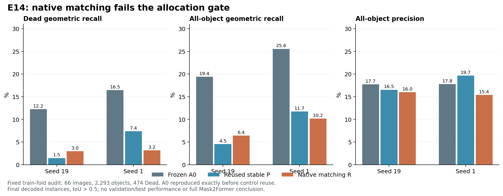

# E14：完整原生匹配未通过质量门

2026-10-17。两种子原门与A0护栏均失败，关闭该300步配方，无大规模训练。audit来自原训练fold，不是验证/测试成绩。

只改变E13 P的Hungarian掩码成本：从stride8网格+全部GT中心改为完整原生256×256像素，保留−2类别概率+5BCE+5Dice、原Hungarian求解器及最终损失。16查询分块限定内存。E13其余设置不变，包括冻结投影、四阶段等权监督、原初始化/注意力/解码、64fit/66audit、两种子、300步/batch2。治疗记为R。

| audit指标（%） | seed19 P | seed19 R | seed1 P | seed1 R |
|---|---:|---:|---:|---:|
| Dead几何召回 | 1.48 | 2.95 | 7.38 | 3.16 |
| 全体几何召回 | 4.54 | 6.41 | 11.73 | 10.16 |
| 全体精确率 | 16.53 | 16.00 | 19.66 | 15.39 |
| Dead typed F1 | 1.18 | 2.82 | 5.22 | 3.19 |
| raw Dead覆盖 | 35.65 | 38.82 | 28.27 | 33.54 |

R−P的Dead召回变化+1.48／−4.22个百分点，没有一致方向；fit全体召回9.58%／12.84%，仍远低于80%门。相对A0，全体召回下降13.00／15.39个百分点，护栏失败。完整原生匹配改善了raw Dead覆盖，但没有转化为稳定的最终实例召回。不能把raw与final差值直接当作某一步的因果损失。

合成反例成立：同一GT中心上，采样点间存在假阳性岛的查询可被旧成本选中，而完整原生成本选出具有更低真实原生掩码损失的候选。它说明一种真实的算法差异，不证明该差异是训练数据上的主要瓶颈。本实验表明仅修正空间支持不足以满足当前学习与质量要求；不追加步数/种子/权重搜索。

下一项E15转向共享的点条件掩码读出，先用合法GT内部点检验局部特征到掩码的可学习性，加入显式点相对坐标项。它是GT辅助诊断，不能算实际点检测、部署质量或扩量门通过；若可拟合再设计预测点实验。E15设计在计算前已冻结，用户明确授权同预算小实验自主执行。

## 实证核验

独立逐图计数复算、全部A0/G/M/N/P对照一致性、原检查点/图组一致性、四阶段平均权重、投影冻结、真实bf16最终推理训练前后等价均通过。staged_forward、auxiliary_loss、check_equivalence、trainable_head与E13源码AST完全一致。

TDD4项缺失功能失败后，合成反例、空GT/容量和非有限输入测试通过；原生成本与直接BCE/Dice解析参考最初因FP32参考累计误差导致1项失败。改用FP64直接参考后，同一成本的绝对误差为2.62e−7／3.08e−7，保留1e−6容差，未放宽阈值。保留原失败日志和旧函数快照。最终LM1定向回归**27通过**，LM2**4通过**。未修改指标/HoVer-Net，未重跑完整套件。

GPU exit0，248.82秒，PyTorch峰值reserved2.0215GiB；LM2GPU5启动前74,491MiB实际空闲。无LM1GPU、新SSH、依赖升级或Git发布。

结果SHA256=`b6ea472912048b4b5c6686e887c51e3863539ff3d1ff5c739e57fc4f86778347`；driver=`d0f74968eac6b6f910aa815eee9003d5322c5a399a9af781c1275c4adcbdebe8`；设计=`8846cce1301a1c597125ce0e21bcd437b78e73518a0daeb1137c3278e320b534`。

主分支`research/set-mask-e6`/`fd98c5f0a7618ed2e1cd454bfbc4dda36a336a3b`；隔离实现`research/set-mask-e7-schedule`/`c6d9b58ff080a3686ea760c05c533a2f62f51ac8`。LM2原始`/data6/jinxinhao/bdd26/ops/e14_native_20261017`；LM1回收同名ops目录。历史完成控制PID878594、startticks1066241029，仅供溯源。配套：[原始结果](results.json)、[独立核算](independent_verification.json)。
