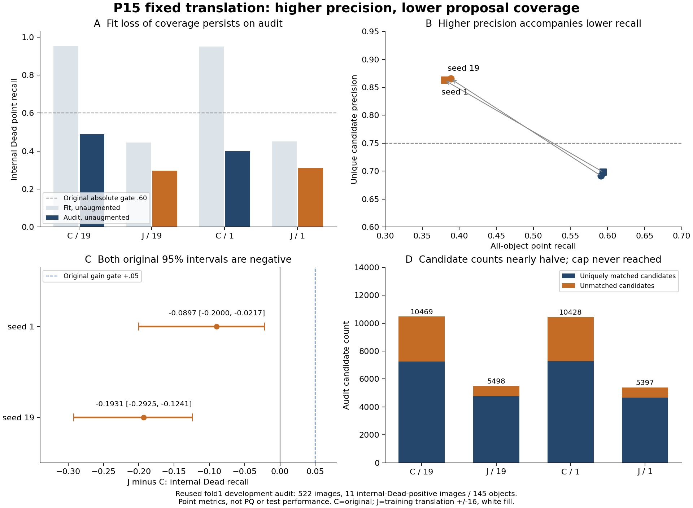

# P15 fixed training translation: final closeout, 2026-10-26

P15 fails the original admission rule in both seeds. The fixed training-translation recipe is closed; do not add a translation-range, seed, or epoch menu, or start Phase B/masks. This is point-proposal development evidence on repeatedly reused fold 1 images, not PQ, test, or independent generalization performance.

Array 55278753 ran tasks 0=C19, 1=J19, 2=C1, and 3=J1. All tasks completed with SLURM status COMPLETED/0:0 and completed 130 epochs, followed by last-checkpoint fit/audit evaluation. Elapsed times were 4:10:58/4:12:13/4:17:28/4:12:26 on exp-3-58/exp-2-58/exp-8-57/exp-4-60. The original P15 training commit is `cf9777be1914884f48d2d8cb142a9b09d7408fc6`; its manifest is `5654147fa8ba972d012e0bee07c1ff3dfc6d1013c4dfcefe17f27dfcd06995a5`.

Fresh C/J runs retain the original architecture, last 12 encoder blocks, encoder LR 1e-5, head LR 3e-4, full image permutation, 130 epochs, BF16, and original decoding. J alone translates RGB and centers by dx/dy in [-16,16] with white fill, removes out-of-frame centers, rebuilds the original Gaussian, and uses the retained-object denominator before the original augmentation. Fit/audit evaluation is unaugmented.

| Seed | Arm | Fit all recall | Fit internal Dead recall | Audit all recall | Audit unique precision | Audit internal Dead recall |
|---|---|---:|---:|---:|---:|---:|
| 19 | C | .977790 | .952744 | .591102 | .691661 | .489655 |
| 19 | J | .470315 | .445122 | .388408 | .865406 | .296552 |
| 1 | C | .977613 | .951220 | .594286 | .698120 | .400000 |
| 1 | J | .470589 | .451220 | .380163 | .862887 | .310345 |

The original F1=C/T1=J admission was recomputed without modification. J−C internal-Dead recall changed by −.193103, with the original tissue-image bootstrap 95% CI [−.292453,−.124138] for seed 19, and by −.089655 [−.200000,−.021739] for seed 1. Support of 11 images/145 objects and nondegenerate fraction 1 pass. Precision rises above .75, but both seeds fail absolute Dead recall ≥.60, gain ≥+.05, and a positive CI lower bound; overall recall changes of −.202694/−.214122 also violate the C−.02 guard. Both admission conjunctions fail. Higher precision cannot override the recall requirements.

Audit candidate counts fall from 10469 to 5498 and from 10428 to 5397. Unique matches fall from 7241 to 4758 and from 7280 to 4657, while unmatched candidates fall from 3228 to 740 and from 3148 to 740. The all-object GT count is 12250; no image reaches the 512-candidate cap. Small-object audit support is only 32 objects, and hits fall from 7 to 6 in both seeds, so the result does not support a separate small-object claim. Here, higher precision accompanies fewer proposals and fewer matched objects; that is not a quality gain under the original rule.

The drop also appears on unaugmented fit images: all-object recall falls from about .978 to .470, and internal-Dead recall from about .952 to .45. The final training focal losses are .05557/.05538 for C and .82139/.81409 for J. Because augmented targets and exposure differ, these losses are not a matched causal estimand. Pure GPU training times were 4.0243/4.0829/4.0367/4.0146 hours; each training peak was about 4.0474 GiB. The observed profile is consistent with difficulty learning this recipe within the fixed budget. It does not isolate absolute-position sensitivity, white margins, partial nuclei, dropped targets, or regularization as the cause.

Independent deterministic replay of all 520 per-epoch translation records matched seed, epoch, original image ID, namespace 150025, 2134 image exposures, 2134 unique members, offset histograms, and exact retained/dropped object totals. The original fit set contains 50968 objects. J drops an average of 9.9377%/9.9406% of centers per epoch, with ranges 9.4059–10.4026%/9.5629–10.4732%. Targets for out-of-frame centers are removed even when part of the nucleus remains visible, and white fill changes image context. These protocol details limit mechanistic interpretation; do not claim that all spatial augmentation fails.

The descriptive internal-Dead counts by tissue are Lung 60, Colon 56, Cervix 15, Esophagus 8, Stomach 4, Breast 1, and Uterus 1. Lung recall C→J is .650→.383/.600→.400; Colon recall is .304→.179/.214→.214. Esophagus recall changes .500→.625/.375→.500. The remaining tissues have very small counts and mixed results. Lung and Colon contain 116/145 objects (80%); this concentration is descriptive and does not establish tissue transfer or create a new selection rule.

Verification covered 45 small files and 40 preservation payloads, with byte length and SHA256 checks passing. All four manifests, configurations, UNI/input/cohort identities, 130 ordered finite loss records per run, and exact audit/fit membership were checked; the original summary and admission were recomputed. All 395 actual Expanse snapshot files independently matched the sealed manifest. Nine inherited historical documentation files differed from current committed LM1 text, while scientific scripts/src/tests matched exactly; missing third_party files in the bare worktree were inherited in deployment. The sealed deployed manifest establishes byte identity for the snapshot; it does not assert that every ancillary file matches Git. P16 refreshed those historical documents only in its own snapshot, preserving P15.

Checkpoint hashes in the writer preservation manifest were not independently rehashed in this closeout. No new inference or fold 2/fold 3 model evaluation was run. The 11 Dead-positive audit images provide weak conditional uncertainty; image-level separation is not patient/slide separation, seed bootstrap is not population uncertainty, and sequential hypothesis selection repeatedly reuses audit 522. This supports no biological or causal mechanism conclusion and is not an official three-split result. Lustre scratch/project are replicas, not an external archive; external archival remains outstanding. Earlier negative recipes and unavailable human expert review remain unchanged.

Evidence is in ignored LM1 `ops/review_20261026/p15_collected_01`, `ops/review_20261026/p15_analysis.json`, `ops/review_20261026/p15_additional_verification.json`, and `ops/review_20261026/p15_document_identity.json`. The original source/control protocol is in the [P15 design](../superpowers/specs/2026-10-25-proposal-p15-design.md). The new [P16 design](../superpowers/specs/2026-10-26-proposal-p16-design.md) tests direct Gaussian squared-error supervision as a separate objective hypothesis; it does not reopen translation.

