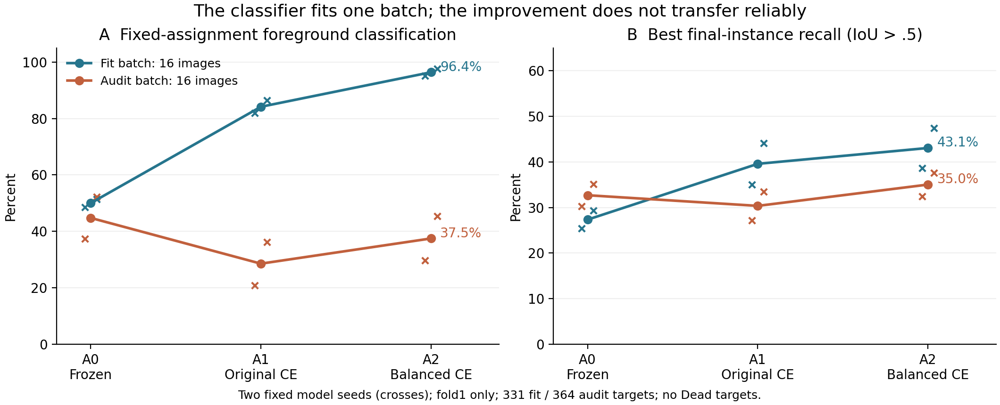

# E8a/E8b：查询分类与Dead掩码机制研究

2026-10-17，America/New_York。E6/E7 的失败结论保持；本轮新增的是训练集机制实验，没有新的验证或测试成绩。

## 结论

前景/背景平衡损失能让固定查询特征在一批训练图上得到很高的分类拟合准确率，但未能稳定改善另一批图。预注册分配门失败，停止扩大这套分类层重加权配方。

这次把“存在可用原始掩码”推进到了一个更具体的判断：分类层确实可以拟合当前批次，但这个读出规则跨批次不稳定；多保留掩码还会改变像素竞争。另立的全部Dead阳性训练图只读审计显示，Dead原始掩码的对象级匹配比例也很低。应同时研究空间表征、分类和输出竞争，单批召回上涨不足以支持扩大训练。

## 1. 实际做了什么

使用 E7 Q_seed19/Q_seed1 最终检查点。两模型看到相同的 fold1 数据种子19、epoch0前32个固定采样键：前16图用于拟合，后16图用于审计，原图无重叠。拟合批331个目标、审计批364个目标。审计批未用于本次分类层优化，但原 E7 模型训练时已经见过这些训练图，不能解释为独立泛化评估。

缓存并固定查询向量、原始掩码特征/嵌入和原模型 Hungarian 匹配。只训练最后线性分类层的1,542个参数；编码器、查询层、掩码、BN和匹配不变。

- A0：冻结原分类层。
- A1：从同一分类层权重开始，用原2倍加权CE（背景权重.1）拟合300步。
- A2：同一初始化、优化器和300步，改为前景/背景CE组均值等权。

两个训练臂均使用新 AdamW、lr3e-4、betas(.85,.95)、wd1e-4，无调度器。只分析第300步，没有选中间检查点、调整阈值或保存训练权重。原.5类别阈值、.5掩码阈值和重叠解码完整保留。

## 2. 固定批次能拟合，另一批没有稳定收益

“前景分类准确率”是原匹配查询对GT类别的准确率，包含背景误判和前景类别误分的共同影响；它不是单独的对象存在性准确率。“最终召回”按GT在所有最终实例中取最佳IoU>.5，类别无关，不惩罚额外误检，不是官方指标。

|模型种子|臂|拟合批前景分类|审计批前景分类|拟合批最终召回|审计批最终召回|
|---|---|---:|---:|---:|---:|
|19|A0|48.64%|37.36%|25.38%|30.22%|
|19|A1 原CE|81.87%|20.88%|35.05%|27.20%|
|19|A2 平衡CE|95.17%|29.67%|38.67%|32.42%|
|1|A0|51.36%|52.20%|29.31%|35.16%|
|1|A1 原CE|86.40%|36.26%|44.11%|33.52%|
|1|A2 平衡CE|97.58%|45.33%|47.43%|37.64%|

预注册要求：A2在两个种子都达到拟合批分类≥90%；审计批最终召回相对A0至少+5个百分点；审计批前景分类不下降。实际：

|判定量|seed19|seed1|
|---|---:|---:|
|A2拟合分类≥90%|通过：95.17%|通过：97.58%|
|A2−A0审计最终召回|+2.20个百分点|+2.47个百分点|
|A2−A0审计前景分类|−7.69个百分点|−6.87个百分点|
|分配门|失败|失败|

只比较A2−A1会夸大收益：审计最终召回差是+5.22/+4.12个百分点，但A1本身低于冻结A0。A2相对A0的真实净变化小得多。

共同原加权CE也显示了批次依赖：A2拟合批从1.0634/.9838降至.5969/.5139，而审计批从1.4156/1.1734升至2.0812/1.7357。300步内能拟合不等于形成稳定的跨图像读出；这个有限预算也不能证明线性不可分或查询表征必然无效。

## 3. 召回、分类与竞争需要分开

|审计批指标|seed19 A0→A2|seed1 A0→A2|
|---|---:|---:|
|背景分类准确率|92.72%→90.55%|90.56%→86.85%|
|保留查询/图|37.06→50.38|49.63→72.50|
|保留查询原始掩码最佳召回|32.69%→37.36%|39.01%→48.90%|
|最终最佳召回|30.22%→32.42%|35.16%→37.64%|

保留更多候选使几何召回略升，同时前景类别和背景判定准确率都下降。额外查询不等同于已确认的误检数量；但这些结果足以说明，不能只凭召回上涨包装为整体质量改善。

在A2拟合批中，“保留查询原始召回−最终召回”的净差达到19.64/17.22个百分点，原A0为6.04/6.65。分类分数同时影响候选保留和像素竞争，所以这个净差也不能当作独立的因果损失分量。

后续需要分别记录背景误判、前景类别误分、重复查询和像素重分配。集合模型原本就把未匹配查询标为no-object；未匹配的好掩码可能是重复候选，不能把所有被拒好掩码都当成分类错误。

## 4. Dead覆盖是明确限制

两批固定图像的Dead目标数均为0。本实验解释的是所覆盖四类上的查询读出行为，不能据此声称解释或改善Dead。

为下一项研究单独审计了训练标签：fold1共2,656图，其中65图含Dead，按类型像素对应实例ID计967个Dead对象（含边界）。没有根据本次结果重抽E8a图像或追加种子。

本轮随后单独冻结并执行了这65张图的只读诊断，使用原E7最终权重，无增强、batch1、无拟合，保留原解码。其选择由训练标签定义，没有使用验证结果选择图像或规则。结果如下。

## 5. E8b：全部Dead阳性训练图只读审计

每个种子均覆盖967个相同Dead对象，其中内部801、边界166；全部端点已从逐对象记录独立重算。以下比例均以967个Dead为分母。

|观察量|seed19|seed1|
|---|---:|---:|
|任意原始查询掩码IoU>.5|35.57%（344）|36.40%（352）|
|保留查询原始掩码IoU>.5，任意类别|11.69%（113）|18.92%（183）|
|保留查询原始掩码IoU>.5且分为Dead|4.55%（44）|14.79%（143）|
|最终实例IoU>.5，任意类别|10.96%（106）|16.13%（156）|
|最终实例IoU>.5且分为Dead|2.79%（27）|12.20%（118）|
|最终完全漏检，max-IoU<.1|43.33%（419）|32.06%（310）|

内部801对象上，任意原始掩码匹配为35.08%/36.45%，最终几何匹配11.74%/16.73%，最终正确Dead分型匹配3.00%/12.86%。因此边界对象没有独自造成这一现象。

这修正了上一轮随机批次的适用范围：无Dead的增强批次中64%–69%的原始匹配比例不能外推到Dead。作为同图描述性参照，Neoplastic/Inflammatory/Connective/Epithelial原始匹配分别为46.54%/72.67%/57.00%/63.83%（seed19）和50.82%/69.57%/57.33%/57.45%（seed1）。类别尺寸、组织和图像选择相互混杂，不能据此隔离类别语义的因果作用。

原匹配Dead查询被判为背景的比例为76.32%/32.37%，判为正确Dead类的比例为14.68%/52.95%。原始掩码覆盖接近，分类结果却在两个固定种子间差异很大。对原本已达IoU>.5的配对掩码，分别有215/120个因背景argmax被拒，另有28/59个因前景置信度不足被拒。分类仍然是实在的损失环节，但不是当前证据支持的唯一环节。

原始掩码的GT最佳匹配比例也不是任意解码器的严格性能上界：seed19/1分别有8/37个Dead对象，所有原始掩码均未达IoU>.5，却在最终像素竞争后达标。竞争可以通过裁剪改进轮廓，也会损失已有好掩码。因此不能把每级计数相减后宣称独立因果贡献，更不能断言任何分类/解码干预都无效。

本审计runner计时45.72秒、退出码0，无训练或权重输出。GT选择的训练图、两个固定种子和上述指标都不是官方验证/测试成绩。原始/保留/正确类型的包含关系、对象身份、类混淆总数及内部/边界计数全部核验通过。

## 6. 一手实现核对与研究方向

DETR默认no-object权重为.1，Mask2Former也使用显式no-object权重的分类CE。因此，上一轮70.37%的归一化权重算术本身不证明实现错误或梯度主导；本次平衡损失也没有通过分配门。[DETR配置](https://github.com/facebookresearch/detr/blob/main/main.py)、[Mask2Former损失](https://github.com/facebookresearch/Mask2Former/blob/main/mask2former/modeling/criterion.py)。

Mask2Former的实例路径选择前景候选并结合掩码质量评分，panoptic路径使用含no-object的argmax筛选和像素竞争。我们的规则在这些方面更接近后者。这是候选解释，需要单独实验，不能静默替换E7解码或据此宣称找到失败原因。[官方推理实现](https://github.com/facebookresearch/Mask2Former/blob/main/mask2former/maskformer_model.py)。

本轮决策：停止这套300步固定分类层平衡CE配方，不追加步数、种子、学习率菜单或完整开发训练。有Dead覆盖的分解现已完成；下一项最小方法实验应明确隔离对象级空间约束/局部特征和实例输出竞争，预先保证Dead覆盖，先做可拟合性及另一批训练图的完整解码检查，再分配完整train/val预算。任何完整方法仍须通过原质量、严格指标、合并和成本门。

## 7. 执行、来源与验证

有效运行退出码0；runner计时34.07秒，峰值保留显存4.135GiB。计时不含此前数据批构建和启动，不是成本基准。未保存特征缓存或训练权重。原始检查点、数据与E7源码未改。

E7源commit `c6d9b58ff080a3686ea760c05c533a2f62f51ac8`；219源码/40vendor文件逐一核验。有效探针SHA256 `f2158f283d082f23c9fbdcd19e8beee74170752d86689617671cf5c39006409c`；结果SHA256 `cbcad03b2410643afaf6f6e13d69622505b0d58fa5e04db45e12b4997c6e3a12`。

已独立核验：两种子输入摘要相同、拟合/审计原图不重叠、A0拟合批最终匹配数84/97复现上一轮、各臂原始掩码召回不变、优化记录固定为0/100/300步、两种子分配门均失败。

执行中保留了两项无效记录：

1. 首次完整回归遗漏worktree的PYTHONPATH，8个E7日程测试导入E6包而失败（485passed/3skipped）；修正入口后493passed/3skipped，19,073warnings。
2. 首次GPU运行被起始logit相等检查拒绝；该检查当时在首臂拟合后执行，因此一臂计算作废。真实只读复现确认：3D投影与原模型逐位相同，展平2D后bf16最大差.0625，改变1个argmax和1个保留决定。保持3D投影、仅在CE处展平，并增加拟合前校验后，新增回归由1RED到GREEN；LM1/LM2均7passed。原运行作为数值控制无效记录保留，不算科学阴性。

运行修正文件保留了科学臂、数据、匹配、终点和分配规则。其后当前源码全量CPU复验遇到LM1根分区0可用空间，形成378passed/3skipped/116个临时目录fixture错误，首个错误包括`test_incomplete_training_log_is_rejected`的`OSError: [Errno 28]`。原有科学代码未改，复验改用空间已核验的项目内新建专用TMPDIR/basetemp；不删除用户文件。最终结果见下段。

**最终验证：494 passed、3 skipped、19,073 warnings，436.78秒，退出码0。** 使用正确worktree源码与新的项目内TMPDIR/basetemp，源码与有效GPU探针相同。所有无效回归和运行日志均保留；失败测试/fixture名称另存`validation_failures.json`（LM1 ignored ops及本地交付同目录）。图已渲染并目视检查；上述环境与数值控制失败均未作为科学阴性。

所有warnings和失败日志保留，无指标或HoVer-Net改动、依赖升级、Git发布、新SSH或LM1 GPU使用。LM1 GPU2本周禁用继续有效。

有效产物：LM2 `ops/query_alignment_probe_20261017/shape_run/results/`；小型结果已校验回收至LM1 `ops/query_alignment_probe_20261017/`。源码/测试在LM1已有隔离worktree中，主分支既有修改保留。

E8b产物：LM2 `ops/query_alignment_probe_20261017/dead_audit_run/results/`；只读driver SHA256 `85bdb48e8dd7906a2af7b9beefc320db1a25b12a7099786d3842401ad0a1625b`，结果SHA256 `f9b56e804417dc962d70369b1cb49b7c45a1b4dddf00888025395c6c6a130208`。源码、前置协议及逐对象数据均保留。
