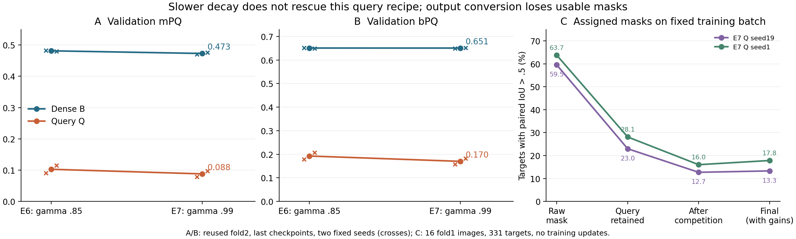

# E7 实验复盘与后续研究决策

日期：2026-10-17，America/New_York。本文依据重新读取的 LM1/LM2 实际产物，不以历史交接状态代替当前状态。

## 核心判断

E7 四次训练及 fold2 评估已完成，每次 130 epochs / 21,580 steps。将指数学习率衰减从 .85 改为 .99 没有挽救当前集合查询配方。应停止扩大该配方，转向训练集上的输出链条诊断。这个结论针对已测最小配方，不否定集合预测方法家族。

以下均为 split1：fold1 训练、fold2 开发验证，最后检查点，无 TTA。不是独立测试成绩，也不是三 split 结论。

图 C 跟踪训练分配查询；更稳妥的“所有查询中的最佳匹配”交叉检查见第 3 节，不能把图 C 直接解释为部署检测召回。

## 1. 已有方法结果

两固定种子 19/1 的算术均值：

|实验|模型|mPQ|bPQ|Dead PQ|strict Dead PQ|几何匹配率|合并率|
|---|---|---:|---:|---:|---:|---:|---:|
|E6，gamma .85|B 密集基线|.481432|.650773|.179635|.128541|.789977|.045363|
|E6，gamma .85|Q 查询掩码|.102699|.192614|.005951|.005504|.290035|.285885|
|E7，gamma .99|B 密集基线|.472939|.650651|.131493|.115839|.779313|.051209|
|E7，gamma .99|Q 查询掩码|.087958|.169912|.006287|.005914|.250827|.219744|

逐种子 E7 mPQ：B=.470016/.475862，Q=.078915/.097002。Q 的五类 PQ 与全部 19 个组织 mPQ 均低于对应 B；它是全局实例预测退化，不是仅 Dead 稀有类不够好。

改变日程后，B 的 mPQ 变化 −.008493，Q 为 −.014741；bPQ 分别 −.000122、−.022701。日程×架构的描述性交互为 mPQ −.006248、bPQ −.022579。两臂没有出现预期的共同恢复，Q 更未赶上新基线。

尤其要防止误读 Dead 交互：Q 的 Dead PQ 只增加 .000336，B 却下降 .048142，所以差中差约 +.048478。这个正交互主要来自基线下降，不能写成查询方法显著改善 Dead。方法准入仍应使用 E7 同日程的匹配 B/Q，不能拿变弱的基线制造胜利。

Q 合并率下降 6.61 个百分点，同时匹配率下降 3.92 个百分点、bPQ 下降 2.27 个百分点。因此“更少合并”不是实例分离已经改善的充分证据；消失、碎裂、轮廓退化也可能减少合并计数。

## 2. 学习率探针与完整训练为什么不矛盾

此前 E6 最终模型在固定 16 张训练图上恢复学习率，300 步后配对最终掩码召回从 18.73% 升至 36.86%。它只证明那个最终状态仍能拟合那个固定批次；不证明从头训练采用 .99 会获得更好的开发集成绩。

E7 在 epoch25 解冻时，两种子和两臂训练损失均出现明显跃升。例如 Q19 从 epoch24 的 3.5551 跳至 epoch25 的 4.9081，B19 从 3.3433 跳至 4.9891。E7 解冻后的学习率较高；这提供了解冻/骨干适配稳定性的候选线索，但同时变化的模型状态很多，不能由时间上的共现认定解冻就是失败原因。禁止据此在 fold2 上扫描骨干学习率。

B 的最终训练/验证损失低于 E6，而 mPQ/Dead PQ 下降；Q 的 mask Dice 项有所下降，但查询分类项并未同步变好。连续训练目标与离散实例指标不等价。不能跨 B/Q 两套不同损失比较绝对数值来判断哪个模型“学得更好”，也不能选择较好中间 checkpoint 改写既定终点。

## 3. 本次新增：固定训练批次的只读诊断

复用已有 `ops/e6_optimization_probe_20261016/probe.py` 的原 `measure` 函数；只进行 eval 前向，无 optimizer、梯度更新或训练权重输出。使用与之前探针相同的 fold1 seed19 增强批次，16 图、331 个目标；E7 两个最终 Q 模型都在同一输入上测量。checkpoint SHA256 与完成凭证核对，模型加载还核对源码和输入来源。

|E7 Q 模型种子|配对原始掩码 recall@IoU>.5|配对最终解码 recall@IoU>.5|配对类型准确率|保留查询/图|最终实例/图|
|---|---:|---:|---:|---:|---:|
|19|59.52%|13.29%|48.64%|39.375|30.188|
|1|63.75%|17.82%|51.36%|38.812|29.875|

这说明在训练样本中，已经有一部分查询产生可用原始掩码，却没有转化为对应最终实例。分类筛选与像素竞争合计造成很大的配对召回差距；同时原始召回远未到 100%，不能只修推理解码就假定问题解决。

这些“配对”是训练 Hungarian 代价选择的查询，不是对所有预测取最佳 IoU，不是官方检测召回。它不能与完整 fold2 的官方指标直接相减或混用；固定批次也不能代表所有训练图或组织。

本次进一步在完全相同输入和冻结解码下逐目标核算转移：

|训练批次中的对象数|seed19|seed1|
|---|---:|---:|
|总目标|331|331|
|配对原始掩码达标|197|211|
|原始达标但查询未保留|121|118|
|原始达标且查询保留|76|93|
|上述保留组经像素竞争后失配|34|40|
|原始不达标但竞争后达标|2|6|
|最终配对掩码达标|44|59|

两条核算恒等式逐种子通过：`raw_good = rejected + accepted_good`，`decoded_good = accepted_good - competition_loss + competition_gain`。例如 seed19 为 `197=121+76`、`44=76−34+2`。

所有配对查询中，背景 argmax 分别 160/151 个，前景但低置信度仅 11/16 个。因此原始达标但被拒的 121/118 个中，至少 110/102 个属于背景 argmax（分别至少 90.9%/86.4%）。这是集合计数下界，不是追加测量；只降低置信度阈值仍无法保留背景 argmax 查询。进一步降低阈值的 fold2 搜索既缺少机制支持，也违反冻结菜单。

损失实现另有一个值得预先注册检验的结构因素：512 查询/图、背景权重 .1。在这个批次共有 8,192 个查询、331 个匹配目标，其余 7,861 个背景查询在加权 CE 的归一化权重中占 `786.1/(786.1+331)=70.37%`。这只是样本权重算术，不是梯度贡献比例，更不证明背景权重导致失败；它说明为什么应检查分类目标与实例匹配的一致性，而不能把 .1 直觉地理解为背景监督已经很弱。

### 避免把训练配对统计误作检测性能

同一个 GT 可能由另一个查询检出。因此又在同批次、同模型、同阈值下，取消“只跟踪分配查询”的限制，对每个 GT 在全部候选中取最佳 IoU：

|331 个训练目标的最佳匹配 recall@IoU>.5|seed19|seed1|
|---|---:|---:|
|所有原始查询掩码|64.05%（212）|68.58%（227）|
|只看实际保留查询的原始掩码|31.42%（104）|35.95%（119）|
|完整解码的最终实例|25.38%（84）|29.31%（97）|

原始→保留查询的损失均为 108/331，即 32.63 个百分点；保留原始→完整解码的净损失为 6.04/6.65 个百分点。最终最佳匹配比配对查询高约 12 个百分点，说明配对口径确实夸大了最终丢失，但并未推翻输出筛选的主要线索。所有原始掩码的最佳匹配已经使用 GT 取最大值，是诊断上界，不是部署成绩；它也仅有 64%–69%，所以分类对齐之外仍存在掩码学习不足。

这项交叉检查支持优先调查查询分类/保留与掩码质量的对齐，随后检查输出竞争；不支持直接宣布找到唯一原因，也不授权从训练集上界推断验证集可达到的收益。

## 4. 成本汇总失败与本次推进

原并行 supervisor 已结束，训练与预测没有遗留进程。汇总失败于 `validated_cost`：原成本测量的 1,589 次采样均记录了外来 GPU 进程 3625124，`load_comparable=false`。其 Q/B 比值 1.2127/1.1870 不应作为可比成本结果。

本次保留旧失败记录和原 `latency.json`，未重跑训练、预测或评估。在 LM2 新建仅含四个原 run 软链接的只读用途视图，复用冻结 benchmark/analyzer，在当时无外来进程的 GPU7 做一次独立固定协议成本测量，再执行完整冻结 CPU 分析。新产物位于 `ops/e7_review_20261017/`；启动 PID945011，整体 1,800 秒硬上限。现已完成，`closeout.exit=0`。

新成本的全部 1,589 次负载采样均无外来进程，`load_comparable=true`；两种子 Q/B 平均延迟比分别 **.738576/.764427**，成本门通过。成本绑定四个实际最终 checkpoint 的哈希；分析中的 latency SHA256 与回收文件完全一致。

完整冻结分析已核验当前来源、四份完成凭证、全部 130 轮日志和各种子 B/Q 相同增强数据流。主端点保持固定 741 个内部 Dead / 60 图，结果如下：

- Q−B 匹配率：seed19 **−.529015**，seed1 **−.527665**；均值 **−.528340**，固定 1,000 次组织分层图像聚类 bootstrap 95% CI **[−.589426, −.468664]**。
- 真正完全漏检（max-IoU<.1）的改善 B_miss−Q_miss 为 **−.125506**，95% CI **[−.196755, −.057357]**，即 Q 更差；没有用 1−matched 代替漏检。
- 内部 Dead 匹配、官方 Dead、质量下限、strict mPQ、合并护栏全部失败；延迟与有限值检查通过；最终 `admission=false`。

本次专项 CPU 回归 **32 passed, 19 warnings，33.69 秒**；另已独立核对五类/19组织逐种子方向，以及两套训练诊断的计数恒等式与召回率完全一致。原质量门不因成本测量恢复而改变。

## 5. 后续优先级与扩容条件

1. E7 质量门与有效成本已封账，保留失败配方，不追加种子、三 split 确认或阈值搜索。
2. 固定训练批次的逐对象转移和所有查询最佳匹配交叉检查已完成。后续应使用两种口径共同判断，不把训练分配统计或 GT 取最大值当作部署性能。
3. 此后若开展新机制训练，先冻结单批可拟合性实验和通过/停止规则。优先检查对象配对稳定性、查询分类与掩码质量的一致性，以及共同训练的骨干是否破坏查询输出。每次只改变一个机制；不能在同一轮同时加点初始化、局部注意力、多尺度、损失改造和新解码器。
4. 小批次上必须同时检查原始掩码与完整解码，不能仅以 loss 下降或原始掩码变好作为扩大算力的理由。只有新机制通过预先冻结的训练集门，才重新启动两种子的 train/val 对照；其后仍须通过质量、严格指标、合并和成本门，才考虑更大实验。

LM2 的容量充足不等于当前科学假设值得扩容。当前已有空闲 A100 与约 1.7 TiB 磁盘，但 E7 的退化幅度远大于此前已量化的种子差异。扩大相同配方预计只会更精确地确认失败，应把算力用于能区分机制的实验。

## 6. 来源、资源与限制

- LM1 主分支 `research/set-mask-e6`，commit `fd98c5f0a7618ed2e1cd454bfbc4dda36a336a3b`；既有未提交修改全部保留。
- E7 实现分支 `research/set-mask-e7-schedule`，commit `c6d9b58ff080a3686ea760c05c533a2f62f51ac8`；LM2 源码快照 `ops/staging/e7_schedule_20261016`，本次未改变。
- 原训练产物留在 LM2 `runs/setmask_e7_20261016`；小型凭证已通过既有 broker 的 read 接口逐文件校验并回收至 LM1 `ops/e7_review_20261017`。
- 本地数字凭证：同目录 `e7_evidence.json`，含完整五类与 19 组织的摘要。
- 本次未修改指标、HoVer-Net 或模型训练代码，未升级依赖、提交或推送 Git。历史完整回归数不作为本次新测试结果。
- LM1 `/data7` 本次检查仅余约 7.7 GB，禁止将大检查点回收到该盘。LM1 GPU2 本周禁用已写入本地 AGENTS.md 和 LM1 ignored CLAUDE.local.md；本次未在 LM1 使用任何 GPU。
- 两固定种子、重复使用的 fold2、缺少患者聚类信息，限制了统计外推。任何图像 bootstrap 区间都不是患者总体或种子总体置信区间。
