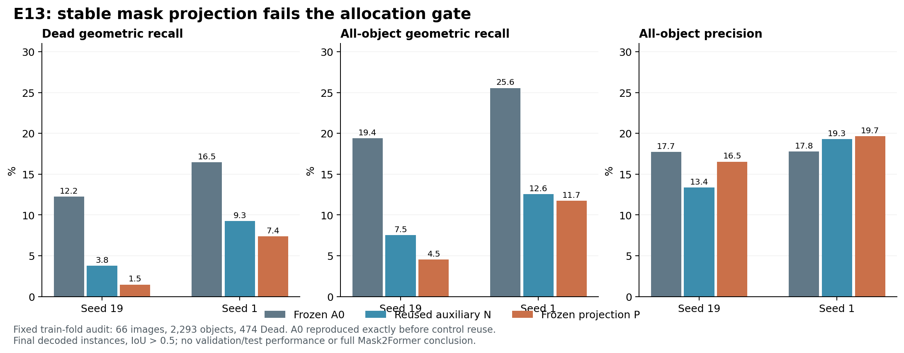

# E13：冻结掩码投影未通过质量门

2026-10-17。两种子原门与A0护栏均失败，关闭该300步配方，未启动大规模训练。全部audit数字来自原训练fold，不能称为验证或测试成绩。

唯一改动：在E11四阶段平均监督配方中冻结原始mask_projection权重与偏置，保持查询头其他参数可训练。原E7Q最后检查点、E10注意力与全局初始化、冻结像素特征、64fit/66audit图组、两种子、300步、batch2、原损失和最终解码不变。与复用E11 N比较，治疗记为P。

| 指标（%，audit） | seed19 N | seed19 P | seed1 N | seed1 P |
|---|---:|---:|---:|---:|
| Dead几何召回 | 3.80 | 1.48 | 9.28 | 7.38 |
| 全体几何召回 | 7.54 | 4.54 | 12.56 | 11.73 |
| 全体精确率 | 13.36 | 16.53 | 19.32 | 19.66 |
| Dead typed F1 | 0.78 | 1.18 | 6.42 | 5.22 |
| raw Dead掩码召回 | 31.22 | 35.65 | 23.21 | 28.27 |

P−N的Dead召回变化−2.32／−1.90个百分点，达不到至少+5个百分点且方向相反；拟合集全体召回只有5.23%／12.35%，远低于80%门。P−A0的全体召回下降14.87／13.82个百分点，护栏同样失败。

冻结投影提高了相对N的raw Dead覆盖，却没有改善最终Dead召回；“有原始掩码候选”与“解码出正确实例”之间仍有大差距。raw覆盖统计遍历全部查询，最终结果还经过类别筛选和像素竞争，因此不能把这两个统计的差值当成单个解码步骤的因果损失。结合E12可拟合性证据，单纯保持特征基稳定不足以解决当前查询学习问题，也不能据此证明投影漂移完全无影响。

下一步E14只将Hungarian掩码匹配成本从stride8网格+GT中心改为全部原生像素，检验匹配与损失支持区域不一致的问题。已有合成反例显示网格间假阳性区域可能被采样成本漏掉；该反例不证明真实失败的原因。E14保留P其余设置，单独预注册质量门并在计算前记录设计。

## 核验与溯源

A0/G/M/N与E11结果完全一致，A0在训练前逐图精确复现，检查点及固定图组哈希一致。独立脚本从每图计数重算全部比例、原门和A0护栏。四阶段损失权重0.25，真实bf16最终推理训练前后与既有路径逐位等价。投影state_dict训练后完全相同；模型输入缓存哈希保持一致。

定向TDD两项RED后通过。首轮回归22通过/3失败，失败原因是继承测试的E10路径未显式提供；日志保留，修正入口后**25项通过**。LM2两项通过，E12/E13便携工作树测试合计6项通过。未修改指标或HoVer-Net，未重跑完整套件，不沿用E11的512项结果作为本轮验证。E13与E11的staged_forward、auxiliary_loss、check_equivalence源码AST相同。

GPU任务exit0，205.24秒，PyTorch峰值reserved2.0215GiB。LM2GPU5，启动前74,493MiB实际空闲；无LM1GPU使用、无新SSH/包升级或Git发布。

结果SHA256=`63da90ec0de54ed04fc548d2365d981ada663204a4d1de33484a56f47e7baee8`；driver=`2cf1ab310f73384db71ade93bd5af5fab90709d5ac3c62326b385609d6eb8965`；设计=`d9fb54c05139055e5f666ad785572ee4b722d2604d5e748b820b3cd93de0eded`。

主分支`research/set-mask-e6`/`fd98c5f0a7618ed2e1cd454bfbc4dda36a336a3b`；隔离实现`research/set-mask-e7-schedule`/`c6d9b58ff080a3686ea760c05c533a2f62f51ac8`。新工作树文件为`scripts/probe_stable_projection.py`、`tests/test_stable_projection.py`、`docs/superpowers/specs/2026-10-17-e13-design.md`，保留未提交状态。

LM2产物`/data6/jinxinhao/bdd26/ops/e13_stable_20261017`；LM1回收与日志`/data7/jinxinhao/bdd26/ops/e13_stable_20261017`。历史完成控制PID844920、startticks1066206559，仅供溯源。配套：[原始结果](results.json)、[独立核算](independent_verification.json)。
