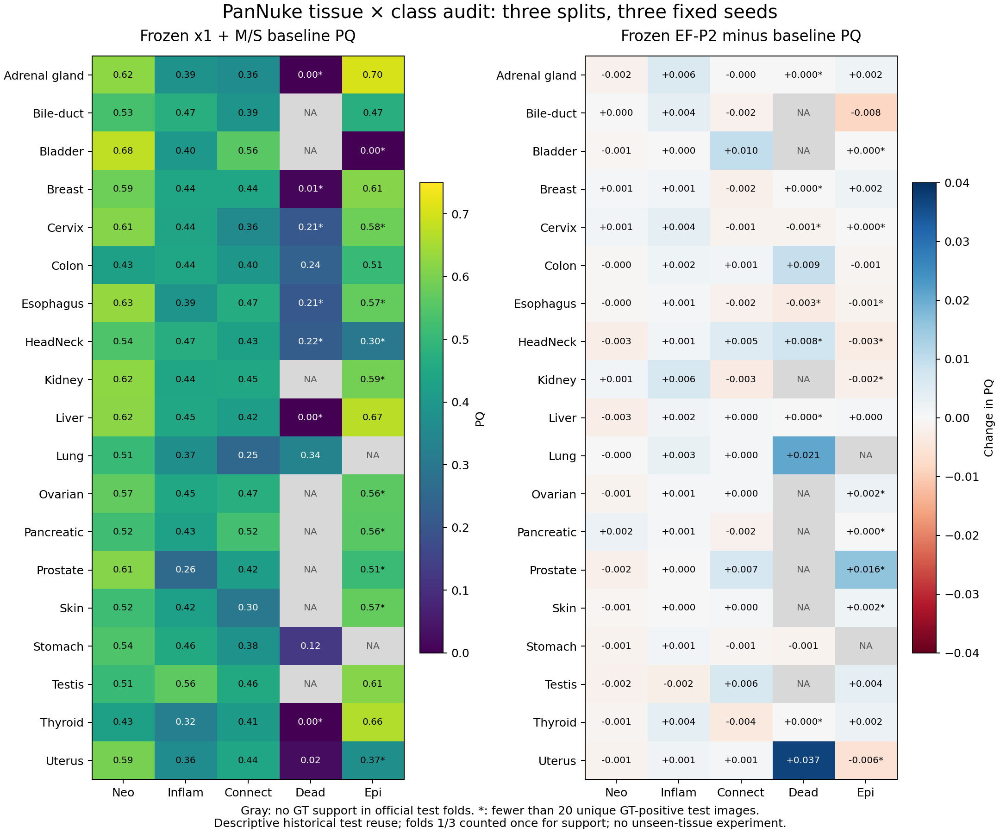

# Tissue and class consistency audit

2026-10-15. Descriptive analysis of frozen predictions, with no training, new inference, threshold search, or model selection.

## Decision

Performance across represented PanNuke tissues remains uneven. The data support retaining the project focus on diagnosed detection and instance-quality failures, with tissue-by-class reliability as a required evaluation dimension. They do **not** establish unseen-tissue transfer as the dominant bottleneck, nor show that existing models have solved that problem.

Dead detection is a defensible targeted case under the original guidance, but its limited tissue coverage prevents a broad transfer claim. PM-Net remains an untrained hypothesis subject to the existing development quality and cost criteria. This audit does not reopen closed methods, authorize training, or alter frozen experimental decisions.

## Scope and reproducibility

The primary comparison uses all nine existing `(split, seed)` pairs from the October 4–5 matched-seed study: official splits 1/2/3 and seeds 19/1/2. The baseline is the frozen x1+M/S configuration and the comparator is frozen EF-P2. Recorded model evaluations used final checkpoints; this audit reads their saved summaries, per-image scores and instance records. It does not revalidate checkpoint bytes or rerun model inference.

- Baseline: `runs/analysis/matched_seed_20261004/p0/<pair>/test/base/ms/eval/`.
- EF-P2: `runs/analysis/existence_ef_20261005/p2ef/<pair>/test/eval/`.
- Unique-fold support also uses `runs/cellvit_uni/split1/eval_fold2/gt_records.csv.gz` and prepared tissue metadata.
- Original reproduced CellViT-UNI and HoVer-Net summaries provide a separate architecture context, without mixing their scores into the matched comparison.

Run `python scripts/analyze_tissue_consistency.py --out runs/analysis/<new_directory>` in the pinned project environment. The output directory must not already exist. The numerical snapshot and tables are in [tissue_class_audit_20261015](tissue_class_audit_20261015/). The snapshot records every input SHA-256 and the script SHA-256. The evaluator `nucseg.metrics.pannuke_eval` is unchanged.

All 18 official mPQ values and every tissue/class PQ were reconstructed from per-image tables to tolerance 1e-12, including NaN handling. Baseline/EF GT rows match exactly on image, tissue, class, area and touching count. Tissue metadata agrees with GT record row indices. Existing EF-P2 headline changes remain +0.00699 Dead PQ and approximately +0.00068 mPQ.

Gray cells lack test support. Asterisks mark fewer than 20 unique GT-positive test images. Small cells can produce extreme or zero scores and require cautious interpretation.

## Persistent differences between represented tissues

Numbers below first average seeds within each split, then average the three splits. Unique test-image counts include folds 1 and 3 once each; splits 1 and 2 both test fold 3.

| Tissue | Official mPQ | bPQ | Common-three-class PQ | Unique test images | Bottom five, split-level seed means |
|---|---:|---:|---:|---:|---:|
| Lung | 0.4064 | 0.6264 | 0.3780 | 131 | 3/3 |
| Skin | 0.4264 | 0.6509 | 0.4140 | 100 | 3/3 |
| Colon | 0.4370 | 0.5687 | 0.4217 | 972 | 3/3 |
| Breast | 0.5155 | 0.6564 | 0.4891 | 1,602 | 0/3 |

Common-three-class PQ gives equal weight to the per-class PQ of neoplastic, inflammatory and connective nuclei within a tissue. It is a supplementary diagnostic, not official mPQ and not a causal adjustment. The official score averages available class scores within images before tissue averaging. Merely comparing tissue mPQ can therefore confound cell composition with conditional performance.

The same-class differences are substantial. Connective PQ is 0.2542 in Lung, 0.3011 in Skin, and 0.4398 in Breast. All these connective cells have at least 25 positive images and 145 labeled nuclei in each underlying test fold. Neoplastic PQ is 0.4262 in Colon versus 0.5858 in Breast, with at least 109 positive images and 2,790 nuclei per underlying fold. Thus, tissue differences are not explained solely by comparing different cell categories. The comparison still leaves size, morphology, staining, density, class subtypes and annotation conventions uncontrolled. Low scores do not identify a causal mechanism.

The pattern also appears before the later M/S configuration: original CellViT-UNI three-split mPQ is 0.4023 in Lung, 0.4325 in Skin and 0.4402 in Colon. Original HoVer-Net is 0.3880, 0.3207 and 0.4020 respectively. Existing stronger modeling has improved some tissues considerably, but has not made performance uniform. This is evidence about these reproduced models, not a comprehensive claim about every current model or an attainable performance ceiling.

## Dead is difficult, sparse and concentrated

Unique support across the three prepared folds is:

| Class | Labeled nuclei | Positive images |
|---|---:|---:|
| Neoplastic | 77,403 | 4,191 |
| Inflammatory | 32,276 | 4,132 |
| Connective | 50,585 | 6,140 |
| Dead | 2,908 | 232 |
| Epithelial | 26,572 | 1,528 |

Positive images overlap across classes. These counts include fold 2 for describing the full available dataset; they are not additional test evaluations. They sum to 189,744 nuclei across 7,901 patches.

Lung has 1,729 Dead nuclei (59.5% of all Dead), Colon 522, Uterus 182, and Stomach 174. Seven tissues have no Dead labels in any fold: Bladder, Kidney, Ovarian, Pancreatic, Prostate, Skin and Testis. Bile-duct has six Dead nuclei in two fold-2 images but none in the two unique official test folds. Tiny cells such as Liver (one nucleus) and Thyroid (three) cannot support reliable claims. Nine of the 95 tissue/class cells have no GT support across the full dataset; missing cells must remain unavailable, not zero-performance cells.

In the matched x1+M/S baseline, averaging instance-level rates across the nine runs, 49.1% of Dead GT instances are matched at the evaluator's class-agnostic IoU criterion, compared with 74.5–84.1% for other classes. 37.9% of Dead have maximum IoU below 0.1. Of matched Dead, 74.5% have the correct type. This supports a substantial detection deficit relative to the supplied annotations. It is not a biological validation of annotations, a centroid detection F1, or evidence that correcting detection alone is sufficient.

## Existing improvement has uneven tissue effects

EF-P2 remains a fixed historical comparator, not a method selected using this audit.

| Tissue | Mean change in Dead PQ | Exploratory paired image 95% interval |
|---|---:|---:|
| Lung | +0.0208 | [+0.0115, +0.0309] |
| Colon | +0.0093 | [−0.0005, +0.0191] |
| HeadNeck | +0.0079 | [+0.0074, +0.0081] |
| Uterus | +0.0371 | [0.0000, +0.0742] |
| Esophagus | −0.0032 | [−0.0078, −0.0001] |
| Stomach | −0.0014 | [−0.0031, −0.0001] |

The overall Dead PQ improvement of +0.00699 is unchanged. Tissue-class scores use different weights and are not additive contributions to that headline. EF-P2 improves official tissue mPQ in 10 of 19 tissue means and decreases it in nine; the overall change remains small. Zero changes in unsupported or tiny Dead cells cannot establish preserved performance. At the measured approximately 6.1× inference cost, EF-P2 remains evidence of scale complementarity rather than a deployment recommendation.

Intervals use 2,000 paired, tissue-stratified image bootstrap draws with random seed 20261015. Predictions stay paired across methods and averaged over the fixed training seeds. Splits 1 and 2 share the same resampled fold-3 indices, rather than pretending their test cohorts are independent. Point estimates are equally averaged split means. For class PQ, resampling is conditional on GT-positive images within each tissue/class, keeping the supported split set fixed. Tiny groups can still produce discrete or degenerate intervals. The initial full-image class bootstrap allowed rare-class support to vanish and was superseded before publication; original point estimates are unchanged. The intervals are pointwise exploratory intervals, without multiplicity correction, and condition on the trained seeds. They do not include training uncertainty, unknown patient clustering or selection from historical test reuse. No inferential decision is based on a single subgroup interval.

## Consequences for the project

1. **Respond to the guidance through measured consistency.** Keep all five classes, tissue-specific quality, counts and error decomposition visible. Report where a proposed fix helps and where it hurts, rather than treating aggregate mPQ as sufficient evidence of generalization.
2. **Retain Dead as a targeted case, with limited coverage.** The observed detection deficit justifies investigation, but rare-class gains do not demonstrate improvement in tissues without Dead labels. Existing closed negative studies stay closed.
3. **Keep PM-Net conditional.** These observations do not uniquely support a query decoder or any other architecture. Its existing quality, strict-score and cost gates remain essential. The minimum contribution is the reproduced baseline and an honest failure analysis; a new-model improvement remains a hypothesis.
4. **Do not promote unseen-tissue transfer to the main bottleneck from these data.** The official splits measure new images from represented tissue categories. A separate, frozen tissue-holdout protocol and a matched target-present reference would be needed to estimate the cost of excluding target tissues from task training. Pathology pretraining also limits claims of entirely unseen tissue exposure.

The present audit reuses historical test results to refine interpretation and reporting. It is not an independent confirmation set. Any new method, subgroup-specific rule or threshold must be developed on train/validation data, with future confirmation limitations disclosed. External dataset results already indicate domain sensitivity, but class mappings and acquisition differences prevent attributing those drops solely to organ transfer.
