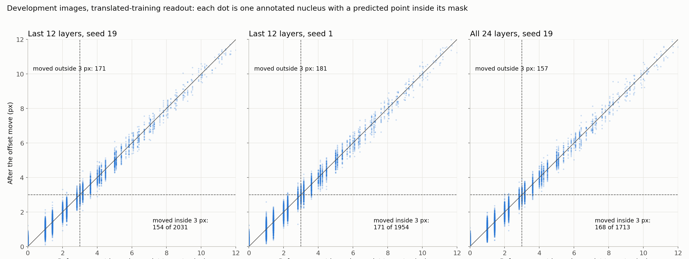
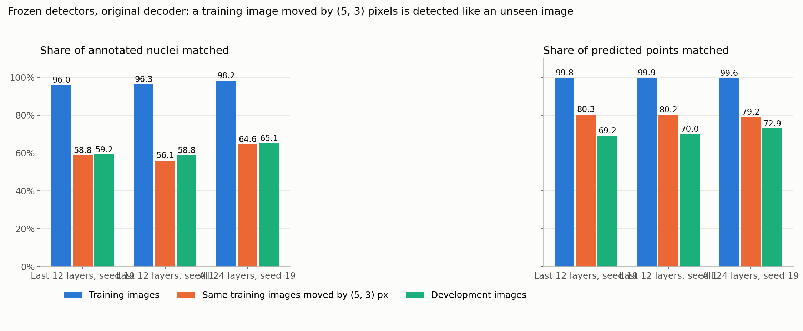
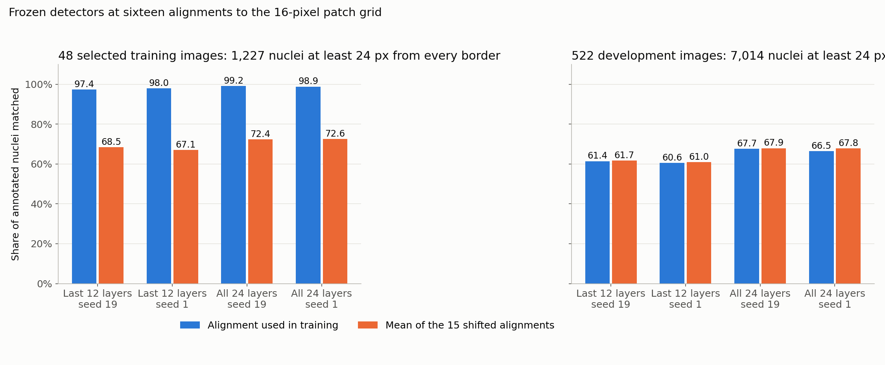
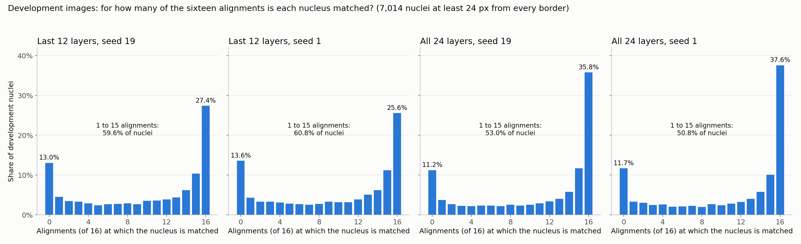

# 导读：这两项实验说明了什么，下一步做什么

> **当前状态：** P34 与 P35 已有结果；下一步实验 P36（作业 55892877，八个任务）已于 11 月 19 日提交，正在排队。

## 先回顾问题

核中心检测器在训练图像上能找到约 98% 的核，在没见过的图像上只有 60% 左右。前面二十多轮实验一直在问：差的这三十多个百分点是怎么来的。

## 第一项实验：给预测点“挪位置”，没有用

上一轮分析发现，很多漏检的核内其实已经有预测点，只是离标注中心略超过三像素。于是 P34 训练了一个小模块，专门告诉每个预测点“中心在哪个方向、多远”，再把点挪过去。

结果是：挪动后新增的匹配和丢失的匹配几乎一样多（每个检测器各 160～180 个）。

图中每个点是一个核。如果挪动有效，右侧（原来偏远）的点应当落到下方的虚线以内；实际上它们仍沿对角线分布。原因是这个小模块和检测器有同样的毛病：训练图像上几乎一个像素不差，换了图像误差就到一两个像素以上。

## 意外的发现：训练图像挪几个像素就“不认识”了

P34 里有一组对照：把训练图像整体平移 (5, 3) 像素再让检测器看。

蓝色是训练图像，橙色是平移后的同一批训练图像，绿色是没见过的图像。橙色和绿色几乎一样高。也就是说，检测器在训练图像上的 98%，只在图像“原样摆放”时成立。

## 第二项实验：换十六种摆放方式逐一测试

检测器先把图像切成 16×16 像素的小块再处理。P35 把每张图像平移十六种不同的量（覆盖一个小块的周期），看结果如何变化。

- 训练图像：原样摆放时找到 97%～99%，换一种摆放只有 67%～73%。
- 没见过的图像：哪种摆放都是 61%～68%，没有差别。

所以“98% 对 60%”的差距里，大部分是检测器记住了每张训练图像在一种摆放下的样子。

更细地看每一个核：

没见过的图像上，一半以上的核是“有时找到、有时找不到”，取决于摆放；只有 11%～14% 的核怎么摆都找不到，而 86%～89% 的核至少在一种摆放下能找到。怎么摆都找不到的，主要是很小的核和挤在一起的核。

把十六张分数图直接平均并不能利用这一点：各种摆放下峰的位置差一两个像素，平均后峰值从约 0.87 掉到 0.5 左右，大部分点反而消失了。

## 这些结果合起来说明什么

1. **结构**：小块网格让检测器对“核落在小块的什么位置”很敏感，训练时每张图只有一种摆放，容易被记住。
2. **损失**：训练目标要求峰值精确落在中心那一个像素。位置稍有不确定，最优的做法就是把分数压到 0.5 以下。许多核检测器是“看见了”的，只是分数不够。
3. **数据**：小核和拥挤的核是另一类困难，与摆放无关。

## 下一步实验 P36

P36 不训练任何模型，用八个现成的检测器回答两个问题：

- **阈值问题**：把 0.5 的阈值换成在“平移后的训练图像”上选出的阈值，没见过的图像上能多找到多少核？
- **平移训练问题**：早先有一轮实验（P15）在训练时加入了随机平移，当时按 0.5 的阈值评估，结果变差而被搁置。它是不是其实已经不依赖摆放，只是分数偏低？

同时测试“一致性解码”：不平均分数图，而是把十五种摆放下各自找到的点放在一起，多数摆放都认可的位置才保留，位置取平均。

阈值和规则只在训练图像上选定，并在检测器看到任何评估图像之前写入文件。预期与判读方式也在提交前写下，见[预先固定的设计](P36_FROZEN_READING.md)。

## 资源

项目 GPU 额度基本用完（1,900 SU 中已用 1,821 SU），三项实验都在 CPU 节点上运行。P34 用了约 493 SU，P35 约 89 SU，P36 最多 2,048 SU；CPU 额度共 50,000 SU，已用 2,135 SU。

完整的数字、口径和文件见[详细分析](REVIEW_ZH.md)与[英文版](REVIEW_EN.md)。
