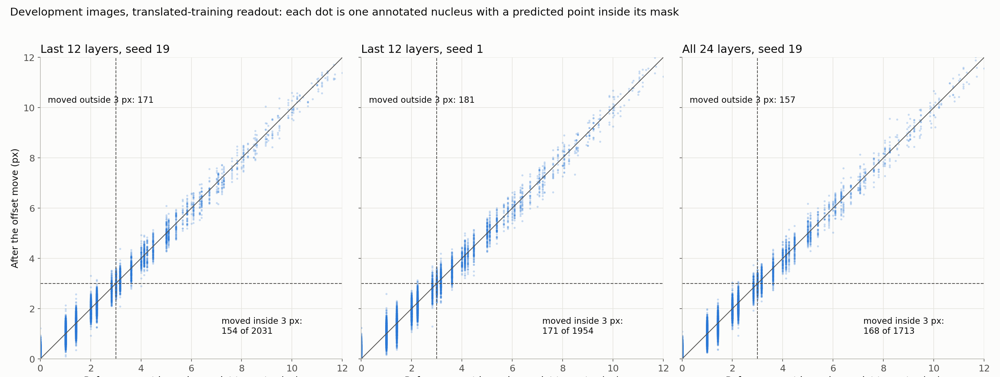
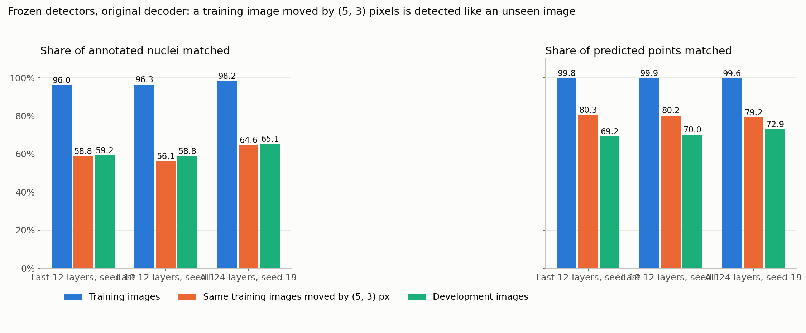
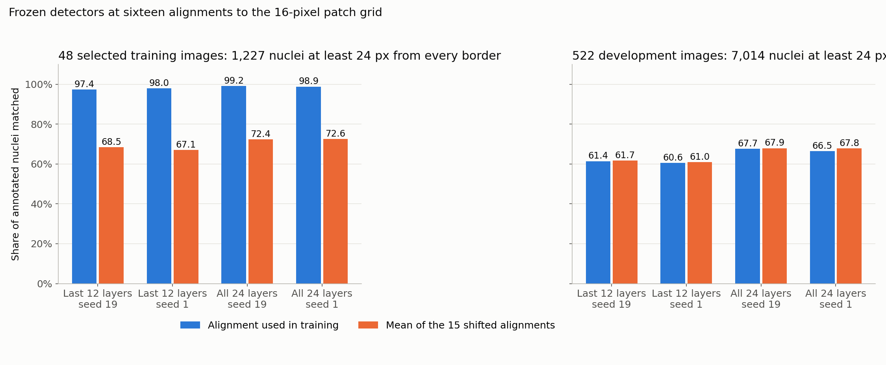
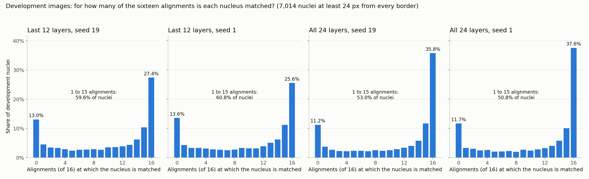
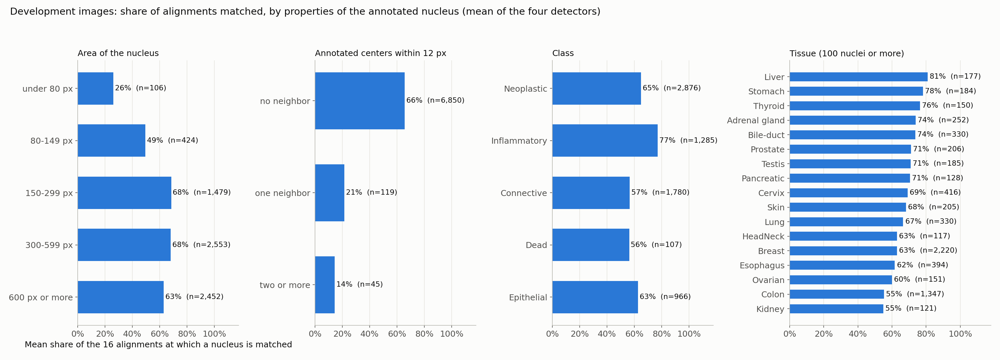

# Offset readout (P34) and sixteen grid alignments (P35): results; P36 submitted — November 19, 2026

> **Status:** P34 array 55855798: three tasks completed, one stopped by its time guard. P35 array 55867961: four tasks completed. P36 array **55892877** (eight tasks, 32 cores/64 GiB/8 hours each) was submitted once at 2026-11-19T21:51:49Z and was queued at 22:16Z. Results of P36 will be added when the job finishes.

- [Detailed Chinese analysis](REVIEW_ZH.md)
- [Detailed English analysis](REVIEW_EN.md)
- [Chinese reader](GUIDE_ZH.md)
- [P34 numbers](P34_RESULTS.json), [P35 numbers](P35_RESULTS.json) and the scripts that generate them: [P34](analyze_p34_results.py), [P35](analyze_p35_results.py)
- [P35 reading fixed in advance](P35_FROZEN_READING.md), [P36 frozen design and expectations](P36_FROZEN_READING.md), [P36 submission receipt](P36_SUBMISSION.json)
- Previous round: [structure analysis of misses and P34 design](../center_offset_p34_2026-11-18/README.md)

## Results

**P34.** Moving each predicted point by a trained offset readout gains 158–172 matches and loses 158–182 on the 522 development images of each of three frozen detectors. The readout places the center within three pixels for 99.4%–99.8% of nuclei on training images and for 71%–81% on development images.

The frozen detectors match 96.0%–98.2% of nuclei on training images, and 56.1%–64.6% on the same images moved by (5, 3) pixels, level with development images.

**P35.** At sixteen alignments to the 16-pixel patch grid, nuclei at least 24 pixels from every border of the training images are matched at 97.4%–99.2% at the trained alignment and at 67.1%–72.6% at the fifteen others; on development images both figures are 61%–68%.

Of 7,014 development nuclei, 11%–14% are matched at no alignment, 26%–38% at all sixteen, and 51%–61% at some; 86%–89% are matched at one alignment or more. Averaging the sixteen score maps at the threshold 0.5 keeps 9%–15% of nuclei, because peaks of different alignments lie one or two pixels apart.

## P36

Eight frozen detectors (P22 control and all layers; P15 control and translation-trained; two seeds each) are recorded at sixteen alignments with two fills. A score threshold and a consensus rule are selected on shifted training images before any development image is read, then applied unchanged. The experiment tests whether the fixed threshold 0.5 removes located nuclei, whether training with translation removed the alignment dependence, and whether agreement across alignments recovers alignment-dependent misses.

## Scope

Fold 1 training and development split, nucleus-center detection, CPU single precision, frozen detectors. The sixteen alignments of one nucleus are repeated observations of the same object.
