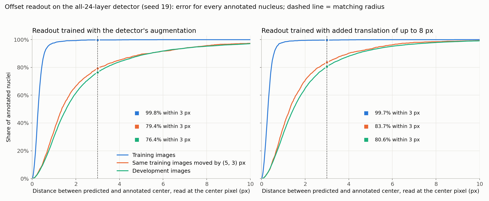
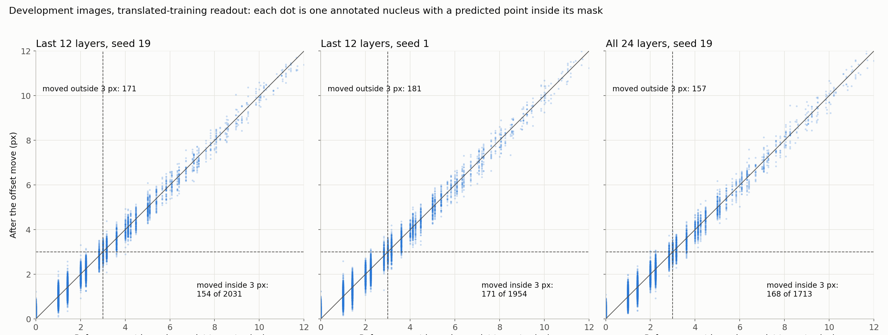
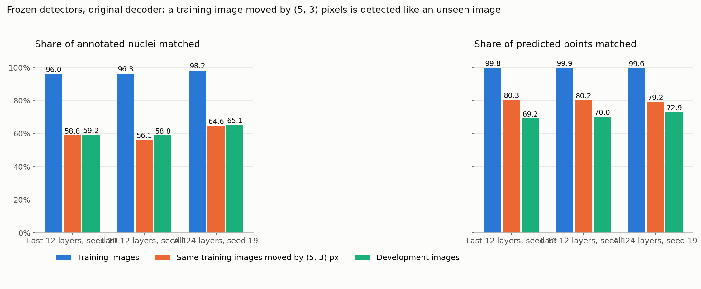
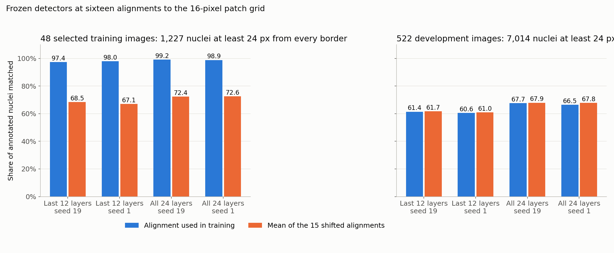
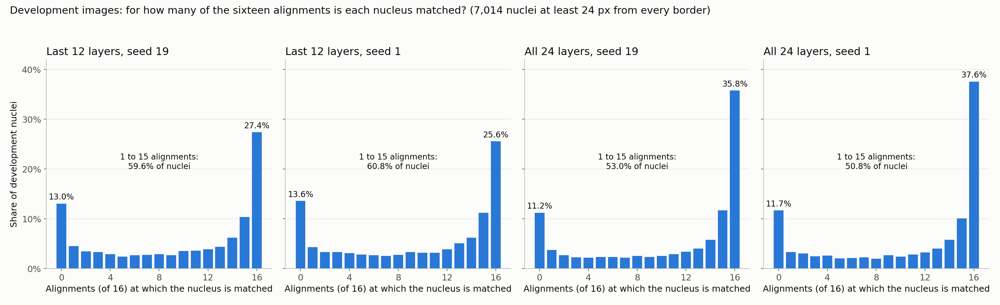
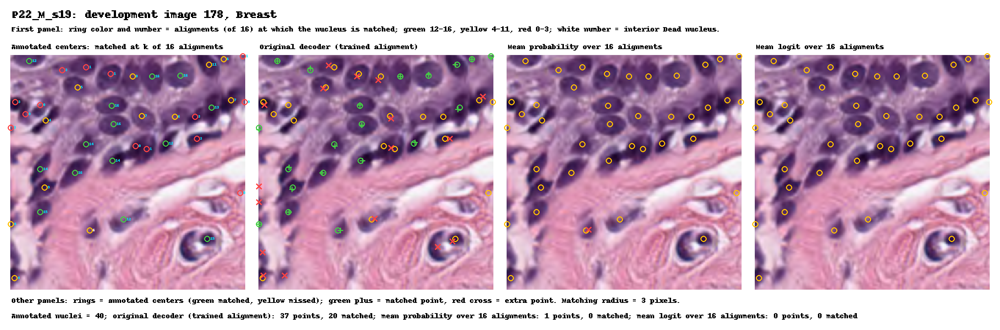
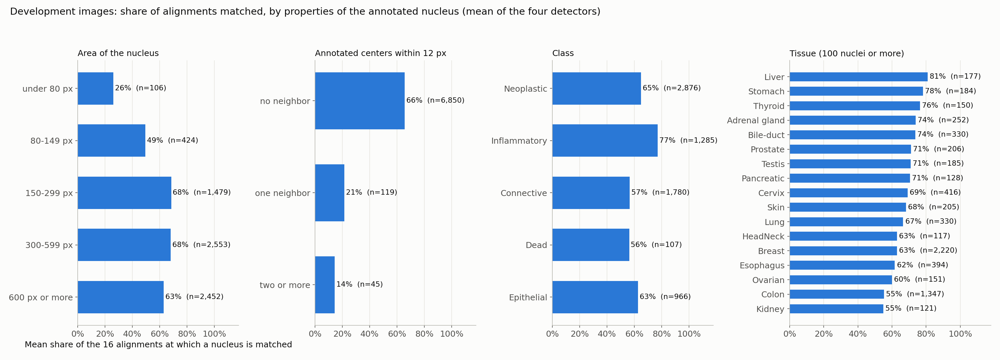

# Nucleus-center detection: results of the offset readout (P34) and of sixteen grid alignments (P35), and the next experiment (P36)

November 19, 2026. This document reports two completed experiments, states what they show about the data and the network structure, and describes the experiment submitted next. The preceding structure analysis and the P34 design are in the [previous analysis](../center_offset_p34_2026-11-18/README.md).

> **Status:** P34 (array 55855798): three tasks completed, one stopped by its time guard. P35 (array 55867961): all four tasks completed. P36 (array **55892877**, eight tasks) was submitted once at 2026-11-19T21:51:49Z and was queued at 22:16Z. All three run on CPU nodes with frozen detectors; no detector was trained.

## 1. Job status

|Job|Content|Resources|State|
|---|---|---|---|
|55855798|P34: offset readouts trained on four frozen P22 detectors|4 tasks, 32 cores and 64 GiB each|Control seed 19, control seed 1, all layers seed 19: COMPLETED / 0:0 (3 h 19 min to 4 h 27 min); all layers seed 1: FAILED / 1:0|
|55867961|P35: four frozen detectors evaluated at sixteen grid alignments|4 tasks, 32 cores and 64 GiB each|All four COMPLETED / 0:0 (38 to 51 minutes)|
|55892877|P36: alignment-resolved point records, threshold selection and consensus decoding for eight frozen detectors|8 tasks, 32 cores, 64 GiB and an 8-hour limit each|Submitted, queued|

The fourth P34 task (all 24 layers, seed 1) finished the 12 epochs of its first readout. The first epoch of the second readout took 1,400.3 seconds, above the 1,300-second limit set in the script, and the task stopped as designed; earlier epochs on that node took 507 to 1,063 seconds, against 420 to 710 seconds on the three other nodes. That detector has no evaluation; its partial output is kept. The primary P34 comparison requires two seeds, so no decision under the original rule is available; the seed-19 result is in section 2.

The project GPU allocation stood at 1,821 of 1,900 SU at 13:42 UTC on November 19, with four GPU jobs of other members queued. The CPU allocation is 50,000 SU with 2,135 SU charged; P34 used about 493 SU, P35 about 89 SU, and the upper bound of P36 is 2,048 SU.

## 2. P34: the offset readout leaves detection unchanged

P34 keeps the detector fixed and trains a readout with 73,986 parameters that predicts, for every pixel inside a nucleus, the displacement to the annotated center; each predicted point of the detector is then moved once by that displacement.

**The readout is nearly exact on training images, and its error grows on any other image.** The figure shows, for the all-layer detector (seed 19), the cumulative distribution of the position error read at the center pixel of every annotated nucleus.

|Image group|Nuclei with an error of at most three pixels (readout with the detector's augmentation)|(readout trained with translation)|
|---|---:|---:|
|48 selected training images|99.4%–99.8%|99.5%–99.8%|
|The same training images moved by (5, 3) pixels|72.1%–79.4%|79.7%–83.7%|
|522 development images|70.6%–76.4%|75.9%–80.6%|

Ranges cover the three detectors. The median error is 0.28–0.35 pixels on training images and 1.47–1.84 pixels on development images. On moved training images the readout behaves as it does on development images.

**Moving the points gains about as many matches as it loses.** Each dot below is one annotated nucleus of the development images; the horizontal axis is the distance of the nearest predicted point inside the nucleus to the center before the move, the vertical axis the distance after it.

|Detector|Original decoder: matched / points / interior Dead|Moved and merged (readout trained with translation)|Gained|Lost|
|---|---|---|---:|---:|
|Last 12 layers, seed 19|7,255 / 10,488 / 66|7,240 / 10,485 / 65|158|173|
|Last 12 layers, seed 1|7,199 / 10,280 / 61|7,189 / 10,279 / 62|172|182|
|All 24 layers, seed 19|7,979 / 10,945 / 85|7,993 / 10,942 / 83|172|158|

In each detector, 1,713 to 2,031 nuclei have their nearest inside point more than three pixels from the center; after the move 154 to 171 of them lie within three pixels, while 157 to 181 points that were within three pixels move out. The points scatter on both sides of the diagonal: on these images the position error of the readout is as large as the displacement of the detector's own peaks, and the move yields no net gain. Interior Dead matches of the all-layer detector (seed 19) go from 85 to 83, below the original criteria.

**The most informative observation comes from the control group.** To separate memorized training images from learned localization, P34 evaluated training images moved by (5, 3) pixels. The detector itself (original decoder) behaves as follows on that group.

The three detectors match 96.0%–98.2% of annotated nuclei on training images and 56.1%–64.6% on the same images moved by (5, 3) pixels, level with the 58.8%–65.1% of development images; precision falls from 99.6%–99.9% to 79.2%–80.3%. Among the 1,495 nuclei at least 32 pixels from the filled edges the detection rate is 64.5%–70.9%, so the fill explains a small part only. The high detection rate on training images depends on one particular alignment of the image to the 16-pixel patch grid. This led to P35.

## 3. P35: sixteen alignments

P35 shifts every image by −8, −4, 0 or 4 pixels along each axis (sixteen combinations covering one 16-pixel patch period), passes it through the frozen detector and moves the score map back. The statistics below use nuclei at least 24 pixels from every image border, visible in full at all sixteen alignments, which excludes truncation by the shift.

|Detector|Training images: trained alignment|Training images: mean of the fifteen others|Development images: trained alignment|Development images: mean of the fifteen others|
|---|---:|---:|---:|---:|
|Last 12 layers, seed 19|97.4%|68.5%|61.4%|61.7%|
|Last 12 layers, seed 1|98.0%|67.1%|60.6%|61.0%|
|All 24 layers, seed 19|99.2%|72.4%|67.7%|67.9%|
|All 24 layers, seed 1|98.9%|72.6%|66.5%|67.8%|

There are 1,227 such nuclei in the training images and 7,014 in the development images. Two conclusions follow.

1. **The high detection rate on the training set belongs to one alignment.** At any other alignment the training images fall from 97%–99% to 67%–73%, five to seven points above development images. Most of the gap reported in earlier rounds (about 98% on training images, about 60% on development images) is the detector's memory of each image at one alignment, not a difference in how tissue content is recognized.
2. **No alignment is special on development images.** The trained alignment and the others differ by less than 1.5 points.

**The same nucleus is not treated consistently across alignments.**

|Detector (development images, 7,014 nuclei)|Matched at no alignment|At some (1–15)|At all sixteen|At one or more|
|---|---:|---:|---:|---:|
|Last 12 layers, seed 19|13.0%|59.6%|27.4%|86.9%|
|Last 12 layers, seed 1|13.6%|60.8%|25.6%|86.4%|
|All 24 layers, seed 19|11.2%|53.0%|35.8%|88.8%|
|All 24 layers, seed 1|11.7%|50.8%|37.6%|88.3%|

More than half of the nuclei are matched at some alignments only: a shift of a few pixels turns the same nucleus from found to missed. The detection rate at a single alignment is 61%–68%, while 86%–89% of nuclei are matched at one alignment or more. Of the variance of the match outcome, 58%–63% lies between nuclei and about four tenths between the alignments of one nucleus. Of the 145 interior Dead nuclei (144 visible at all alignments), the original decoder matches 61 to 85, and 109 to 116 are matched at one alignment or more.

The record of the all-layer detector (seed 19) on development image 178 follows. In the first panel the number beside each annotated nucleus is the number of alignments at which it is matched; the second panel is the original decoder.

In the cluster of dark nuclei at the top, neighboring nuclei are matched anywhere from 1 to 16 times. Most red crosses (extra points) of the original decoder on these nuclei lie inside the nucleus slightly more than three pixels from the center, as in the earlier structure analysis.

**Averaging the sixteen score maps does not work.** At the threshold 0.5 the averaged map keeps 1,075 to 1,896 matches (original decoder: 7,199 to 7,979) at 95%–96% precision; the primary comparison fixed for P35 is not met, as expected in the note written before the results were read. The nuclei matched at all sixteen alignments show why: the highest score near the center has a median of 0.86–0.90 at a single alignment and 0.46–0.50 in the averaged map. Peaks of different alignments sit one or two pixels apart and are themselves one or two pixels wide, so the average falls to the threshold.

**Which nuclei are missed at most alignments.**

|Group (development images, mean of four detectors)|Nuclei|Share of alignments matched|Matched at no alignment|
|---|---:|---:|---:|
|Area below 80 pixels|106|26%|43%|
|Area 80–149 pixels|424|49%|23%|
|Area 150–599 pixels|4,032|68%|10%|
|Area 600 pixels or more|2,452|63%|13%|
|No other annotated center within 12 pixels|6,850|66%|12%|
|One other center within 12 pixels|119|21%|42%|
|Two or more|45|14%|47%|
|Inflammatory|1,285|77%|7%|
|Neoplastic|2,876|65%|12%|
|Epithelial|966|63%|13%|
|Connective|1,780|57%|16%|
|Dead|107|56%|19%|

Small and crowded nuclei are hardest: nuclei below 80 pixels are matched at 26% of alignments, nuclei with a neighbor within 12 pixels at 14%–21%. By tissue, liver, stomach and thyroid are highest (76%–81%), colon and kidney lowest (55%).

## 4. What this says about the data, the loss and the network

Together with the previous analysis, P34 and P35 give three layers to the gap between about 98% on training images and about 60% on development images.

**Network structure.** The encoder cuts the 256×256 image into 16×16-pixel patches; the position of a nucleus relative to the patch borders decides which vectors encode it. During training every image appears at one alignment (rotations by 90 degrees and flips keep the same class of positions relative to the patch borders), so the detector can memorize an image at that alignment. P35 confirms this: at another alignment the detection rate on training images drops by 26 to 31 points.

**Loss.** The exact-center loss treats the single center pixel as positive. The previous analysis derived that once the position is uncertain by more than about 0.95 pixels, the loss-optimal peak score is below the decoding threshold 0.5. P35 supplies the matching measurement: peaks of one nucleus at different alignments lie one or two pixels apart, and their average score sits near 0.5. For many nuclei the detector responds, with a score that is insufficient at a fixed threshold.

**Data.** About 11%–14% of nuclei are found at no alignment; they concentrate in small nuclei, crowded nuclei and tissues such as colon and kidney. This part is independent of alignment and concerns the training data and annotation density.

Two questions can be tested directly: whether the threshold 0.5 removes nuclei the detector has located, and whether the detector trained with translation earlier (P15, whose detection rate fell at the threshold 0.5) removed the alignment dependence and merely produced lower scores. P36 tests both.

## 5. P36: alignment-resolved point records, threshold selection and consensus decoding

The design was written and fixed before submission (scientific commit `a2289cb`; [frozen design and expectations](P36_FROZEN_READING.md)).

**Detectors.** Eight completed 130-epoch detectors, last checkpoint, frozen: P22 control (last 12 layers) and all 24 layers; P15 control and P15 trained with random translation of up to 16 pixels; two seeds each. Configuration, split, weights and preserved files of every run were checked before submission.

**Measurements.** Every image is evaluated at sixteen alignments, once with white fill and once with mirrored fill of the vacated strip; all local maxima with a score of at least 0.1 are stored in original coordinates. Images: 240 training images fixed by a hash of the image number, and all 522 development images. For every nucleus the alignments at which it is matched and the displacement of the nearest point at each alignment are recorded; the mean squared displacement is split into a part shared by all alignments and a part that changes with the alignment.

**Three decoders.**
- Original: trained alignment, threshold 0.5.
- Selected threshold: trained alignment, one threshold from 0.1 to 0.9.
- Consensus: points with a score of at least 0.5 from the fifteen other alignments are grouped within 2, 3 or 4 pixels; groups supported by at least v alignments are kept, at the mean position of their points.

The threshold and the consensus rule (fill, radius, v) are selected on the fifteen shifted alignments of the training sample by the F1 score over all annotated nuclei, and written to disk before the detector reads any development image. The trained alignment takes no part in the selection because training images are reproduced almost exactly there.

**Primary comparison.** P22 all 24 layers, consensus against original decoder, both seeds under the original criteria (interior Dead detection rate at least 0.60, increase of at least 0.05 with a paired bootstrap 95% lower bound above 0, precision at least 0.75 and not more than 0.02 below the reference, overall detection rate not more than 0.02 below the reference). The other comparisons describe mechanism, including the translation-trained P15 detector at its selected threshold against its control.

**Expectations written before submission.** Selected thresholds below 0.5 for most detectors; the translation-trained detector equal across alignments, with the lowest selected threshold; a gain in F1 from the consensus of a few points at most, with the primary criteria not assured.

|Observation|Reading|
|---|---|
|Selected thresholds below 0.5 and higher F1 on development images at those thresholds|The fixed threshold removes nuclei the detector has located; threshold selection becomes part of the decoder.|
|Consensus raises detection rate and precision together|Combining alignments recovers alignment-dependent misses; the next model change is training for agreement across alignments.|
|The translation-trained detector is equal across alignments and gains most from a lower threshold|Training with translation removes the alignment dependence; its loss at 0.5 comes from lower scores.|
|Displacement mostly changes with the alignment|Position error comes from the patch grid; averaging over alignments reduces it.|
|Displacement mostly shared by all alignments|Position error comes from image content and the annotation rule; averaging does not reduce it.|

**Submission record.**

|Item|Record|
|---|---|
|Job|Array 55892877; tasks 0–7: P22 control seeds 19 and 1, P22 all layers seeds 19 and 1, P15 control seeds 19 and 1, P15 translation-trained seeds 19 and 1|
|Submission|Submitted once at 2026-11-19T21:51:49Z; eight tasks queued at 22:16:56Z|
|Resources|Shared partition; 32 cores, 64 GiB and an 8-hour limit per task; upper bound 2,048 SU of the CPU allocation|
|Source|Scientific commit `a2289cbae92bc78de4a85165835187fafd16a2a0`; seal of 530 files `bb2eb30fcd3e406c8954c1e9c508190719f5c76aa3a9fe0f60e4fae34d19d4b1`|
|Checks|74 behavior checks passed on LM1 (19 new for P36); the complete path ran on real images with the real encoder weights (untrained detection head, code path only); identity of the eight detectors verified|

## 6. After the job

1. Check the final state and preservation records of the eight tasks, collect the small results and compute the paired two-seed decisions.
2. Read the results against each expectation above: selected thresholds, detection rate per alignment, the two parts of the displacement, gains and losses of the consensus decoder.
3. Collect the comparison figures of the fixed images (19 per detector) and write the bilingual analysis with the summary figures.
4. Decide the next training design from the results. While the GPU allocation is not replenished, training experiments stay on frozen-encoder designs for CPU nodes or wait for the allocation.

## Scope and definitions

All results use the training and development split of fold 1 and nucleus-center detection: a predicted point within three pixels of an annotated center, after one-to-one assignment, is a match. Jobs run on CPU in single precision; the original decoder of P35 equals the single-precision original decoder of P34 image by image on the 522 development images of the three shared detectors, and differs from the stored BF16 results in individual counts on 82–116 images, with totals within 0.4%. The sixteen alignments of one nucleus are repeated observations of the same object. Once a method enters instance-segmentation evaluation, the project rules apply: last checkpoint, official metric implementation, three-split reporting.

## Files

- [P34 numbers](P34_RESULTS.json) and the [script](analyze_p34_results.py)
- [P35 numbers](P35_RESULTS.json) and the [script](analyze_p35_results.py)
- [P35 reading fixed in advance](P35_FROZEN_READING.md), [P36 frozen design and expectations](P36_FROZEN_READING.md), [P36 submission receipt](P36_SUBMISSION.json)
- Scripts: [P34](../../../scripts/train_center_offset_p34.py), [P35](../../../scripts/evaluate_grid_phase_p35.py), [P36](../../../scripts/evaluate_alignment_consensus_p36.py); behavior checks: [P35](../../../tests/test_grid_phase_p35.py), [P36](../../../tests/test_alignment_consensus_p36.py)
- [Chinese version](REVIEW_ZH.md), [Chinese reader](GUIDE_ZH.md)
