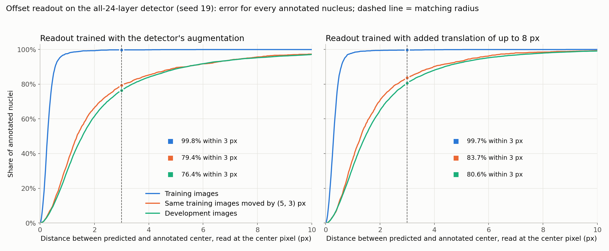
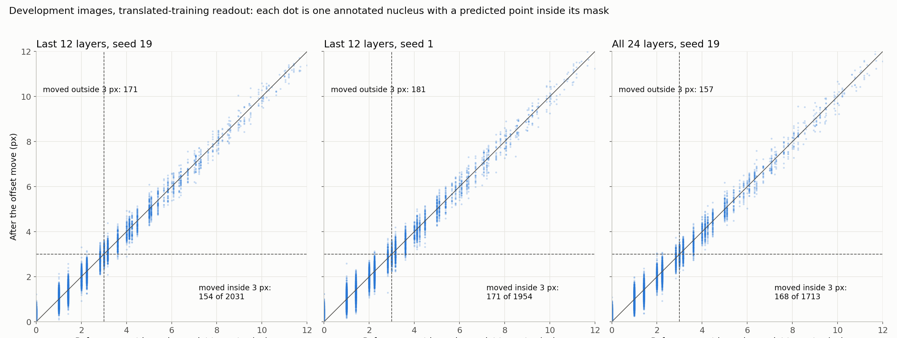
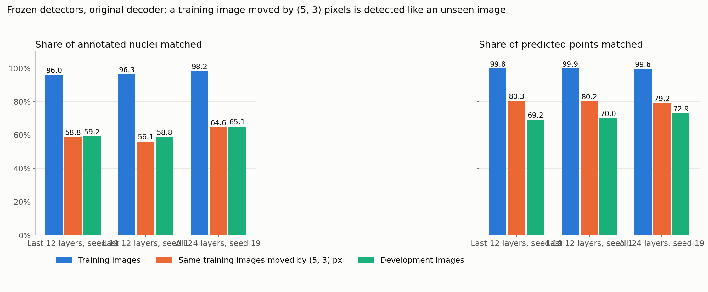
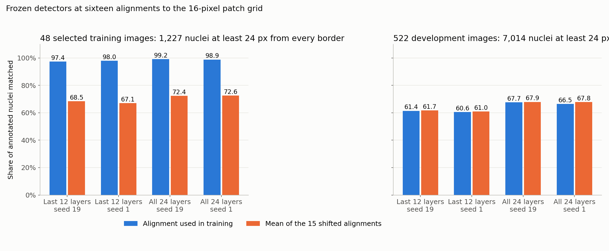
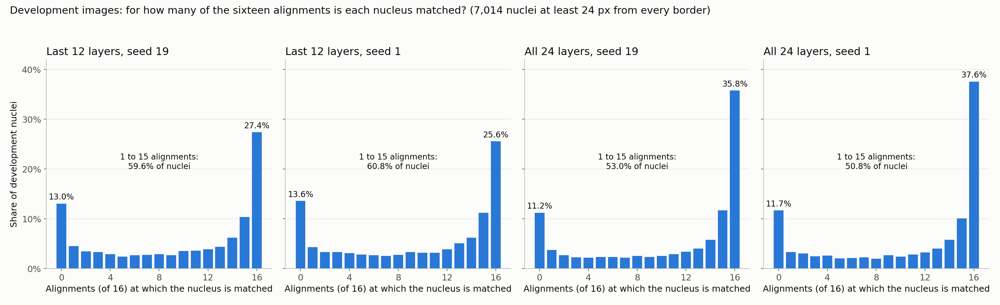
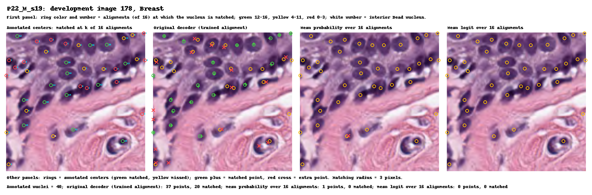
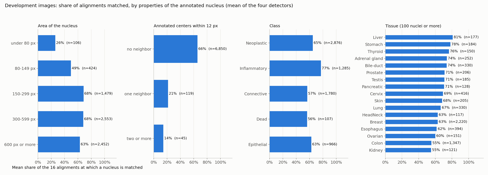

# 核中心检测：位置读出（P34）与十六种网格对齐（P35）的结果，以及下一步实验（P36）

2026 年 11 月 19 日。本文报告两项已完成实验的结果，给出由此得到的数据与网络结构层面的认识，并说明已提交的下一步实验。上一轮的结构分析与 P34 设计见[前一份分析](../center_offset_p34_2026-11-18/README.md)。

> **当前状态：** P34（数组 55855798）三个任务完成、一个任务被时间保护中止；P35（数组 55867961）四个任务全部完成；P36（数组 **55892877**，八个任务）已于 2026-11-19T21:51:49Z 单次提交，22:16Z 排队中。三项实验都在 CPU 节点上运行，检测器全程冻结，没有新的检测器训练。

## 一、任务进度

|作业|内容|资源|状态|
|---|---|---|---|
|55855798|P34：在四个冻结的 P22 检测器上训练位置读出|4 个任务，各 32 核、64 GiB|对照种子 19、对照种子 1、全层种子 19：COMPLETED / 0:0（3 小时 19 分至 4 小时 27 分）；全层种子 1：FAILED / 1:0|
|55867961|P35：四个冻结检测器在十六种网格对齐下推理|4 个任务，各 32 核、64 GiB|四项均 COMPLETED / 0:0（38 至 51 分钟）|
|55892877|P36：八个冻结检测器的逐对齐预测点记录、阈值选择与一致性解码|8 个任务，各 32 核、64 GiB、上限 8 小时|已提交，排队中|

P34 的第四个任务（全部 24 层、种子 1）完成了第一个读出的 12 轮训练。第二个读出的第一轮用时 1,400.3 秒，超过脚本预设的 1,300 秒上限，任务按设计中止；同一节点上此前各轮用时在 507 至 1,063 秒之间波动，其他三个节点为 420 至 710 秒。该检测器没有评估结果，原输出保留。P34 预先固定的主要比较需要两个种子，因此不能按原规则给出通过结论；种子 19 的结果见第二节。

项目 GPU 额度在 11 月 19 日 13:42 UTC 为 1,900 SU 中已记账 1,821 SU，另有其他成员四个 GPU 作业在排队。CPU 额度为 50,000 SU，已记账 2,135 SU；P34 实际使用约 493 SU，P35 约 89 SU，P36 上界 2,048 SU。

## 二、P34 的结果：位置读出不改变检测结果

P34 保持检测器不变，训练一个 73,986 参数的读出模块，为核内每个像素预测指向标注中心的位移，再把检测器给出的每个预测点按该位移移动一次。

**训练图像上读出几乎精确，换一批图像后误差明显增大。** 下图是全层检测器（种子 19）上，在每个标注核的中心像素读出的位置误差的累积分布。

|图像组|误差不超过三像素的核（相同增强的读出）|（加入平移训练的读出）|
|---|---:|---:|
|48 张选定训练图像|99.4%～99.8%|99.5%～99.8%|
|同样的训练图像整体平移 (5, 3) 像素|72.1%～79.4%|79.7%～83.7%|
|522 张开发评估图像|70.6%～76.4%|75.9%～80.6%|

区间为三个检测器的范围。训练图像上的中位误差为 0.28～0.35 像素，开发评估图像上为 1.47～1.84 像素。读出在平移后的训练图像上的表现与在开发评估图像上接近。

**移动预测点带来的新增匹配与丢失匹配数量相当。** 下图每个点是开发评估图像中的一个标注核，横轴是移动前核内最近预测点到中心的距离，纵轴是移动后的距离。

|检测器|原解码：匹配 / 预测点 / 内部死亡核|移动并合并后（加入平移的读出）|新增匹配|丢失匹配|
|---|---|---|---:|---:|
|最后 12 层，种子 19|7,255 / 10,488 / 66|7,240 / 10,485 / 65|158|173|
|最后 12 层，种子 1|7,199 / 10,280 / 61|7,189 / 10,279 / 62|172|182|
|全部 24 层，种子 19|7,979 / 10,945 / 85|7,993 / 10,942 / 83|172|158|

每个检测器有 1,713～2,031 个核，其内部最近的预测点距中心超过三像素；移动后只有 154～171 个进入三像素，同时有 157～181 个原本在三像素以内的点被移出。预测点沿对角线上下散开，说明读出在这些图像上的位置误差与检测器峰值本身的偏差同样大，移动没有带来净收益。全层检测器种子 19 的内部死亡核匹配数由 85 变为 83，未达到原判定条件。

**最重要的观察来自对照组。** P34 为了区分“记住训练图像”和“学会定位”，评估了整体平移 (5, 3) 像素的训练图像。检测器本身（原解码）在这组图像上的表现如下。

三个检测器在训练图像上匹配 96.0%～98.2% 的标注核，同样的图像平移 (5, 3) 像素后只匹配 56.1%～64.6%，与开发评估图像上的 58.8%～65.1% 相当；精度由 99.6%～99.9% 降到 79.2%～80.3%。只统计距离填充边缘 32 像素以上的 1,495 个核，检出率为 64.5%～70.9%，边缘填充只能解释其中一小部分。检测器在训练图像上的高检出率依赖于图像与 16 像素小块网格的特定对齐方式。这促成了 P35。

## 三、P35 的结果：十六种对齐方式

P35 把每张图像沿两个方向各平移 −8、−4、0、4 像素（共十六种，覆盖一个 16 像素小块周期），送入冻结的检测器，再把分数图移回原坐标。以下统计只使用距离图像四边至少 24 像素、在十六种对齐下都完整可见的核，以排除平移造成的边缘截断。

|检测器|训练图像：训练时的对齐|训练图像：其余十五种对齐的平均|开发评估图像：训练时的对齐|开发评估图像：其余十五种的平均|
|---|---:|---:|---:|---:|
|最后 12 层，种子 19|97.4%|68.5%|61.4%|61.7%|
|最后 12 层，种子 1|98.0%|67.1%|60.6%|61.0%|
|全部 24 层，种子 19|99.2%|72.4%|67.7%|67.9%|
|全部 24 层，种子 1|98.9%|72.6%|66.5%|67.8%|

训练图像有 1,227 个这样的核，开发评估图像有 7,014 个。结论有两点。

1. **训练集上的高检出率属于一种对齐方式。** 把训练图像换一种对齐，检出率从 97%～99% 降到 67%～73%，只比开发评估图像高 5 至 7 个百分点。此前各轮报告的“训练集约 98%、开发评估集约 60%”的差距中，绝大部分是检测器对“这张图像在这一种对齐下的样子”的记忆，而不是对组织内容的认识差异。
2. **开发评估图像上没有特殊的对齐方式。** 训练时的对齐与其他对齐的检出率相差不到 1.5 个百分点。

**同一个核在不同对齐下的结果并不一致。**

|检测器（开发评估图像，7,014 个核）|十六种对齐下都未匹配|有时匹配（1～15 种）|十六种都匹配|至少一种对齐下匹配|
|---|---:|---:|---:|---:|
|最后 12 层，种子 19|13.0%|59.6%|27.4%|86.9%|
|最后 12 层，种子 1|13.6%|60.8%|25.6%|86.4%|
|全部 24 层，种子 19|11.2%|53.0%|35.8%|88.8%|
|全部 24 层，种子 1|11.7%|50.8%|37.6%|88.3%|

一半以上的核处于“有时匹配”的状态：平移几个像素，同一个核就在“找到”与“漏检”之间变化。单一对齐下的检出率为 61%～68%，而 86%～89% 的核至少在一种对齐下被匹配。把匹配结果的方差分解到“核之间”和“同一个核的不同对齐之间”，核之间的部分占 58%～63%，其余约四成来自对齐。对 145 个内部死亡核（其中 144 个在全部对齐下可见），原解码匹配 61～85 个，至少一种对齐下匹配的有 109～116 个。

下面是全层检测器（种子 19）在开发评估图像 178 上的记录。第一栏中每个标注核旁的数字是它在十六种对齐中被匹配的次数；第二栏是原解码。

图像上部成片的深染核中，相邻的核被匹配的次数从 1 次到 16 次不等。原解码在这些核上给出的红色叉（额外点）大多位于核内、距中心略超过三像素，与 P34 之前的结构分析一致。

**直接平均十六张分数图不可行。** 平均后在阈值 0.5 下只保留 1,075～1,896 个匹配（原解码 7,199～7,979 个），精度 95%～96%；P35 预先固定的主要比较未通过，这与提交前写下的预期一致。原因可以从“十六种对齐下都匹配”的核上读出：单一对齐下中心附近的最高分数中位数为 0.86～0.90，平均图上降到 0.46～0.50。各对齐下峰的位置相差一两个像素，峰本身又只有一两个像素宽，平均把峰压到了阈值附近。

**哪些核在多数对齐下找不到。**

|分组（开发评估图像，四个检测器平均）|核数|被匹配的对齐比例|十六种都未匹配|
|---|---:|---:|---:|
|面积不足 80 像素|106|26%|43%|
|面积 80～149 像素|424|49%|23%|
|面积 150～599 像素|4,032|68%|10%|
|面积 600 像素以上|2,452|63%|13%|
|12 像素内没有其他标注中心|6,850|66%|12%|
|12 像素内有一个其他中心|119|21%|42%|
|12 像素内有两个以上|45|14%|47%|
|炎症细胞|1,285|77%|7%|
|肿瘤细胞|2,876|65%|12%|
|上皮细胞|966|63%|13%|
|结缔组织细胞|1,780|57%|16%|
|死亡细胞|107|56%|19%|

小核和拥挤的核最难：面积不足 80 像素的核只在 26% 的对齐下被匹配，12 像素内有邻核的核为 14%～21%。按组织看，肝、胃、甲状腺最高（76%～81%），结肠和肾最低（55%）。

## 四、对数据、损失和网络结构的认识

综合 P34、P35 与前一份分析，目前对“训练图像约 98%、开发评估图像约 60%”这一差距有三层认识。

**网络结构。** 编码器把 256×256 的图像切成 16×16 像素的小块，一个核相对小块边界的位置决定了它被编码进哪些向量。训练时每张图像只以一种对齐方式出现（旋转 90 度、翻转都不改变核与小块边界的相对关系类别），检测器因此可以把“这张图像、这种对齐”记下来。P35 证实了这一点：换一种对齐，训练图像的检出率下降 26 至 31 个百分点。

**损失函数。** 精确中心损失只把标注中心一个像素当作正样本。前一份分析推出：位置不确定度超过约 0.95 像素时，损失最优的峰值分数低于解码阈值 0.5。P35 给出了与之对应的测量：同一个核在不同对齐下的峰位置相差一两个像素，平均后的分数恰好落在 0.5 附近。检测器对许多核“知道有核”，但在固定阈值下分数不足。

**数据。** 约 11%～14% 的核在任何对齐下都找不到，它们集中在小核、拥挤的核以及结肠、肾等组织。这一部分与对齐无关，需要从训练数据和标注密度入手。

由此得到两个可以直接检验的问题：阈值 0.5 是否把检测器已经定位到的核排除在外；以及早先加入平移训练的检测器（P15，当时在阈值 0.5 下检出率下降）是否其实消除了对齐依赖、只是分数偏低。P36 检验这两个问题。

## 五、P36：逐对齐预测点记录、阈值选择与一致性解码

设计在提交前写入并固定（科学提交 `a2289cb`，[预先固定的设计与预期](P36_FROZEN_READING.md)）。

**检测器。** 八个已完成 130 轮训练的检测器，使用最后检查点并冻结：P22 的对照（最后 12 层）与全部 24 层，P15 的对照与加入最多 16 像素随机平移训练的检测器，各两个种子。提交前逐一核对了每次训练的配置、数据划分、权重和保存清单。

**测量。** 每张图像在十六种对齐下推理，平移空出的区域分别用白色和镜像内容填充；保存每种对齐下分数不低于 0.1 的全部局部极大值及其原坐标。图像为按图像编号散列固定抽取的 240 张训练图像和全部 522 张开发评估图像。对每个核记录它在哪些对齐下被匹配，以及各对齐下最近预测点相对中心的位移；位移的均方值被分解为“各对齐共有”与“随对齐变化”两部分。

**三种解码。**
- 原解码：训练时的对齐，阈值 0.5。
- 选定阈值：训练时的对齐，阈值取自 0.1 至 0.9。
- 一致性解码：把其余十五种对齐下分数不低于 0.5 的预测点按 2、3 或 4 像素半径归组，至少 v 种对齐参与的组保留，位置取组内各点的平均。

阈值与一致性规则（填充方式、半径、v）只在训练图像样本的十五种平移对齐上、按全部标注核的 F1 分数选择，并在检测器读取任何开发评估图像之前写入磁盘。训练时的对齐不参与选择，因为训练图像在该对齐下几乎被精确重现。

**主要比较。** 全部 24 层的 P22 检测器，一致性解码对原解码，两个种子都满足原判定条件（内部死亡核检出率不低于 0.60，提高不少于 0.05 且成对自助法 95% 区间下限大于 0，精度不低于 0.75 且不比对照低 0.02 以上，总体检出率不比对照低 0.02 以上）。其余比较用于说明机制，包括加入平移训练的 P15 检测器在选定阈值下与其对照的比较。

**提交前写下的预期。** 多数检测器的选定阈值低于 0.5；加入平移训练的检测器在各对齐下表现一致、选定阈值最低；一致性解码带来几个百分点以内的 F1 提高，主要判定条件不一定达到。

|观察到的情形|含义|
|---|---|
|选定阈值低于 0.5，且开发评估图像上 F1 随之提高|固定阈值排除了检测器已定位的核；阈值选择成为解码的一部分。|
|一致性解码同时提高检出率和精度|多对齐组合能找回随对齐变化的漏检；下一步在训练中要求各对齐输出一致。|
|加入平移训练的检测器各对齐一致，且降低阈值后获益最大|平移训练消除了对齐依赖；它在阈值 0.5 下的损失来自分数偏低。|
|位移主要随对齐变化|位置误差来自小块网格；对齐平均可以减小它。|
|位移主要为各对齐共有|位置误差来自图像内容与标注规则；对齐平均无法减小它。|

**提交记录。**

|项目|记录|
|---|---|
|作业|数组 55892877，任务 0～7 依次为 P22 对照种子 19、种子 1，P22 全层种子 19、种子 1，P15 对照种子 19、种子 1，P15 平移训练种子 19、种子 1|
|提交|2026-11-19T21:51:49Z 单次提交；22:16:56Z 八个任务排队中|
|资源|shared 分区，每个任务 32 核、64 GiB、上限 8 小时；CPU 额度上界 2,048 SU|
|源码|科学提交 `a2289cbae92bc78de4a85165835187fafd16a2a0`；530 个文件的封存摘要 `bb2eb30fcd3e406c8954c1e9c508190719f5c76aa3a9fe0f60e4fae34d19d4b1`|
|检查|LM1 上 74 项行为检查通过（其中 19 项为 P36 新增）；真实图像与真实编码器权重的完整流程联调通过（检测头未训练，仅验证代码路径）；八个检测器的身份核对通过|

## 六、作业完成后的工作

1. 核对八个任务的终态与保存清单，回收小型结果，合并两个种子的成对判定。
2. 对照提交前的预期逐条判读：选定阈值、各对齐下的检出率、位移的两部分、一致性解码的增减。
3. 回收固定图像的对照图（每个检测器 19 张），连同统计图写入双语分析。
4. 依据结果确定下一步的训练设计。GPU 额度未补充期间，训练类实验继续按 CPU 节点上的冻结编码器方案设计，或在额度补充后进行。

## 数据范围与口径

全部结果来自 fold 1 的训练与开发评估划分，指标为核中心检测：预测点在标注中心三像素以内并经一对一分配记为匹配。作业在 CPU 上以单精度运行；P35 的原解码与 P34 的单精度原解码在三个共同检测器的 522 张图像上逐图一致，与原保存的 BF16 结果相比有 82～116 张图像的个别计数不同，总量差异在 0.4% 以内。同一个核在十六种对齐下的结果是对同一对象的重复观察。方法进入实例分割评估后，按项目规定使用最后检查点、官方指标实现和三折报告。

## 文件

- [P34 结果数字](P34_RESULTS.json)与[生成脚本](analyze_p34_results.py)
- [P35 结果数字](P35_RESULTS.json)与[生成脚本](analyze_p35_results.py)
- [P35 预先固定的判读](P35_FROZEN_READING.md)、[P36 预先固定的设计与预期](P36_FROZEN_READING.md)、[P36 提交收据](P36_SUBMISSION.json)
- 脚本：[P34](../../../scripts/train_center_offset_p34.py)、[P35](../../../scripts/evaluate_grid_phase_p35.py)、[P36](../../../scripts/evaluate_alignment_consensus_p36.py)；行为检查：[P35](../../../tests/test_grid_phase_p35.py)、[P36](../../../tests/test_alignment_consensus_p36.py)
- [英文版](REVIEW_EN.md)、[中文导读](GUIDE_ZH.md)
