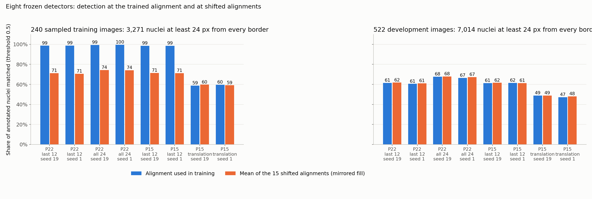
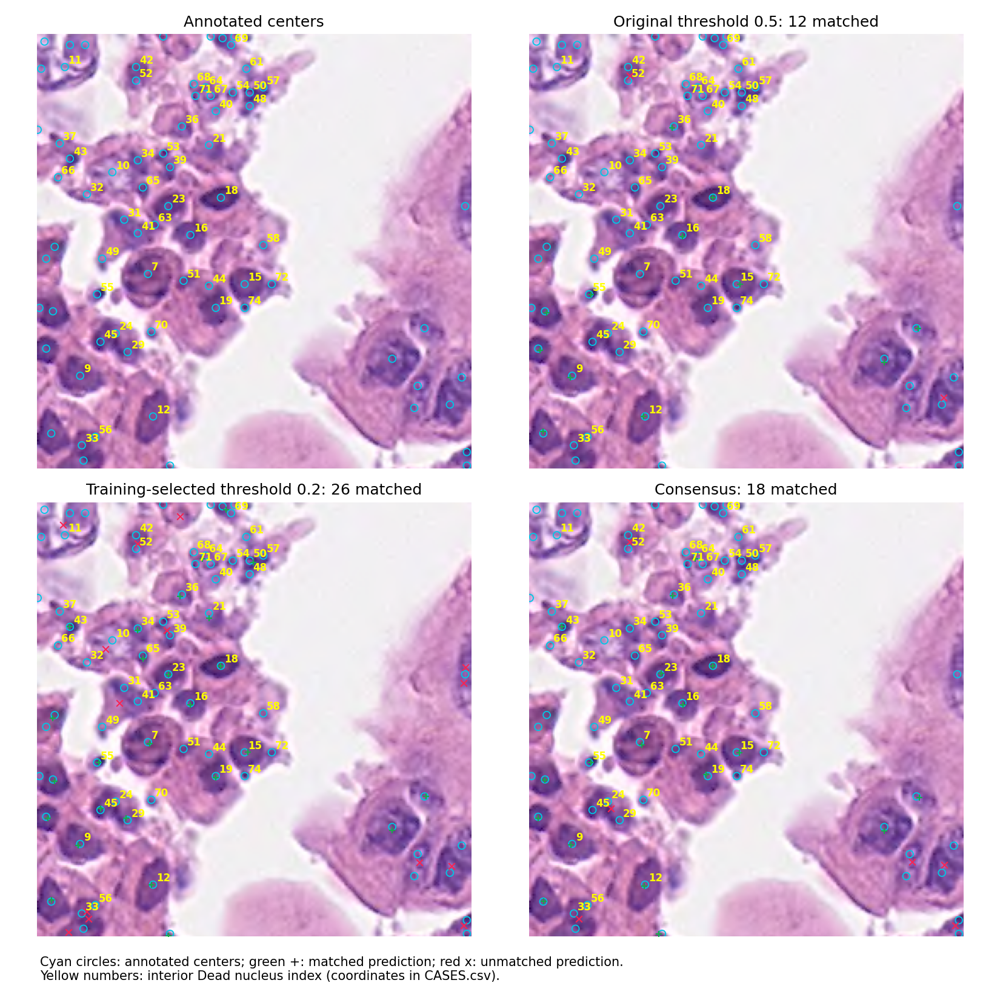
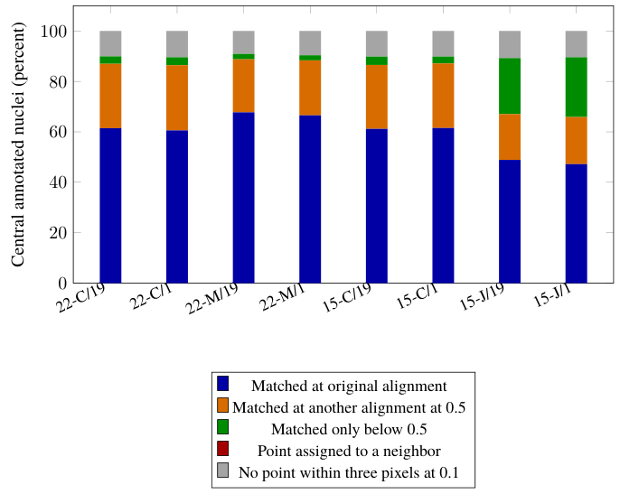

# 中文导读：同一颗核，为什么换个位置就可能找到

本轮先后检验了三个问题：把预测点移动到更准确的位置是否有效；平均多个平移图像的分数是否有效；平移训练模型是否因为分数偏低而被阈值排除。现在又用保存的预测点，把每颗漏检核的情况分开。

八个模型均完成了最新实验，一次保存故障已经补齐。最值得记住的区别是：全层检测器的漏检多受对齐影响，平移训练检测器则有更多核已经定位、分数却低于原阈值。

# 训练图像接近99%，为什么仍会漏检

编码器把图像分成16像素的小块。训练时几乎精确找到的核，换一种与小块网格的对齐方式后，检出率降到约70%。同一张图像、同一颗核，平移几个像素就足以改变预测。

这也是位置读出实验和十六种对齐实验共同给出的线索。移动预测点新增的匹配与丢失的匹配相当；直接平均不同位置的窄分数峰又把峰值压低。后续因此改为汇总点的位置，并独立检查分数阈值。

蓝、橙、绿柱依次比较训练原对齐、训练其他对齐、开发评估其他对齐；后缀为种子。

# 平移训练的模型，为什么降低阈值后找回很多核

平移训练模型在阈值0.5下只找到约38%的标注核，但两个种子在训练图像上都选出了0.2。保持这些选择，在开发评估图像上找到约69%—70%；内部死亡核从44个增加到101、99个。

预测位置没有重新训练，变化来自解码接纳了较低分数的点。与此同时，预测点精度从约86%降到约66%。这说明下一步要解决的是如何保留这些核并抑制额外点。

位置一致性汇总保留的点较少，精度约81%，检出率约52%—53%；它仍只汇总分数0.5以上的点。低分数接纳与多对齐位置支持可以在新的、训练侧固定的设计中一起检验。

# 一张结肠组织图像里的三个具体例子

图中黄色7号核的标注中心为(141,65)，模型原分数0.486，刚好被0.5排除。降至训练侧选出的0.2后能找到；多对齐汇总也找到它，预测点距标注1.90像素。

51号核面积67像素，两个检测器在所有对齐、0.1记录下限下都没有三像素内匹配点。附近55号核更小，只有57像素，平移训练模型却找到它。实际图像与坐标告诉我们：小核确实困难，但不能只用面积解释每一次漏检。

# 剩下的核，需要改进哪一个环节

新诊断将每颗核依次归为原来找到、换对齐找到、接纳低分数后找到、近邻分配竞争、所有对齐下仍无三像素内已记录点。下面仅统计离边缘足够远的7014个核。

全层种子19原来漏掉4271个核，其中2476个换对齐可找到，401个只在低分数下找到。平移训练种子19原来漏掉7479个核，其中2104个换对齐可找到，4141个需要低分数点。两类模型的主要困难不同。

五类互斥结局；统计利用标注核检查点是否可用，分数低于0.1的点没有保存。
下一步应在训练侧独立校准低分数点，并检验位置支持能否减少额外点。训练与开发评估角色、两种子与原判定条件继续保留；本阶段结论来自核中心检测。完整报告另有英文版、详细中文版、坐标表与源码。