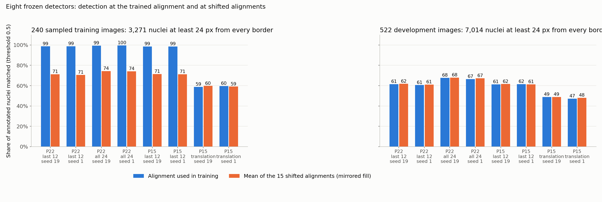
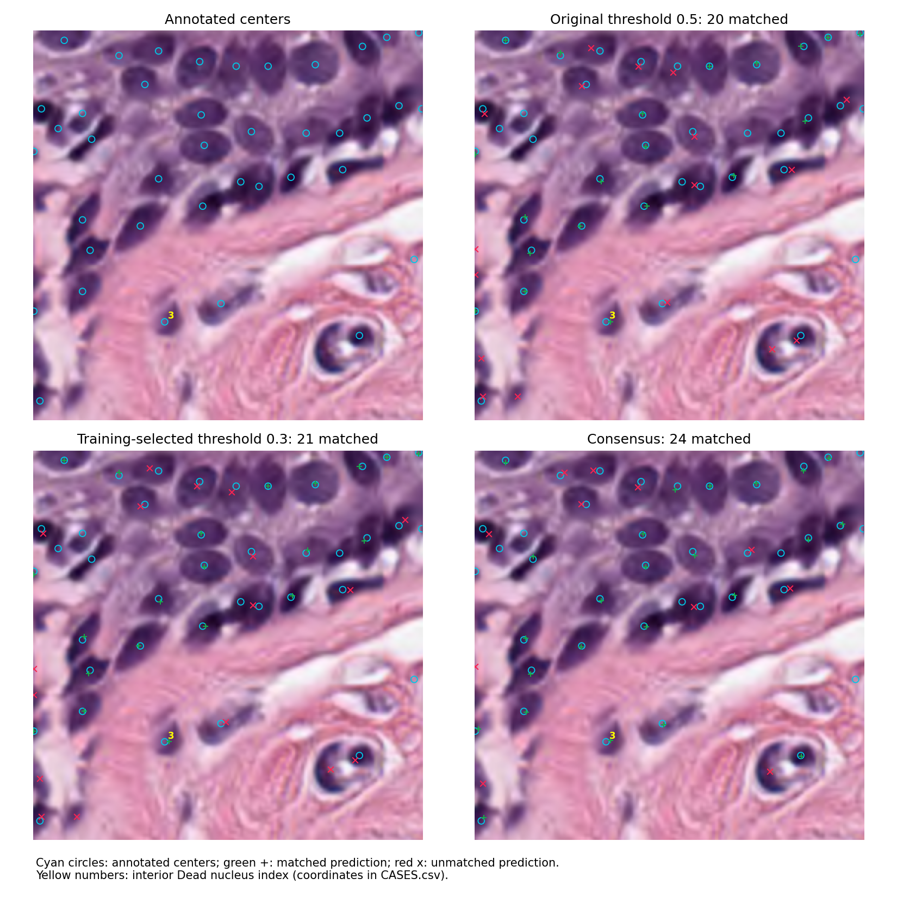
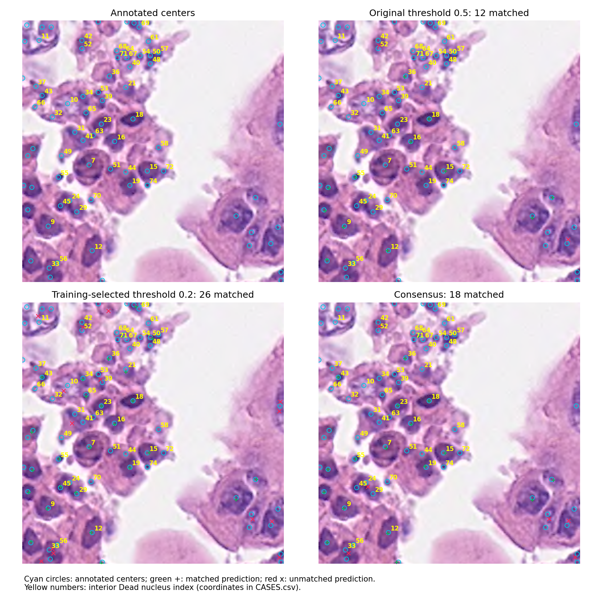
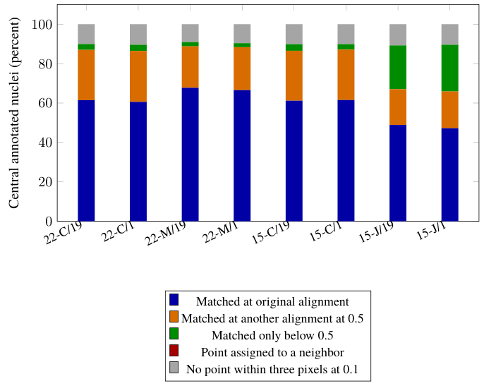
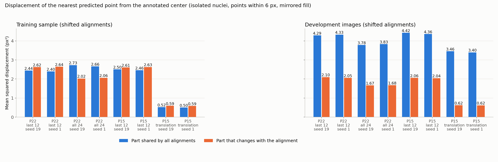

# Stage nine: alignment, score thresholds and nucleus-center detection

November 18–20, 2026. The main finding is that alignment dependence and low prediction scores are distinct failure modes. The all-layer detector benefits most from combining positions across alignments; the translation-trained detector locates many nuclei at scores below the threshold previously used. A fixed diagnostic of preserved predictions now separates these cases object by object.

This report covers the useful sequence of experiments, rather than only the newest result: the earlier translation-trained detector (P15), full-depth adaptation (P22), intermediate-map and interpolation diagnosis (D32/D33), position readout (P34), sixteen aligned score maps (P35), threshold and point consensus (P36), and the new saved-point diagnostic (D37). D32/D33 supply context; P34–D37 are the current stage.

Eight P36 scientific computations completed. Seven array tasks finished normally; P15 translation-trained seed 19 failed during preservation after computation, and preservation-only job 55895127 completed successfully. Eight collection receipts passed; 242 collected files matched their preserved hashes. All paired decisions and the published P36 analysis were independently reproduced. D37 replayed every original, selected-threshold and consensus count per image before partitioning misses. The partial P34 all-layer seed-1 run remains preserved with no completed evaluation.

# Detectors, images and interpretation

All eight detectors use their last checkpoint after 130 training epochs. P22 C updates the last twelve encoder layers, and P22 M updates all twenty-four. P15 C is its own last-twelve control; P15 J was trained with integer translation up to sixteen pixels per axis. Each recipe has seeds 19 and 1. P15 and P22 controls are different training runs and are compared with their own paired experiments.

All measurements use the established fold-1 training/development division: 2,134 training images and 522 development images. P36 samples 240 training images by a fixed hash of their number; these contain 5,581 annotated nuclei. The development set has 12,250 nuclei and 145 interior Dead nuclei. The latter includes apoptotic and necrotic nuclei. Central analyses use 7,014 development nuclei at least 24 pixels from all borders, visible at all sixteen alignments.

A point is matched within three pixels of its annotated center using maximum-cardinality one-to-one assignment. The sixteen alignments move each axis by −8, −4, 0 or 4 pixels. White and mirrored fills are recorded separately. Predictions are returned to original coordinates. Threshold and consensus parameters were selected on shifted training images and written before development images were read; the trained alignment was excluded from selection.

Precision is the share of predicted points matched to an annotation; recall is the share of annotated nuclei matched. F1 is their harmonic mean. These are center-detection measurements from CPU single precision. The original BF16 records are retained separately; this stage uses the single-precision paired controls. Repeated alignments observe the same nucleus and are not independent samples. Three-fold instance segmentation and official PanNuke metrics belong to a later method evaluation.

# Position readout and averaged score maps: what the earlier experiments established

P34 trained a 73,986-parameter position readout while keeping each detector frozen. Three tasks completed; the fourth stopped at the second readout’s first-epoch time guard (1,400.3 seconds against 1,300). No final two-seed all-layer result is available.

The readout places the center within three pixels for 99.4%–99.8% of nuclei on the 48 selected training images, versus 70.6%–80.6% on development images depending on the readout and detector. Moving and merging predicted points adds 158, 172 and 172 matches for the three detectors and loses 173, 182 and 158. Its position error is therefore large enough to undo almost as many valid matches as it creates. Training the readout with translation improves its shifted-image localization, but the final detection changes remain small.

The frozen detector itself matches 96.0%–98.2% on these training images; moving the same images by (5,3) pixels reduces matching to 56.1%–64.6%. P35 extends this observation to sixteen alignments. Among central training nuclei, the original alignment matches 97.4%–99.2%, compared with 67.1%–72.6% at the other fifteen. The central development rates at the original and other alignments remain close, at roughly 61%–68%.

P35 also finds that 86%–89% of central development nuclei are matched at some alignment, while 51%–61% are matched at only some of the sixteen. Directly averaging narrow, displaced score peaks at threshold 0.5 matches only 9%–15% of all development nuclei at 95%–96% precision. The observed peak displacement and score reduction motivate combining point positions and studying thresholds separately.

P36 repeats the alignment comparison on 240 training images. Labels 22-C, 22-M, 15-C and 15-J denote the four defined recipes; the suffix is the seed. Bars use central nuclei and mirrored fill.

# Threshold selection recovers low-score nuclei

The selected threshold is 0.3 for all last-twelve controls and all-layer seed 19, 0.4 for all-layer seed 1, and 0.2 for both translation-trained detectors. These values were selected on shifted training images by F1 over all annotated nuclei, pooling both fills.

The translation-trained detector is the clear change. At threshold 0.5 it matches 4,771/4,600 development nuclei with 86.57%/86.38% precision and 44/44 interior Dead matches. At the training-selected threshold 0.2 it matches 8,463/8,542 nuclei with 66.04%/66.50% precision and 101/99 interior Dead matches. The matched count increases by 3,692/3,942 with no lost original match in the saved-record replay. This gain comes with many new unmatched predictions.

For the all-layer detector, selected thresholds add 293/145 matches and two interior Dead matches in each seed. Their F1 increases by only 0.0034/0.0015. Translation-trained and control models therefore require different score interpretation; the earlier P15 verdict at fixed threshold 0.5 remains part of that original recipe’s history. The new decoder answers a different, explicitly training-selected question.

The translation-trained model’s threshold-selected training F1 is about 0.795/0.796, while development F1 is 0.675/0.681. Translation reduces the special advantage of the original alignment; a substantial training-to-development gap still remains.

|Recipe / seed|Cutoff|Matched / points|Dead / 145|Recall|Precision|F1|
|---|---:|---:|---:|---:|---:|---:|
|22-C/19|0.3|7,622 / 11,430|76|62.22%|66.68%|0.6438|
|22-C/1|0.3|7,606 / 11,324|69|62.09%|67.17%|0.6453|
|22-M/19|0.3|8,272 / 11,677|87|67.53%|70.84%|0.6914|
|22-M/1|0.4|8,078 / 11,173|86|65.94%|72.30%|0.6897|
|15-C/19|0.3|7,569 / 11,463|77|61.79%|66.03%|0.6384|
|15-C/1|0.3|7,707 / 11,454|66|62.91%|67.29%|0.6503|
|15-J/19|0.2|8,463 / 12,814|101|69.09%|66.04%|0.6753|
|15-J/1|0.2|8,542 / 12,846|99|69.73%|66.50%|0.6807|

# Combining point positions: useful gains and the remaining tradeoff

Consensus groups points scoring at least 0.5 from the fifteen shifted alignments around a highest-scoring point, then averages their positions. Every detector selects radius four pixels. Last-twelve controls select four or six contributing alignments; the all-layer detectors select five or six; both translation-trained detectors select one. The number is relative to alignments valid at that position.

All-layer seed 19 gains 1,163 matches and loses 871, a net 292; seed 1 gains 1,096 and loses 825, a net 271. Interior Dead matches change from 85 to 99 and 84 to 89. Precision changes from 72.90% to 73.63% and 73.43% to 72.29%. The primary two-seed criteria remain unmet: the precision floor is 75%, and seed 1’s Dead gain is 5/145 with a paired interval spanning zero (−0.0204 to 0.1000).

The translation-trained consensus raises recall from 38.95%/37.55% to 52.86%/52.24%, while retaining precision above 80%. It gains 1,826/1,906 nuclei and loses 122/107. Its one-alignment rule reflects less complementary variation among its predictions, compared with detectors trained at one alignment. The threshold-selected decoder has much higher recall; the consensus still discards all phase points scoring below 0.5.

|Recipe / seed|Cutoff|Matched / points|Dead / 145|Recall|Precision|F1|
|---|---:|---:|---:|---:|---:|---:|
|22-C/19|0.5|7,671 / 11,050|84|62.62%|69.42%|0.6585|
|22-C/1|0.5|7,917 / 11,543|94|64.63%|68.59%|0.6655|
|22-M/19|0.5|8,271 / 11,233|99|67.52%|73.63%|0.7044|
|22-M/1|0.5|8,204 / 11,348|89|66.97%|72.29%|0.6953|
|15-C/19|0.5|7,628 / 10,963|80|62.27%|69.58%|0.6572|
|15-C/1|0.5|7,681 / 10,957|81|62.70%|70.10%|0.6620|
|15-J/19|0.5|6,475 / 8,006|71|52.86%|80.88%|0.6393|
|15-J/1|0.5|6,399 / 7,863|69|52.24%|81.38%|0.6363|

# Breast image 178: following individual nuclei

The four panels use the all-layer detector, seed 19: annotated centers, original decoder, threshold 0.3 selected on training images, and selected consensus. The image has 20 original matches, 21 at the lower threshold and 24 with consensus. Cyan circles mark annotated centers; green plus signs are matched points, red crosses are unmatched predictions. Yellow indices identify interior Dead nuclei.

Object 23, an epithelial nucleus at (y,x)=(71,38), has an original peak score 0.202 within three pixels. Neither threshold 0.5 nor 0.3 retains that peak. Four shifted alignments match it, and the consensus position is (69.33,38.33), 1.70 pixels from the annotation. Combining shifted positions therefore recovers this object.

Interior Dead object 3 at (191,86), area 286 pixels, is retained in all three decoders. Its original peak score is 0.926; the consensus point is 2.97 pixels from its center, close to the three-pixel boundary. More views can move a valid point closer to the matching boundary as well as rescue a miss.

# Colon image 1482: score loss, recovery and persistent misses

This figure uses the translation-trained detector, seed 19. Matching rises from 12 nuclei at threshold 0.5 to 26 at selected threshold 0.2; consensus matches 18. The central strip contains many adjacent small annotated nuclei; the full coordinates and assignments are retained.

Dead object 7 at (141,65), area 504 pixels, has an original center-neighborhood peak score 0.486. Threshold 0.5 removes it; threshold 0.2 retains it. Twelve shifted alignments match it, and consensus places a point 1.90 pixels from its annotation. Here score threshold and alignment both account for recovery.

Dead object 51 at (145,86), area 67 pixels, remains missed by both detectors. Neither detector has a recorded original peak at or above 0.1 within six pixels, and no alignment matches it at recording floor 0.1 within three pixels. A nearby small object, 55 at (153,35), area 57 pixels, is found by the translation-trained model (score 0.575; consensus distance 1.11 pixels) and missed by the all-layer model. Small area is associated with difficulty across the dataset; these two objects show that area alone cannot explain each outcome.

# D37: an exclusive partition of the remaining misses

The new diagnostic uses preserved P36 points without another model forward pass. In order, each nucleus is: matched originally; missed originally but matched at another alignment at 0.5; matched only after admitting scores down to the recording floor 0.1; near a point assigned elsewhere; or without a recorded point within three pixels at any alignment. Both fills and both data roles are analyzed. Lower thresholds can alter assignment to neighboring nuclei, so the partition uses the stated priority rather than assuming identical per-object assignments.

For all-layer seed 19, of 4,271 original misses, 2,476 (58.0%) are matched at another white-filled alignment at 0.5, 401 (9.4%) only below 0.5, two involve competition, and 1,392 (32.6%) have no recorded point within three pixels. For translation-trained seed 19, of 7,479 original misses, 2,104 (28.1%) are alignment-recoverable and 4,141 (55.4%) require lower scores; 1,234 (16.5%) have no recorded point within three pixels. Seed 1 repeats the contrast.

The central-only chart below removes the border strip. The annotations are used to ask whether a matching point exists at any alignment; this availability statistic is separate from the selected decoder. A score below 0.1 is not stored, and a peak farther than three pixels belongs to the last category even when it is inside the nucleus.

Exclusive states for 7,014 central development nuclei; white fill. Full all-nucleus counts are below.

|Recipe / seed|Original|Other alignment|Low score|Competition|No nearby point|
|---|---:|---:|---:|---:|---:|
|22-C/19|7,255|2,875|536|1|1,583|
|22-C/1|7,199|2,893|521|1|1,636|
|22-M/19|7,979|2,476|401|2|1,392|
|22-M/1|7,933|2,493|354|2|1,468|
|15-C/19|7,255|2,849|574|1|1,571|
|15-C/1|7,285|2,894|498|1|1,572|
|15-J/19|4,771|2,104|4,141|0|1,234|
|15-J/1|4,600|2,178|4,267|1|1,204|

# Position variation: reduced jitter, persistent shared displacement

For isolated central nuclei with a point within six pixels in at least two shifted alignments, P36 separates squared displacement into an alignment-varying component and a shared component. With mirrored fill, last-twelve detectors have about 2.04–2.10 squared pixels of variation and 4.29–4.42 of shared displacement. All-layer detectors have 1.67/1.68 and 3.78/3.83. Translation-trained detectors have 0.62/0.62 and 3.46/3.40.

Translation training reduces the alignment-varying quantity by roughly 70% relative to its own controls. The shared displacement remains larger. Averaging views can reduce variation, but it cannot remove a common offset. This explains why stable predictions need not coincide with the annotation.

The shared estimate is the squared mean offset minus the within-alignment sample variance divided by the number of observed points. This is a descriptive moment decomposition of deterministic shifts, not a causal attribution of the offset to image content or annotation noise. It also conditions on a nearby retained point; the translation-trained subset contains about 4,500 nuclei versus roughly 6,300 in the other models, so the cross-model comparison is not based on identical retained objects.

Development images, mirrored fill: same radius, isolation rule and estimator for each detector. The differing retained-object subsets are stated above.

# Research decisions, reproducibility and remaining work

The useful findings now separate three mechanisms. First, changing alignment recovers many misses of the all-layer detector; point-position consensus is more suitable than averaging narrow probability peaks. Second, translation training reduces alignment variation and lowers scores, making decoder calibration part of evaluating that recipe. Third, about 9%–10% of central development nuclei still lack a recorded point within three pixels at any alignment at 0.1 in the all-layer and translation-trained detectors. Those objects require further image and response analysis, with small and crowded nuclei as concrete subgroups.

The next method experiment should couple training-selected score calibration with positional support: P36 selects a lower threshold for single-view decoding, but its consensus always starts at 0.5. A separate frozen design should compare calibrated low-score consensus with the existing P36 rule, choose parameters only on a training calibration subset separated by image, and keep both seeds, last checkpoints and original development criteria. No development threshold will be deployed from the descriptive curves. No new detector training, mask expansion or test-fold evaluation was run in this task.

D37 code and the fixed design were committed before its calculation. The first replay omitted images with no annotated nuclei from the object table; a focused regression and a corrected replay retain their unmatched predictions. The failed output and log remain preserved. Final focused validation: 33 passed, including inherited alignment behavior. D37 replays all three decoders on 240 training and 522 development images for all eight models. Source, hashes, full object records, eight fixed image figures, selected case responses and build instructions are retained.

P34’s incomplete all-layer seed-1 evaluation and independent external checkpoint archiving remain recorded tasks. A future completion of P34 requires its own explicit recovery design and resource check. GPU allocation queries now differ from earlier accounting snapshots; this task uses CPU saved-record analysis, preserving the budget uncertainty. The report PDFs are compiled from the accompanying LaTeX, with statistical charts generated by PGFPlots and actual tissue images embedded as raster evidence.