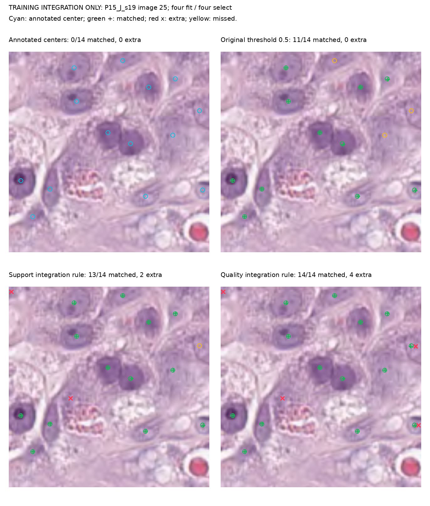

# Calibrating candidate quality before combining center positions

November 20, 2026. Expanse CPU job **55918618** was submitted once and completed in **291 seconds / ExitCode 0:0** on exp-1-27. All eight models, eight fixed-image PNGs and 140 outputs passed preservation. Thirty-one node tests and 192 independent analytical checks passed.

For translation-trained detectors, quality calibration removes 676/377 extra predictions versus support-only filtering, raising precision to 71.99%/70.17%. The original precision condition is 75%. Against the calibrated paired controls, interior Dead recall rises by 8.28/9.66 percentage points with positive paired intervals. Full-depth detectors have a different precision/recall tradeoff; every fixed comparison is retained.

The experiment uses eight frozen P36 point records. It separates 120 training images for learning candidate quality from 120 for selecting the filter, then evaluates the unchanged procedure on all 522 development images. A support-only filter provides a direct control. Both seeds and the original matching/decision rules are retained.

- [Detailed English review](REVIEW_EN.md)
- [详细中文分析](REVIEW_ZH.md)
- [中文导读](GUIDE_ZH.md)
- [Frozen, reproducible protocol](FROZEN_DESIGN.md)
- [Actual submission and validation record](P38_SUBMISSION.json)
- [Current complete stage-nine reports and fixed-result images](../alignment_results_2026-11-20/README.md)

## Formal images and coordinates

[Full P38 results](P38_RESULTS.json), [every per-image comparison](PER_IMAGE_COUNTS.json), [fixed cases](FIXED_CASES.json), [measured candidate responses](CASE_RESPONSES.json), [independent verification](INDEPENDENT_VERIFICATION.json). Eight final PNGs:

- [P15_J_s19_0178.png](figures/P15_J_s19_0178.png)
- [P15_J_s19_0776.png](figures/P15_J_s19_0776.png)
- [P15_J_s19_1037.png](figures/P15_J_s19_1037.png)
- [P15_J_s19_1482.png](figures/P15_J_s19_1482.png)
- [P22_M_s19_0178.png](figures/P22_M_s19_0178.png)
- [P22_M_s19_0776.png](figures/P22_M_s19_0776.png)
- [P22_M_s19_1037.png](figures/P22_M_s19_1037.png)
- [P22_M_s19_1482.png](figures/P22_M_s19_1482.png)

## Training implementation preview

The eight-image training integration produced [this preview](figures/TRAINING_INTEGRATION_PREVIEW_0025.png). It verifies matching overlays and image export using four fitting and four selection images. Its coefficients and rules are discarded before the formal P38 run. In image 25, the integration preview shows 11 original matches, 13 under the support filter and 14 under the quality filter, out of 14 nuclei; the filters also add two and four unmatched points. This makes the gain/extra-point tradeoff visible without selecting a development image.



Existing formal P36/D37 images remain preserved: [breast tissue, all-layer detector](../alignment_results_2026-11-20/figures/P22_M_s19_development_0178.png), [colon tissue, translation-trained detector](../alignment_results_2026-11-20/figures/P15_J_s19_development_1482.png), [decoder comparison](../alignment_results_2026-11-20/figures/p36_decoders.png) and [exclusive miss outcomes](../alignment_results_2026-11-20/figures/d37_partition.png). P38 saved all eight fixed development-image panels and complete group/object coordinates. Full original outputs remain preserved on Expanse; the analytical bundle returned to LM1 and Windows.

## Reproduction and continuation

Scientific source commit: `bd70fbefb2acf739249a0b8c1654eea54aecf03f`. The 534-file source seal and launcher/design digests are in the submission record. Portable command:

```bash
PYTHONPATH=src:scripts python scripts/evaluate_calibrated_consensus_p38.py \
  --root <verified-P36-results> --out <new-output-directory> \
  --images <original-fold1-images.npy>
```

The CPU job requests four cores, 8 GiB and two hours; upper allocation envelope 8 CPU SU. It makes no detector forward pass. Completion, the all-rule selection barrier, old-decoder replay, eight final PNGs and preservation hashes were verified. Per-image aggregates and all original paired decisions independently reproduced within 10^-12. Preserve the first failed precheck and the second stopped attempt; there was exactly one actual SLURM submission. P34 all-layer seed-1 final evaluation and independent external checkpoint archiving remain outstanding.
