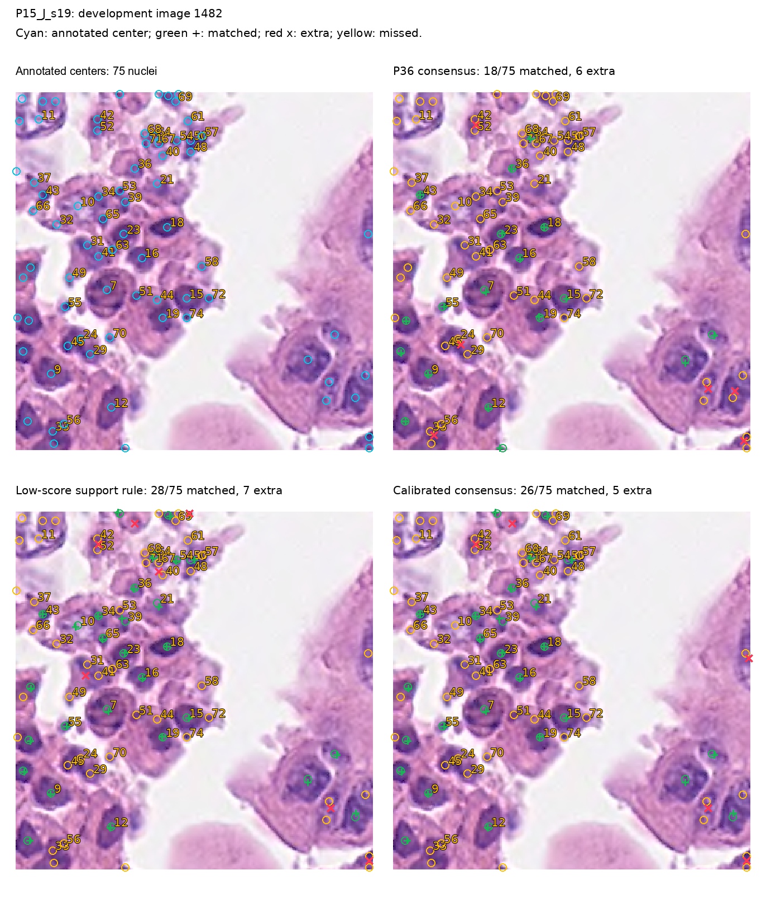
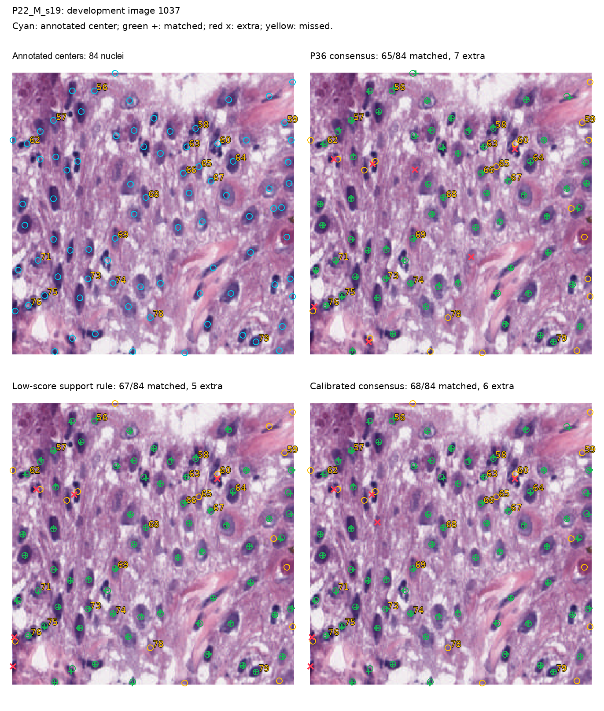

# Current progress, completed P38 results and the next center-detection question

P38 completed in 291 seconds. Quality calibration reduced extra predictions in the translation-trained detectors, giving 71.99%/70.17% precision; the original precision criterion is 75%. All eight models and eight fixed result figures were preserved.
November 20, 2026. The completed work now supports a concrete distinction between position errors and low prediction scores. P38 tests whether these observations can improve candidate selection on frozen detector outputs. [The fixed protocol](FROZEN_DESIGN.md) defines every training-calibration choice and comparison.

## What the useful sequence established

The earlier P15 translation-trained detector and P22 all-layer detector are useful complementary cases. P15 originally looked unfavorable at a fixed threshold of 0.5. P22 increased interior Dead detection substantially but its original recall/precision decision remained unmet. D32 and D33 subsequently located displaced peaks inside annotated nuclei and showed that interpolation and threshold interpretation affect measured center detection. These results motivated position analysis rather than another unstructured encoder ablation.

P34 trained a small position readout on frozen detectors. Three of four tasks finished; all-layer seed 1 stopped at a first-epoch time guard and has no completed evaluation. Moving and merging points gained 158–172 matched nuclei but lost 158–182. Training localization was much stronger than development localization. This makes a further readout run a lower-priority question than improving selection of already observed points.

P35 measured sixteen alignments to the detector's 16-pixel patch grid. On central training nuclei, matching fell from about 97%–99% at the trained alignment to 67%–73% at other alignments. Development matching was roughly 61%–68% across these alignments. Averaging displaced narrow score peaks retained only about 9%–15% of development nuclei at threshold 0.5. Averaging point positions therefore has a clearer experimental basis than averaging the score maps under that threshold.

P36 completed the eight scientific computations. Seven array tasks ended normally; the eighth failed while preserving completed outputs. A separate preservation job completed successfully, and the subsequent eight collection receipts and 242 recovered files passed verification. The trained threshold for P15 translation-trained detectors was 0.2. This raised interior Dead matching from 44/44 to 101/99 out of 145, while precision fell from about 86% to 66%. Positional consensus retained precision above 80% in that recipe but had much lower recall. P22 all-layer consensus raised Dead matches from 85/84 to 99/89, with precision 73.63%/72.29%. These observations expose a candidate-quality problem alongside positional complementarity.

D37 reproduced all three existing decoders image by image and separated the remaining misses. In all-layer seed 19, 2,476 of the 4,271 original misses were recoverable at another alignment at score 0.5; 401 required lower scores; 1,392 had no recorded point within three pixels at any alignment at the recording floor 0.1. In translation-trained seed 19, the corresponding counts were 2,104, 4,141 and 1,234 among 7,479 misses. Annotation competition accounts for the small remainder. Both seeds show the same qualitative distinction.

The [stage-nine reports and actual fixed images](../alignment_results_2026-11-20/README.md) provide the detailed evidence. Breast image 178 illustrates recovery of a low original response through aligned positions. Colon image 1482 includes a Dead nucleus whose score 0.486 is removed at 0.5 but recovered at the training-selected threshold, alongside an unresolved small nucleus. Those cases motivate the next question without selecting images for their outcomes.

## Architectural interpretation and the testable question

A patch-based encoder with positional information and a spatial readout need not be exactly equivariant to integer translation. Changing the image's position relative to its patch grid can therefore change both the output location and score. P35/P36 measure this effect in the implemented detector. They do not isolate a single layer as its cause.

Represent a recovered point's displacement as a shared offset plus a component that varies with alignment. Averaging observed positions can reduce the varying component, while a shared offset remains. In P36's retained isolated-nucleus subsets, translation training reduced alignment variation by about 70% relative to its controls; shared displacement remained larger. Consequently, agreement among views supplies useful candidate evidence but cannot guarantee an accurately centered nucleus. The observations also condition on having recorded nearby points and use different retained-object subsets across models.

The center-loss analysis in the previous stage showed that uncertainty in the center location can reduce the optimal peak score. The translation-trained detector's useful low-score points are consistent with that explanation, but the experiments have not separated uncertainty, training distribution and loss calibration as causal mechanisms. P38 tests the practical implication: a raw score and positional support may jointly rank candidate correctness better than either alone.

P38 retains peaks down to the existing floor 0.1 and groups shifted positions at radius four. It compares two filters on identical group positions: support alone, and a six-input logistic quality score combining raw scores, support and dispersion. One half of the 240 training images fits the quality score; the other half selects a cutoff under a 75% precision condition. The same image membership is used for every detector, and all eight selections are saved before opening development records. Ground truth supplies fitting labels and evaluation assignments; deployed candidate features use predictions alone.

The primary comparison pairs the P15 translation-trained detector with its original P15 control under the calibrated procedure in both seeds. P22 all-layer versus its paired control is secondary. Within-model comparisons with support-only, original and P36 decoding reveal whether a gain comes from admitting low scores, adding a quality model or changing the detector recipe. Preserve all comparisons and the original decision; no additional threshold is chosen from development outcomes.

These image-separated subsets calibrate a detector trained on those images. Their role is fitting and selection separation, and the 522 development images measure transfer of the frozen procedure. A later independent dataset and official three-split segmentation evaluation would address broader transfer once the center method is established. The current measurements concern center detection, including apoptotic and necrotic nuclei in the Dead category.

## P38 completed: the measured benefit and the remaining transfer problem

Job 55918618 completed successfully in 291 seconds on exp-1-27. All eight detectors were evaluated; 31 compute-node checks passed, eight fixed-image PNGs were written and 140 products passed preservation. The 4.12 MB analytical bundle contains full per-image metrics and fixed-case coordinates. An independent replay using NumPy 2.3.5 reproduced all per-image aggregates, training-selected rules and sixteen original paired decisions within 10^-12: 192 checks passed. The compute environment remained pinned at NumPy 1.23.5.

For the translation-trained detector, quality filtering removes 676/377 unmatched predictions relative to support-only filtering. Matched nuclei change by -166/+4, and precision rises from 68.23%/67.92% to 71.99%/70.17%. Interior Dead matches change from 105/101 to 98/99 of 145. The quality model therefore improves candidate selection in this recipe, with a recall cost in seed 19.

Against the P15 controls under the same calibrated procedure, interior Dead recall increases by 0.08276/0.09655, with paired 95% intervals [0.04167,0.11176]/[0.03032,0.14556]. The precision values remain below the fixed 75% condition. The primary decision is false; no threshold is changed after this measurement. Compared with P36's high-score consensus, calibration retains 1,334/1,627 more nuclei while increasing unmatched predictions by 1,507/1,948. Compared with P36's low single-view threshold, it reduces unmatched predictions but retains fewer nuclei.

For all-layer detectors, calibrated filtering changes matched counts by +489/+117 and unmatched predictions by +984/+175 versus support-only filtering. Precision falls from 75.86%/73.48% to 70.58%/72.61%. The six-feature score is therefore not a universal improvement over the support control. All fixed primary and secondary decision records are retained in P38_RESULTS.json; all sixteen decisions are false.

The table uses all 522 development images/12,250 nuclei. Dead columns count interior Dead nuclei out of 145. Each detector has its own paired control and independently selected calibration rule.

C denotes each experiment's own control; M denotes full-depth adaptation and J translation training. The suffix identifies the seed.

|Detector / seed|Original Dead|Support-only Dead|Calibrated Dead|Calibrated recall|Calibrated precision|
|---|---:|---:|---:|---:|---:|
|P22_C_s19|66|86|87|62.87%|70.11%|
|P22_C_s1|61|94|86|64.87%|67.69%|
|P22_M_s19|85|92|95|68.62%|70.58%|
|P22_M_s1|84|89|89|66.67%|72.61%|
|P15_C_s19|73|90|86|64.09%|67.37%|
|P15_C_s1|58|91|85|64.41%|68.10%|
|P15_J_s19|44|105|98|63.75%|71.99%|
|P15_J_s1|44|101|99|65.52%|70.17%|

## Fixed images: what the filters retain and delete

In colon image 1482 with the translation-trained detector, P36 consensus matches 18 of 75 nuclei, support filtering 28, and quality filtering 26; unmatched points are 6, 7 and 5. Dead object 7 at (y,x)=(141,65) is recovered. Its nearest group has all fifteen alignments, quality score 0.91579 and a center distance of 1.89 pixels. Dead object 10 at (81,44) has a position only 1.69 pixels from its annotation and eleven supporting alignments, but quality score 0.30811 falls below the selected cutoff 0.5. The support rule keeps this correct candidate and the quality filter deletes it. Object 51 at (145,86), area 67 pixels, remains missed; its closest grouped position is 20.14 pixels away. These are measured group positions and fitted quality scores, not raw detector peak scores.

In lung image 1037 with the all-layer detector, object 78 at (222,125), area 78 pixels, was found by the original decoder. The new group is just 0.25 pixels away, but only four of fifteen alignments support it and its quality score is 0.19840. Both new filters delete the valid nucleus. By contrast, colon image 1482 contains object 43 at (73,19), area 89 pixels: seven supporting alignments and quality score 0.39413 keep the group under cutoff 0.35, while the nine-vote support rule rejects it. Calibration can thus rescue a weakly supported correct candidate and remove another correctly located candidate. CASE_RESPONSES.json and FIXED_CASES.json retain the coordinates and selection states.

All eight fixed images are retained. The other cases are [breast 178, all-layer](figures/P22_M_s19_0178.png), [colon 776, all-layer](figures/P22_M_s19_0776.png), [colon 1482, all-layer](figures/P22_M_s19_1482.png), [breast 178, translation-trained](figures/P15_J_s19_0178.png), [colon 776, translation-trained](figures/P15_J_s19_0776.png) and [lung 1037, translation-trained](figures/P15_J_s19_1037.png). Published headings clarify that the first panel contains annotated centers; raw compute-node figures remain preserved and the label-only changes have separate hashes.

## What this changes in the architectural plan

The selected translation-model cutoffs achieve 86.31%/85.34% precision on the image-separated training selection subset but 71.99%/70.17% on development images. Separating the quality fitting and selection images prevented reuse within the calibrator; it did not make them independent of the trained detector. Score calibration transfers incompletely. The measured false-positive reduction supports keeping the candidate-quality question, while the deleted correctly centered groups show why replacing every original prediction is costly.

The next method should preserve credible original predictions and learn the marginal value of supplementary candidates. Its training labels should identify additions that recover previously unmatched nuclei, with duplicate candidates and extra predictions counted explicitly, rather than treating all grouped candidates as interchangeable. Before new detector training, a saved-group diagnostic should distinguish retained extra points inside an annotated nucleus, duplicates, and background points, and compare score-conditioned correctness between training and development images. These measurements decide whether the next representation needs morphology features, a displacement correction or an uncertainty-aware center loss. This next design is a proposal; P38 itself is complete and the frozen rule is unchanged.

## Execution and follow-up

P38 uses the saved records on Expanse CPU nodes. It requests one four-core/8-GiB/two-hour job, a conservative 8-SU CPU envelope. The November 20 live query returned GPU spending 1,519 of 1,900 SU and CPU spending 1,547 of 50,000 SU. GPU accounting differs from the November 18 snapshot and will need reconciliation before any GPU proposal. This experiment needs no GPU or model forward pass.

The output includes complete group and annotation coordinates, fitted parameters, both image membership lists, selection grids, paired decisions and eight fixed-image PNGs. Source, input and preservation hashes are recorded. After completion, examine gained and lost nuclei together: a high-support displaced cluster can remove a valid original match, while a low-score but well-supported group can recover one. Report changes for small and crowded nuclei and by tissue using the preserved object tables.

P34's incomplete seed-1 task and independent external checkpoint archiving remain outstanding. The next architecture experiment, if candidate selection proves useful, should test alignment consistency and uncertainty-aware center representation while controlling inference cost. It requires its own frozen design and resource check.
