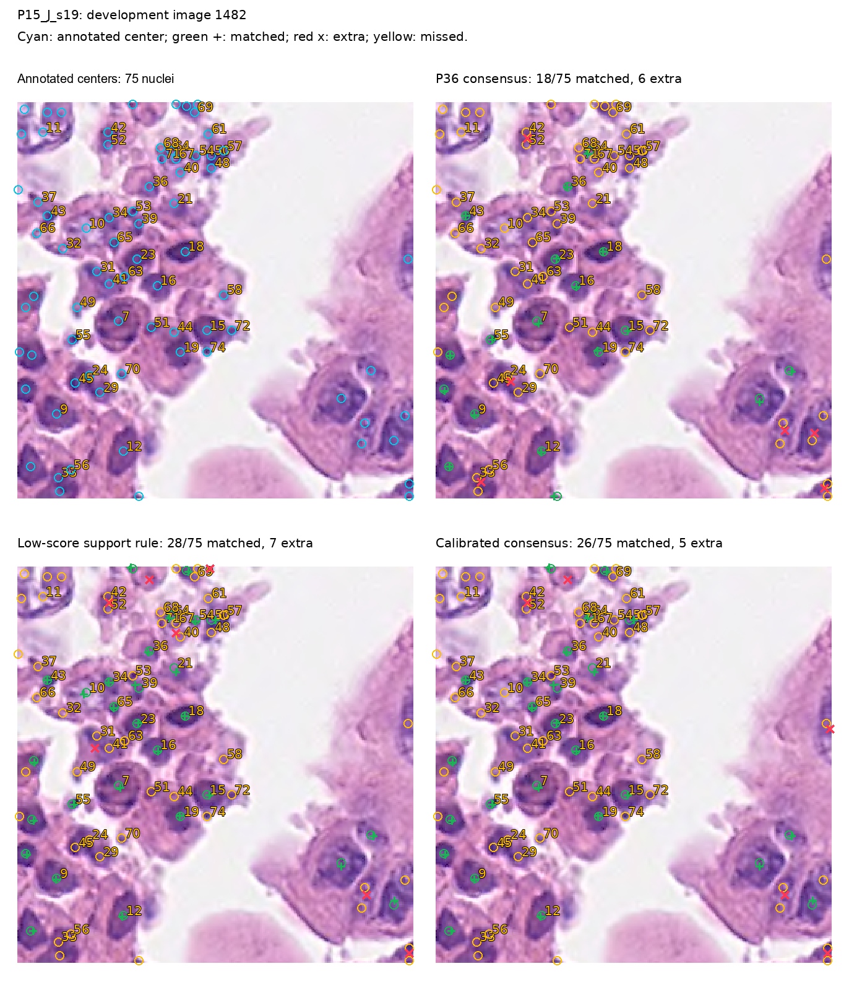
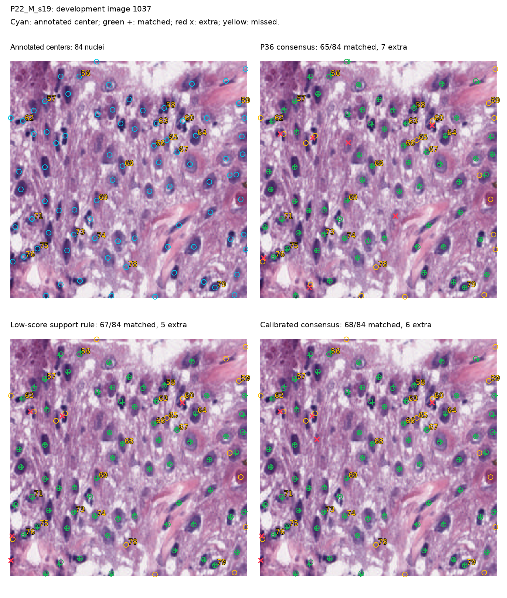

# 当前进度、P38 实测结果与下一步中心检测研究

P38 已在 291 秒内完成。质量评分减少了平移训练模型的额外点，精度为 71.99%/70.17%，原定标准为 75%；八个模型与八张正式结果图均已保存核验。
2026 年 11 月 20 日。最新结果把两个问题区分开了：有些核在不同图像对齐位置下才被找到；另一些核已经产生接近标注中心的预测点，但分数低于原阈值。下一步 P38 复用已有预测记录，检验预测分数、位置一致性和跨对齐支持是否能共同改善候选点筛选。[完整冻结方案](FROZEN_DESIGN.md)给出了数据划分、模型、选择规则和判定标准。

## 已完成的有效实验链

较早的 P15 在训练时加入整数平移，P22 则让全部编码器层参与适配。P15 在固定 0.5 阈值下的结果不理想；P22 明显提高了内部死亡核的检出数量，但精度与召回的联合条件尚未满足。随后 D32/D33 保存中间分数图，发现不少预测峰仍位于核的标注区域内，却偏离三像素中心匹配范围；插值顺序和分数解释也影响最终检出。这些观察把研究重点引向了位置与候选点筛选。

P34 在冻结检测器后训练一个小型位置读出模块。四项任务完成三项，全层模型种子 1 在首轮时间检查后中止，仍缺完整评估。三个完成模型在移动并合并预测点后新增了 158～172 个匹配，同时丢失 158～182 个原有匹配。训练图像上的定位明显优于开发评估图像，因此当前证据更支持先研究已有候选点的筛选，暂缓追加位置读出训练。

P35 系统改变图像相对于 16 像素图块网格的位置。在距边界至少 24 像素的训练核中，原对齐位置的匹配率约 97%～99%，其他对齐位置约 67%～73%；开发评估图像各位置约 61%～68%。把这些位置下的狭窄分数峰直接平均，再使用 0.5 阈值，仅保留约 9%～15% 的开发评估核。不同位置的峰会错开，直接平均分数容易降低峰值；先提取点再汇总位置更符合已观察到的结果。

P36 八个模型的科学计算均已完成。原数组七项正常结束，另一项在结果保存阶段失败，单独的保存任务已成功补齐；后续八份回收收据与 242 个文件核验通过。平移训练模型在训练图像上选择的阈值为 0.2，内部死亡核匹配数从两种子的 44/44 增至 101/99，总数为 145；精度由约 86% 降至约 66%。原位置汇总方法维持了超过 80% 的精度，但召回低得多。全层模型的位置汇总将死亡核匹配从 85/84 提高到 99/89，精度为 73.63%/72.29%。因此，提高候选覆盖之后，仍需区分可信预测与新增额外点。

最新 D37 已逐图重现三种原解码，并把漏检划为互斥结局。全层模型种子 19 的 4,271 个原始漏检中，2,476 个可以在其他对齐位置以 0.5 分数找到，401 个需要更低分数，1,392 个在所有对齐位置、记录下限 0.1 和三像素范围内都没有预测点。平移训练模型的 7,479 个原始漏检中，相应数量为 2,104、4,141、1,234。其余极少数涉及相邻标注之间的匹配竞争，种子 1 重现了相同趋势。

[阶段报告九](../alignment_results_2026-11-20/README.md)保存了更完整的双语分析和固定图像。乳腺组织图像 178 展示了其他对齐位置如何补回原响应较弱的核；结肠组织图像 1482 同时包含原分数为 0.486、被 0.5 阈值删除后又恢复的死亡核，以及仍未找到的小核。下一轮继续使用固定图像与逐对象坐标，连同新增匹配、丢失匹配和额外点一起分析。

## 理论与架构解释

以图块为输入、包含位置编码并通过空间读出产生中心分数的模型，通常不会严格保持整数平移前后的输出一致性。图像内容相同，相对于图块网格的位置变化仍可能改变预测坐标与分数。P35/P36 已测量当前实现中的这种变化；目前尚未把它归因到某一层。

可以把一个核的预测偏移分为两部分：各对齐位置共同保留的偏移，以及随对齐位置变化的偏移。汇总多个位置可以减少后一部分，但共同偏移仍会存在。P36 在有近邻预测的孤立核子集中发现，平移训练相对于其自身对照降低了约 70% 的对齐位置变动，而共同偏移更大。因此，多次预测位置稳定提供了候选质量信息，却不能自动保证预测位于标注中心。不同模型进入该分析的核子集也不同。

上一阶段的中心损失分析表明，中心位置存在不确定性时，最优分数峰可能降低。平移训练模型产生有用的低分数预测点，与这一解释相容；现有实验仍未区分位置不确定性、训练分布和损失校准各自的因果作用。P38 检验其中可直接测量的推论：原始分数结合跨位置支持与位置离散程度，能否比单独使用支持数更有效地筛选正确候选。

## P38 的具体方法

使用已有记录中不低于 0.1 的预测点，在十五个平移对齐位置上按四像素半径分组，固定镜像填充。每个对齐位置只保留组内最高分点，避免同一位置的多个峰重复贡献证据；输出坐标取这些点的位置均值。两个筛选方法共享完全相同的候选组：对照仅按支持比例筛选，实验方法使用六个输入的逻辑回归质量评分，输入为最高与平均分数、有效对齐位置的支持比例、位置离散程度和分数分布。

把 P36 的 240 张训练图像按固定图像编号哈希分为两组：120 张学习质量评分，另 120 张选择保留规则。选择时在精度至少 75% 的条件下最大化整体 F1；没有满足条件的非空结果时，明确记录选择失败。所有八个模型的规则先保存，再读取开发评估预测并按冻结规则计算。这里的图像分离针对质量模型拟合与规则选择；这两组图像都曾用于检测器训练。

主要比较是平移训练模型与它自身的 P15 对照，二者使用相同校准过程、保留种子 19 和 1。全层模型与其 P22 对照是次要比较。每个模型还分别比较校准方法与支持数对照、原始解码及 P36 位置汇总。这样可以分清收益来自低分数点的加入、质量评分，还是检测器训练方式。开发评估结果不参与选择新的阈值。

所有评估继续使用原三像素一对一最大匹配、组织分层的成对图像自助法和原双种子联合标准。死亡核包括凋亡与坏死核。当前数据是反复使用的 fold-1 中心检测开发评估；下一步方法明确后，再单独规划独立数据与正式三划分实例分割验证。

## P38 已完成：筛选收益与仍存在的迁移差距

作业 55918618 在 exp-1-27 上以 0:0 正常完成，用时 291 秒。八个检测器全部评估，计算节点 31 项检查通过，八张固定图像生成，140 个产物通过保存校验。回收的 4.12 MB 分析包包含完整逐图指标和固定对象坐标。使用 NumPy 2.3.5 独立重算全部逐图汇总、训练选择规则和十六项原成对判定，与计算节点结果在 10^-12 内一致，共 192 项核验；计算环境保持固定的 NumPy 1.23.5。

对平移训练模型，相比仅按支持数筛选，质量评分分别减少 676、377 个额外预测点；匹配核数量变化为减少 166 个、增加 4 个。精度由 68.23%/67.92% 提高到 71.99%/70.17%，内部死亡核匹配从 105/101 变为 98/99，总数为 145。因此，该模型的候选筛选有所改善，但种子 19 付出了召回代价。

与使用同样校准过程的 P15 对照相比，内部死亡核召回提高 0.08276/0.09655，组织分层的成对 95% 区间为 [0.04167,0.11176]/[0.03032,0.14556]。精度仍低于固定的 75% 条件，主要判定为 false，结果读取后未调整阈值。相比 P36 的高分数位置汇总，新方法多保留 1,334/1,627 个核，也增加 1,507/1,948 个额外预测；相比 P36 的低阈值单图解码，额外点减少，核覆盖也下降。

全层模型的情况不同。相比支持数对照，质量评分新增 489/117 个匹配核，同时增加 984/175 个额外点；精度由 75.86%/73.48% 降至 70.58%/72.61%。六个输入的质量评分没有在各模型上稳定优于简单支持数筛选。十六项原判定全部保留，均为 false。

下表使用全部 522 张开发评估图像、12,250 个核。死亡核列均以 145 个内部死亡核为总数，各模型使用自身的训练选择规则与配对对照。

C 指各实验自身的对照，M 为全层适配，J 为平移训练；s19/s1 指种子 19/1。

|模型 / 种子|原始死亡核|支持数死亡核|校准死亡核|校准整体召回|校准整体精度|
|---|---:|---:|---:|---:|---:|
|P22_C_s19|66|86|87|62.87%|70.11%|
|P22_C_s1|61|94|86|64.87%|67.69%|
|P22_M_s19|85|92|95|68.62%|70.58%|
|P22_M_s1|84|89|89|66.67%|72.61%|
|P15_C_s19|73|90|86|64.09%|67.37%|
|P15_C_s1|58|91|85|64.41%|68.10%|
|P15_J_s19|44|105|98|63.75%|71.99%|
|P15_J_s1|44|101|99|65.52%|70.17%|

## 固定图像中的新增与丢失核

结肠组织图像 1482 中，平移训练模型的 P36 位置汇总找到 75 个核中的 18 个，支持数筛选找到 28 个，质量评分筛选找到 26 个，额外点分别为 6、7、5。位于 (y,x)=(141,65) 的死亡核 7 被恢复：最近候选组得到十五个对齐位置支持，质量评分 0.91579，距标注中心 1.89 像素。死亡核 10 位于 (81,44)，候选位置仅偏离 1.69 像素，并得到十一个对齐位置支持，但质量评分 0.30811 低于所选 0.5 阈值。支持数筛选保留了这一正确候选，质量评分删除了它。面积 67 像素的核 51 位于 (145,86)，仍被漏检，最近的候选组中心距它 20.14 像素。这里的质量评分来自新学习的候选模型，与原始检测器中心分数是不同的量。

肺组织图像 1037 中，全层模型原解码已经找到面积 78 像素、中心为 (222,125) 的核 78。新候选组距离仅为 0.25 像素，但只得到四个对齐位置支持，质量评分为 0.19840，因此两个新筛选方法都删除了它。另一方面，结肠图像 1482 中面积 89 像素、位于 (73,19) 的核 43 得到七个位置支持，质量评分 0.39413，高于全层模型所选的 0.35 阈值，能够保留；需要九个支持位置的对照规则却将它删除。校准既能补回支持较弱的正确候选，也可能丢失位置准确的核，完整坐标与状态见 CASE_RESPONSES.json 和 FIXED_CASES.json。

八张固定图像全部保留。其余图像为[乳腺 178，全层模型](figures/P22_M_s19_0178.png)、[结肠 776，全层模型](figures/P22_M_s19_0776.png)、[结肠 1482，全层模型](figures/P22_M_s19_1482.png)、[乳腺 178，平移训练模型](figures/P15_J_s19_0178.png)、[结肠 776，平移训练模型](figures/P15_J_s19_0776.png)、[肺 1037，平移训练模型](figures/P15_J_s19_1037.png)。首栏标题明确标注中心数量；计算节点原始图像保留，标题澄清单独记录哈希，图像与预测位置保持一致。

## 下一步架构与实验规划

平移训练模型在用于选择规则的训练图像上达到 86.31%/85.34% 精度，而开发评估精度为 71.99%/70.17%。质量模型拟合与规则选择已按图像分离，但这两组图像都参与过检测器训练，校准关系仍未充分迁移。额外点减少说明候选质量值得继续研究；真实核被删除说明整体替换原预测还会损失已有有效信息。

下一方法优先保留可信原预测，再学习补充候选的边际收益。训练标签应明确指出哪些新增点恢复了原本漏检的核，并把重复候选与额外预测列入代价。新增训练之前，先用保存的候选组诊断额外点是否仍落在某个标注核内、是否重复已有检出、是否位于背景，并比较训练与开发图像按分数条件化后的正确率。这些结果将决定需要加入形态信息、修正位置，还是采用表示中心不确定性的监督。该下一方案尚处于规划，P38 已完成，冻结规则保持原值。

## 执行、保存与后续

P38 通过 Expanse 的 SLURM 使用 CPU 计算节点，申请一个任务、四个 CPU 核、8 GiB 内存、两小时，保守 CPU 额度上限为 8 SU。复用保存点，无检测器前向计算。最新官方查询为 GPU 已记账 1,519/1,900 SU、CPU 已记账 1,547/50,000 SU；GPU 数字与 11 月 18 日记录不同，后续 GPU 规划前需要核对账目。

输出保存模型系数、两组图像编号、选择网格、全部逐图指标、候选组坐标与分数、逐标注对象的匹配变化，以及八张固定图像 PNG。完成后重点检查新找到与丢失的核：位置一致但共同偏移的组仍可能造成错误；分数较低而支持较充分的组可能恢复原漏检。按组织、小死亡核与拥挤程度分层分析，所有坐标都能回溯。

P34 缺失的种子 1 完整评估及大检查点的独立外部归档仍保留为待办。如果 P38 的候选筛选带来稳定收益，下一项架构实验应研究如何通过训练时的对齐一致性与中心不确定性表示保留收益，并减少部署所需的多次前向计算；该问题另行冻结实验方案。
