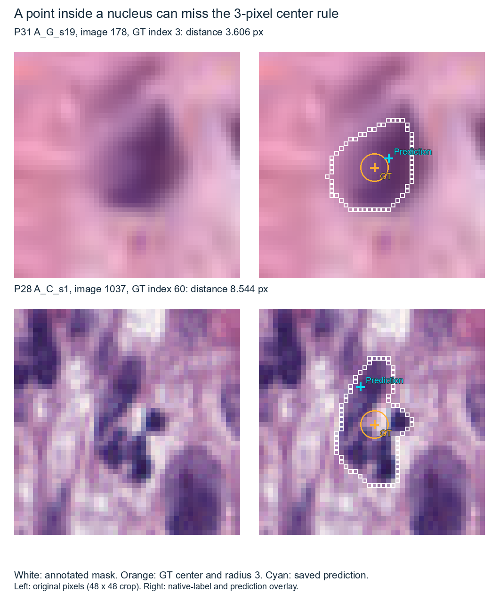
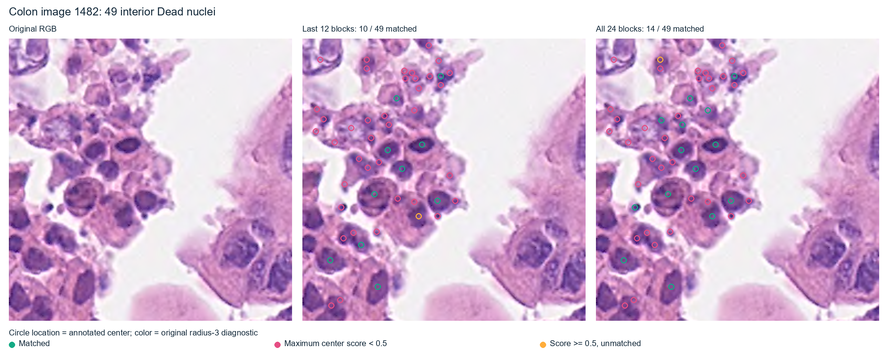

# Existing-model center diagnostics, November 17, 2026

P31 completed four 130-epoch runs. This review connects the latest native-label audit and model-theory analysis to D32, a fixed twelve-model inference experiment.

- [Detailed Chinese plan](PLAN_ZH.md)
- [Detailed English plan](PLAN_EN.md)
- [Chinese reader](GUIDE_ZH.md)
- [Frozen machine-independent selection](SELECTION.json)
- [Figure provenance](FIGURE_PROVENANCE.json)
- [Earlier P27–P31 stage report](../../report/stage_report_8/README.md)

The preserved images below come from existing last-checkpoint outputs and native labels. They provide the evidence used to choose the diagnostic questions. D32 intermediate-map figures will be saved by the new job and analyzed after completion.

The examples show predictions inside an annotated nucleus that remain more than three pixels from its representative center. Coordinates and the original masks define this distinction.

Colon1482 contains all eleven small crowded interior Dead nuclei in the development subset. Image identity, morphology, crowding and appearance are correlated; the displayed responses motivate measuring actual coarse and fine maps.

The portable runner is `scripts/diagnose_proposal_center_maps.py`; supply an ignored JSON manifest with the existing run/data/weight paths. The experiment saves original logits, feature arrays, complete peak decisions, object and shift tables, and large PNG panels. The corresponding behavior checks are `tests/test_center_map_diagnostics.py`.
