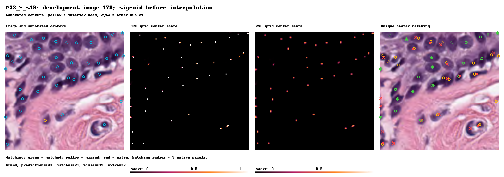
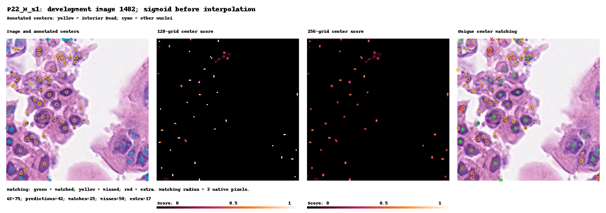

# D33: fixed interpolation-order intervention and completed results

The design was fixed in scientific commit 5bf69a3 after D32 and before job submission. It uses all twelve D32 models, all eleven development images with 145 interior Dead nuclei, and the same saved label-selected training maps. The eleven development images contain 488 annotated nuclei of all classes. Model weights and original development decisions remain fixed.

The two conditions are `sigmoid(U(z))`, the original operation, and `U(sigmoid(z))`, the fixed counterfactual. Here U is the existing bilinear interpolation with align_corners=False. Coarse and fine values come from verified D32 arrays; score arithmetic uses FP32. Local-maximum size 3, threshold 0.5, top-512 cap and unique radius-three matching are unchanged. The original condition must reproduce every stored image count and retained point order exactly. No network inference or optimizer update is performed.

For a single coarse peak surrounded by score 0.01 background, the counterfactual requires peak score at least (8-7*0.01)/9 = 0.8811 to cross 0.5, compared with approximately 0.9727 in the logit-interpolation construction. Sigmoid is nonlinear and therefore does not commute with interpolation. This is a controlled output-operation change; it can also change peak locations and create competing nearby predictions. If every coarse contributor to the center region has negative logit, their scores are below 0.5 and their weighted average remains below 0.5.

Job **55839942** was submitted once at **2026-11-18 08:29:32 EST**. It completed with exit 0:0 in **237 seconds**. CPU resources: four cores, 16 GiB and one hour, no GPU. Fresh CPU allocation was 50,000 SU, spent 1,547, with no queued CPU reservation at submission; the submission used a conservative 16-SU upper bound. Node checks: **21 passed in 6.23 seconds**. All twelve original count replays passed. **180 alternate-output PNGs** and complete maps/records were preserved and verified: **546 files, 188,525,908 bytes**. [Receipt](D33_SUBMISSION.json), [analysis](D33_ANALYSIS.json), [geometry](D33_GEOMETRY.json), and [raw object transitions](evidence/d33_object_transitions.csv).

|Model|Dead matches|Gained/lost Dead|All matches change|Extra points change|Selected-image precision|
|---|---:|---:|---:|---:|---:|
|P22_C_s19|67 → 80|14/1|+20|+91|76.00% → 63.41%|
|P22_C_s1|62 → 70|9/1|+23|+64|74.67% → 65.67%|
|P22_M_s19|85 → 89|5/1|+13|+161|76.53% → 56.50%|
|P22_M_s1|82 → 90|8/0|+17|+122|78.88% → 62.07%|
|P29_C_s19|65 → 78|14/1|+22|+45|74.30% → 68.26%|
|P29_C_s1|67 → 76|11/2|+22|+75|74.87% → 64.56%|
|P29_B_s19|81 → 83|2/0|+9|+26|77.81% → 73.62%|
|P29_B_s1|80 → 82|4/2|+9|+30|75.12% → 70.52%|
|P31_C_s19|65 → 75|12/2|+23|+55|74.62% → 67.09%|
|P31_C_s1|68 → 72|4/0|+14|+72|74.87% → 64.46%|
|P31_G_s19|73 → 84|11/0|+22|+28|77.06% → 73.29%|
|P31_G_s1|70 → 77|7/0|+18|+44|77.30% → 70.70%|

All twelve models gain 2–13 Dead matches, while selected-image precision falls in every model. The largest gain is accompanied by additional predictions; extra-point changes range from +26 to +161. These are paired intervention results on the same eleven images, with repeated model observations of the same nuclei.

Across all twelve conditions, extra points increase by 813: +491 inside the correct nucleus within radius three but unassigned, +137 inside nuclei beyond radius three, and +185 outside annotated masks. Thus multiple nearby predictions on already detected objects account for 60.4% of the added extra-point observations. There are 25 complete equal-score 2-by-2 clusters under the counterfactual and zero under the original outputs. Complete 2-by-2 clusters describe part of the broader nearby-competition pattern; the measured +491 is not attributed entirely to those 25 clusters.

This is the same image and model as the preserved D32 counterpart. Red points can include nearby outputs competing for a nucleus already represented by one matched point. The point tables retain each output and assignment, so this behavior can be traced rather than inferred from the heatmap alone.

Colon image 1482 illustrates a separate weak-response case. Instance 69 at (y=29,x=92), area 40, has coarse-support maximum logits -6.84375 and -15.3125 in the P22 control and full-depth seed-1 models. Its fine radius-three maxima are -7.58008 and -22.47266. A change of interpolation order leaves these wholly subthreshold contributors unable to produce a qualifying center score. The native labels and object tables distinguish this case from an already strong in-mask displaced peak.

The resulting research question is how to learn stable, distinct center peaks while preserving background rejection. A future training design should compare one explicitly defined spatial center-supervision rule with the original exact-center loss, retaining the same encoder, sample exposure, seeds, optimization and full development criterion. It needs a unique-object interpretation, unchanged background control and evidence of real gradients/updates before a 130-epoch experiment. The earlier P5 refinement and P11 positive-mass redistribution are distinct tested recipes whose negative results remain relevant controls. D33 supports studying the learning objective and peak geometry; its selected-image intervention retains the original full-development gate.
