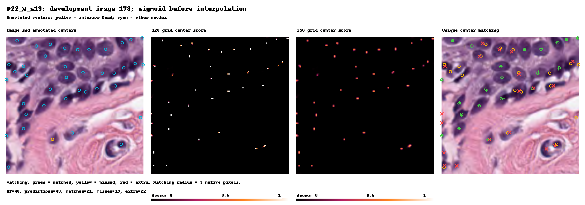
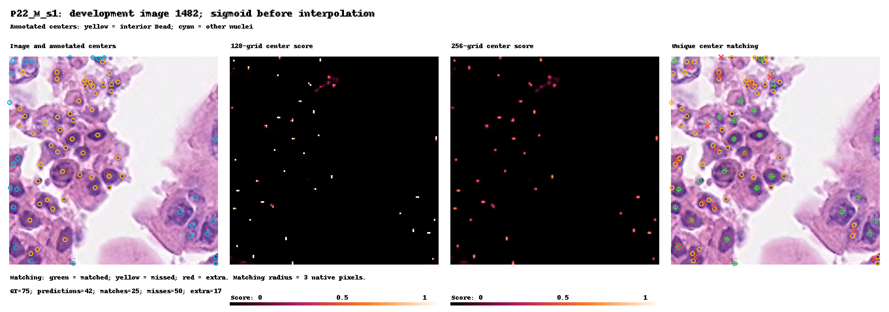

# D33：固定插值顺序对照与已完成结果

本设计在 D32 结果之后、作业提交之前由科学提交 5bf69a3 固定。使用 D32 的全部十二个模型、十一张含内部死亡核的开发评估图像，以及同一组已保存的标注分层训练图像。十一张开发图像共有 488 个标注核，其中内部死亡核 145 个。原模型权重与开发判定保持固定。

两个条件分别为原来的 `sigmoid(U(z))` 和固定对照 `U(sigmoid(z))`；U 是原来的双线性插值，align_corners=False。粗细预测值来自核验后的 D32 数组，分数计算使用 FP32。局部极大值窗口、0.5 阈值、最多 512 点和三像素内唯一匹配均保持原样。原条件必须逐图重现保存的计数与保留点排序。任务直接处理数组，没有网络推理或优化更新。

周围背景分数为 0.01、粗网格只有一个峰的例子中，对照需要至少 `(8-7×0.01)/9≈0.8811` 的粗网格峰分数，才会达到插值后 0.5；原来的预测值插值构造约需 0.9727。sigmoid 为非线性函数，与插值交换顺序会改变输出，也可能改变峰位置并产生竞争预测。若中心区域对应的全部粗网格预测值均为负，其分数都低于 0.5，插值加权平均也保持低于 0.5。

任务 **55839942** 于 **2026 年 11 月 18 日 08:29:32 EST** 单次提交，已 **COMPLETED / 0:0**，实际用时 **237 秒**。申请四个 CPU 核、16 GiB、一小时，不使用 GPU。提交时 CPU 总额度为 50,000 SU，已记账 1,547 SU，无其他排队 CPU 预留；采用 16 SU 的保守申请上界。节点 **21 项检查在 6.23 秒内通过**，十二个原条件计数全部准确复现。**180 张对照 PNG** 与完整数组、记录已保存核验，共 **546 文件、188,525,908 字节**。[收据](D33_SUBMISSION.json)、[分析](D33_ANALYSIS.json)、[几何分解](D33_GEOMETRY.json)及[原始逐对象变化](evidence/d33_object_transitions.csv)均保留。

|模型|死亡核匹配|新增/丢失死亡核|总体匹配变化|额外点变化|固定十一图的精度|
|---|---:|---:|---:|---:|---:|
|P22_C_s19|67 → 80|14/1|+20|+91|76.00% → 63.41%|
|P22_C_s1|62 → 70|9/1|+23|+64|74.67% → 65.67%|
|P22_M_s19|85 → 89|5/1|+13|+161|76.53% → 56.50%|
|P22_M_s1|82 → 90|8/0|+17|+122|78.88% → 62.07%|
|P29_C_s19|65 → 78|14/1|+22|+45|74.30% → 68.26%|
|P29_C_s1|67 → 76|11/2|+22|+75|74.87% → 64.56%|
|P29_B_s19|81 → 83|2/0|+9|+26|77.81% → 73.62%|
|P29_B_s1|80 → 82|4/2|+9|+30|75.12% → 70.52%|
|P31_C_s19|65 → 75|12/2|+23|+55|74.62% → 67.09%|
|P31_C_s1|68 → 72|4/0|+14|+72|74.87% → 64.46%|
|P31_G_s19|73 → 84|11/0|+22|+28|77.06% → 73.29%|
|P31_G_s1|70 → 77|7/0|+18|+44|77.30% → 70.70%|

十二个模型分别增加 2～13 个死亡核匹配，同时精度均下降，额外点增加 26～161 个。这里是同一组十一张图像上的成对操作对照；模型之间重复观察相同对象。

合计新增 813 次额外点观察，其中 491 次位于对应核内且距离中心不超过三像素，但没有获得唯一分配；137 次位于核内并偏离三像素范围，185 次在标注核外。已检出核附近的多重输出因此占新增额外点的 60.4%。原输出没有完整同分 2×2 点团，对照出现 25 个。这些完整点团只覆盖近中心竞争现象的一部分，不能将全部 491 次变化都归于这 25 个点团。

该图与保存的 D32 对应图使用相同模型和图像。红色点可以包括同一已检出核附近的额外输出；逐点坐标和分配记录支持直接追踪这些变化。

结肠图像 1482 中还存在另一类弱响应。实例 69 的中心为 `(y=29,x=92)`，面积 40 像素；P22 对照与全层种子 1 的粗网格贡献区域最大值分别为 −6.84375、−15.3125，细网格三像素邻域最大值为 −7.58008、−22.47266。这些完全低于阈值的粗网格贡献通过改变插值顺序仍无法产生合格中心分数。原生标注和对象表将它与“核内已有强峰但位置偏移”的情况分开。

据此，后续研究问题应收敛为：在保持背景抑制的同时，学习位置稳定、彼此可区分的中心峰。新的训练设计应只比较一种明确的空间中心监督与原精确中心损失，保持同一编码器、样本曝光、种子、优化器及完整开发判定。设计需要明确每个对象的唯一解释、保留背景对照，并在 130 轮实验前验证真实梯度和更新。P5 网格细化及 P11 正样本质量重分配是不同的已测试配方，其负结果继续作为设计背景。D33 为学习目标和峰形研究提供测量依据，原完整开发判定保持固定。
