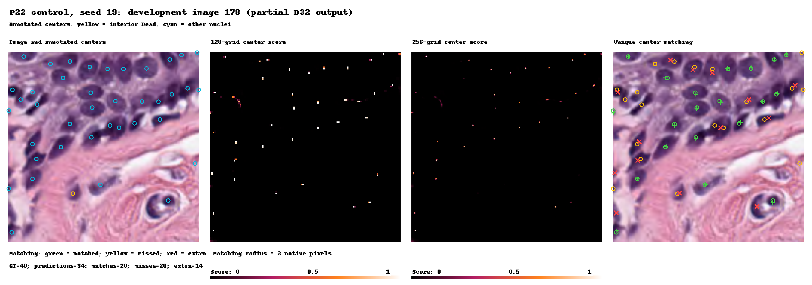

> **最新状态：** D32 恢复任务 55839400 已 COMPLETED / 0:0，十二模型诊断与 180 张图片保存核验完成；下一步是固定插值顺序对照 D33。

# 这一轮接着解决什么问题

训练已经能找到绝大多数训练核，但开发评估图像仍有明显漏检。最近几轮给出了不同线索：全层适配更有利于孤立死亡核；前后层联合适配的收益分散在更多图像中；检测头归一化改善训练优化，开发图像的收益较小。因此，下一步先检查这些模型究竟在哪里失去目标。

昨晚的诊断任务在生成第一张图片时遇到绘图库缺失。原日志和部分中间结果已经保存；绘图已改用环境已有的 Pillow，并通过图片生成与回读检查。恢复任务 **55839400** 已提交，已完成十二模型诊断，申请一张 V100 和 3 小时 56 分钟。

从左到右分别是原图与标注中心、插值前分数、插值后分数以及唯一匹配结果。最后一栏绿色是匹配，黄色是漏检，红色是额外预测。两幅分数图使用同一个色标。

图像 178 的一个死亡核已经有很强的核内预测，但预测点离标注中心约 3.16 像素，刚超过原来的三像素匹配范围。这种情况下，“找到了核内位置”和“找到了规定中心”会得到不同记录。另一些死亡核在中心附近几乎没有响应，需要解释的是分数如何形成。

模型最后把 128×128 预测插值为 256×256，孤立尖峰可能被削弱；当前损失也要求精确中心为正，而附近像素主要接受较弱的负惩罚。理论分析说明这些机制值得检查。完整诊断已保存十二个模型的真实分数图、峰位置和平移结果。

D32 与 D33 已分别保存 180 张大幅图片，并保存完整坐标、分数和相关特征。这些结果支持下一步按照具体机制确定一个训练对照：定位问题研究位置稳定性，分数形成问题研究特征与监督，筛选问题追踪具体选择步骤。原来的数据划分、评估规则和最后检查点保持固定。

详细实验进展、理论依据、资源记录和后续判读见[中文分析](REVIEW_ZH.md)；更完整的前期实验见[第七阶段报告](../../report/stage_report_7/README.md)与[第八阶段报告](../../report/stage_report_8/README.md)。

D33 固定对照已完成。十二个模型各增加 2～13 个死亡核匹配，但全部精度下降。新增额外点主要来自已找到核附近的多重输出，说明提高分数还需要同时控制每个对象的输出数量与峰位置。详细成对数字及逐图解释见[D33 中文分析](D33_REVIEW_ZH.md)。
