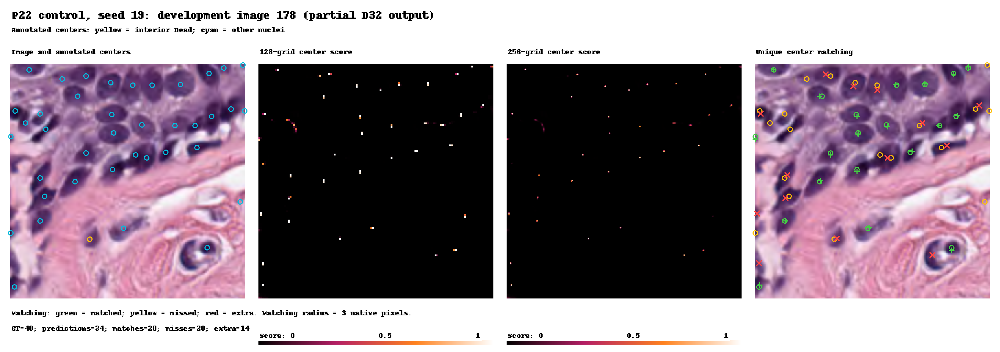

> **Final November 18 status:** D32 recovery **55839400** and next experiment D33 **55839942** are both **COMPLETED / 0:0**. Together they preserve **360 diagnostic PNGs** on Expanse, with selected figures and complete small analysis tables returned to LM1. [D33 Chinese analysis](D33_REVIEW_ZH.md), [English analysis](D33_REVIEW_EN.md), and [receipt](D33_SUBMISSION.json).

> **Completion update:** D32 recovery 55839400 is COMPLETED / 0:0; all twelve models and 180 PNGs were preserved and verified. The next experiment is the fixed D33 interpolation-order counterfactual.

# Center-detection recovery and research review, November 18, 2026

D32 recovery job **55839400** was submitted once at **08:05:41 EST**. Initial observation: **PENDING / Resources**. It retains twelve existing P22/P29/P31 models and the original diagnostic scope. The previous job failed on an unavailable plotting import; the recovery uses pinned Pillow and validates PNG generation before inference.

- [Detailed Chinese analysis](REVIEW_ZH.md)
- [Detailed English analysis](REVIEW_EN.md)
- [Chinese reader](GUIDE_ZH.md)
- [Scientific submission and source identity](SUBMISSION.json)
- [Actual partial-image coordinates and scores](PARTIAL_IMAGE_RECORD.json)
- [Image and input provenance](FIGURE_PROVENANCE.json)
- [Original frozen diagnostic plan](../center_diagnostics_2026-11-17/README.md)
- [Stage 7 report](../../report/stage_report_7/README.md) and [stage 8 report](../../report/stage_report_8/README.md)

The figure uses original D32 image 178 arrays, fixed label selection, the P22 seed-19 control and the unchanged unique radius-three matching rule. The image has 40 annotated nuclei, 34 retained points and 20 matches. A retained prediction inside Dead instance 4 is 3.162 pixels from the representative center. The complete recovery run will retain 180 large panels, full intermediate arrays and diagnostic records. Its actual-node checks and new results follow scheduling.
