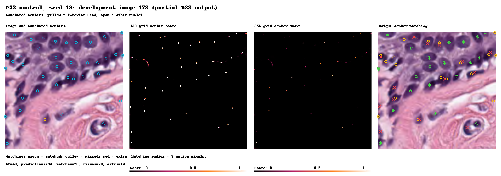
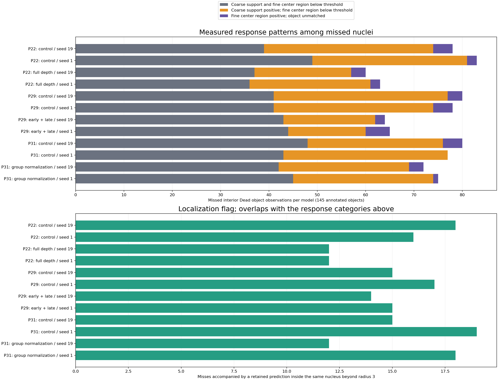

> **Completed update:** D32 and D33 both completed with exit 0:0. D32 preserves twelve-model mechanisms; the [D33 intervention analysis](D33_REVIEW_EN.md) quantifies recovered nuclei and added competing predictions.

# Center detection: progress, architecture analysis and next experiment

November 18, 2026. This review focuses on full-depth adaptation (P22), adaptation distributed across early and late blocks (P29), and decoder group normalization (P31). These comparisons address representation, adaptation location and optimization, respectively. The [stage 7 report](../../report/stage_report_7/README.md) and [stage 8 report](../../report/stage_report_8/README.md) retain the complete earlier experimental context.

## Verified progress

P31's four independent runs completed 130 epochs. On the original 522-image development set, the experimental model finds 73/145 and 70/145 interior Dead nuclei, compared with 65/145 and 68/145 for its controls. Unique center precision is 70.71% and 70.14%. Training recall reaches 99.56% and 99.73%. Overall development matches change by -140 and +6. The original two-seed decision remains false; this specific normalization recipe is closed.

P22's full-depth adaptation adds 18 and 20 interior Dead matches overall. The finer decomposition is +19/+19 among 117 isolated objects and -1/+1 among 28 objects with another annotated center within 12 pixels. P29's early-six plus late-six adaptation adds 16/13 interior Dead matches and 283/165 total matches; its Dead improvement remains positive after removing any one positive image or tissue in the recorded sensitivity analysis. These are useful measured contrasts for mechanism diagnosis. Their original decisions remain unchanged.

D32 job **55825240** ended **FAILED / 1:0**, after **198 seconds**. Its 13 compute-node behavior checks passed. During the first model's first saved image, the plotting function attempted to import `matplotlib`, which is absent from the pinned Expanse environment. Four partial result files exist: selected native arrays, selection, one pair of coarse/fine maps, and one feature array. There is no completed twelve-model summary or preserved project result set from that job. Original files and logs are retained; a small copy was returned to LM1.

The recovery job **55839400** was submitted once at **2026-11-18 08:05:41 EST**. The first subsequent observation was **PENDING / Resources**. It requests one V100, four CPU cores, 32 GiB and **3:56:00**. Original elapsed time plus the new walltime envelope is 14,358 seconds, below the original 14,400-second diagnostic budget. Scheduler billing remains subject to the site's charging rules.

## What the architecture actually constrains

The detector reads UNI features after blocks 6, 12, 18 and 24, projects their 1,024 channels to 192 per tap, fuses them, and produces a 128-by-128 logit grid. A logit is the value before sigmoid; zero corresponds to score 0.5. Bilinear interpolation creates the 256-by-256 final grid, on which the original local-maximum, threshold, cap and unique radius-three matching rules operate.

For a single coarse peak `a` surrounded by a constant background `b`, the largest interpolated logit is `(9a + 7b) / 16`. If the background score is 0.01, that particular narrow peak needs a coarse score of approximately 0.9727 to reach 0.5 after interpolation. Wider or asymmetric peaks behave differently. The next measurement must therefore inspect the actual weighted contributors and peak position, rather than infer a general recall ceiling from this example.

The identical linear 1-by-1 output head commutes with interpolation: `U(WF + b) = WU(F) + b`. Moving that head after interpolation preserves the represented function. A useful structural change would need additional spatial computation, a nonlinearity, or independent high-resolution information. The earlier P5 native-grid refinement experiment already provides a negative comparison for one specific refinement recipe; any future design must identify a distinct measured mechanism and a suitable control.

The current Gaussian-weighted focal objective makes only the exact integer center positive. Nearby non-center pixels remain negative, with reduced weights. The previously verified conditional-risk example has a certainly present nucleus whose center is equally likely at four nearby locations. Its unconstrained pixel-risk optimum is approximately 0.4335 at each location, although any one of those four predictions would be within the evaluation tolerance. This motivates examining spatially dispersed responses and localization stability. The network's actual feature uncertainty and interpolation constraints require empirical measurement.

Last-twelve adaptation leaves the first two feature taps fixed. Updating earlier blocks also changes downstream features, including those produced by frozen later blocks. Thus the layer comparisons measure adaptation recipes, rather than identifying a separate biological role for each layer. Group normalization improves measured training optimization and introduces spatial-statistic dependence; its effect on crowded-image center scores remains a hypothesis to examine.

## A real intermediate-output example

This figure was reconstructed from the first saved image of the failed D32 job: P22 control, seed 19, development image 178. Image selection follows the original label-based rule. The image has 40 annotated nuclei, 34 retained predictions, 20 unique matches, 20 misses and 14 extra predictions. Both score panels use the same 0-to-1 color scale; grid cells are enlarged without introducing new interpolation. Coordinates and input hashes are in [the object record](PARTIAL_IMAGE_RECORD.json) and [figure provenance](FIGURE_PROVENANCE.json).

The interior Dead nucleus, instance 4, has representative center `(y=191, x=86)` and area 286 pixels. Its retained in-mask prediction at `(190, 89)` lies approximately **3.162 pixels** away. That displacement produces a miss and an unmatched prediction under the frozen radius-three rule. The highest radius-three score is about **0.1080**, while the mask-wide peak score is about **0.9632**. The coarse support maximum is positive, but its support covers a different region from the fine radius-three maximum. This object therefore illustrates overlapping interpolation and localization flags; its record supports direct analysis of peak location. It is one object from a partial model run. The complete twelve-model comparison is scheduled in the recovery job.

## Recovery and evidence-driven planning

The only changed computation is PNG rendering, which now uses the environment's existing Pillow package. An abstract-syntax-tree comparison verifies that every diagnostic function outside `render_panel` is unchanged from commit `4759e58`. Model forward passes, feature capture, data roles, seeds, thresholds, top-512 ordering, last checkpoints and matching remain fixed. Fifteen focused behavior checks passed on LM1 in 2.19 seconds, including PNG generation/readback with `matplotlib` imports blocked. The recovery job repeats these checks before model inference, then performs the original real-model hook equality, interpolation reconstruction, checkpoint and source checks. Its actual GPU checks occur after scheduling.

The frozen comparison remains P22 C/M, P29 C/B and P31 C/G, each with seeds 19 and 1: twelve existing epoch-130 last checkpoints. It covers all 522 development images and all 145 interior Dead objects, selected training images, the original fixed examples and four one-pixel translations. It saves 180 large PNGs, native arrays, coarse/fine logits, four feature taps, complete peak decisions, object records and shift tables. Results are copied and verified from the compute node to project storage, with scratch originals retained.

| Measured pattern to inspect | Next research question and control |
|---|---|
| Strong coarse response, weakened fine response near the center | Inspect exact interpolation contributors, peak width and alignment; compare training and development objects before selecting one representation or target change. |
| Strong peak inside the nucleus but outside radius three, especially after a one-pixel shift | Test localization stability and center-target compatibility; distinguish displacement from absence before designing a single localization experiment. |
| Weak coarse and fine response despite detectable training examples in the same label group | Compare tissue, morphology, staining and feature support; coarse label overlap alone does not establish matched appearance. |
| Eligible nearby peaks removed by threshold, local maxima, cap or assignment | Name the responsible selection step using the complete trace; retain the original decoder as the control. |
| Similar failures in all three model families | Prioritize shared data and target assumptions over another layer-location combination. |

A new training contrast will be frozen after the complete diagnostic identifies one specific mechanism. Earlier closed loss, augmentation and refinement recipes remain recorded as prior evidence. The original development criterion is unchanged. At submission the GPU allocation was 1,900 SU, recorded spending 1,779 SU, and other queued GPU jobs had a 72-SU full-walltime upper bound. The 3.9333-SU request leaves approximately 45.1 SU under that conservative calculation; future training must use fresh accounting and an explicit resource envelope.

These results use repeatedly consulted fold-1 training/development data and center-detection metrics. Formal segmentation evaluation follows the project's last-checkpoint, official evaluator and three-split protocol when a method reaches that stage. Current uncertainty reflects the retained images: 145 interior Dead objects occur in only 11 development images, and all 11 small crowded objects occur in one colon image. Object-level flags are descriptive and may overlap.

References: [Objects as Points](https://arxiv.org/abs/1904.07850); [Vision Transformers for Dense Prediction](https://arxiv.org/abs/2103.13413); [focal-loss probability-estimation theory](https://openaccess.thecvf.com/content/CVPR2021/html/Charoenphakdee_On_Focal_Loss_for_Class-Posterior_Probability_Estimation_A_Theoretical_Perspective_CVPR_2021_paper.html). Interpolation and Gaussian-weighted focal statements are derived from this project's implementation; the retained [November 17 plan](../center_diagnostics_2026-11-17/PLAN_EN.md) documents the full frozen diagnostic.

## Completed D32 measurements and the next fixed intervention

Recovery 55839400 completed with exit 0:0 in 880 seconds. All twelve checkpoint rehashes and real-model hook/interpolation checks passed; all recomputed development and selected-training counts equal the retained historical counts. The 180 PNGs and all arrays/records were preserved and verified: 1,399 files, 815,269,533 bytes, with scratch originals retained. The new [analysis JSON](D32_ANALYSIS.json) and [source tables](evidence/) retain the complete measurements.

Across twelve repeated evaluations of the same 145 interior Dead objects, there are 875 miss observations. Of these, 334 have a positive coarse support maximum and a negative fine radius-three maximum; 183 include a retained in-mask prediction beyond radius three. The flags overlap and the coarse/fine supports differ. None of the missed objects has a nearby retained peak lost to unique matching, and none has a nearby peak removed by the top-512 cap. These measurements prioritize response formation and localization.

The upper panel partitions misses by coarse-support and fine-center-region sign; the lower panel counts an overlapping localization flag. Every bar uses the same 145 annotated objects. These observations motivate a direct intervention on the last interpolation operation. D33 will compare the original sigmoid-after-logit-interpolation output with sigmoid applied before interpolation, using the existing saved maps and frozen decoder. It covers all eleven development images and the same selected training maps; selected-image precision uses its own denominator. A CPU SLURM job will generate object gains/losses, extra-point changes and 180 alternate-output panels.
