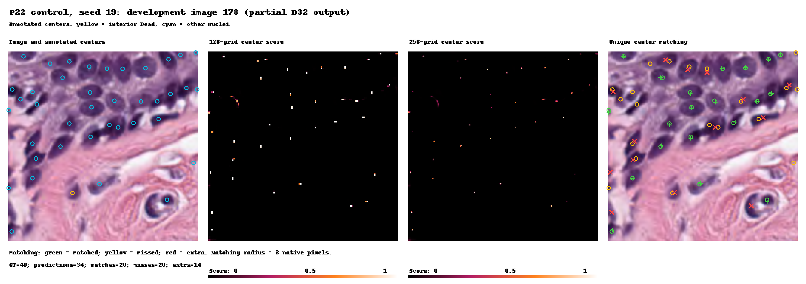
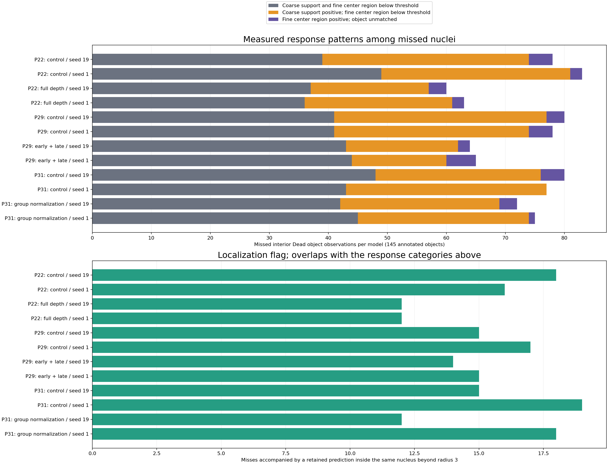

> **最新结果：** D32 与 D33 均已 COMPLETED / 0:0。D32 保存十二模型机制测量；[D33 成对干预分析](D33_REVIEW_ZH.md)解释新增检出与竞争预测的代价。

# 核中心检测：最新进展、结构分析与下一步实验

2026 年 11 月 18 日。本次重点比较全层适配实验 P22、前后层联合适配实验 P29，以及检测头组归一化实验 P31，分别讨论特征适配、更新层的位置和优化行为。[第七阶段报告](../../report/stage_report_7/README.md)与[第八阶段报告](../../report/stage_report_8/README.md)保留更完整的前期实验及逐图分析。

## 已核查的任务进度

P31 的四次独立训练均完成 130 轮。在原来的 522 张开发评估图像上，实验模型分别找到 73/145、70/145 个内部死亡核，对照为 65/145、68/145；唯一中心匹配精度为 70.71%、70.14%。训练集检出率达到 99.56%、99.73%，开发评估集总体匹配数变化为 −140、+6。原双种子判定仍为未通过，具体的组归一化方案已关闭。这里的“内部”沿用原来的图像边界定义，“精度”表示被唯一匹配的预测点占全部预测点的比例。

P22 全层适配在两个种子中分别增加 18、20 个内部死亡核匹配；分组后，117 个孤立对象各增加 19 个匹配，28 个十二像素内有邻核的对象变化为 −1、+1。P29 更新前六层和后六层，增加 16、13 个内部死亡核匹配及 283、165 个总体匹配。在原有敏感性分析中，删除任意一张死亡核阳性图像或一种组织后，P29 两个种子的死亡核净收益仍为正。这些不同的表现有助于选择机制诊断对照；各轮原判定保持不变。

昨晚提交的 D32 任务 **55825240** 已结束，状态为 **FAILED / 1:0**，实际用时 **198 秒**。计算节点的 13 项行为检查通过。首个模型保存第一张结果图时，绘图函数导入环境中缺少的 `matplotlib`，任务因此中止。已生成原图和标注副本、固定选择清单、第一张图像的粗细分数图以及特征数组，共四个部分产物。完整十二模型汇总和项目存储中的完整结果副本尚未生成。原文件与日志保留，并已将这一小批产物回收到 LM1。

恢复任务 **55839400** 已于 **2026 年 11 月 18 日 08:05:41 EST** 单次提交，随后首次查询为 **PENDING / Resources**。申请一张 V100、四个 CPU 核、32 GiB 内存和 **3 小时 56 分钟**。加上旧任务实际用时，总计算包络为 14,358 秒，低于原来的 14,400 秒；实际收费遵循集群计费规则。

## 理论分析如何指导结构选择

当前检测器读取 UNI 第 6、12、18、24 层后的特征，每路从 1,024 通道投影为 192 通道，再融合并产生 128×128 的预测值。这个 sigmoid 之前的数值称为 logit；数值为零时，预测分数为 0.5。最后一次双线性插值将其转换为 256×256 输出，再按原规则执行局部极大值、0.5 阈值、最多 512 点和三像素内唯一匹配。

当粗网格只有一个峰值 `a`、周围背景均为 `b` 时，插值后的最大值为 `(9a+7b)/16`。背景分数为 0.01 时，这种特定窄峰需要约 0.9727 的粗网格分数，才能在插值后达到 0.5。真实峰可以更宽或不对称。因此，应测量真实插值贡献、峰宽和位置，再判断是否存在需要修复的输出约束。

同一个 1×1 线性输出层与插值可以交换顺序：`U(WF+b)=WU(F)+b`。仅调整它的位置，函数表达能力保持相同。结构设计需要增加有意义的空间计算、非线性或独立高分辨率信息。前期 P5 已测试过一种原生网格细化方案，其结果应作为后续设计的对照背景；新设计需要明确不同的实测机制。

当前高斯加权焦点损失仅把整数标注中心设为正样本，邻近像素仍为负样本，只是负损失权重较低。此前已验证的条件风险例子中，对象始终存在，但模型可用表征无法区分四个相近中心位置；逐像素风险最优分数可为约 0.4335，而四个位置中的任意一个预测都能落入评估容差。这个例子提示我们检查空间响应分散和峰位置不稳定。真实网络中的特征不确定性及插值耦合仍需直接测量。

只更新最后十二层时，前两路特征保持固定；更新前层时，下游冻结层产生的特征也会改变。因此，层位置实验反映的是整套适配方案。组归一化已改善训练优化，同时引入空间统计依赖；它是否改变密集图像中标注中心附近的预测分数，还需要实际输出支持。

## 首张真实中间结果图

该图来自失败任务已经保存的第一张图像：P22 对照、种子 19、开发评估图像 178。图像按照原来的标注分层规则选择。图中共有 40 个标注核、34 个保留预测、20 个唯一匹配、20 个漏检和 14 个额外预测。两幅分数图共用 0～1 色标，网格仅放大显示；完整坐标见[对象记录](PARTIAL_IMAGE_RECORD.json)，输入与图片哈希见[图片来源清单](FIGURE_PROVENANCE.json)。

图中的内部死亡核为实例 4，代表中心为 `(y=191, x=86)`，面积 286 像素。模型在同一核内保留了预测点 `(190, 89)`，距离中心约 **3.162 像素**，因此按固定三像素规则计为一个漏检和一个额外点。三像素邻域内最高分数约为 **0.1080**，整个核内最高分数约为 **0.9632**。粗网格贡献区域的最大值为正，但该区域与细网格三像素邻域覆盖范围不同。这个对象同时触发插值和定位相关标记，需要结合峰的位置解释。它来自一个模型的部分运行；完整比较由恢复任务继续完成。

## 恢复方案及下一步研究规划

本次只改变 PNG 绘制，使用运行环境已有的 Pillow。抽象语法树比较确认，`render_panel` 以外的诊断代码与 `4759e58` 提交完全相同。模型计算、特征捕获、数据角色、种子、阈值、前 512 点排序、最后检查点和唯一匹配保持固定。LM1 的 15 项行为检查在 2.19 秒内通过，其中包含屏蔽 `matplotlib` 后生成与回读 PNG。恢复任务在推理前重做这些检查，之后核验真实模型挂钩前后输出、插值重建、检查点和源码；真实 GPU 验证在作业获调度后执行。

冻结比较仍为 P22 C/M、P29 C/B、P31 C/G，两个种子 19 和 1，共十二个已完成第 130 轮的最后检查点。任务覆盖全部 522 张开发评估图像、145 个内部死亡核、选定训练图像、原固定样例及四种单像素平移。保存 180 张大幅 PNG、原图与标注、粗细网格预测值、四路特征、完整峰筛选、逐对象记录和平移结果。计算节点完成结果复制和哈希验证，项目存储与 scratch 原件均保留。

|需要测量的现象|对应的下一步问题与对照|
|---|---|
|粗网格响应强，中心附近细网格响应下降|检查真实插值贡献、峰宽及对齐关系；先比较训练和开发对象，再选择一种输出表达或监督变化。|
|核内已有强峰，但偏离三像素范围，或单像素平移后位置变化|研究定位稳定性与中心监督的兼容性，将位置偏移与缺少响应分开后设计一个定位对照。|
|粗细网格都弱，同类训练对象却可检出|比较组织、形态、染色及特征支持；相同粗标签只说明部分训练支持。|
|中心附近已有合格峰，随后被筛选或匹配移除|通过完整记录定位具体步骤，以原解码规则为对照。|
|三类模型共享相似错误|优先检查共同数据与目标定义，减少缺少机制依据的层位置组合。|

完整诊断识别具体机制后，再冻结一个新的训练对照。前期已关闭的损失、增强和细化配方继续保留为历史证据；原开发判定保持固定。提交时 GPU 总额度为 1,900 SU，已记账 1,779 SU，其他排队 GPU 作业的全时长保守上界为 72 SU。本次申请 3.9333 SU，按这一计算还剩约 45.1 SU；后续训练须重新查询实时账目并明确资源上限。

这些比较使用已反复查看的 fold 1 训练与开发数据，指标为中心检测。方法进入正式分割评估阶段后，按项目规定使用最后检查点、官方指标实现及三折报告。当前开发集的 145 个内部死亡核仅来自 11 张图像，11 个小型且有邻核的对象全部来自同一张结肠图像。逐对象标记可以重叠；统计解释遵循这些实际数据范围。

参考：[Objects as Points](https://arxiv.org/abs/1904.07850)、[Vision Transformers for Dense Prediction](https://arxiv.org/abs/2103.13413)、[焦点损失与概率估计理论](https://openaccess.thecvf.com/content/CVPR2021/html/Charoenphakdee_On_Focal_Loss_for_Class-Posterior_Probability_Estimation_A_Theoretical_Perspective_CVPR_2021_paper.html)。插值和高斯加权损失的具体结论由本项目实现推导；完整冻结设计见[11 月 17 日中文计划](../center_diagnostics_2026-11-17/PLAN_ZH.md)。

## D32 已完成的测量与下一步固定对照

恢复任务 55839400 已完成，退出码 0:0，实际用时 880 秒。十二个最后检查点均独立重做哈希核验，真实模型挂钩和插值重建检查全部通过；重新计算的开发评估及选定训练图像计数与历史记录完全一致。180 张 PNG 及全部数组、记录已保存并验证，共 1,399 个文件、815,269,533 字节，scratch 原件保留。[完整分析 JSON](D32_ANALYSIS.json)与[来源表格](evidence/)保存全部测量。

同一组 145 个内部死亡核在十二个模型中产生 875 次漏检观察。其中 334 次粗网格贡献区域的最大值为正，而中心三像素邻域的细网格最大值为负；183 次伴随核内保留预测点偏离三像素范围。标记可以重叠，粗细网格对应区域也不同。全部漏检对象中，中心附近保留点被唯一匹配丢失的次数为零，附近候选峰被最多 512 点限制移除的次数也为零。这些测量将后续问题集中到响应形成和定位。

上图按照粗网格贡献区域和细网格中心邻域的数值符号划分漏检；下图记录可与前述分类重叠的定位标记。每根条形均来自同一组 145 个标注对象。下一步 D33 直接改变最后一次插值的计算顺序，比较原来的“插值预测值后执行 sigmoid”与“执行 sigmoid 后插值分数”。使用已经保存的图像和分数，解码规则保持固定，覆盖全部十一张开发评估图像及同一组选定训练图像。该子集精度使用自己的预测点分母。CPU SLURM 任务将保存逐对象新增和丢失、额外点变化及 180 张对照图。
