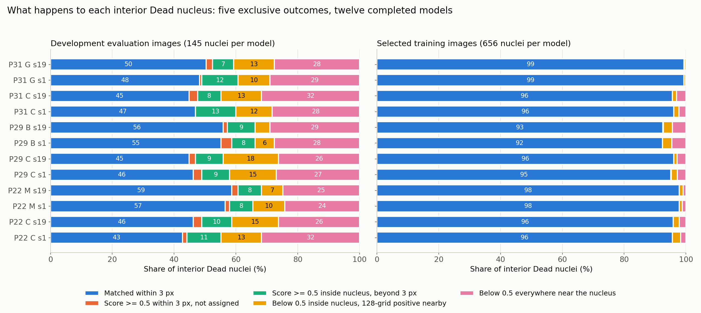
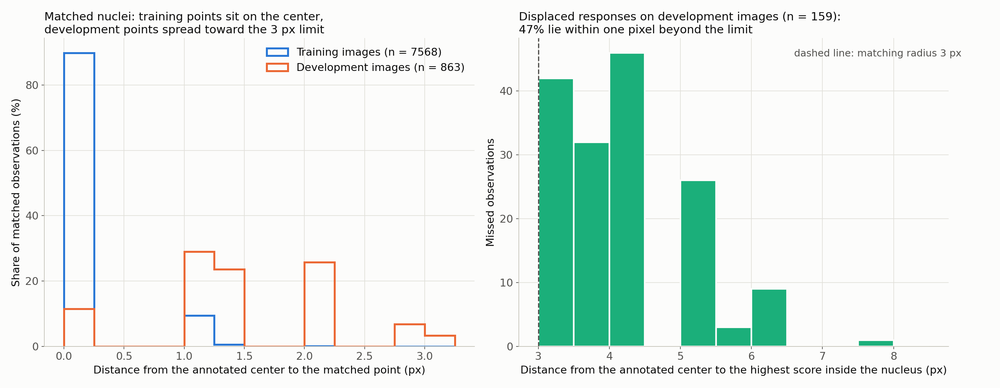
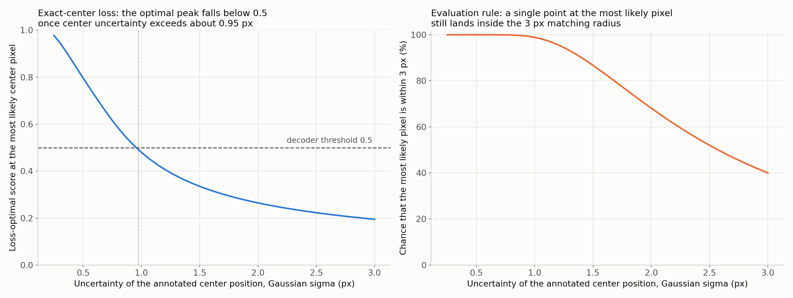

# 这一轮想弄清什么，下一步做什么

> **当前状态：** 下一步实验（中心偏移读出，P34）的作业 55855798 已于 11 月 18 日 14:31（美国东部时间）提交并开始运行，四个任务都已通过运行前检查。结果待作业完成后回收。

## 模型到底错在哪里

前几轮的问题一直是：训练图像上的核几乎都能找到，换到没见过的图像，死亡核只能找到一半左右。上一轮诊断把十二个模型在每个核上的输出都保存了下来，这一次把每个核的结局分成互不重叠的五类。

左边是开发评估图像，右边是训练图像。蓝色是找到了；绿色和橙色是“核内已经有超过阈值的响应，但峰离标注中心超过三像素”；黄色是有一点响应但不够强；粉色是完全没有响应。

开发评估图像上，约一半的核被找到，约 11% 属于“有响应但位置偏了”，约 12% 响应偏弱，约 28% 没有响应。训练图像上“位置偏了”几乎不存在，7,872 次观察里只有 3 次。

## 位置偏多少

在训练图像上，预测点几乎总是正好落在标注中心（中位距离 0 像素）。在开发评估图像上，即使是已经算作“找到”的核，预测点离中心的中位距离也有 1.4 像素，四分之一在两到三像素之间。右图是那些“位置偏了”的核：将近一半只超出匹配范围不到一个像素。

评估规则以三像素为界。界内算找到；界外的同一个预测，既算一次漏检，又算一个多余的预测点。把所有类别的核都算上，每个模型的多余预测点里有约六成其实落在某个尚未匹配的核内部。

## 为什么会这样

训练用的损失只承认标注中心那一个像素是正样本。可以算出来：只要模型对中心位置的把握差到大约一个像素，让损失最小的做法就是把峰值压到 0.5 以下，也就是干脆不输出这个点。而评估规则其实允许两到三像素的偏差。

左图是损失希望的峰值分数，右图是“在最可能的位置给一个点”能落入三像素的概率。位置的不确定度为 1.5 像素时，损失希望的分数只有 0.335，而给出一个点仍有 87% 的机会被算作正确。此前调整目标宽度、改变正样本权重、交换插值顺序等实验，都还在让同一张分数图既回答“有没有核”，又回答“中心在哪个像素”。

## 下一步实验：让另一个小模块专门回答“中心在哪”

P34 保持检测器完全不变，只在它最后一层特征上加一个很小的读出模块（约 7.4 万个参数），让核内每个像素都指出“中心在我的哪个方向、多远”。解码时，检测器给出的每个预测点按这个方向移动一次，移动后挤在一起的点合并成一个。检测器原有的预测点一个不多、一个不少，只是位置被修正。

实验用 P22 的四个已完成检测器（两种训练方案、两个种子）。每个检测器训练两个读出模块：一个使用和检测器相同的数据增强，另一个额外加入随机平移，用来区分“记住了训练图像”和“学会了读位置”。评估在三组图像上进行：开发评估图像、训练图像、整体平移后的训练图像。

主要看一件事：对更新全部 24 层的检测器，位置修正后内部死亡核的检出率能否从约 58% 提高到 60% 以上并至少增加 5 个百分点，同时精度达到 75%。按已保存的记录估算，如果“位置偏了”的核全部被修正，检出率的上限约为 66%～68%。

## 资源与进度

项目的 GPU 额度已基本用完（1,900 SU 中已用 1,818 SU，其余被其他成员排队中的作业覆盖），所以这次实验改在 CPU 节点上运行：四个任务，各 32 个 CPU 核，估计需要 4.5～6.5 小时。作业开始前，每个任务都确认了“位移为零时结果与原检测器逐图一致”。

完整的数字、公式、设计细节和运行记录见[中文分析](REVIEW_ZH.md)；[英文版](REVIEW_EN.md)内容相同。
