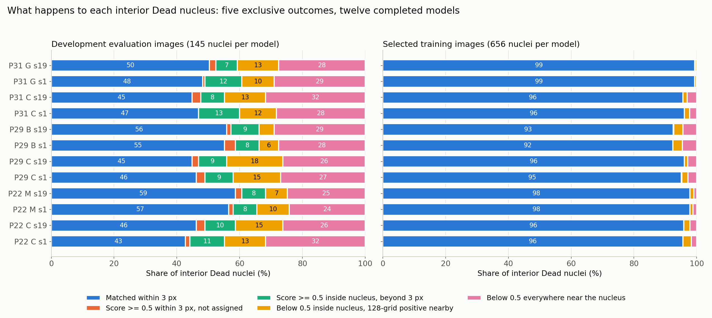
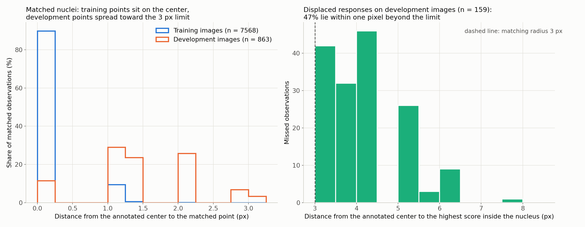
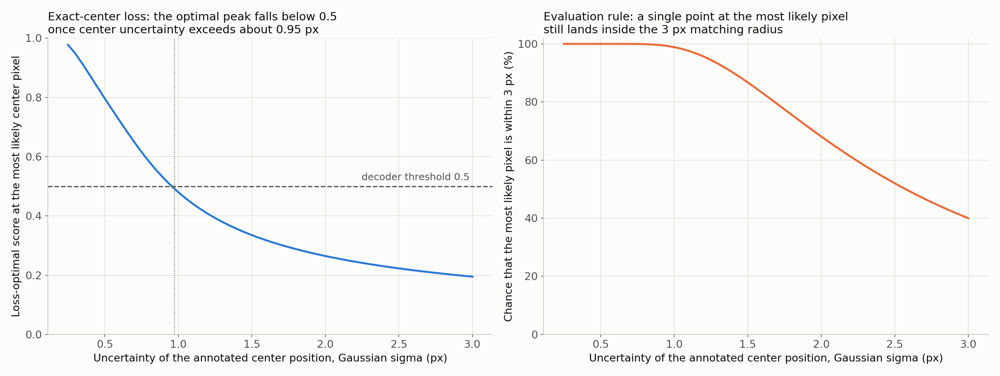
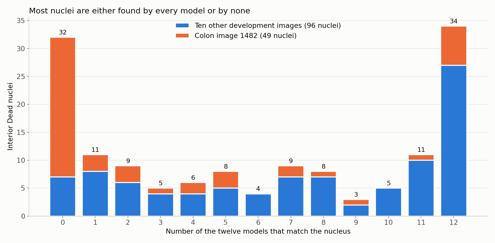

# Structure analysis of misses and the center-offset readout experiment (P34), November 18, 2026

> **Status:** array job **55855798** was submitted once at 2026-11-18T19:31:05Z and has been running since 19:31:54Z: four tasks, each 32 CPU cores, 64 GiB and a 10-hour limit. Every task passed 44 node checks and the zero-offset identity check on the real detectors. Results will be added here when the job finishes.

- [Detailed Chinese analysis](REVIEW_ZH.md)
- [Detailed English analysis](REVIEW_EN.md)
- [Chinese reader](GUIDE_ZH.md)
- [Numbers of the structure analysis](STRUCTURE_ANALYSIS.json) and the [script that generates them](analyze_structure.py)
- [Submission receipt](P34_SUBMISSION.json)
- [Training and evaluation script](../../../scripts/train_center_offset_p34.py) and [behavior checks](../../../tests/test_center_offset_p34.py)
- Previous round: [twelve-model diagnostics and interpolation-order comparison](../center_diagnostics_recovery_2026-11-18/README.md)

## What the analysis shows

Every interior Dead nucleus observed by the twelve completed models falls into one of five exclusive outcomes. On the development images, 49.7% of 1,740 observations are matched, 11.0% have a response above the threshold inside the nucleus whose peak lies beyond the three-pixel matching radius, 11.5% respond weakly and 27.8% do not respond. On the selected training images, 96.1% of 7,872 observations are matched and the displaced pattern occurs 3 times.

Matched points lie on the annotated center in training images (median distance 0.0 pixels) and 1.41 pixels away in development images. Among the displaced responses, 46.5% lie less than one pixel beyond the matching radius.

The exact-center training loss explains the pattern. When the position of the center is uncertain by more than about 0.95 pixels, the peak score that minimizes the loss is below the decoding threshold of 0.5, while a single point at the most likely position would still land within three pixels in most cases.

Of the 145 nuclei, 34 are matched by all twelve models and 32 by none; 25 of the latter come from one colon image.

## What P34 tests

Four completed P22 detectors stay frozen. A readout with 73,986 parameters on the last detector feature map predicts, for every pixel inside a nucleus, the displacement to the annotated center. Each predicted point of the detector is moved once by the displacement at its pixel, and moved points within two pixels are merged. Two readouts per detector are trained, with and without random translation, and evaluated on the development images, on selected training images and on the same training images after a fixed shift.

The primary comparison, fixed before submission, is the detector with all 24 encoder layers updated, the readout trained with translation and the moved-and-merged decoder against the original decoder, under the original two-seed criteria.

The project GPU allocation stood at 1,818 of 1,900 SU with up to 83 SU of queued jobs from other members, so the experiment runs on the CPU allocation in single precision. Differences from the stored BF16 results are recorded per image: the totals of matches and predicted points differ by less than 0.4%.

## Scope

Fold 1 training and development split, nucleus-center detection. The 145 interior Dead nuclei of the development set come from 11 images and are observed repeatedly by twelve models.
