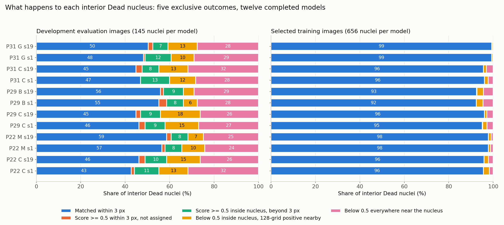
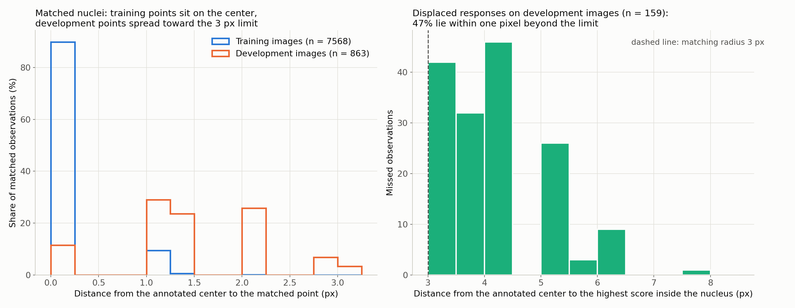
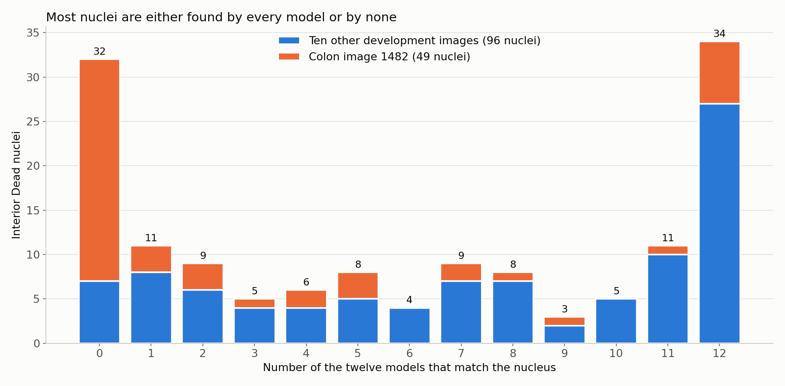
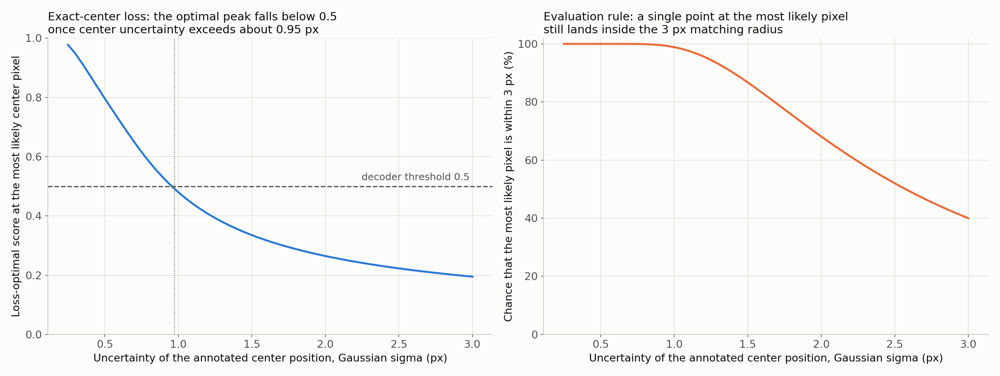

# Nucleus-center detection: status check, structure analysis and the center-offset readout experiment (P34)

November 18, 2026. This document first verifies the state of the completed jobs, then uses the stored per-object records to analyze the data, the loss function and the network structure, and finally describes the next experiment that was designed from this analysis and submitted. The previous round is documented in [twelve-model diagnostics and the interpolation-order comparison](../center_diagnostics_recovery_2026-11-18/README.md); earlier experiments are in the [stage 8 report](../../report/stage_report_8/README.md).

> **Current state:** array job **55855798** for the center-offset readout was submitted once on November 18, 2026 at 14:31:05 Eastern Time, and all four tasks have been running since 14:31:54. Each task passed 44 behavior checks on its compute node and confirmed on the real detectors that predicted points stay in place when the offset is zero. Training and evaluation results will be collected when the job finishes.

## 1. Verified job status

|Job|Content|Resources|State|
|---|---|---|---|
|55792463|P31 group normalization in the detection head, four 130-epoch runs|one V100 each|all four COMPLETED / 0:0|
|55839400|Intermediate outputs and localization diagnostics of twelve completed models (D32)|one V100, 880 s|COMPLETED / 0:0|
|55839942|Order of sigmoid and interpolation (D33)|4 CPU cores, 237 s|COMPLETED / 0:0|
|55855798|Center-offset readout (P34) on four frozen detectors|4 tasks, each 32 CPU cores, 64 GiB, 10-hour limit|RUNNING since November 18, 19:31:54 UTC|

The user queue was empty before submission. The project GPU allocation is 1,900 SU, of which 1,818 SU were charged at 18:26 UTC; queued GPU jobs of other project members can take up to 83 SU at their requested durations, which covers the remainder. The CPU allocation is 50,000 SU with 1,548 SU charged. This experiment was therefore designed for CPU nodes, with a conservative upper bound of 1,280 SU.

## 2. Data structure: five outcomes for every interior Dead nucleus

Diagnostic job D32 stored per-object records for twelve completed models. The objects are 145 interior Dead nuclei, that is, annotated nuclei of the Dead class that do not touch the image border; they come from 11 images of the development evaluation set. The same records cover 656 such nuclei in 48 selected training images. Each nucleus has an annotated center, the mask pixel nearest to the mask centroid. The model outputs a 256×256 score map; local maxima with a score of at least 0.5 become predicted points, and a predicted point within three pixels of an annotated center counts as a match after one-to-one assignment.

The original D32 flags can overlap. Here every observation is assigned to exactly one class, in this order:

1. **Matched**: the nucleus is uniquely matched by a point within three pixels.
2. **Threshold reached near the center, peak beyond the radius**: the highest score within three pixels of the center is at least 0.5, but no local peak above the threshold lies within three pixels. There are 33 such observations; 31 of them have a retained predicted point inside the nucleus at 3.16 to 4.0 pixels from the center. The peak lies beyond the radius and only its shoulder reaches inside.
3. **Response inside the nucleus, away from the center**: the score within three pixels stays below 0.5 while the highest score elsewhere inside the mask is at least 0.5.
4. **Weak response**: every pixel of the nucleus is below 0.5, and the corresponding position of the 128×128 coarse grid has a non-negative prediction value.
5. **No response**: none of the above.

The left panel shows the development images and the right panel the training images. Each row is one model and the numbers inside the bars are percentages.

|Outcome|Development images (1,740 observations)|Training images (7,872 observations)|
|---|---:|---:|
|Matched|865 (49.7%)|7,568 (96.1%)|
|Threshold reached near the center, peak beyond the radius|33 (1.9%)|1|
|Response inside the nucleus, away from the center|159 (9.1%)|2|
|Weak response|200 (11.5%)|130 (1.7%)|
|No response|483 (27.8%)|171 (2.2%)|

Classes 2 and 3 together contain 192 observations, 11.0% of the development observations: the model already responds above the threshold inside the nucleus, and the peak lies more than three pixels from the annotated center. The same pattern occurs 3 times in 7,872 training observations.

Grouping by training recipe shows which class each recipe changes:

|Recipe (development images)|Matched|Peak beyond the radius (classes 2 and 3)|Weak response|No response|
|---|---:|---:|---:|---:|
|Control updating the last 12 encoder layers (6 models)|45.3%|11.8%|14.4%|28.5%|
|P22, all 24 layers updated|57.6%|9.3%|8.6%|24.5%|
|P29, first 6 and last 6 layers updated|55.5%|10.7%|5.5%|28.3%|
|P31, group normalization in the detection head|49.3%|10.7%|11.7%|28.3%|

The two recipes that widen the encoder update mainly turn weak responses into matches (from 14.4% to 8.6% and 5.5%). The share of peaks beyond the radius stays between 9% and 12% in every recipe. Earlier rounds have not addressed this part.

## 3. Localization error: training images versus development images

The left panel compares the distance between the matched point and the annotated center. On training images the median over 7,568 matches is 0.0 pixels and 99.4% lie within one pixel. On development images, 863 of the 865 matches have their point inside the nucleus mask; their median distance is 1.41 pixels, only 40.4% lie within one pixel and 25.7% lie between two and three pixels. The right panel shows, for the 159 displaced responses of class 3, the distance from the annotated center to the highest score inside the nucleus: the median is 4.0 pixels, 46.5% are below four pixels, 93.7% are below six pixels, and the maximum is 7.6 pixels. In 152 of these cases a retained predicted point lies inside the nucleus.

The two panels show two segments of one distribution. On training images the detector reproduces the pixel of the annotated center. On unseen images its peak lands one to several pixels away. The three-pixel matching rule cuts through this distribution: on the near side a prediction counts as a match, and on the far side the same prediction counts once as a missed nucleus and once as an extra point.

One example can be checked pixel by pixel. For the P22 control (seed 19) on development image 178, instance 4 has its annotated center at (y=191, x=86) and an area of 286 pixels. The highest score inside the nucleus is about 0.963 at (190, 89), 3.16 pixels from the center, while the highest score within three pixels of the center is about 0.108. The nucleus is unmatched and the point inside it is counted as an extra point. The [diagnostic figure of this image](../center_diagnostics_recovery_2026-11-18/figures/p22_control_seed19_image0178_partial.png) is stored with the previous round.

The same pattern holds for all classes. D32 stored every predicted point of every model on the 522 development images, which contain 12,250 annotated nuclei:

|Model|Predicted points|Precision|Unmatched: nucleus holds no matched point|Unmatched: nucleus already holds a matched point|Unmatched: outside every annotated nucleus|
|---|---:|---:|---:|---:|---:|
|P22 control, seed 19|10,497|69.2%|2,103|21|1,109|
|P22 control, seed 1|10,259|69.9%|2,017|20|1,051|
|P22 all layers, seed 19|10,985|72.8%|1,803|19|1,161|
|P22 all layers, seed 1|10,801|73.4%|1,716|25|1,136|

Precision is the share of predicted points that are uniquely matched. In each of the twelve models, 1,716 to 2,144 unmatched points lie inside an annotated nucleus that has not been matched, about 60% to 66% of all unmatched points; only 15 to 25 are duplicates inside an already matched nucleus. As an arithmetic upper bound, moving every such point to within three pixels of its nucleus center would give a precision of 89.4% to 90.1% in every model. The bound states the size of this error component; the experiment measures how much of it can be corrected.

## 4. Which nuclei are never found

Of the 145 nuclei, 34 are matched by all twelve models and 32 by none, so the distribution concentrates at both ends. Of the 32 nuclei that are never matched, 25 come from one colon image (number 1482, with 49 interior Dead nuclei and an average match rate of 27.4% over the twelve models); 329 of their 384 observations belong to the class without response.

Stratifying by area and neighborhood shows that the two main losses concentrate on different objects:

|Stratum (development observations)|Matched|Peak beyond the radius|Weak response|No response|
|---|---:|---:|---:|---:|
|Area of 200 pixels or more, no neighbor within 12 pixels (384)|66.4%|18.5%|9.1%|6.0%|
|Area 80 to 199 pixels, no neighbor (660)|60.9%|6.7%|12.0%|20.5%|
|Area below 80 pixels, no neighbor (360)|45.8%|3.3%|11.9%|38.9%|
|Area 80 to 199 pixels, with neighbor (192)|12.5%|24.5%|9.4%|53.6%|
|Area below 80 pixels, with neighbor (144)|13.2%|12.5%|17.4%|56.9%|

Large isolated nuclei rarely lack a response; their main loss is the position of the peak. Small or crowded nuclei mainly lack a response. Of the 145 nuclei, 28 have a neighbor within 12 pixels, and 23 of those come from colon image 1482. The first kind of loss is spread over the images and is the part that can be addressed directly now. The second kind is limited by the examples that this one image provides and needs separate study.

## 5. Theory: the gap between the exact-center loss and the three-pixel matching rule

The training loss treats only the annotated center pixel as positive. Pixels within the surrounding 7×7 window are negatives with reduced weight, and more distant pixels are full negatives. Suppose the model is not fully certain where the center of a nucleus lies and assigns probability π(c) to pixel c. At the most likely pixel u, the expected loss of an output score p is

`L(p) = −π(u)·(1−p)²·ln p − [Σ_{c≠u} π(c)·(1−k(u−c))⁴]·p²·ln(1−p)`,

where `k(d)=exp(−|d|²/2)` is the Gaussian kernel of the training target and equals 0 outside the window. Taking π as an isotropic Gaussian with standard deviation σ pixels and minimizing over p gives the curve in the left panel below.

|Uncertainty of the center position, σ (pixels)|Loss-optimal peak score|Chance that a point at the most likely pixel lies within three pixels|
|---:|---:|---:|
|0.5|0.796|above 99.9%|
|1.0|0.480|98.9%|
|1.5|0.335|86.7%|
|2.0|0.265|68.1%|
|3.0|0.195|40.0%|

Once the uncertainty exceeds about 0.95 pixels, the peak score that minimizes the loss is already below the decoding threshold of 0.5. At the same time, a single point at the most likely position still lands inside the three-pixel matching radius with a probability of 86.7% when σ is 1.5 pixels. The evaluation rule accepts a localization accuracy of two to three pixels, while the loss rewards a peak above the threshold only at sub-pixel accuracy. This is a property derived from the form of the loss; the actual uncertainty inside the network has not been measured directly. The corresponding measured quantity is the localization distance of section 3, whose median on development images is 1.41 pixels, inside this gap.

The analysis also explains why earlier rounds that only reshaped the score map gained little. Widening the target band (P6, plus 0.021 Dead recall in each seed), redistributing the positive weight (P11), regressing the Gaussian target directly (P16) and exchanging the order of sigmoid and interpolation (D33, 2 to 13 additional Dead matches per model together with multiple outputs near nuclei that were already found) all keep one score map responsible for two questions: whether a nucleus is present, and at which exact pixel its center lies.

## 6. Structure: why a position readout is added

The detector consists of the UNI encoder and a light detection head. UNI divides the 256×256 image into patches of 16×16 pixels and represents each patch by a 1,024-dimensional vector. The head reads the four groups of vectors after layers 6, 12, 18 and 24, projects each to 192 channels, fuses them, applies three stages of two-fold upsampling followed by a 3×3 convolution to reach a 128×128 map with 64 channels, produces the prediction with a 1×1 convolution and interpolates bilinearly to 256×256.

Two properties of this structure bear on localization. First, the position inside a 16-pixel patch can only be encoded in the vector of that patch. In the D32 shift test, moving the image by one pixel made 744 of 6,048 observations (12.3%) cross the 0.5 threshold, so the response depends on how the image is aligned to the patch grid. Second, the training augmentations (rotations by 90 degrees, flips, brightness and contrast changes) all preserve this alignment, so the detector saw every training image at one alignment only. The earlier P15 added translations of up to 16 pixels while training the detector and lowered Dead recall by 0.193 and 0.090; that round changed everything the detector learned at once.

This round leaves the detector unchanged and adds a small position readout on the same 64-channel feature map: two 3×3 convolutions with 64 channels each and a 1×1 convolution with two outputs, 73,986 parameters in total. For every pixel it outputs the displacement to the annotated center of the nucleus that contains the pixel, one number for the vertical and one for the horizontal direction. During decoding, the predicted points of the detector keep their original set and order. Each point is moved once by the displacement read at its own pixel, and a moved point that lands within two pixels of a higher-scoring point is merged into it. The output weights of the readout start at zero, so at the start of training every displacement is zero and the decoding result equals that of the original detector.

Three testable reasons support assigning localization to displacement regression. First, the supervision is dense: every pixel inside a nucleus has a target and all 50,968 annotated nuclei of the training images take part, whereas the exact-center loss has one positive pixel per nucleus. Second, the displacement is a linear function of position inside a nucleus, so the target is smooth. Third, under position uncertainty the optimal output of an absolute-error loss is the conditional median of the center position, which changes gradually with the uncertainty and does not fall below a threshold the way a peak score does. These three points are the basis of the design; the results decide whether they hold.

## 7. Design of experiment P34

The design was fixed by scientific commit `34fc988` before any P34 result was seen.

**Detectors.** Four completed P22 models: the control that updates the last 12 layers and the model that updates all 24 layers, seeds 19 and 1, each the last checkpoint of epoch 130, frozen throughout.

**Two readouts.** Two position readouts are trained for every detector. They share the initial weights, the image order and the random draws of rotation, flip and color change. They differ in one respect:
- the readout with the same augmentation uses only the augmentation of detector training;
- the readout with translation first shifts the image by a random integer between −8 and 8 pixels along each axis, fills the vacated area with white, and recomputes the center of nuclei cut by the border with the same annotation rule.

**Training.** 2,134 training images, 12 epochs, 16 images per batch, AdamW with a learning rate of 3×10⁻⁴ that follows a cosine schedule down to one tenth, weight decay 0.01. The loss is the mean absolute displacement error inside each nucleus, averaged over nuclei, so large and small nuclei carry equal weight.

**Three decoders.** Compared on identical predicted points: the original decoder; each point moved by the readout; moved points merged within two pixels. No two annotated centers of the training images lie within three pixels of each other and 60 lie within six pixels, so the two-pixel merge radius does not merge two annotated nuclei.

**Three image groups.** The 522 development images with all original rules; the 48 selected training images of D32; the same 48 training images shifted by (5, 3) pixels. The third group separates remembering the content of training images from reading out position.

**Primary comparison.** Fixed before submission: the detector with all 24 layers updated, the readout with translation and the moved-and-merged decoder, against the original decoder of the same detector. Both seeds must satisfy the original criteria: interior Dead recall of at least 0.60, a gain of at least 0.05 with the lower end of the paired bootstrap 95% interval above 0, precision of at least 0.75 and not more than 0.02 below the original decoder, and overall recall not more than 0.02 below the original decoder. The other seven comparisons serve to explain the mechanism.

**Reading the results.**

|Observed pattern|Meaning and next direction|
|---|---|
|Small displacement error on training images, clearly larger error on the shifted training images|The readout remembered image content at one alignment; generalizing position requires translation diversity.|
|Small error on training images and their shifted versions, large error on development images|Position cues do not transfer to new tissue content; the features themselves need study.|
|Small error on all three groups, with more matches and fewer extra points on development images|Responses away from the center can be corrected by a position readout; the next step trains score and displacement jointly in one model and then moves to instance segmentation.|

According to the D32 records, correcting every observation of classes 2 and 3 would raise the interior Dead matches of the P22 all-layer model from 85 and 82 to 99 and 95 (68.3% and 65.5%), and those of the control from 67 and 62 to 85 and 80 (58.6% and 55.2%). These are arithmetic upper bounds.

**Numerical precision.** The job runs on CPUs in single precision. The evaluation during the original training used BF16 automatic mixed precision on a V100. All three decoders come from the same single-precision forward pass and are strictly paired; the single-precision results are compared image by image with the stored results and the differences are recorded.

## 8. Submission, validation and run records obtained so far

|Item|Record|
|---|---|
|Job|Array 55855798; tasks 0 to 3 are control seed 19, control seed 1, all-layer seed 19, all-layer seed 1|
|Submission and start|Submitted once at 2026-11-18T19:31:05Z; all four tasks started at 19:31:54Z on nodes exp-8-38, exp-9-46 (two tasks) and exp-5-14|
|Resources|shared partition, 32 CPU cores, 64 GiB and a 10-hour limit per task; upper bound of 1,280 SU of the CPU allocation|
|Source|Scientific commit `34fc98837919902ba21e440d18b3d4656946f44e`; 526-file sealed digest `3589e17a461b0aabf977d0424c29221f2f9bf4ed6ccb2fa7b3cf82fb32b8c394`|
|LM1 checks|44 behavior checks passed in 8.78 s, 29 of them new for this experiment|
|LM1 run on real data|Centers and areas of 50,968 annotated nuclei in 2,134 training images agree with the stored annotation; the complete procedure ran on real images (with an untrained detection head, as a check of the code paths)|
|Node checks|44 checks passed in each of the four tasks|

Before training, every task evaluates all images once with a readout whose displacement is zero. For all four detectors, the moved decoder and the original decoder give identical per-image counts on the 522 development images. The same step compares the single-precision results with the stored results:

|Detector|Single precision: matches / predicted points / interior Dead matches|Stored (BF16): same quantities|Images with different counts|
|---|---|---|---:|
|P22 control, seed 19|7,255 / 10,488 / 66|7,264 / 10,497 / 67|111|
|P22 control, seed 1|7,199 / 10,280 / 61|7,171 / 10,259 / 62|116|
|P22 all layers, seed 19|7,979 / 10,945 / 85|8,002 / 10,985 / 85|87|
|P22 all layers, seed 1|7,933 / 10,804 / 84|7,924 / 10,801 / 82|82|

Numerical precision changes individual counts on 82 to 116 images; the totals of matches and predicted points differ by less than 0.4%, and the interior Dead matches differ by 0 to 2. All paired comparisons of this experiment use the single-precision original decoder as the control.

The measured forward speed is 0.31 to 0.51 seconds per image, and the first training epoch of the control with seed 19 took 596 seconds. From these values, the tasks of the two control detectors are estimated to need about 4.5 hours and those of the two all-layer detectors about 6.5 hours.

## 9. Work after the job finishes

1. Collect the small result files after checking every file against the preservation manifest, combine the four detectors on LM1 and compute the paired two-seed decisions.
2. Trace, object by object, the matches gained and lost between the original and the new decoders, grouped by the five outcomes of section 2, and check that the corrected objects are those of the two classes with a peak beyond the radius.
3. Compare the displacement-error distributions of the three image groups and determine the mechanism with the table of section 7.
4. Store and collect the comparison figures of the fixed images (23 per detector, with panels for the image and annotation, the original decoder and each readout) and include them with the statistical figures in the bilingual analysis.

## Scope of the data

All comparisons use the training and development split of fold 1 and measure nucleus-center detection. The 145 interior Dead nuclei of the development set come from 11 images, and the twelve models observe the same objects repeatedly. When a method enters the instance-segmentation stage, the project rules apply: last checkpoint, the official metric implementation and three-split reporting.

## Files

- [All numbers of the structure analysis](STRUCTURE_ANALYSIS.json) and the [script that generates them](analyze_structure.py)
- [Submission receipt](P34_SUBMISSION.json)
- [Training and evaluation script](../../../scripts/train_center_offset_p34.py) and [behavior checks](../../../tests/test_center_offset_p34.py)
- [Chinese version](REVIEW_ZH.md), [Chinese reader](GUIDE_ZH.md)

References: [Objects as Points](https://arxiv.org/abs/1904.07850) for the detection form with center points and displacement regression, and [Vision Transformers for Dense Prediction](https://arxiv.org/abs/2103.13413). The expected-loss derivation of section 5 applies to the loss function implemented in this project.
