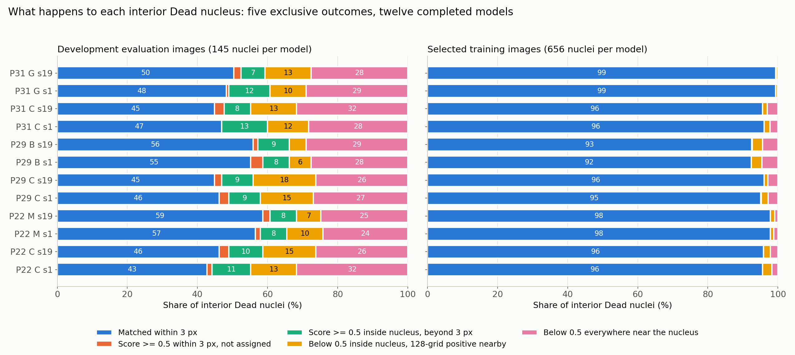
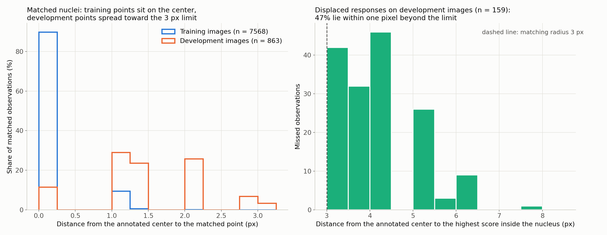
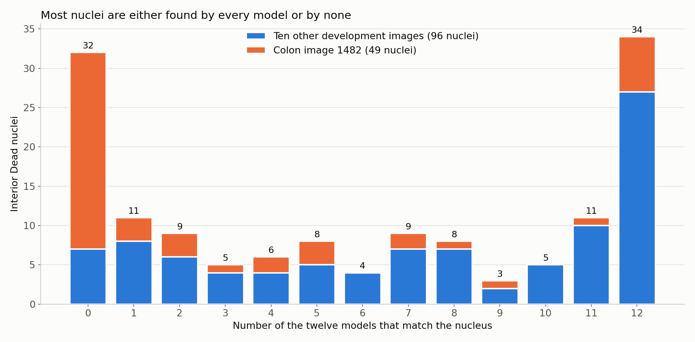
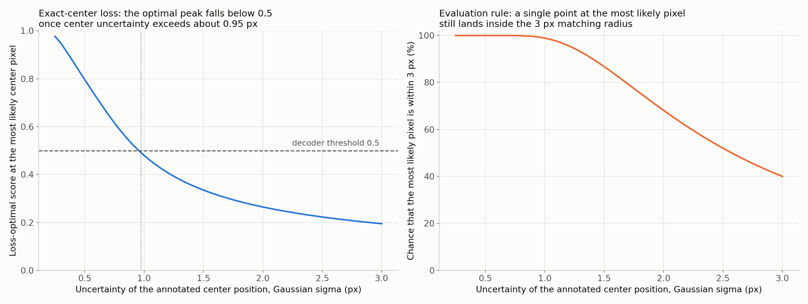

# 核中心检测：进度核查、结构分析与中心偏移读出实验（P34）

2026 年 11 月 18 日。本文先核对已完成任务的状态，再用已保存的逐对象记录分析数据、损失函数和网络结构三个层面的规律，最后说明据此设计并已提交的下一步实验。上一轮诊断的完整记录见[十二模型诊断与插值顺序对照](../center_diagnostics_recovery_2026-11-18/README.md)，更早的实验见[第八阶段报告](../../report/stage_report_8/README.md)。

> **当前状态：** 中心偏移读出实验的数组作业 **55855798** 已于 2026 年 11 月 18 日 14:31:05（美国东部时间）单次提交，14:31:54 起四个任务全部运行。各任务已在计算节点通过 44 项行为检查，并在真实检测器上通过“偏移为零时预测点保持不变”的核对。训练与评估结果待作业完成后回收。

## 一、已核查的任务进度

|任务|内容|资源|状态|
|---|---|---|---|
|55792463|P31 检测头组归一化，四次 130 轮训练|每次 1 张 V100|四项均 COMPLETED / 0:0|
|55839400|十二个已完成模型的中间输出与定位诊断（D32）|1 张 V100，实际 880 秒|COMPLETED / 0:0|
|55839942|sigmoid 与插值顺序对照（D33）|4 个 CPU 核，实际 237 秒|COMPLETED / 0:0|
|55855798|中心偏移读出（P34），四个冻结检测器|4 个任务，各 32 个 CPU 核、64 GiB、上限 10 小时|RUNNING（11 月 18 日 19:31:54 UTC 开始）|

提交前本人队列为空。项目的 GPU 额度为 1,900 SU，18:26 UTC 已记账 1,818 SU；其他成员排队中的 GPU 作业按申请时长计最多再占用 83 SU，剩余额度已被这些作业覆盖。CPU 额度为 50,000 SU，已记账 1,548 SU。因此本轮实验按 CPU 节点设计，保守上界为 1,280 SU。

## 二、数据结构：每个内部死亡核的五种结局

诊断任务 D32 为十二个已完成的模型保存了逐对象记录。评估对象是 145 个“内部死亡核”，即类别为死亡核、且不接触图像边界的标注核，全部来自开发评估集中的 11 张图像；同时记录了 48 张选定训练图像中的 656 个同类核。每个核有一个标注中心（掩膜内最接近质心的像素）。模型输出 256×256 的分数图，分数不低于 0.5 的局部极大值成为预测点；预测点落在标注中心三像素以内、并经一对一分配后，记为一次匹配。

D32 原来的诊断标记可以相互重叠。本次把每一次观察归入唯一的一类，判断顺序如下：

1. **已匹配**：核被一个三像素以内的预测点唯一匹配。
2. **中心附近达到阈值、峰在范围外**：中心三像素内的最高分数不低于 0.5，但三像素内没有超过阈值的局部峰。这样的观察共 33 次，其中 31 次在核内距中心 3.16～4.0 像素处有一个被保留的预测点：峰顶在范围之外，只有峰的侧坡伸进了三像素。
3. **核内有响应、偏离中心**：三像素内分数低于 0.5，核的掩膜内其他位置的最高分数不低于 0.5。
4. **弱响应**：核内所有像素低于 0.5，而对应的 128×128 粗网格位置有非负的预测值。
5. **无响应**：以上都不满足。

左图是开发评估图像，右图是训练图像，每一行是一个模型，条内数字为百分比。

|结局|开发评估图像（1,740 次观察）|训练图像（7,872 次观察）|
|---|---:|---:|
|已匹配|865（49.7%）|7,568（96.1%）|
|中心附近达到阈值、峰在范围外|33（1.9%）|1|
|核内有响应、偏离中心|159（9.1%）|2|
|弱响应|200（11.5%）|130（1.7%）|
|无响应|483（27.8%）|171（2.2%）|

第 2、3 两类合计 192 次，占开发评估观察的 11.0%：模型已经在核内给出了超过阈值的响应，只是峰的位置离标注中心超过三像素。同一现象在训练图像中 7,872 次观察里只出现 3 次。

按训练方案分组后可以看到各方案改变的是哪一类：

|方案（开发评估图像）|已匹配|峰在范围外（第 2、3 类）|弱响应|无响应|
|---|---:|---:|---:|---:|
|只更新编码器最后 12 层的对照（6 个模型）|45.3%|11.8%|14.4%|28.5%|
|P22 更新全部 24 层|57.6%|9.3%|8.6%|24.5%|
|P29 更新前 6 层与后 6 层|55.5%|10.7%|5.5%|28.3%|
|P31 检测头加入组归一化|49.3%|10.7%|11.7%|28.3%|

扩大编码器更新范围的两种方案主要把“弱响应”变成了匹配（14.4% 降到 8.6% 和 5.5%），“峰在范围外”这一类在所有方案中都保持在 9%～12%。前面各轮实验尚未触及这一部分。

## 三、定位误差：训练图像与开发评估图像的差距

左图比较已匹配核的预测点到标注中心的距离。训练图像上，7,568 次匹配的中位距离为 0.0 像素，99.4% 不超过一像素。开发评估图像上，865 次匹配中有 863 次的预测点位于核的掩膜内，它们到标注中心的中位距离为 1.41 像素，只有 40.4% 不超过一像素，25.7% 落在两到三像素之间。右图是第 3 类 159 次偏离响应中核内最高分数到标注中心的距离：中位数 4.0 像素，46.5% 不到四像素，93.7% 不到六像素，最远 7.6 像素；其中 152 次在核内留有一个被保留的预测点。

这两幅图描述的是同一个分布的两段。检测器在训练图像上能复现标注中心所在的像素；在未见过的图像上，它的峰落在离中心一到数个像素的位置。三像素的匹配规则把这个分布从中间切开：切线以内记为匹配，切线以外的同一个预测既记为一次漏检，又记为一个额外预测点。

一个可以逐像素核对的例子来自 P22 对照模型（种子 19）在开发评估图像 178 上的输出：实例 4 的标注中心为 (y=191, x=86)，面积 286 像素；核内最高分数约 0.963，位于 (190, 89)，距中心 3.16 像素；中心三像素内的最高分数约 0.108。该核因此没有匹配，核内的预测点被计为额外点。[该图像的诊断图](../center_diagnostics_recovery_2026-11-18/figures/p22_control_seed19_image0178_partial.png)保存在上一轮结果中。

同样的现象也出现在全部类别上。D32 保存了每个模型在 522 张开发评估图像上的全部预测点（共 12,250 个标注核）：

|模型|预测点数|精度|未匹配点：所在核内没有已匹配点|未匹配点：所在核已有匹配点|未匹配点：在所有标注核之外|
|---|---:|---:|---:|---:|---:|
|P22 对照，种子 19|10,497|69.2%|2,103|21|1,109|
|P22 对照，种子 1|10,259|69.9%|2,017|20|1,051|
|P22 全层，种子 19|10,985|72.8%|1,803|19|1,161|
|P22 全层，种子 1|10,801|73.4%|1,716|25|1,136|

精度指被唯一匹配的预测点占全部预测点的比例。十二个模型中，每个模型有 1,716～2,144 个未匹配点落在一个“尚未被匹配的标注核”内部，约占全部未匹配点的 60%～66%；落在已匹配核内的重复点只有 15～25 个。作为算术上界，如果这些点都能移动到所在核的中心三像素以内，各模型的精度将为 89.4%～90.1%。这个上界只说明这部分误差的规模，实际能够修正多少由实验回答。

## 四、哪些核始终找不到

145 个核中，34 个被全部十二个模型匹配，32 个没有被任何模型匹配，结果呈两端集中的分布。32 个始终未匹配的核里有 25 个来自同一张结肠图像（编号 1482，共 49 个内部死亡核，十二模型的平均匹配率为 27.4%）；这些核的 384 次观察中有 329 次属于“无响应”。

按面积和邻近情况分层后，两种主要损失分别集中在不同的对象上：

|对象分层（开发评估观察数）|已匹配|峰在范围外|弱响应|无响应|
|---|---:|---:|---:|---:|
|面积 200 像素以上，12 像素内无邻核（384）|66.4%|18.5%|9.1%|6.0%|
|面积 80～199 像素，无邻核（660）|60.9%|6.7%|12.0%|20.5%|
|面积 80 像素以下，无邻核（360）|45.8%|3.3%|11.9%|38.9%|
|面积 80～199 像素，有邻核（192）|12.5%|24.5%|9.4%|53.6%|
|面积 80 像素以下，有邻核（144）|13.2%|12.5%|17.4%|56.9%|

较大的孤立核很少没有响应，它们的主要损失是峰的位置；较小或拥挤的核主要是没有响应。145 个核中有 28 个在 12 像素内存在邻核，其中 23 个来自结肠图像 1482。前一类损失遍布各张图像，是目前最有条件直接处理的部分；后一类受限于这张图像本身提供的样本，需要另行研究。

## 五、理论：精确中心损失与三像素匹配规则之间的落差

训练使用的损失只把标注中心那一个像素当作正样本，周围 7×7 范围内的像素是权重较低的负样本，更远处是完整的负样本。设想模型对某个核的中心位置并不完全确定，认为中心位于像素 c 的概率为 π(c)。在最可能的像素 u 处，输出分数 p 的期望损失为

`L(p) = −π(u)·(1−p)²·ln p − [Σ_{c≠u} π(c)·(1−k(u−c))⁴]·p²·ln(1−p)`，

其中 `k(d)=exp(−|d|²/2)` 是训练目标使用的高斯核，窗口外取 0。令 π 为标准差 σ 像素的各向同性高斯分布，对 p 求最小值，得到下图左侧的曲线。

|中心位置的不确定度 σ（像素）|损失最优的峰值分数|把预测点放在最可能像素时落入三像素的概率|
|---:|---:|---:|
|0.5|0.796|超过 99.9%|
|1.0|0.480|98.9%|
|1.5|0.335|86.7%|
|2.0|0.265|68.1%|
|3.0|0.195|40.0%|

不确定度超过约 0.95 像素后，使损失最小的峰值分数已经低于解码阈值 0.5。与此同时，只要在最可能的位置给出一个点，它在 σ 为 1.5 像素时仍有 86.7% 的概率落入三像素的匹配范围。也就是说，评估规则可以接受的定位精度是两到三像素，而损失只在亚像素精度下才鼓励模型给出超过阈值的峰。这是由损失函数的形式推导出的性质，网络内部实际的不确定度并未被直接测量；与之对应的实测量是第三节的定位距离，开发评估图像上的中位距离为 1.41 像素，正处在这个落差区间里。

这个分析也解释了此前几轮只调整分数图的实验为何收益有限：加宽目标带宽（P6，两个种子各增加 0.021 的死亡核检出率）、重新分配正样本权重（P11）、直接回归高斯目标（P16）和交换 sigmoid 与插值的顺序（D33，每个模型增加 2～13 个死亡核匹配，同时在已找到的核附近出现多重输出）都还在让同一张分数图同时回答“这里有没有核”和“中心精确在哪个像素”两个问题。

## 六、结构：为什么增加一个位置读出

检测器由 UNI 编码器和一个轻量检测头组成。UNI 把 256×256 的图像切成 16×16 像素的小块，每块对应一个 1,024 维的向量；检测头读取第 6、12、18、24 层之后的四组向量，各自投影为 192 通道后融合，经过三次“放大两倍加 3×3 卷积”得到 128×128、64 通道的特征图，再由一个 1×1 卷积给出预测值，最后双线性插值到 256×256。

这一结构有两个与定位直接相关的特点。第一，一个 16 像素小块内部的位置信息只能编码在这个小块的向量里。D32 的平移试验把图像平移一个像素后，6,048 次观察中有 744 次（12.3%）跨过了 0.5 的阈值，说明响应依赖图像与小块网格的对齐方式。第二，训练使用的旋转 90 度、翻转和亮度对比度变化都保持图像与网格的对齐关系，检测器在训练中见到的每张图像只有一种对齐方式。此前的 P15 在训练检测器时加入最多 16 像素的平移，死亡核检出率下降了 0.193 和 0.090；那一轮同时改变了检测器学到的全部内容。

本轮的做法是保持检测器完全不变，在同一张 64 通道特征图上增加一个小的位置读出：两个 3×3 卷积（各 64 通道）加一个输出两个数的 1×1 卷积，共 73,986 个参数，输出每个像素指向所在核标注中心的位移（纵向和横向各一个数）。解码时，检测器给出的预测点保持原有的集合和顺序，每个点按它所在像素读出的位移移动一次；移动后落在更高分预测点两像素以内的点被合并。读出层的输出权重初始为零，训练开始时移动量恒为零，解码结果与原检测器完全相同。

把定位交给位移回归有三个可以检验的理由。其一，监督是稠密的：核内每个像素都有目标，训练图像中的 50,968 个标注核全部参与，而精确中心损失每个核只有一个正像素。其二，位移在核内是位置的线性函数，目标平滑。其三，在位置不确定时，绝对误差损失的最优输出是中心位置的条件中位数，它随不确定度平缓变化，不会像峰值分数那样掉到阈值以下。这三点是设计依据，是否成立由实验结果判断。

## 七、P34 实验设计

设计在查看任何 P34 结果之前由科学提交 `34fc988` 固定。

**检测器。** P22 的四个已完成模型：只更新最后 12 层的对照和更新全部 24 层的模型，种子 19 和 1，均为第 130 轮的最后检查点，全程冻结。

**两种读出。** 每个检测器训练两个位置读出，二者初始权重相同，图像顺序、旋转、翻转和颜色变化的随机抽取也完全相同，唯一的区别是：
- “相同增强”读出只使用检测器训练时的增强；
- “加入平移”读出在此之前把图像沿两个方向各随机平移 −8～8 个整数像素，空出的区域填白色，被边界切开的核按同一标注规则重新计算中心。

**训练。** 2,134 张训练图像，12 轮，每批 16 张，AdamW，学习率 3×10⁻⁴ 并按余弦下降到十分之一，权重衰减 0.01。损失是每个核内位移绝对误差的平均值，再对核取平均，大核和小核权重相同。

**三种解码。** 在完全相同的预测点上比较：原解码；每个点按读出移动；移动后再合并两像素以内的点。训练图像的标注中心之间没有任何一对距离在三像素以内，六像素以内的有 60 个，因此两像素的合并半径不会合并两个真实的标注核。

**三组评估图像。** 522 张开发评估图像（沿用原来的全部规则）；D32 使用的 48 张选定训练图像；同样 48 张训练图像整体平移 (5, 3) 像素后的版本。第三组把“记住了训练图像的内容”与“学会了读出位置”分开。

**主要比较。** 提交前固定为：更新全部 24 层的检测器、加入平移的读出、移动并合并的解码，与同一检测器的原解码相比，两个种子都满足原来的判定条件：内部死亡核检出率不低于 0.60，提高不少于 0.05 且成对自助法 95% 区间下限大于 0，精度不低于 0.75 且不比原解码低 0.02 以上，总体检出率不比原解码低 0.02 以上。其余七组比较用于解释机制。

**结果的判读。**

|观察到的情形|含义与后续方向|
|---|---|
|训练图像上位移误差小，平移后的训练图像上误差明显变大|读出记住了特定对齐方式下的图像内容；位置信息的泛化要靠平移多样性解决。|
|训练图像及其平移版本上误差都小，开发评估图像上误差大|位置线索不能迁移到新的组织内容；需要研究特征本身。|
|三组图像上误差都小，且开发评估图像的匹配数增加、额外点减少|偏离中心的响应可以由位置读出修正；下一步把分数与位移放在同一个模型中联合训练，再进入实例分割阶段。|

按 D32 的记录，如果第 2、3 两类观察全部被修正，P22 全层模型的内部死亡核匹配数将由 85 和 82 变为 99 和 95（68.3%、65.5%），对照模型由 67 和 62 变为 85 和 80（58.6%、55.2%）。这是算术上界。

**数值精度。** 作业在 CPU 上以单精度浮点运行，原训练时的评估在 V100 上使用 BF16 自动混合精度。三种解码都来自同一次单精度前向计算，彼此严格成对；单精度结果与原保存结果逐图比较并记录差异。

## 八、提交、验证与已取得的运行记录

|项目|记录|
|---|---|
|作业|数组 55855798，任务 0～3 依次为对照种子 19、对照种子 1、全层种子 19、全层种子 1|
|提交与开始|2026-11-18T19:31:05Z 单次提交；19:31:54Z 四个任务同时开始，节点 exp-8-38、exp-9-46（两个任务）、exp-5-14|
|资源|shared 分区，每个任务 32 个 CPU 核、64 GiB、上限 10 小时；CPU 额度上界 1,280 SU|
|源码|科学提交 `34fc98837919902ba21e440d18b3d4656946f44e`；526 个文件的封存摘要 `3589e17a461b0aabf977d0424c29221f2f9bf4ed6ccb2fa7b3cf82fb32b8c394`|
|LM1 检查|44 项行为检查通过（8.78 秒），其中 29 项为本实验新增|
|LM1 真实数据联调|2,134 张训练图像、50,968 个标注核的中心与面积全部与既有标注一致；完整流程在真实图像上运行通过（检测头未训练，仅验证代码路径）|
|节点检查|四个任务各自通过 44 项检查|

每个任务在训练前先用偏移恒为零的读出完整评估一遍。四个检测器上，“移动”解码与原解码在 522 张开发评估图像上的逐图计数完全相同。同一步还给出了单精度结果与原保存结果的比较：

|检测器|单精度：匹配数 / 预测点数 / 内部死亡核匹配|原保存（BF16）：同上|计数有差异的图像|
|---|---|---|---:|
|P22 对照，种子 19|7,255 / 10,488 / 66|7,264 / 10,497 / 67|111|
|P22 对照，种子 1|7,199 / 10,280 / 61|7,171 / 10,259 / 62|116|
|P22 全层，种子 19|7,979 / 10,945 / 85|8,002 / 10,985 / 85|87|
|P22 全层，种子 1|7,933 / 10,804 / 84|7,924 / 10,801 / 82|82|

数值精度改变了 82～116 张图像上的个别计数，匹配数和预测点数的总量差异在 0.4% 以内，内部死亡核匹配数相差 0～2 个。本实验的成对比较全部以单精度的原解码为对照。

实测前向速度为每张图像 0.31～0.51 秒；对照种子 19 的第一轮训练用时 596 秒。据此估计，两个对照检测器的任务需要约 4.5 小时，两个全层检测器的任务需要约 6.5 小时。

## 九、作业完成后的工作

1. 按保存清单逐文件核对后回收小型结果，在 LM1 上合并四个检测器并计算两个种子的成对判定。
2. 逐对象追踪原解码与新解码之间新增和丢失的匹配，并按第二节的五种结局分组，核对被修正的对象是否就是“峰在范围外”的那两类。
3. 比较三组图像上的位移误差分布，按第七节的判读表确定机制。
4. 保存并回收固定图像的对照图（每个检测器 23 张，原图与标注、原解码、两种读出各一栏），连同统计图一起写入双语分析。

## 数据范围与口径

全部比较使用 fold 1 的训练与开发评估划分，指标为核中心检测。开发评估集的 145 个内部死亡核来自 11 张图像，十二个模型对同一批对象重复观察。方法进入实例分割评估阶段后，按项目规定使用最后检查点、官方指标实现和三折报告。

## 文件

- [结构分析的全部数字](STRUCTURE_ANALYSIS.json)与[生成脚本](analyze_structure.py)
- [提交收据](P34_SUBMISSION.json)
- [训练与评估脚本](../../../scripts/train_center_offset_p34.py)与[行为检查](../../../tests/test_center_offset_p34.py)
- [英文版](REVIEW_EN.md)、[中文导读](GUIDE_ZH.md)

参考：[Objects as Points](https://arxiv.org/abs/1904.07850)（中心点加位移回归的检测形式）、[Vision Transformers for Dense Prediction](https://arxiv.org/abs/2103.13413)。第五节的期望损失推导针对本项目实现的损失函数。
