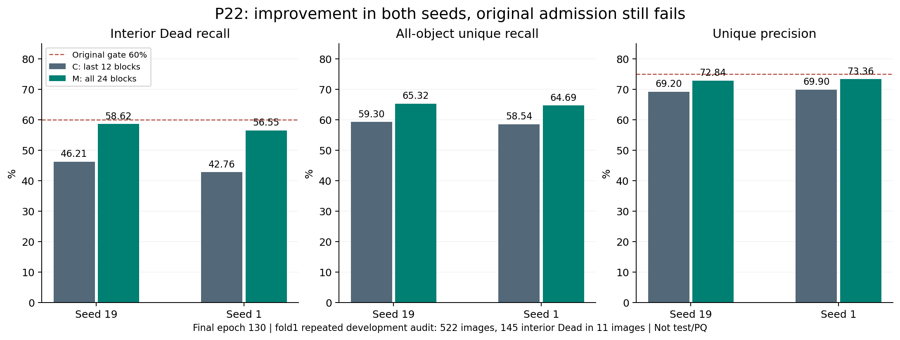

# 这轮实验告诉了我们什么？

这次P22把模型能学习的范围从后半段扩大到整个24层Transformer。结果有明显进展：原来145个内部Dead对象中，两个种子分别找到67和62个；现在找到85和82个。整体找点也改善了，而且额外预测减少，不是靠到处多画点换来的。

**为什么有进步，却仍然记为未通过？**

实验前约定了两个绝对要求：Dead召回至少60%，预测精度至少75%。现在Dead召回是58.62%和56.55%，精度是72.84%和73.36%，还没有到线。它回答了“全层适配是否在这批开发图上更好”：答案是两个种子都更好；它还没有满足“是否足够可靠，值得进入下一阶段”的条件。保留正向发现与遵守停止规则可以同时做到。

**是否只靠一两张图撑高平均数？**

Lung中的一张图贡献很大，Stomach则变差了。我们把11张Dead阳性图逐张去掉，剩余图上的总体增益仍为正。因此方向不完全依赖单张图，但证据也没有看起来那么庞大：145个对象中80%来自Lung和Colon。对象多不等于独立患者多，这仍然是反复使用的内部开发检查。

**图片应该怎么看？**

[种子19对照](figures/p22_fixed_audit_seed19.png)和[种子1对照](figures/p22_fixed_audit_seed1.png)各保留全部八张预先选定的审计图，左侧是后12层适配，右侧是全24层适配。既有改善也有退步，还保留空图和普通对象图。看匹配、漏检和额外点的变化，比只看一张漂亮预测更有用。最终结论来自全部522张审计图，而不是这些展示图。

**代价增加了多少？**

纯训练从每跑约4小时变成约5.7小时，增加42%–43%；显存从约4.05GiB变成6.74GiB。四跑实际占用约21.48GPU小时。这里说的是训练成本，未测新的推理速度。

**下一步做什么？**

P23准备检验“把训练过程中相邻的参数状态平滑平均，能否改善最终找点”。使用原始后12层模型，每个种子只训练一次，最终比较普通权重和固定EMA权重；不挑最佳训练时刻，也不靠修改阈值凑过线。两个种子总正式申请上限24GPU小时，先通过真实V100验证才提交。

目前方案和实现已在研究分支提交，61项专项测试通过，完整CPU测试和独立审查正在进行。用户授权后连接已恢复，原未知请求核查确认没有执行；未动其他会话。**下一轮正式任务和GitHub推送尚未完成**，后续实际进度见P23_SUBMISSION.md。已核实的P22分析与48张图片已保存在本地。
