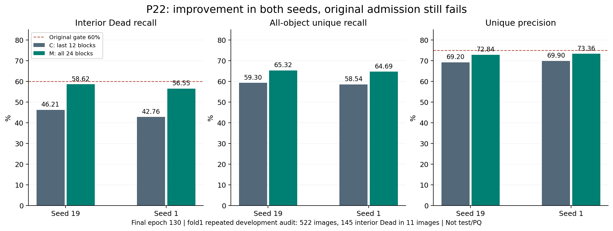
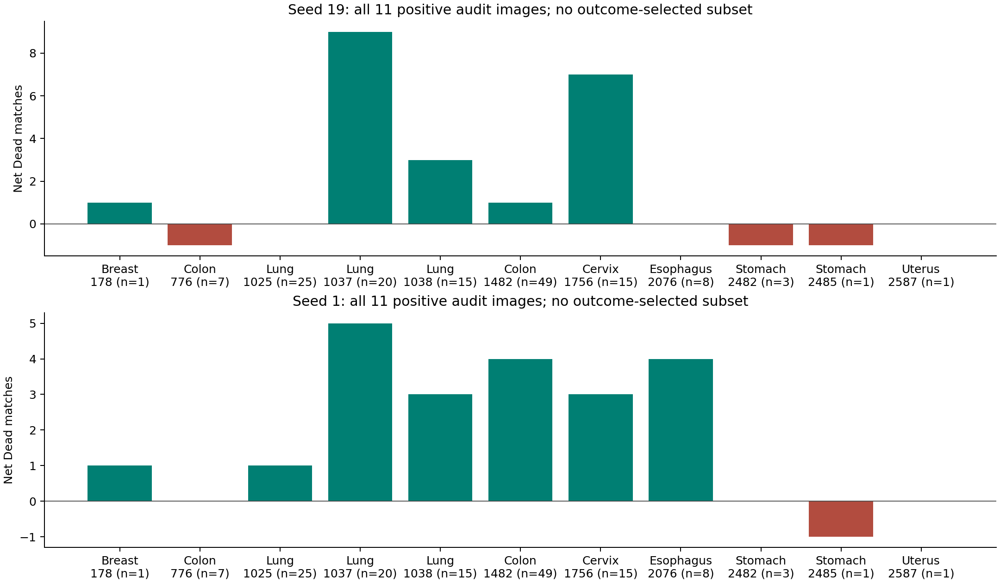
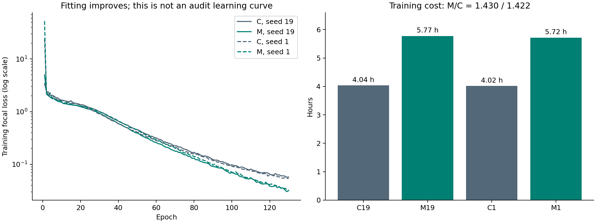

# P22 verified closeout and P23 submission — 4 November 2026

P22 produced a substantial, consistent development improvement, but failed the frozen admission rule. All four runs in array **55469245** completed 130 epochs with `COMPLETED/0:0`. The next distinct experiment, P23, passed CPU and V100 validation and was submitted as array 55538967. It tests fixed parameter averaging on the original control trajectory. No P23 outcome is reported yet.

## What was verified

The immutable P22 training source is `3af8cac4d025b7d97a1b548e3f3ef93863546bad`, with 463 source files and manifest SHA256 `2ff1440699a7d23dc77b486087403896998dbeda7e2e55539714ac84cc54c492`. Sixty-six small payloads were collected and checked by byte count and SHA256; recursive preservation checks included the fixed sample images. Four complete 130-epoch logs, configuration, fit/audit membership, input/UNI identities and original summaries agree. All four SLURM stderr files were empty. Forty-eight final-checkpoint PNGs were recovered and checked. Large `last.pth`/`final.pth` files were size-matched to preservation records, but were neither independently rehashed nor transferred; an independent external checkpoint archive remains outstanding.

The original admission function was replayed on LM1. An independently implemented image bootstrap matched its intervals and decisions. Local NumPy1.26.4 reproduced the server NumPy1.23.5 intervals exactly. This is verification of the recorded calculation, not new inference or an independent dataset.

## Main result

C adapts UNI blocks12–23; M adapts all24 transformer blocks. Architecture, initialization, native256 input, head, loss, training cohort, optimizer rates,130epochs, decoding and last-checkpoint rule are unchanged. Embeddings and final norm stay frozen. Global gradient clipping spans the full trainable set, so this is an adaptation-depth/optimization recipe, not isolated causal evidence about a particular early layer.

| Seed | Arm | Dead matched /145 | Dead recall | All-object recall | Unique precision | Fit recall |
|---|---|---:|---:|---:|---:|---:|
|19|C|67|.462069|.592980|.692007|.977770|
|19|M|85|.586207|.653224|.728448|.988248|
|1|C|62|.427586|.585388|.698996|.977692|
|1|M|82|.565517|.646857|.733636|.989032|

Paired interior-Dead changes are **+.124138** (95%CI **[+.037975,+.255102]**) and **+.137931** (**[+.089109,+.204178]**). The descriptive mean gain is .131034; it is not a pooled independent estimate. Overall recall rises .060245/.061469 and precision rises .036441/.034640.

Both seeds pass support, minimum gain, positive CI lower bound, relative precision/recall and nondegeneracy clauses. Both fail **absolute Dead recall .60** and **absolute precision .75**. The .60 Dead threshold requires 87 of 145 matches: M falls short by 2 matches in seed 19 and 5 in seed 1. Precision also remains 2.16 and 1.64 percentage points below .75. Passing Dead alone would therefore still be insufficient. Consequently the original conjunction is false and this fixed full-depth recipe closes. Neither a threshold adjustment nor selecting the better seed/checkpoint is justified by these data.

## Why the signal is informative

The gains do not arise simply from emitting many more points. In seed19, candidates increase10497→10985, but matches increase7264→8002 and unmatched predictions fall3233→2983. In seed1, candidates increase10259→10801, matches7171→7924 and unmatched predictions fall3088→2877. Thus matches increase by738/753 while extra predictions fall by250/211. The sets are summarized by counts; these aggregates do not identify which individual objects switch between outcomes.

Across all522 audit images, M has more matches in285/304 images, fewer in103/96 and equal counts in134/122. The improvement extends beyond the small Dead-positive subset. Small-interior-object matches rise7→11 out of32 in both seeds, although that denominator is too small for broad claims.

Dead gains remain heterogeneous. Lung contributes+12/+9 matches; Cervix+7/+3; Colon0/+4; Esophagus0/+4; Breast+1/+1; Stomach−2/−1; Uterus0/0. Lung image1037 contributes+9/+5 alone. Removing each Dead-positive image in turn leaves a positive aggregate gain: ranges **+.0720 to+.1771** and **+.1168 to+.1667**. These leave-one-image-out ranges are descriptive sensitivity checks, not replacement confidence intervals. They show the direction survives removal of any one image; they do not establish patient independence or universal tissue benefit.

The endpoint support is only145 interior Dead objects in11 images from7 tissues. Lung and Colon together contain116/145 objects (80%). Singleton tissue groups cannot contribute within-tissue resampling variability to this bootstrap. Reusing the same fold1 audit over many proposals also introduces adaptive selection bias. The positive intervals therefore describe this fixed development audit under its sampling procedure; they do not establish external generalization or confirmatory significance after the entire search history.

## Fitting and cost

Fit coverage improves from about97.77% to98.82%/98.90%, while audit coverage reaches65.32%/64.69%. The fit–audit gap narrows by roughly five percentage points but remains33.50/34.22points for M. Last training losses fall .05734→.03159 and .05373→.03337. Better fitting and better audit scores coexist; the evidence does not justify attributing the remaining gap solely to overfitting, optimizer noise or representation quality.

| Seed | Arm | Training hours | Recorded run elapsed hours | Epoch-checkpoint minutes | Training peak GiB |
|---|---|---:|---:|---:|---:|
|19|C|4.0374|4.2488|6.75|4.0474|
|19|M|5.7731|6.3084|14.42|6.7448|
|1|C|4.0183|4.2718|6.97|4.0474|
|1|M|5.7155|6.0124|12.92|6.7448|

M/C training-time ratios are1.4299/1.4224. The four allocated tasks total **21.4767 GPUhours** by SLURM elapsed time, below the64GPUhour request envelope; smoke is separate. Scheduler time includes startup/storage work and differs from the runner timer. M optimizer checkpoints are3.668GB versus1.854GB for C. These are actual measured training costs, not inference benchmarks. The inference architecture is unchanged, but no fresh deployment-speed result is claimed.

## Interpretation across experiments

Historical P10(last4) reduced overall audit coverage; P14(encoderLR1e-6) also reduced transfer. P22 extends adaptation in the opposite direction and improves both recall and precision. Together they support treating encoder adaptation as an important empirical axis for this detector. They do not prove that unfreezing more parameters will monotonically improve every protocol. Across rounds, fresh controls themselves vary; comparisons must use each round's paired control rather than subtract unrelated raw scores.

Other closed interventions address different questions: P20(input512) improved Dead less and cost about4.3times training, while P21 semantic auxiliary supervision failed to improve both seeds. P22 is therefore a useful positive mechanistic result despite failing admission. No closed recipe is automatically reopened, and no segmentation/mask or three-split performance claim follows from point-detection improvements.

## Fixed visual evidence

All8audit+4fit examples per run are preserved, including empty and non-Dead strata; none were selected by model performance. Each PNG contains the original image, GT centers, predictions and unique-match/miss/extra visualization. Coordinates accompany the original collected payloads. Full audit contact sheets: [seed19](figures/p22_fixed_audit_seed19.png), [seed1](figures/p22_fixed_audit_seed1.png). Images illustrate spatial behavior, while the full audit metrics determine the verdict. These are final130epoch examples, not smoke previews.

## Next experiment and actual execution state

P23 asks whether a fixed exponential average of the original last12 training trajectory improves generalization. It is independent of P22's full24 recipe. Each fresh seed19/1 trajectory yields ordinary epoch130 C and epoch130 EMA E. FP32 shadows are initialized from trainable parameters, updated with decay.999 after every successful optimizer step including the tail, and never fed into training. There is no best-epoch/decay search. Two trajectories suffice because the online control is shared; formal cap24GPUhours, smoke separately30minutes. The original paired gate remains unchanged. E is a final algorithmic EMA checkpoint averaging historical parameter values, not the final instantaneous parameter vector. One model is used at inference.

The fixed decay has an interpretable time scale. For beta=.999 and 134 updates per epoch, the parameter-weight half-life is 692.80 updates, or 5.17 epochs; the most recent 2302 updates (17.18 epochs) carry at least 90% of the averaging mass. The initialization coefficient after 17420 updates is only 2.70e-8. These are algebraic properties, not measured independent samples: consecutive optimizer states are correlated. Averaging may suppress fluctuations, but it may also lag useful late adaptation. The fit–audit gap alone cannot distinguish those explanations.

Weight averaging has prior motivation in [Mean Teacher](https://arxiv.org/abs/1703.01780), which uses averaged weights for semi-supervised targets, and [SWA](https://arxiv.org/abs/1803.05407), which studies trajectory averaging with cyclical or constant learning rates. P23 adds neither teacher-consistency training nor the SWA learning-rate schedule. Those papers motivate the question; they do not establish that this frozen EMA recipe will help our detector. This context was added during validation without changing the frozen algorithm.

P23 passed 61 focused tests and the full CPU suite (1029 passed, 3 skipped, 19073 warnings in 502.90s (0:08:22)); the submission storage adapter additionally passed 17 focused checks. Independent review's quota-admission finding was fixed. V100 smoke 55536183 passed both-seed original-control parity, EMA witnesses, strict reload/source/cohort checks and readiness in 1280 seconds; 1.5x safety 7.8951 hours, training peak 4.6232 GiB. **Formal array 55538967 was submitted once at 2026-11-04T23:31:24.262351Z**, two 12-hour trajectories, 24 GPUhour envelope. This records submission, not completed research results. See [actual validation and receipt](P23_SUBMISSION.md) and [machine-readable receipt](P23_RECEIPT.json).

## Machines at the last verified snapshot

LM1 `/data7` was100% utilized with9.9GiB free after the authorized recovery; root `/tmp` had202GiB. Do not copy checkpoints or run storage-heavy tests there without rechecking. LM2 `/data6` had3.3TiB free, root231GiB; no project training was observed. Other users' GPU loads were preserved. Expanse P22 was complete; unrelated jobs remained untouched. These are dated observations, dated observations requiring fresh checks before computation.

Reproduce local checks and figures with `python source/review_2026-11-04/build_delivery.py` from the local workspace, using the delivered raw JSON. No network or inference is required. See `LOCAL_VERIFICATION.json` and the JSON analysis for exact values. Current Expanse operational rules were consulted in the [official user guide](https://www.sdsc.edu/systems/expanse/user_guide.html); any later submission still requires fresh account and queue checks.
