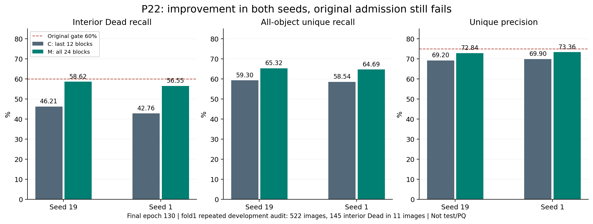
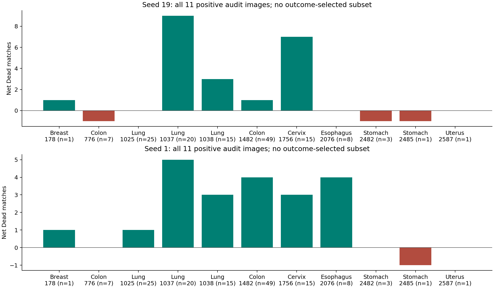
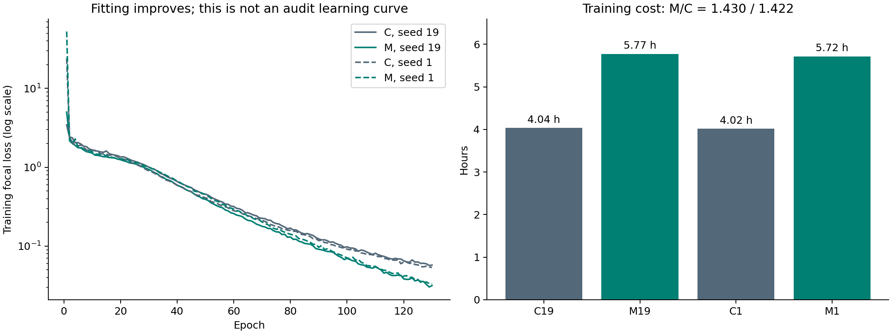

# P22 结果详析与 P23 提交记录

日期：2026年11月4日，美国东部时间。

P22 得到了两个种子方向一致、幅度明显的开发集改善，但仍未通过原判定门。四组任务全部完成130轮，保存清单与源码已核验。P23 已通过 CPU、独立审查和真实 V100 验证，正式数组 55538967 已提交。下一轮测试原始对照轨迹的固定参数平均，尚无 P23 效果结论。

## 一、结果可信度与实验口径

P22 数组55469245的四项均为COMPLETED/0:0，错误日志为空。已检查66份小文件、463份封存源码、四条连续130轮训练记录、配置、数据及UNI权重身份、拟合/审计成员和原汇总指标。48张最后检查点样例图逐项通过SHA256验证。大检查点只核对大小，没有独立重算哈希或回传；外部独立归档仍待完成。

全部结果来自反复使用的fold1内部开发划分：拟合2134张，审计522张。这是找点能力，不是实例分割PQ，也不是独立测试集性能。审计中的内部Dead只有11张图、145个对象。LM1原判定函数、独立bootstrap实现和本地NumPy复算给出一致的区间与结论。

## 二、全层适配确实改善了找点，但还差什么

C只训练UNI最后12个block；M训练全部24个block。两者输入、点头、初始化、损失、学习率、130轮训练和解码均相同，嵌入与最终norm保持冻结。全局梯度裁剪覆盖的参数集合会随解冻范围变化，因此这里比较的是完整适配配方，不能把结果直接归因于某一个早期层。

|种子|方案|Dead匹配数/145|Dead召回|总体召回|唯一匹配精度|
|---|---|---:|---:|---:|---:|
|19|C|67|46.21%|59.30%|69.20%|
|19|M|85|58.62%|65.32%|72.84%|
|1|C|62|42.76%|58.54%|69.90%|
|1|M|82|56.55%|64.69%|73.36%|

Dead召回分别提高**12.41和13.79个百分点**。原组织分层、图像配对bootstrap的95%区间分别为**[3.80,25.51]**和**[8.91,20.42]个百分点**，两者下界均大于零。总体召回也提高6.02/6.15个百分点，精度提高3.64/3.46个百分点。

但是原规则要求Dead召回至少60%、精度至少75%，两个种子都没有达到。样本支持、最小增益、区间下界、相对精度/召回和非退化条件通过，两个绝对门槛失败。因此正式结论是：**本固定全层适配配方关闭，保留其清楚的正向研究信号。**不能在看到结果后降低门槛、换阈值或只保留表现更好的种子。

## 三、不是单纯多报点换召回

种子19的候选点增加488个，但匹配对象增加738个，额外预测减少250个；种子1候选点增加542个，匹配增加753个，额外预测减少211个。它同时改善了覆盖与预测质量。522张审计图中，种子19有285张匹配增加、103张减少、134张不变；种子1对应304/96/122张。收益不限于少量Dead图像。

内部小对象的匹配均由7/32升至11/32，但样本太少，不能据此概括所有小核表现。逐图计数也无法给出每一个对象的身份迁移，不能把净增量直接描述为“这些对象全部从漏检变为检出”。

## 四、收益分布与不确定性

按组织计算Dead净匹配变化，两个种子分别为：Lung+12/+9，Cervix+7/+3，Colon0/+4，Esophagus0/+4，Breast+1/+1，Stomach−2/−1，Uterus0/0。Lung图1037单独贡献+9/+5，说明局部贡献不均，但收益不完全依赖它。

逐一删去每张Dead阳性图，再计算剩余图像的总体Dead增益：种子19范围为**7.20–17.71个百分点**，种子1为**11.68–16.67个百分点**，都仍为正。这是敏感性描述，不是新的置信区间，也不替代原判定。

145个Dead中116个来自Lung与Colon，占80%。11张阳性图仅覆盖7种组织，某些组织只有一张图，组织内bootstrap无法表达这些单图组的变化范围。再加上同一开发集经过多轮适应性研究，这些区间不能当作整个探索过程校正后的确认性显著性，更不能推断患者独立或外部泛化。

## 五、拟合与计算代价

C的拟合总体召回约97.77%，M升至98.82%/98.90%；M审计召回仍只有65.32%/64.69%。拟合与审计差距缩小约5个百分点，但仍有33.50/34.22个百分点。最后训练损失分别从.05734降到.03159、从.05373降到.03337。数据支持“拟合更好且审计也更好”，并不单独证明剩余问题来自优化噪声、过拟合或某种表示缺陷。

|种子|C纯训练小时|M纯训练小时|M/C耗时|C/M训练峰值显存|
|---|---:|---:|---:|---:|
|19|4.0374|5.7731|1.4299|4.047/6.745 GiB|
|1|4.0183|5.7155|1.4224|4.047/6.745 GiB|

全层训练增加约42%–43%耗时。四个SLURM任务实际合计21.4767GPU小时，低于申请的64GPU小时包络；smoke另计。调度器耗时包括准入、保存等环节，和纯训练时间不同。M的last检查点约3.668GB，C约1.854GB。推理架构不变，但本轮没有测新的推理速度，不能把训练成本比当作部署成本比。

## 六、放回整个研究过程看

历史P10把可训练层缩到最后4层，总体审计覆盖下降；P14降低编码器学习率，也降低迁移。P22向相反方向扩大适配范围，召回和精度一起改善。这使“编码器适配程度”成为值得认真记录的经验线索，但不意味着继续解冻或增加训练一定单调变好。

P20增大输入带来较小的Dead改善，训练代价约4.3倍；P21语义辅助头未在双种子取得一致改善。相比之下，P22的改善幅度与成本关系更值得讨论。但各轮新对照本身存在波动，必须比较每轮的配对差值，不能把不同轮的原始分数直接相减作因果结论。所有关闭配方仍按各自原规则关闭。

## 七、图片与下一轮方案

已保存每跑8张审计图、4张拟合图，共48张，包含Dead、空图和普通对象分层。样本按GT预定规则选择，没有按效果筛图。每图展示原图、GT中心、预测以及唯一匹配/漏检/额外点；原始坐标也已回收。[种子19完整对照图](figures/p22_fixed_audit_seed19.png)、[种子1完整对照图](figures/p22_fixed_audit_seed1.png)都包含八张审计样例。

P23独立测试原始last12模型的固定EMA参数平均。每个种子只训练一次，同一轨迹产生最终普通权重C和最终EMA权重E。EMA从初始可训练参数克隆，以.999衰减在每次成功优化后更新，包括最后尾批；不反馈到训练，不选择最佳epoch，不扫描衰减率。两种子正式上限24GPU小时，硬件验证另申请30分钟，原判定门保持不变。这是研究假设，不是“EMA一定修复泛化”的承诺。

固定 .999 的时间尺度也需要说清楚：每轮 134 次更新时，权重半衰期约 692.8 次更新，即 5.17 轮；最近 2302 次更新、约 17.18 轮承载至少 90% 的平均权重。17420 次更新后，初始化权重只剩约 2.70e-8。这是代数性质，不能把相邻、相关的优化状态当作独立样本。平均可能减少波动，也可能滞后于最后阶段的有效适配；现有拟合—审计差距无法判定哪种解释成立。

[Mean Teacher](https://arxiv.org/abs/1703.01780) 使用权重平均构造半监督目标，[SWA](https://arxiv.org/abs/1803.05407) 研究循环或恒定学习率下的轨迹平均。P23 没有加入前者的一致性训练，也没有更换为后者的学习率方案。这些工作提供研究动机，不能替代本项目的配对验证；文献说明在验证期间补入，冻结算法没有变化。

方案和实现已提交，61项专项通过；完整CPU结果为1029 passed, 3 skipped, 19073 warnings in 502.90s (0:08:22)，配额修复另17项通过。独立审查发现的提交前配额检查缺口已修复。真实V100验证55536183完成并通过，耗时1280秒：双种子与原对照等价、EMA更新见证、冻结参数、最后/最终C/E重载和源码/数据准入全部通过。保守耗时外推7.8951小时、训练峰值4.6232GiB。**正式数组55538967已于2026-11-04T23:31:24.262351Z单次提交**，两种子各12小时，总申请24GPU小时；提交不代表训练完成。详见[P23验证与提交](P23_SUBMISSION.md)。

恢复后的资源快照：LM1 `/data7`100%使用、约9.9GiB剩余，`/tmp`约202GiB，完整CPU测试使用短路径`/tmp`。LM2复查 `/data6`约3.3TiB剩余，未见本项目训练；Expanse本项目P22全部完成，其他项目作业保留。资源均为带时间的观测，计算前仍须重新核实。
