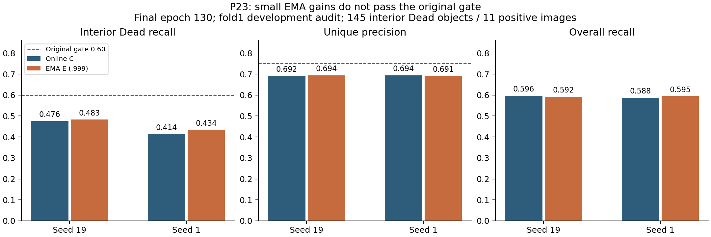
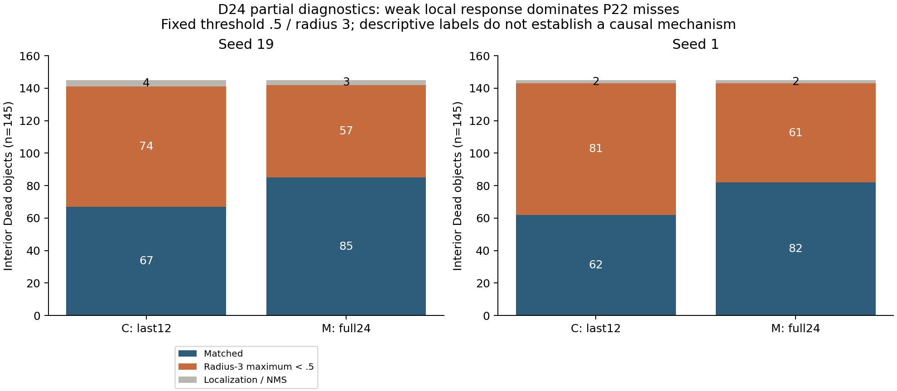
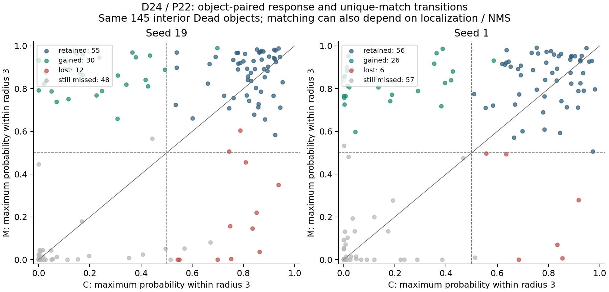

# P23 closeout, D24 partial diagnosis and P24 rationale — 6 November 2026

P23's fixed 0.999 EMA does not satisfy the original two-seed admission rule. Both 130-epoch trajectories completed, and the restored raw results reproduce the earlier preliminary values exactly. Close this precise EMA recipe. P22's full-depth adaptation also remains closed despite its larger improvement. P24 is a separate, adaptive development experiment: raise the encoder learning rate from 1e-5 to 3e-5 while keeping the original last 12 trainable blocks.

## Evidence and completion

| Work | Verified state | Interpretation |
|---|---|---|
| P22 array 55469245 | Four completed runs; previously verified source/preservation; D24 now reproduces all 522 image counts for each model | Valid development comparison; original gate failed |
| P23 array 55538967 | Both COMPLETED / 0:0, 130 epochs, 17,420 EMA updates | Final online C and EMA E share each seed's training trajectory |
| D24 integrity 55551568 | COMPLETED / 0:0; integrity JSON PASS | Eight checkpoints, 180 payloads, 934 source files across the P22/P23 snapshots checked |
| D24 points 55551569 | FAILED / 1:0 after 1,964 seconds | Lustre I/O error opening the seventh model output; six completed model outputs retained |

The D24 failure is an infrastructure failure, not a negative scientific result for the missing models. Available outputs are all four P22 models and P23 C/E seed19. P23 seed1 per-object diagnosis was not generated and is not imputed. Its final evaluation metrics are available and valid independently of D24.

The morning read attempts timed out at 240 seconds, and the quota probe at 195 seconds. At 17:37 UTC all three strict quota scopes passed; scratch/project 64-KiB write–fsync–readback then passed. A new bounded collection recovered 33 small files totaling 4,036,115 bytes, including eight final PNGs, and all six available D24 compact outputs. Thirty collected P23 payloads were checked against their preservation manifests; the two manifest files and integrity report retain their separate collection hashes. No checkpoint was transferred to Windows. See [raw verification](raw_verification.json), [recovered artifacts](p23_recovered), and [D24 six-model evidence](evidence/d24_recovered_six.jsonl).

## P23: final values and why the recipe closes

| Seed / output | Interior Dead hits /145 | Dead recall | Overall recall | Unique precision | Small Dead hits /32 |
|---|---:|---:|---:|---:|---:|
| 19 / online C | 69 | .475862 | .596490 | .692082 | 6 |
| 19 / EMA E | 70 | .482759 | .592327 | .694022 | 6 |
| 1 / online C | 60 | .413793 | .587673 | .694415 | 6 |
| 1 / EMA E | 63 | .434483 | .594776 | .691337 | 6 |

EMA's paired Dead-recall changes are +.006897 and +.020690. The original 1,000-replicate tissue-stratified positive-image bootstrap (seed20261018) gives [0,.018750] and [.015228,.032276]. The complete 522-image raw evaluations were rerun through the unchanged `proposal_p3_utils.admission`; results equal the earlier preliminary gate object. Both seeds fail absolute Dead recall >=.60, gain >=.05 and precision >=.75; seed19 additionally fails the strictly positive lower CI condition. Relative precision/overall-recall noninferiority, support and nondegeneracy pass. A positive seed1 interval does not rescue the failed conjunction.

The gain is also narrow: seed19 adds one hit on Lung image1025; seed1 adds one each on Colon776, Colon1482 and Cervix1756. All four outputs detect only 6/32 small interior Dead objects. No audit image reaches the candidate cap512; the maxima are123/121/114/113. Raising the cap therefore has no support from these results.

Training fit is much stronger than development audit. Fit overall recall is .9757–.9777, precision .9982–.9988, and interior Dead recall .9512–.9543, versus audit Dead .4138–.4828. This argues against explaining the result as simply insufficient fit to training points. It does not prove a specific causal account of the transfer gap. EMA changes neither the fitting objective nor the decoder, and its small aggregate improvement fails to address the small-Dead deficit.

P23 uses two trajectories rather than four independent training runs. Pure training takes14,508.42/14,515.42seconds; checkpoint saves414.07/371.83seconds. SLURM elapsed times15,248/15,114seconds sum to8.4339GPUh. E adds averaging, storage and evaluation overhead to the shared trajectory; these receipts do not isolate EMA-only overhead, so no standalone EMA cost ratio is claimed.

## D24: what the object-level diagnosis adds

| P22 seed | C matched / low / localization | M matched / low / localization | New hits | Lost hits | Retained hits | Missed by both |
|---|---|---|---:|---:|---:|---:|
| 19 | 67 / 74 / 4 | 85 / 57 / 3 | 30 | 12 | 55 | 48 |
| 1 | 62 / 81 / 2 | 82 / 61 / 2 | 26 | 6 | 56 | 57 |

All rows refer to the same145 interior Dead objects, matched by image and GT instance index. A low-response miss means the maximum probability within radius3 of the GT center is below the fixed .5 threshold. Among P22 misses this accounts for94.87%/95.00% in seed19 C/M and97.59%/96.83% in seed1 C/M. No cap exclusion or unique-matching competition appears in these four diagnostic outputs. Localization/NMS remains a minority explanation.

The full24 gain is not uniform recovery. Seed19 gains30 but loses12, including five lost and five gained Colon objects: net zero there. Lung contributes net+12 and Cervix+7. Seed1 has net+9 Lung, +4 Colon, +4 Esophagus and +3 Cervix; Stomach loses one. These descriptive slices are small and were examined after results; they are not new significance claims or subgroup selection rules. Small-Dead improves7→11/32 in both seeds, still leaving21 misses.

For P23 seed19, D24 finds69 retained matches, one newly matched low-response object,72 still-low objects, one low→localization/NMS transition and two persistent localization/NMS misses. Its count moves69→70 without rescuing any of the26 small-Dead low-response misses. P23 seed1 has no comparable object-level output; only its already verified aggregate evaluation is reported.

Weak local response describes where the fixed decoder fails. It does not distinguish representation quality, calibration, loss incentives, image heterogeneity or train/audit distribution differences. It does not establish that raising the LR will work, and it does not authorize tuning the threshold on these audit images.

## P24 decision and frozen constraints

P22 showed that broader adaptation can improve recall but costs roughly1.42–1.43 times the training time and still fails the absolute gates. P14's lower encoder rate1e-6 previously reduced recall. Together with the weak-response diagnosis, this motivates one bounded test of stronger optimization at the original depth. This is an agent-selected hypothesis after reviewing development results, not a preregistered confirmatory finding.

C/L use encoder1e-5/3e-5, identical last12 blocks12–23, head3e-4, AdamW betas(.9,.999), weight decay.01, clip1, original cosine schedule, native256 input, effective16/physical4, seeds19/1, fresh130epochs, last checkpoint. LR also scales AdamW's decoupled decay; the comparison is an optimization recipe, not an isolated pure-gradient intervention. No full24, EMA, extra threshold, extra seed, resume, test-fold inference or automatic PhaseB is added.

The original admission conjunction is unchanged and must pass separately in both seeds. Four formal tasks C19/L19/C1/L1 request12h each, concurrency2, maximum48GPUh; one separate smoke requests at most30minutes. Forty-eight final examples are predetermined by GT strata (8 audit+4 fit per run), with IDs and digest saved before optimization. The complete protocol is in the [frozen specification](../../superpowers/specs/2026-11-06-proposal-p24-design.md). Hardware readiness and actual submission are recorded separately in [P24 status](P24_SUBMISSION.md).

## Scope and reproducibility

All scores are repeated fold1 point-proposal development measurements:2134 fitting images,522 audit images,11 Dead-positive audit images and145 interior Dead objects,80% of them Lung/Colon. They are not PQ, not an independent test, and not patient-level evidence. Seeds are not extra independent patients. Keep the remaining folds and original split/selection rules frozen.

P23 scientific source9f2075b5a14e202c73fe804acf0ab4549aeee2a0, manifest830f3cdd44db1a17387a0e419137124257c0e719ff3a21fd9b037527e4172470. P22 source3af8cac4d025b7d97a1b548e3f3ef93863546bad, manifest2ff1440699a7d23dc77b486087403896998dbeda7e2e55539714ac84cc54c492. LM1 ignored evidence lives under `ops/review_20261106` and `ops/p24_development_20261106`. Early `figures/analysis.json` explicitly describes the compact-evidence stage; `raw_verification.json` supersedes its retrieval limitation. Original failed attempts and partial outputs are preserved.

Latest P24 formal submission: **55599902**, single serial four-run job,7November21:43EST. [Current record](../p24_submission_2026-11-07/README.md).
