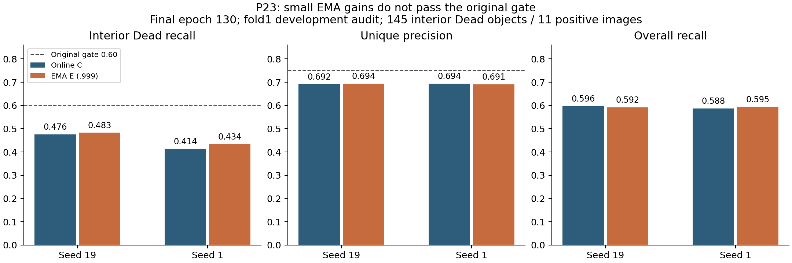
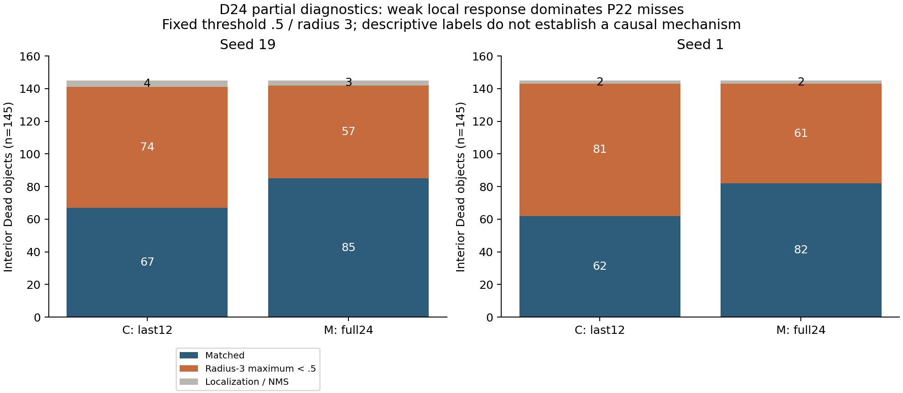
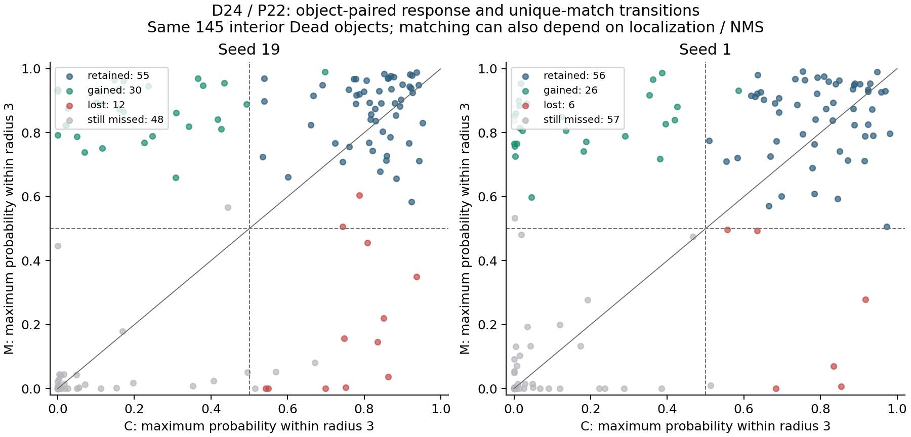

# P23 收尾、D24 逐对象诊断与 P24 决策（2026-11-06）

**结论：关闭固定 .999 EMA 配方，保留其完整负结果。** P23 两个种子的130轮训练均完成，恢复后的逐图原始结果与此前初步分析完全一致。P22 全24层方案虽然提升较大，也仍未通过原门槛。下一轮 P24 单独检验：保持原来的最后12层可训练，把编码器学习率从1e-5改为3e-5。

## 完成情况与证据层级

- P23 数组55538967：两项均 COMPLETED/0:0，130轮、17420次 EMA 更新；每个种子的一条训练轨迹同时产生最终在线权重C和EMA权重E。
- D24 完整性检查55551568：完成，8个checkpoint、180个文件载荷、P22/P23合计934份封存源码通过核验。
- D24 逐点诊断55551569：运行1964秒后失败，在打开第七个模型输出时出现 Lustre I/O error。四个P22模型和P23种子19的C/E已生成；种子1的C/E诊断未生成。缺失诊断不表示模型性能失败，也不影响已有最终评估结果。
- 早间结果读取240秒超时、配额195秒超时。17:37 UTC 三范围严格配额通过，随后scratch/project小文件fsync和读回通过。新一轮有界回收取得33个小文件（4,036,115字节）、8张最终样例，以及6个模型的逐对象摘要。30个P23载荷对照保存清单逐项验证；两个清单自身和完整性报告另保留传输哈希。没有向Windows传大checkpoint。

权威复算文件是 [raw_verification.json](raw_verification.json)。早期 [figures/analysis.json](figures/analysis.json) 保留“当时只有紧凑摘要”的历史限定；其读取限制已被后续原始数据复算取代。

## P23 为什么不能算成功

| 种子 / 输出 | 内部Dead命中/145 | Dead召回 | 全体召回 | 唯一匹配精度 | 小Dead命中/32 |
|---|---:|---:|---:|---:|---:|
| 19 / C | 69 | .475862 | .596490 | .692082 | 6 |
| 19 / E | 70 | .482759 | .592327 | .694022 | 6 |
| 1 / C | 60 | .413793 | .587673 | .694415 | 6 |
| 1 / E | 63 | .434483 | .594776 | .691337 | 6 |

EMA带来的内部Dead提升分别只有1个、3个，即+.006897/+.020690。按原来1000次、种子20261018、按组织分层的阳性图像bootstrap，95%区间为[0,.018750]与[.015228,.032276]。已将完整522图的评估重新交给原封不动的 `proposal_p3_utils.admission`，结果逐字段等于旧的初步结论。

两个种子都未达到Dead召回≥.60、提升≥.05、精度≥.75；种子19的区间下界也没有严格大于0。支持度、非退化和相对非劣条件通过，不能抵消其他失败项。种子1区间为正也不能单独判成功，更不能平均两个种子后过关。

提升集中在很少的图：种子19仅Lung1025多一个；种子1在Colon776、Colon1482、Cervix1756各多一个。四组的小Dead都只有6/32，EMA没有解决最小目标漏检。候选点最大数为123/121/114/113，均远低于512上限，所以没有提高候选上限的证据。

拟合集与审计集的差距很大：拟合全体召回约.976–.978、精度.998–.999，内部Dead召回.951–.954；审计内部Dead仅.414–.483。因此“模型连训练目标都没有学会”不是主要现象。这个差距支持继续研究迁移与泛化问题，但不能据此证明某一个具体原因。EMA没有改变训练目标或推理解码，它的微小变化没有跨过我们原定的实用门槛。

计算成本也需正确解释：P23只有两条训练轨迹，不是独立训练四个模型。纯训练14508.42/14515.42秒，checkpoint保存414.07/371.83秒；SLURM计时15248/15114秒，共8.4339GPU小时。EMA自身的额外成本没有单独计时，不报告伪精确的EMA加速或开销比例。

## D24：净提升背后的获益与损失

| P22种子 | C：命中/低响应/定位-NMS | M：命中/低响应/定位-NMS | 新增命中 | 丢失命中 | 保留命中 | 两边均漏 |
|---|---|---|---:|---:|---:|---:|
| 19 | 67/74/4 | 85/57/3 | 30 | 12 | 55 | 48 |
| 1 | 62/81/2 | 82/61/2 | 26 | 6 | 56 | 57 |

逐对象配对使用同一图像和GT实例编号，全部对应同一批145个内部Dead。低响应的定义是“距GT中心半径3范围内的最大概率低于固定阈值.5”。在P22四个模型的漏检中，这类原因占94.87%–97.59%；定位/NMS仅占少数，没有候选上限排除或唯一匹配竞争。

全层适配并不是把原来漏掉的对象全部单向补回来：种子19新增30个同时丢失12个；Colon新增5个、丢失5个，净收益为零，主要净收益来自Lung(+12)与Cervix(+7)。种子1净收益Lung+9、Colon+4、Esophagus+4、Cervix+3，Stomach反而少1个。这些是看完结果后的描述性分组，不新增显著性结论，也不用它们挑选下一轮的评估子集。小Dead从7→11/32，两种子一致，但仍漏21个。

P23种子19则更保守：69个原命中全部保留，只把1个低响应对象变为命中；72个仍低响应，1个从低响应变成定位/NMS漏检，另2个定位/NMS漏检保持。26个小Dead低响应漏检完全未改善。种子1的对应逐对象文件不存在，不能把种子19机制外推给它。

“低响应”只是固定解码器失败的位置描述，不等于已经找到了病因。特征适配、置信度校准、损失函数、组织差异和数据分布都有可能参与；目前证据不能区分。尤其不能因此在这批审计图上调低阈值，或断言提高学习率必然奏效。

## 为什么下一轮是 P24

P22提示更强适配可能提高召回，但全层训练耗时约为原来的1.42–1.43倍，且绝对Dead/precision仍不过门。此前P14降低编码器学习率到1e-6使召回下降。结合这次低响应诊断，选择一次保持原深度、固定提高编码器学习率的实验，检验较低成本的优化变化。这是观察开发集后的适应性探索，不冒充事先注册的确认性试验。

P24：C/L编码器学习率1e-5/3e-5，均仅训练UNI最后12层；头部学习率3e-4、AdamW(.9,.999)、weight decay.01、clip1、原cosine日程、256输入、有效batch16/物理4、种子19/1、新训130轮、最后checkpoint。提高学习率也会放大AdamW解耦衰减，故结论应归于整体优化配方，不能写成纯梯度效应。原split、增强、损失分母、阈值、匹配和双种子门槛冻结。

正式四项C19/L19/C1/L1，每项1V100、4CPU、32GiB、12小时，并发2，总请求上限48GPU小时；独立smoke最多30分钟。每跑8张审计+4张拟合图，训练前按GT固定选图并保存ID和SHA，共48张最终图。绝不加EMA/全层/阈值菜单/额外种子/延长训练/测试折推理。硬件验收和实际提交见 [P24记录](P24_SUBMISSION.md)。

## 结论的边界

所有指标来自反复使用的fold1点提议开发集，2134图拟合、522图审计；内部Dead仅11张阳性图、145个对象，80%来自Lung和Colon。它们不是PQ、不是独立test、不是患者层面的统计证据。两种子不等于多了独立患者。P22/P23失败配方继续关闭；下一轮是否成功，仍按原双种子完整条件判定。

完整原始小结果、8张最终图、配对分析与哈希均保留，来源和复现入口见 [英文报告](RESULTS_EN.md) 和 [目录](README.md)。历史阶段PDF不覆盖这次更新，仍保持原日期的内容范围。
