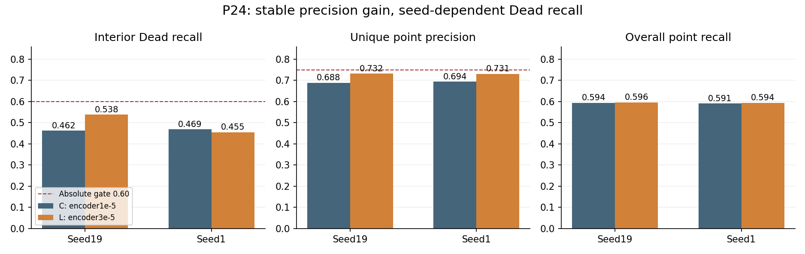
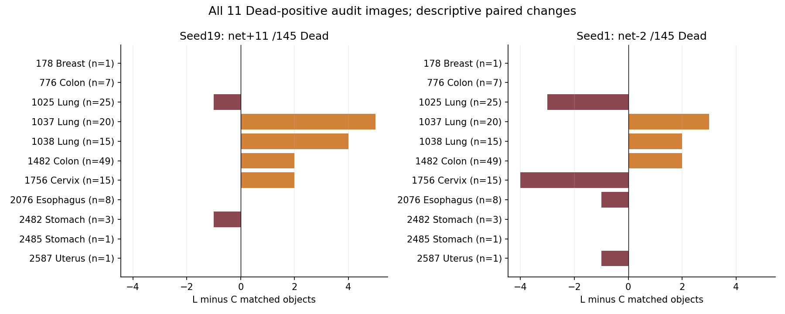
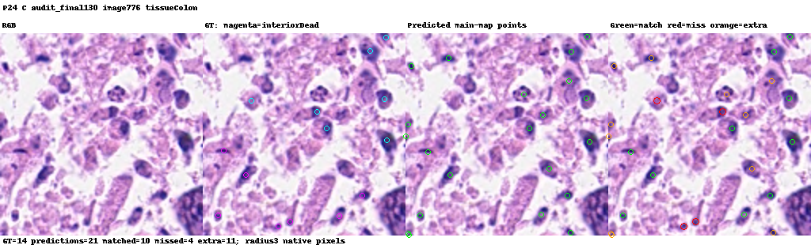

# 这轮实验到底说明了什么？

可以把任务理解成：在显微图上，给每个细胞核放一个点。我们既希望该放的点都放上，也希望空白或其他结构上别乱放。Dead是稀少、较难发现的一类核。这里先研究“能否找到”，还没有证明完整实例分割的PQ提高。

## 调大学习率后发生了什么？

P24保持同一个模型和同一批训练图，只把编码器最后12层的学习率从1e-5调到3e-5。两个种子都少放了几百个额外点，正确匹配还略有增加，点的精度约从69%提高到73%。这个现象是稳定的。

但最关心的Dead没有稳定改善。种子19从145个中的67个提高到78个；种子1却从68个降到66个。按实验前的规则，两种子都必须找到至少60%的内部Dead，精度至少75%，且还要满足增益、区间等条件。因此P24不通过，不能靠取平均、只展示种子19或换一个阈值来改判。

## 为什么小目标变好了，总结果还会变差？

两种子的小Dead都从7/32变成11/32。种子1确实多找到了4个小目标，但较大Dead净少了6个，合起来仍少2个。就像考试某一题型进步，并不保证总分提高。我们会保留这条有用观察，但不会把它升级成整套方法成功。

还有一个直观例子：Lung图1037在两种子都更好，Cervix图1756却一正一负。样本集中在很少几张图上，这类变化很容易左右总数。图表展示全部11张Dead阳性图，避免只看有利例子。

## 已经几乎记住训练图了，为什么仍找不好？

提高学习率后的拟合Dead召回接近99%，但审计图只有约46%—54%。这提示“继续把训练图拟合得更好”不等于“面对另一组图也更可靠”。它还没有告诉我们具体原因；图像差异、表示、优化或输出校准仍可能有关。

过去全24层适配的P22，Dead改善比P24更稳定，但仍不过原门。EMA的P23改善很小。把这些放在一起，下一轮值得检验的是：让所有层都能适配，同时让低层更新温和些、高层更新充分些，而不是继续扫描一个统一学习率。

## P25 会怎样做？

C保留原模型作为fresh对照。D训练全部24层，低层约9.22e-6、最高层3e-5，中间按固定公式递增；参数在运行前冻结。其余数据、种子、130轮、最后检查点、损失、点解码和通过条件不变。先做一次真实V100小验收，确认计算、更新、重载、显存和耗时可靠，再提交最多48GPU小时的正式四跑。提交状态见[P25记录](P25_SUBMISSION.md)。

这是一个新的探索性组合配方。即使更好，也不能仅凭这次比较说清究竟是训练层数还是学习率分配在起作用；也不会自动启动后续分割或其他fold。研究仍在反复使用同一fold1开发数据，下一轮结果同样不能冒充独立测试。

## 图片和原始记录在哪里？

raw目录有四跑共48张最终图，每跑8张审计图、4张拟合图，及完整点坐标。它们按GT规则预先选定，不按结果好坏挑选。每张图包含原图、GT中心、预测点、唯一匹配/漏检/额外点。

例如下图是固定审计图0776的种子19对照；其余臂、种子和图在同级目录，可以逐一比较。

详细数字、置信区间、成本、复现方法和检查点核验范围见[中文详报](RESULTS_ZH.md)及[英文详报](RESULTS_EN.md)。

另一个核查是每次拿掉一张阳性图看看总差值有多大变化。种子19可从+.048到+.100，种子1甚至会变号。我们并不据此删图，而是把它当成“样本太集中，结论可能被单图左右”的提醒。[详细敏感性分析](RESULTS_ZH.md)。
