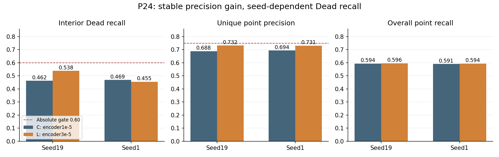
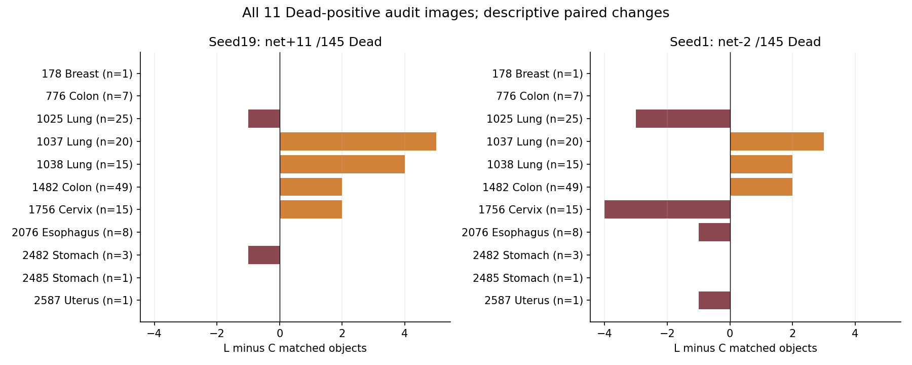
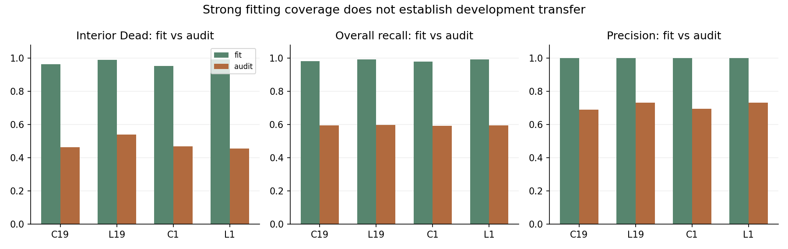
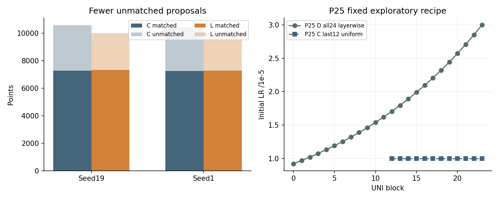
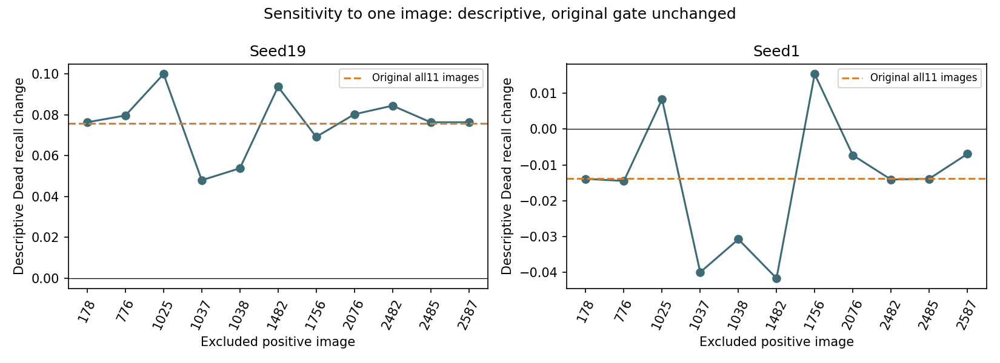

# P24 closeout and P25 research decision — 9 November 2026

P24 fails the original two-seed admission rule. Raising the learning rate of the same last12 UNI blocks from1e-5 to3e-5 consistently improves point precision and fitting coverage, but does not produce stable interior-Dead recovery. Close this exact uniform high-rate recipe. P25 is a new exploratory, compound depth/rate recipe, described below; its submission and hardware results are recorded separately.

## Completed work and evidence

Expanse job55599902 completed all four fresh130epoch runs with COMPLETED/0:0 in16:46:05, or16.7681GPUh. The four independent serial exits are0 and stderr files are empty. Training began8November02:43:34UTC; final preservation ended19:29:39UTC. Scheduler display times differ from these explicit UTC log stamps.

This review recovered126small files, including48final PNGs and all coordinate records, in a5,880,166-byte bundle. Every recovered payload was checked against its collection hash; all scientific payloads/images were checked against original preservation SHA256/byte entries, and all479sealed source files were rehashed. Bundle SHA256: `57ceb016d4ec6e09e0c44224bc1d095d096e179445f292c05ce266c7b97f1f57`. Scientific source is4f46733; source-manifest SHA256 is `5efef9d479aab158fe8f1a88c333dd449924576b1dd854864b52c916a315a75c`.

We verified130consecutive epoch records,134updates/epoch,17,420updates/run, physical4/effective16, exact source/configuration/UNI/input/cohort identities,2134fit/522audit rows and their fixed order, and the8audit+4fit example IDs and digest per run. Large last/final checkpoints remain on Expanse: their saved hashes and current sizes agree with the recorded inventory, but this review did not independently transfer or rehash those large files. The original preservation job did hash them; these are different evidence levels.

## Final development results

| Seed/output | Interior Dead hits/145 | Dead recall | Overall recall | Unique precision | Small Dead hits/32 | Candidates |
|---|---:|---:|---:|---:|---:|---:|
|19 C|67|.462069|.593959|.688363|7|10570|
|19 L|78|.537931|.596327|.731891|11|9981|
|1 C|68|.468966|.591020|.693885|7|10434|
|1 L|66|.455172|.594122|.730503|11|9963|



The independent paired bootstrap and unchanged `proposal_p3_utils.admission` agree exactly. Seed19: gain+.075862,95%CI[+.006329,+.164835]; seed1:−.013793,CI[−.090909,+.034014]. The original bootstrap uses1000replicates, seed20261018, tissue-stratified Dead-positive audit images. Both seeds fail Dead recall>=.60 and precision>=.75; seed1 also fails gain>=.05 and strictly positive lowerCI. Support, overall-recall/precision relative floors and nondegeneracy pass. The mean gain+.031034 cannot substitute for the required conjunction. To reach the absolute Dead floor alone, L would need at least87hits:9more in seed19 and21more in seed1, before considering every other clause.

Precision rises by4.353/3.662percentage points. L emits589/471fewer candidates while matching29/38more objects; unmatched points therefore fall by618/509. This is consistent with improved proposal discrimination at the fixed decoder. It does not identify a calibration mechanism. Max audit candidates120/128/116/134 remain far below512; raising the cap is unsupported by these outputs.

## Where the Dead changes occur



Seed19 net+11 comes from Lung+8,Colon+2,Cervix+2 andStomach−1. Four images improve,two worsen,five tie. Seed1 gainsLung+2 andColon+2 but losesCervix−4,Esophagus−1 andUterus−1; three improve,four worsen,four tie. Image1037 improves+5/+3 and1038+4/+2, whereas1025loses1/3. The opposing Cervix1756 changes(+2/−4) illustrate why a favorable seed is not sufficient. These are post-result descriptive slices, not new subgroup selection rules or independent significance tests.

Both seeds improve small interior Dead by4objects,7→11of32, still missing21. Subtracting this small-object gain from the total change gives larger-Dead net+7/−6. The seed1 reversal therefore does not negate the small-object improvement; it exposes losses elsewhere. These are per-image hit-count changes. Full per-object gain/loss transitions outside the predetermined example images are unavailable; aggregate counts cannot establish that the same objects were gained or retained. No new inference was added to invent that missing diagnosis.

## Fitting, transfer and cost



L fit overall recall reaches.991426/.992642 and precision.999585/.999486; fit interiorDead649/656and651/656(.989329/.992378), versus audit78/145and66/145. Original C fit Dead632/656and624/656. L also improves fit smallDead150→162/168and147→165/168. Stronger fitting alone is insufficient to explain or repair development transfer. This observation does not distinguish image heterogeneity, representation, optimization or calibration as a cause.

Pure training durations are14,526.38/14,677.97seconds(C/L seed19) and14,538.72/14,537.88seconds(seed1). L/C ratios are1.0104/.99994; this run does not establish a meaningful speed difference. Four-run training totals about16.19GPUh; serial SLURM16.7681h includes initialization/evaluation/storage/other overhead. Both arms peak around4.05GiB allocated in recorded training. Shared storage and loading conditions limit timing attribution.

The evidence sequence now separates several failures. P22 all24 had larger and more consistent recall gains but failed absolute gates. P23 EMA scarcely changed rare-object recovery. P24 higher uniform last12 rates improve precision and fit, while Dead response remains seed-sensitive. None of these results establishes that a generic larger model, longer training or threshold sweep would work. The exact P22/P23/P24 recipes remain closed.

## P25: fixed full-depth layerwise adaptation



Agent-selected hypothesis: distribute adaptation across all24UNIblocks while keeping lower layers near the pretrained regime and allowing stronger upper-layer changes. C remains the original last12@1e-5/head3e-4. D trains only blocks0..23 with initial blockb LR `3e-5*.95**(23-b)`; embeddings/finalnorm remain frozen, encoder stayseval. Block0starts about9.22e-6 andblock23at3e-5; all rates use the original cosine factor1→.1. Head remains3e-4; original data/order/loss/augmentation/256input/batches/AdamW/clip/130epochs/lastcheckpoint/decoder/gate are unchanged. Four fresh C19/D19/C1/D1. This simultaneously changes depth and the distribution of rates; it is not a factorial estimate of either mechanism or their interaction. Decoupled decay changes with LR too.

Both seeds must pass the unchanged original gate. One30minute V100 validation must establish real control parity, full24 gradients/updates beyond decay, AMP/frozen states, strict last/final reload and each arm's1.5safeprojection<12h with training peak<=24GiB. Formal allocation is four12h runs,max48GPUh,concurrency<=2; legal serial scheduling may reduce concurrency. Failed or incomplete validation blocks submission; no resume, added seeds, threshold menu, shortened epochs, PhaseB,masks or fold2/3 evaluation follows automatically.

These are repeatedly reused fold1 point-proposal development results, not PQ, test performance or independent patient evidence. Only11Dead-positive audit images contain145interiorDead;116/145occur in5Lung/Colon images. More seeds do not create new patients. P25 is chosen after development inspection and must be described as exploratory.

## Reproduction and visual provenance

Run from repository root with pinned project environment:

```bash
PYTHONPATH=src:scripts python docs/results/p24_p25_2026-11-09/reproduce_p24.py
python docs/results/p24_p25_2026-11-09/make_figures.py docs/results/p24_p25_2026-11-09/analysis.json docs/results/p24_p25_2026-11-09/figures
```

`artifact_hashes.json` covers published scientific payloads and all48original PNGs. Portable manifests preserve scientific identity and fixed IDs; full operational manifests/logs remain in ignored LM1ops. `analysis.json` retains both seeds/all522images, original gate and cost summaries. `paired_dead_images.csv` lists every positive-image change. All fixed examples use the pre-existing GT-only strata, same fixed threshold and original four-panel rendering(raw/GT/prediction/unique-match status); no best-image selection. Smoke previews, when present, are explicitly one-epoch fit-only. See [P25 state](P25_SUBMISSION.md), [specification](../../superpowers/specs/2026-11-09-proposal-p25-design.md), [Chinese report](RESULTS_ZH.md) and [reader](READER_ZH.md).

## Additional descriptive sensitivity (original gate unchanged)

Dropping each of the11positive images in turn gives Dead-recall changes ranging+.048to+.100(seed19) and−.041667to+.015385(seed1). In particular, excluding image1037brings seed19's gain below.05; excluding Cervix1756reverses seed1's sign. This is a post-result sensitivity description, not a replacement bootstrap, selection rule or re-evaluation of the original pass/fail decision. Single-image influence reinforces the limited support.

The8predetermined audit examples cover53of145interiorDead(36.55%). Exact GT-index matching within these images finds seed19 retained26/gained9/lost5/missed-by-both13; seed1 retained24/gained7/lost7/missed-by-both15. Net changes+4/0differ from the full522-image+11/−2. These fixed strata illustrate actual object transitions but do not estimate their full-cohort frequencies. The diagnostic enforces equality to the original saved per-image Dead counts. Its initial GT/predicted-index interpretation was rejected by that assertion; the matching-source convention(GT index first) was verified and corrected before these results were generated. Original evaluation/gates are unaffected.



[Sensitivity values and exact fixed-example transitions](descriptive_sensitivity.json); [all tissue changes](figures/tissue_changes.csv). Rebuild these descriptions with `python docs/results/p24_p25_2026-11-09/descriptive_sensitivity.py`.
