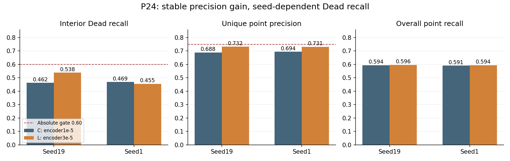
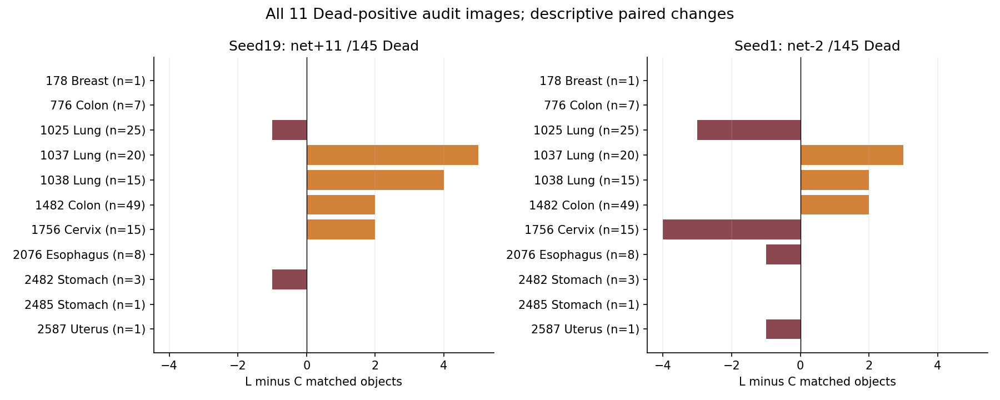
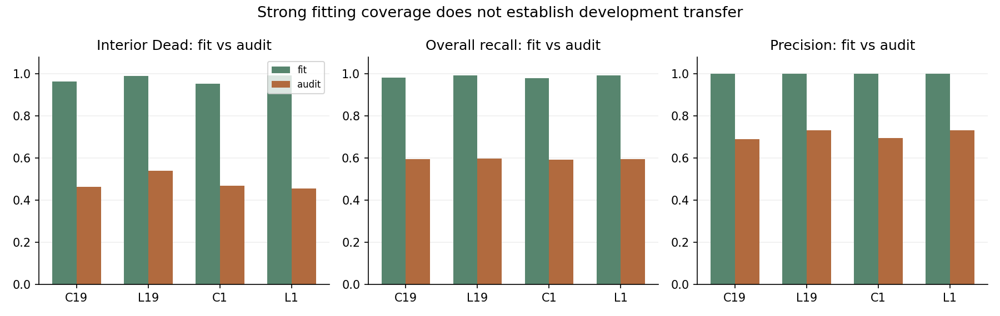
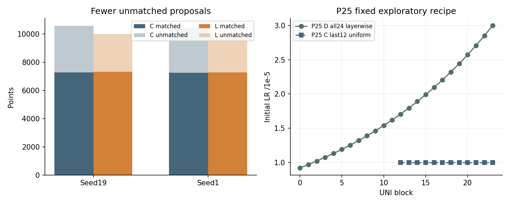

# P24 结果分析与 P25 研究决策（2026年11月9日）

P24 没有通过原定双种子准入门，关闭这套“最后12层统一提高学习率”的具体配方。它带来稳定的点精度改善和更充分的训练拟合，但 Dead 召回方向在两个种子间反转。P25 是基于这些开发结果选择的新探索性配方，不能写成独立确认或已证实的机制。

## 完成与核验

Expanse 作业55599902已完成四次独立130轮训练，主作业和四个训练step均COMPLETED/0:0，四个串行退出码为0，stderr为空；总计16小时46分05秒，即16.7681GPU小时。日志明确UTC时间为11月8日02:43:34开始、19:29:39最终保存结束；不要把调度器显示的其他时区混入UTC。

回收126个小文件，包含48张正式最终PNG及坐标；逐项核对SHA256/字节数，479份封存源码重哈希通过。检查了130轮连续记录、每轮134次有效更新、每跑17420次更新、物理4/有效16、2134张拟合图及522张审计图的成员和顺序、模型/数据/cohort身份，以及每跑预先固定的8审计+4拟合样例。大检查点保留在Expanse：本轮核对大小与原保存清单，未独立回传或重哈希；原训练保存阶段对大文件做过哈希，两者证据强度不同。详见[英文报告](RESULTS_EN.md)的来源和复现记录。

## 正式结果

|种子/输出|内部Dead命中/145|Dead召回|总体召回|唯一匹配精度|小Dead命中/32|候选数|
|---|---:|---:|---:|---:|---:|---:|
|19 C|67|.462069|.593959|.688363|7|10570|
|19 L|78|.537931|.596327|.731891|11|9981|
|1 C|68|.468966|.591020|.693885|7|10434|
|1 L|66|.455172|.594122|.730503|11|9963|

原bootstrap与独立复算完全一致：种子19的Dead变化+.075862，95%区间[+.006329,+.164835]；种子1变化−.013793，区间[−.090909,+.034014]。保留原1000次、随机种子20261018、按组织分层的Dead阳性图像bootstrap。两种子都没有达到Dead≥.60和精度≥.75；种子1还未达到增益≥.05和区间下界>0。支持量、相对精度/总体召回下限及非退化条件通过。平均增益+.031034不能取代“两个种子分别满足全部条件”。单就Dead绝对门而言，需至少87次命中，L19还差9个，L1还差21个。

精度分别提高4.353和3.662个百分点。候选少589/471个，匹配反而多29/38个，因此额外点少618/509个。这说明固定解码下的候选区分更好，但不能仅凭这个现象认定“校准改善”就是原因。四跑审计图候选上限分别120/128/116/134，都远低于512；扩大候选上限没有证据支持。

## 改善落在哪里，为什么不稳定

种子19净增11个：Lung+8、Colon+2、Cervix+2、Stomach−1；4张图改善、2张变差、5张不变。种子1则是Lung+2、Colon+2被Cervix−4、Esophagus−1、Uterus−1抵消，总计−2；3张改善、4张变差、4张不变。Lung图1037在两种子均改善(+5/+3)，1038也改善(+4/+2)，但1025同时下降(−1/−3)。Cervix1756在两种子中+2/−4，展示了只挑好种子的风险。上述小分层是事后描述，不用于选择子集，也不另立显著性结论。

小Dead两种子都从7/32升至11/32，仍有21个未找到。总变化扣除小Dead的+4后，较大Dead分别净增7和净减6；因此种子1并非“小目标完全没改善”，而是别处的损失超过了收益。逐图命中数不能替代逐对象轨迹：除固定样例图外，本轮没有完整对象级新命中/丢失清单，不能把净变化说成同一批对象的稳定保留。

## 拟合、迁移与成本

L的拟合总体召回达到.991426/.992642，精度.999585/.999486；内部Dead为649/656、651/656，约98.93%/99.24%，但审计仅78/145、66/145。C的拟合Dead为632/656、624/656。L的拟合小Dead也从150→162/168、147→165/168。提高学习率确实使拟合更充分，仍不能保证审计迁移；这尚不能区分表示、优化、图像异质性或校准的因果贡献。

纯训练耗时：种子19 C/L为14526.38/14677.97秒，种子1为14538.72/14537.88秒。L/C约1.0104/.99994，无明确实用加速差异。纯训练合计约16.19GPU小时；SLURM总16.7681小时还含初始化、评估和保存等开销。正式训练记录峰值约4.05GiB。共享存储条件会影响计时，不把这些差异作为受控速度结论。

跨轮证据现在较清楚：P22全24层的召回改善更大且两种子同向，但仍不过绝对门；P23的EMA只增加少量命中；P24统一提高最后12层学习率稳定提高精度和拟合，却没有稳定恢复Dead。三条具体配方继续关闭，不能由此推出加轮数、换阈值或继续扫描全局学习率就会成功。

## P25 如何推进

新问题是：能否让全部24层参与适配，同时让低层变化更温和、上层变化更充分？C仍为原最后12层1e-5/头3e-4；D只训练24个block，初始学习率为block b的`3e-5*.95**(23-b)`，从block0约9.22e-6到block23的3e-5，全部沿用原cosine的1→.1倍率。embedding和finalnorm冻结，编码器保持eval。数据、顺序、增强、focal/对象分母、256输入、批量、AdamW/clip、130轮、最后检查点、解码与原门不变，四次fresh C19/D19/C1/D1。

这是“深度+分层速率”的组合配方，不能单独识别深度或学习率的作用，也不是交互作用的因果证明；学习率同时影响AdamW衰减。先用一次≤30分钟V100验收双种子真实对照等价、D各层梯度及超过纯衰减的更新、AMP/冻结/重载；两臂各自1.5倍安全外推必须低于12小时，训练峰值≤24GiB。正式四跑各12小时，合计最多48GPU小时，并发≤2或合法串行。失败或不完整则不提交正式训练，不自动增加种子、阈值、轮数、mask、PhaseB或fold2/3。

所有数值都是反复使用fold1的点提议开发指标，非PQ、测试集或患者独立证据。11张阳性图共145个内部Dead，其中116个集中在5张Lung/Colon图。多随机种子不是新增患者。P25选择发生在看过开发结果之后，必须明确标注探索性质。

[复现脚本与英文详报](RESULTS_EN.md)保留全体数值、原门和哈希；[逐图CSV](figures/paired_dead_images.csv)覆盖11张阳性图；raw目录保存48张原始最终PNG及坐标，按既有GT分层预选，未挑最好看的图。完整运维日志留在忽略的LM1ops。另见[中文导读](READER_ZH.md)和[P25提交状态](P25_SUBMISSION.md)。
