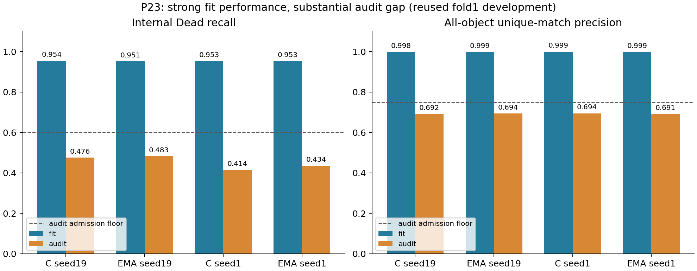

# P24 submitted after storage recovery and a submission-count limit

Job **55599902** was submitted once at 2026-11-08T02:43:19Z (7 November 21:43 EST), initially PENDING/Priority. It contains four fresh independent runs C19/L19/C1/L1 sequentially, 130 epochs each. This is a regular job, not an array; the legacy receipt field array_job_id carries its JobID.

The complete [P23/D24 analysis](../p23_p24_2026-11-06/RESULTS_EN.md) remains authoritative. P23 EMA improves internal Dead by only 1/3 of145 objects, with original CIs [0,.018750]/[.015228,.032276]. Both seeds fail the original full admission rule. At least87/145 are required for .60 recall: E misses that threshold by17/24 objects. The .05 gain condition requires8 net hits, compared with observed1/3. Small Dead stays6/32. Fit Dead recall .951鈥?954 contrasts with audit .414鈥?483, as visualized below; cohort composition differs, so this gap does not identify a causal generalization mechanism.

P22 full-depth adaptation gains18/20 net Dead objects, with30 gains/12 losses and26 gains/6 losses. Recall .586207/.565517 and precision .728448/.733636 still fail. Approximately95鈥?8% of P22 Dead misses have low local response under the frozen decoder, rather than candidate-cap or assignment competition. This describes where failure occurs, not why. Full-depth training costs about42鈥?3% more. P24 tests a fixed cheaper optimization change: encoder LR1e-5 versus3e-5 at unchanged last12 depth. Head LR3e-4, data/order, augmentation, loss, batch16/micro4, BF16, seeds19/1, fresh130epochs, last checkpoint and original two-seed gate stay fixed. LR also changes decoupled weight decay. This is adaptive development exploration on reused fold1, not PQ or independent test evidence. D24 P23 seed1 object outputs remain unavailable.

Old submission parents and blocked lfs were absent, no remote submit/job/receipt markers or previous P24 formal jobs existed. The new admission passed three strict quota scopes, capacity, OST43/150GiB reserve, fsync/readback and complete source identity. The four-element array failed sbatch --test-only with MaxSubmitJobsPerAccount: the permitted nonpreemptive QoS caps submissions at24 and23 existing GPU jobs occupied the account. Existing unrelated jobs were preserved.

A single 48h job now invokes the unchanged sealed launcher in a fresh bash/Python process for each task. Each invocation has43140s plus30s termination cleanup, leaving120s within the 48h envelope. This slightly tightens each original12h walltime and changes concurrency2鈫?; completion may be later. Original source/weights/cohort, GPU1/CPU4/RAM32GiB, per-run output and preservation remain. Failures are recorded and remaining arms continue; the final job exit signals any arm failure. Simulated all-success and arm-failure behavior verified task mapping, isolation, exit propagation and continuation; bash syntax and actual scheduler dry admission passed. The passed real V100 smoke55571695 (858s,61node checks) was retained. Existing CPU1055passed/3skipped and71focused checks are historical validation, not newly rerun tests. No scientific or metric code changed.

Fresh account admission: allocation1900,spent1033,existing GPU reservations466.043478SU,additional48; conservative remaining352.956522SU. The change in reported spent from937 is an account reading, not P24 cost. Source4f46733 /479-file manifest5efef9d479aab158fe8f1a88c333dd449924576b1dd854864b52c916a315a75c; [receipt](submission_receipt.json), [wrapper checks](wrapper_validation.json). LM1 free data7鈮?9GiB,tmp鈮?78GiB; LM2 data6鈮?.7TiB,root鈮?.6GiB. Existing GPU users/processes were preserved. All three execution channels were reused without a new authentication.

On completion verify each serial exit, complete130, last checkpoint and preservation hashes before applying the unchanged C/L two-seed gate. Preserve8audit+4fit examples/run and coordinates (48final PNGs planned). Existing8P23 final PNGs and4P24 one-epoch fit previews remain in the previous results directory; previews are not formal outcomes. Large checkpoint independent external archival remains outstanding. A healthy targeted OST/write check does not establish whole-Lustre recovery.
