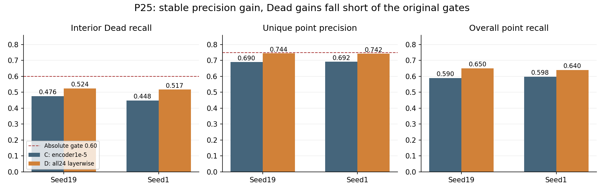
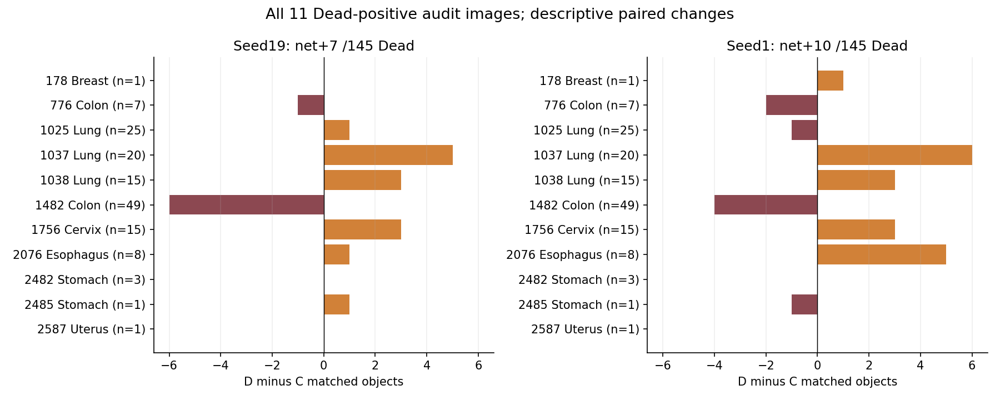
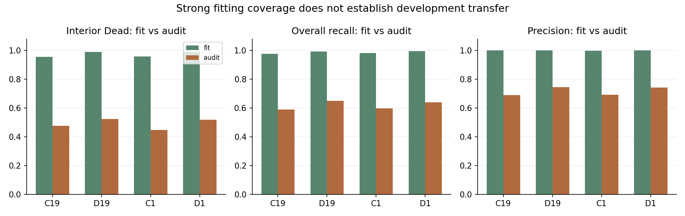

# P25: broader adaptation improves overall detection but leaves rare-nucleus misses

P25 completed all four fresh 130-epoch runs. The new approach D found more nuclei and produced fewer unmatched points than the original control C in both random seeds. Dead-nucleus recall reached 52.4% and 51.7%; the original minimum was 60%. Both seeds failed the full decision criteria, so we will not pursue this exact configuration further.

The project aims to outline and classify each nucleus. This study evaluates an earlier step: finding its center. Recall is the share of annotated nuclei found; precision is the share of predicted points matched to annotations. Training images are used to learn the model, and audit images are used to compare approaches. The two random seeds repeat training with different random processes.

## What changed

C trains the final 12 of UNI's 24 image-encoder blocks at an initial learning rate of 1e-5. D trains all 24, with initial block-b rate `3e-5 * .95**(23-b)`. The detection head, data, training order, augmentation, object-normalized focal loss, physical batch 4/effective batch 16, 130 epochs, final checkpoint and 0.5 decoding threshold are shared. Depth and learning rates change together in D. The comparison therefore evaluates their combination.

## Four completed runs

| Seed and approach | Dead found /145 | Overall found /12,250 | Candidate points | Precision | Small Dead found /32 |
|---|---:|---:|---:|---:|---:|
| 19 C | 69 | 7,226 | 10,472 | .690031 | 8 |
| 19 D | 76 | 7,967 | 10,703 | .744371 | 10 |
| 1 C | 65 | 7,326 | 10,589 | .691850 | 7 |
| 1 D | 75 | 7,838 | 10,557 | .742446 | 12 |

D matches 741 and 512 more nuclei and produces 510 and 544 fewer unmatched points in seeds 19 and 1, respectively. Its improvement in overall recall and precision is therefore broader than simply emitting more points. The small-Dead results still leave 22/20 of 32 objects unmatched.

The gains in dead-nucleus recall, D minus C, are +.048276 and +.068966. Independently recomputed paired intervals are [−.010417, +.164835] and [0, +.194031]. Neither lower bound is strictly positive. Both absolute recalls and both precisions fall below .60/.75; seed 19's gain is also below .05. Support, relative precision/overall-recall checks and nondegeneracy pass. The original decision function and an independent calculation agree on failure for both seeds.

## Where gains and losses occur

Lung images contribute +9/+8 Dead matches, while Colon contributes −7/−6. The 49-Dead Colon image 1482 falls from 15 to 9 and from 14 to 10 matches. The 20-Dead Lung image 1037 rises from 10 to 15 and from 10 to 16. Together, Lung and Colon contain 116/145 Dead in five images, making these shifts consequential.

Removing one positive image at a time gives descriptive gain ranges of +.016 to +.135417 and +.032 to +.145833. This recalculation measures single-image influence; the original all-image result and decision remain unchanged. It is not a new confidence interval.

The eight predetermined audit examples contain 53 Dead objects. Object identities show retained/gained/lost/missed-in-both counts of 26/11/6/10 in seed19 and 30/8/4/11 in seed1. Thus the examples contain both recoveries and losses. These counts describe their 53 objects; they do not substitute for all 145.

## Fitting and cost

D finds 649/656 interior Dead on the training images in both seeds, compared with 627/629 for C. Its training small-Dead count is 163/162 of 168; audit counts are 10/12 of 32. High training coverage has not carried over at the same level to the audit images. The gap motivates testing training constraints but does not identify a unique cause.

Pure training time D/C is 1.412/1.418, with peak training allocation 6.745 versus 4.047 GiB. The four top-level SLURM tasks used 19:59:17, or 19.9881 GPU hours including job overhead. All four show COMPLETED/0:0, 130 epochs and 17,420 optimizer steps; source, cohort, input and final-example identities were verified.

## P26: a single pretrained-parameter constraint

P26 returns to the original C architecture and rates in both approaches. R alone adds `0.01/2 * sum((theta-theta0)**2)` over the trainable encoder parameters. The head is excluded, original AdamW decay remains, and the added penalty is applied once per effective batch, including the final partial batch. Its coefficient is fixed before the run; no audit-dependent adjustment is planned.

The hypothesis is that limiting parameter drift may improve transfer from training to audit images. The method is motivated by [Li et al., ICML 2018](https://proceedings.mlr.press/v80/li18a.html); its value for UNI nucleus detection is the question being tested. Fresh C/R × seeds 19/1 retain the original 130 epochs, final checkpoint, matching and full decision criteria. Four 12-hour tasks request at most 48 GPU hours; actual submission and validation are recorded separately.

The [full stage report](../../report/stage_report_7/README.md) places these results alongside P17–P24 and includes all 11 positive-image rows and the measurement definitions.
