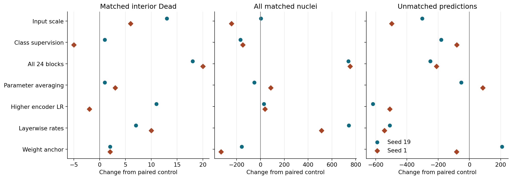
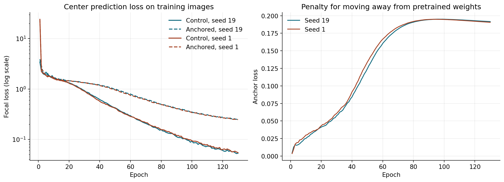
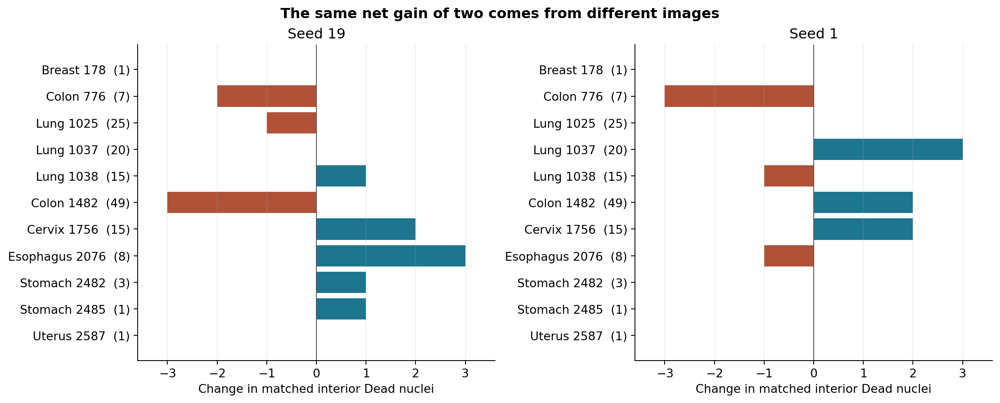
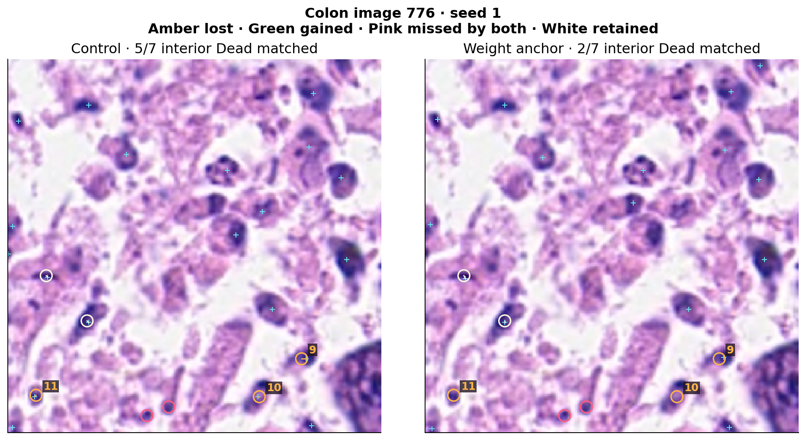
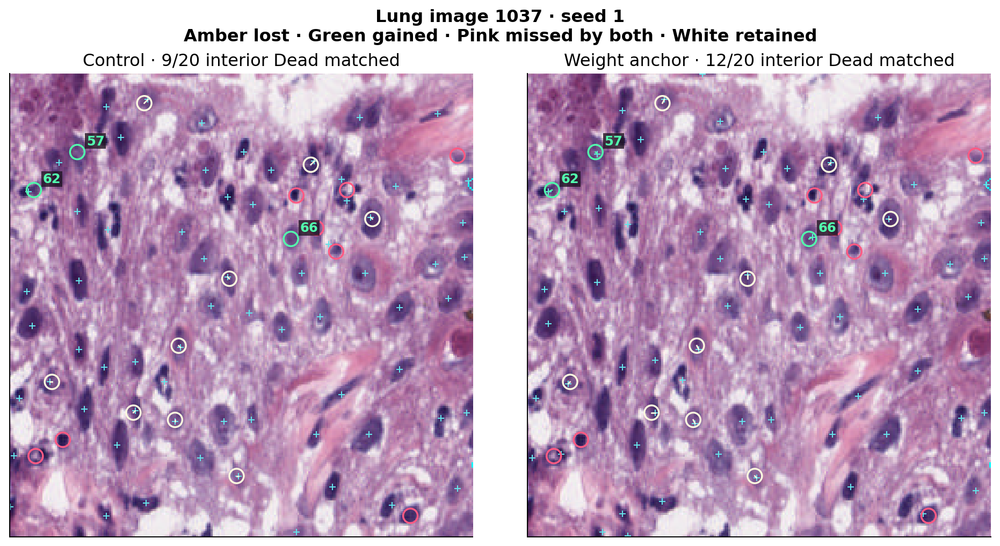

# Development review of nuclei center detection

The experiments train on 2,134 images from PanNuke fold 1 and evaluate the last training epoch on a fixed, held-out subset of 522 images from the same fold. An output point can match one annotated nucleus within three native pixels. Overall recall uses all annotated nuclei, and precision uses all output points. Extra points are predictions left unmatched after one-to-one assignment. The interior Dead subset contains 145 nuclei labeled Dead whose masks do not touch an image edge, including 32 covering fewer than 67 native pixels. The development set was reused across the stage.

## Comparing the interventions

Each point is a change from the same-round, same-seed control. A reduction in unmatched predictions appears to the left in the third panel.

| Intervention | Interior Dead matches | All matches | Unmatched predictions |
|---|---:|---:|---:|
| 512-pixel interpolated input (P20) | +13 / +6 | +3 / −244 | −302 / −497 |
| Auxiliary class-center supervision (P21) | +1 / −5 | −168 / −148 | −180 / −81 |
| Adapt all 24 encoder blocks (P22) | +18 / +20 | +738 / +753 | −250 / −211 |
| Exponential moving average of weights (P23) | +1 / +3 | −51 / +87 | −52 / +85 |
| Raise the last-12 encoder learning rate (P24) | +11 / −2 | +29 / +38 | −618 / −509 |
| Adapt all blocks with layerwise rates (P25) | +7 / +10 | +741 / +512 | −510 / −544 |
| Anchor the last 12 blocks to pretrained weights (P26) | +2 / +2 | −157 / −331 | +208 / −82 |

Pairs list seeds 19 and 1. Input enlargement recovered some interior Dead nuclei with mixed overall coverage and approximately 4.3 times the control training time. Auxiliary class-center supervision reduced extra points alongside a decrease in overall matches. Parameter averaging produced modest, seed-dependent changes. Higher learning rates for the last 12 blocks consistently removed extra points, while interior Dead coverage changed in opposite directions. Full-depth adaptation produced the largest interior Dead gain in this stage and improved overall coverage in both seeds. Layerwise rates also improved overall coverage, while the interior Dead gains concentrated in lung tissue (+9/+8) and colon lost coverage (−7/−6). Colon image 1482 alone contains 49 interior Dead nuclei, with matches falling from 15 to 9 and from 14 to 10 under the layerwise recipe.

## Fixed constraint toward pretrained weights

P26 applies a penalty of `0.01/2` times the sum of squared parameter differences from the pretrained encoder weights, once per effective update. The original last-12 trainable blocks, point head, AdamW decay, training data, and prediction and matching rules are shared with the control.

| Seed and arm | Interior Dead | Small interior Dead | All matches / labels | Precision | Extra points |
|---|---:|---:|---:|---:|---:|
| 19 control | 67/145 | 8/32 | 7,150/12,250 | 69.72% | 3,105 |
| 19 anchor | 69/145 | 8/32 | 6,993/12,250 | 67.85% | 3,313 |
| 1 control | 64/145 | 7/32 | 7,304/12,250 | 69.25% | 3,243 |
| 1 anchor | 66/145 | 7/32 | 6,973/12,250 | 68.81% | 3,161 |

The paired gain of 1.38 percentage points in interior Dead recall has 95% tissue-stratified image-bootstrap intervals of [−0.62, +5.38] and [−7.14, +6.12] percentage points. Removing one Dead-positive image at a time gives ranges of [−0.73, +5.21] and [−0.80, +3.62] points. Overall recall fell by 1.28 and 2.70 points. The original admission rule returned false for each seed and closes this fixed anchoring recipe.

At epoch 130, the center prediction loss rose from 0.0531/0.0545 to 0.2477/0.2480 and the penalty contributed 0.1916/0.1906. Overall training recall fell from 97.60%/97.98% to 89.88%/89.45%, with interior Dead matches falling from 625/627 to 567/557 of 656. The fixed constraint weakened the fit to training data and lowered overall recall on the development set. The anchor logs show the largest final drift in block 17 (2.20/2.17) and smallest in block 23 (0.78/0.79). A paired drift comparison needs the corresponding measurements from the control weights.

## Localizing the gains and losses

The count in parentheses is the number of interior Dead nuclei in an image. In seed 19, esophagus image 2076 gained three matches and colon image 1482 lost three. In seed 1, lung image 1037 gained three and colon image 776 lost three. Cervix image 1756 gained two matches in each seed. The eight fixed examples contain 53 interior Dead nuclei. Seed 19 retained 26, gained 4, lost 7, and missed 16 in both arms. Seed 1 retained 25, gained 5, lost 5, and missed 18 in both.

The cyan crosses are output points. In colon image 776, seed 1 fell from 5/7 to 2/7 interior Dead matches. Object 9 lies at the edge of a dark cluster in the lower right. Its distance to the nearest output increased from 3.00 to 3.16 pixels, just beyond the matching radius. The two separate dark structures labeled 10 and 11 in the lower part matched at 1.00 and 1.41 pixels under the control. Their nearest anchor outputs were 41.68 and 27.46 pixels away.

In lung image 1037, the same seed gained three matches, from 9/20 to 12/20. Object 62 is near the left edge and its distance to the nearest output fell from 3.16 to 2.24 pixels. Objects 57 and 66 sit near other dark-stained structures. Their new matched points are 1.41 and 2.24 pixels away, compared with nearest control outputs at 11.66 and 19.92 pixels. The five persistent misses from the 20 stage outputs reviewed previously remain unmatched in all four P26 outputs. For object 1037:60, the seed-19 anchor produced a point 3.16 pixels from its center. These measurements come from decoded coordinates. Full score maps would distinguish weak local scores from peak displacement or suppression.

## Next controlled comparison

P27 compares adapting the first versus the last 12 blocks with the same number of trainable parameters, head, data, seeds, 130 epochs, final checkpoint selection, and evaluation. Gradients pass through the frozen late blocks in the early-adaptation arm, so time and memory are measured separately. The question follows directly from P22, where changing the layer placement and the number of adapted parameters together produced the largest Dead gain.

All four P26 jobs finished 130 epochs in a combined 16:52:50. We checked 490 deployed source hashes and 114 small payloads, including all 48 final PNGs. The eight large checkpoints were checked against current sizes and the original preservation manifests. Independent full-checkpoint rehashing and external archival remain open. See the [numeric record](p26_analysis.json), [fixed-object coordinates](fixed_objects.csv), and [stage comparison counts](stage_pairs.csv).
