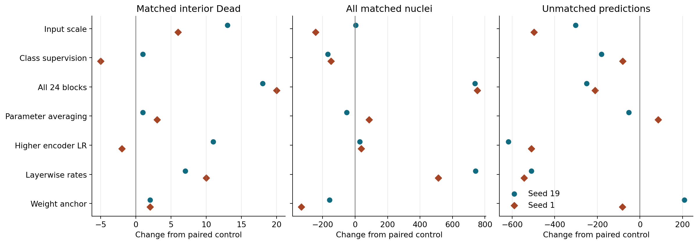
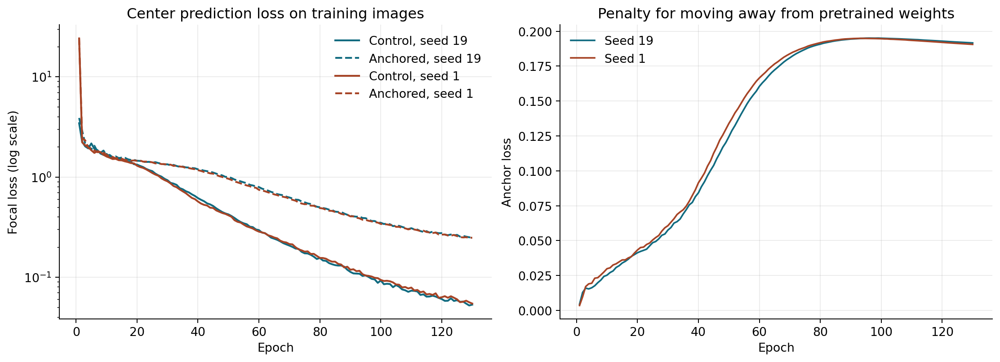
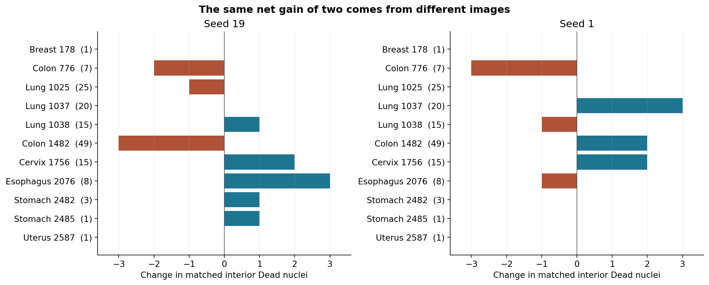
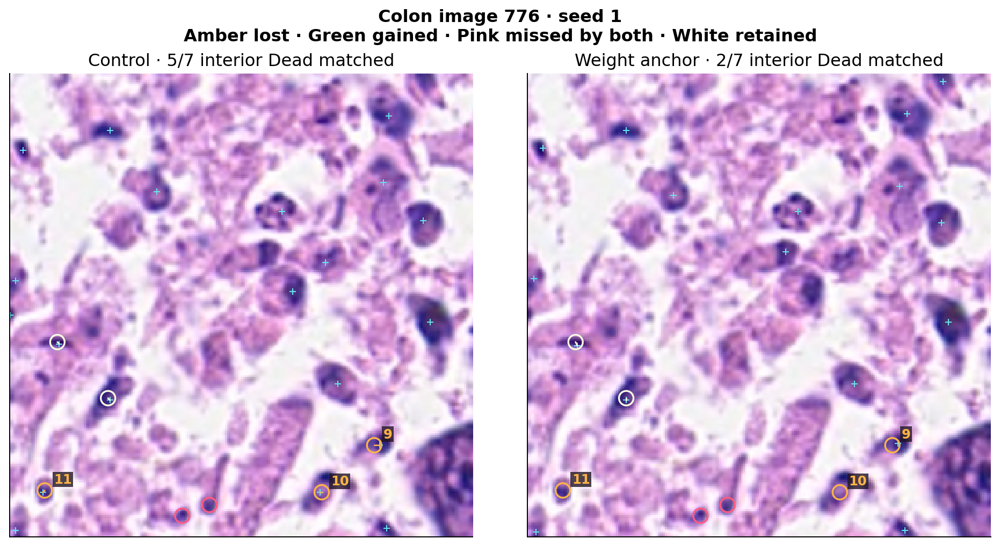
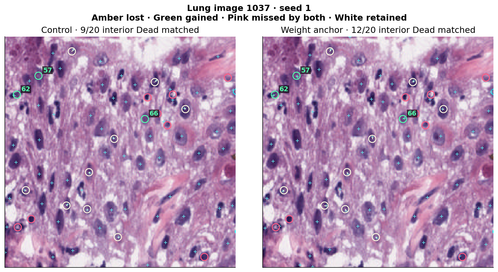

# 细胞核中心检测阶段复核

本阶段用 PanNuke 第 1 折中的 2,134 张图像训练，在同一折留出的 522 张开发评估图像上比较最后一轮模型。模型输出细胞核中心候选点。匹配算法在原图 3 像素半径内做一对一配对。总体召回率按全部标注核计算，精确率按全部输出点计算，额外点是配对后仍未匹配的输出点。内部死亡核指 PanNuke 的 Dead 类中标注轮廓未接触图像边缘的细胞核，共 145 个，其中占据少于 67 个原图像素的有 32 个。此前多轮使用了同一开发评估集。

## 哪些改变值得继续追踪

图中每个点是一种改动相对于同轮、同种子对照的计数差。第三栏向左表示额外点减少。

| 改动 | 内部死亡核匹配变化 | 总体匹配变化 | 额外点变化 |
|---|---:|---:|---:|
| 输入插值放大到 512 像素（P20） | +13 / +6 | +3 / −244 | −302 / −497 |
| 训练时加入类别中心监督（P21） | +1 / −5 | −168 / −148 | −180 / −81 |
| 更新全部 24 个编码器块（P22） | +18 / +20 | +738 / +753 | −250 / −211 |
| 参数指数移动平均（P23） | +1 / +3 | −51 / +87 | −52 / +85 |
| 提高后 12 个块的学习率（P24） | +11 / −2 | +29 / +38 | −618 / −509 |
| 全层更新并使用分层学习率（P25） | +7 / +10 | +741 / +512 | −510 / −544 |
| 约束后 12 个块靠近预训练权重（P26） | +2 / +2 | −157 / −331 | +208 / −82 |

每列依次为种子 19 和 1。P20 对小结构可见性的干预同时改变训练尺度，两个种子的总体覆盖变化不同，纯训练耗时约为各自对照的 4.3 倍。P21 的额外点减少伴随总体匹配下降。P23 的移动平均改变部分命中和额外点，变化随种子而异。P24 在两个种子都明显减少额外点，但内部死亡核变化方向相反。P22 同时扩大覆盖并减少额外点，两个种子的死亡核增益在本阶段最大。P25 的总体收益同样稳定，但死亡核增加主要来自肺组织，肺净增 9/8，结肠净减 7/6。在有 49 个内部死亡核的结肠组织图像 1482 上，P25 从 15 降到 9、从 14 降到 10。两种全层设置都揭示了值得复查的收益和组织差异。

## 权重约束改变了什么

P26 在原有后 12 块更新方案上加固定的平方距离惩罚，按每次有效更新计算一次，系数为 `0.01/2`。训练数据、随机种子、原有 AdamW 权重衰减、检测头和评估过程相同。

| 种子与设置 | 内部死亡核匹配 | 小死亡核匹配 | 总体匹配 / 标注 | 精确率 | 额外点 |
|---|---:|---:|---:|---:|---:|
| 19 对照 | 67/145 | 8/32 | 7,150/12,250 | 69.72% | 3,105 |
| 19 权重约束 | 69/145 | 8/32 | 6,993/12,250 | 67.85% | 3,313 |
| 1 对照 | 64/145 | 7/32 | 7,304/12,250 | 69.25% | 3,243 |
| 1 权重约束 | 66/145 | 7/32 | 6,973/12,250 | 68.81% | 3,161 |

内部死亡核召回均增加 1.38 个百分点。按组织分层、对图像重采样的配对 95% 区间为 −0.62 至 +5.38、−7.14 至 +6.12 个百分点。删除单张有内部死亡核的评估图像后，结果范围分别为 −0.73 至 +5.21、−0.80 至 +3.62 个百分点。两个种子的总体召回分别降低 1.28 和 2.70 个百分点。两次原判定均为未通过，结束这项固定权重约束设置。

最后一轮，中心预测损失从 0.0531/0.0545 升至 0.2477/0.2480，约束项为 0.1916/0.1906。训练集总体召回从 97.60%/97.98% 降到 89.88%/89.45%，内部死亡核匹配从 625/627 降到 567/557（共 656 个）。约束模型的训练覆盖明显收缩，开发评估中的少数死亡核收益同时伴随更多总体漏检。权重约束组记录了各块偏离初始权重的大小，编号 17 的块偏移最大（2.20/2.17），编号 23 最小（0.78/0.79）。对照未记录同一统计量，现有曲线可描述约束组各层的变化，比较两组的层间偏移需要对照权重数据。

## 相同净增来自不同细胞核

括号内是每张图的内部死亡核数。种子 19 的食管组织图像 2076 增加 3 个，结肠组织图像 1482 减少 3 个。种子 1 的肺组织图像 1037 增加 3 个，结肠组织图像 776 减少 3 个。宫颈组织图像 1756 在两种子中各增加 2 个。固定八张评估图含 53 个内部死亡核。种子 19 保留 26 个、找回 4 个、丢失 7 个，两组均漏 16 个。种子 1 对应 25、5、5、18。该固定子集净变化为 −3 和 0，全体评估各增加 2 个。

图中青色十字是输出点，圆圈标记内部死亡核。种子 1 的结肠组织图像 776 从 5/7 降至 2/7。对象 9 位于图像右下的深染团块边缘，最近输出点到标注中心的距离从 3.00 增至 3.16 像素，刚超过匹配半径。对象 10 和 11 位于图像下部彼此分离的深染区域。它们在对照中分别于 1.00 和 1.41 像素内匹配，约束组最近输出点距中心 41.68 和 27.46 像素。坐标区分了临界位置偏差与近处缺少输出点两种现象。

同一种子的肺组织图像 1037 从 9/20 升至 12/20。靠左边缘的对象 62 最近输出距离从 3.16 缩至 2.24 像素，跨进匹配半径。对象 57 和 66 位于深染结构相邻处，约束组在距中心 1.41、2.24 像素处输出匹配点，对照的最近输出距离为 11.66、19.92 像素。上一阶段在 20 份输出中持续漏检的五个对象，仍未在 P26 的四份输出中匹配。对象 1037:60 在种子 19 的约束组最近输出距离为 3.16 像素。这里的距离来自解码后的输出坐标。区分低预测分数、峰位偏移和峰值筛选的影响，需要保存或重算完整分数图。

## 下一轮对照

P22 同时改变了可更新层的位置和参数数量。P27 把两组固定在同样的参数预算，比较只更新前 12 个块和只更新后 12 个块。两个种子、130 轮、训练集和评估口径照旧。前层更新组的梯度必须穿过冻结的后层，因此显存和时间按组实测。现有结果支持把更新位置作为下一轮比较因素。

## 来源

P26 四次作业均完成 130 轮，作业累计 16:52:50。此次重算对齐原判定，并核验 490 个部署文件和 114 个小型产物，其中有 48 张最终图片。八个大检查点核对当前大小和原保存清单，独立重哈希与外部归档待完成。逐图、逐组织、损失曲线和原判定保存在 [数值记录](p26_analysis.json)，固定对象坐标见 [CSV](fixed_objects.csv)，阶段对照数据见 [CSV](stage_pairs.csv)。
