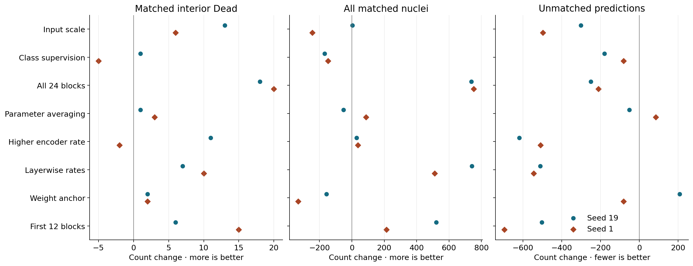
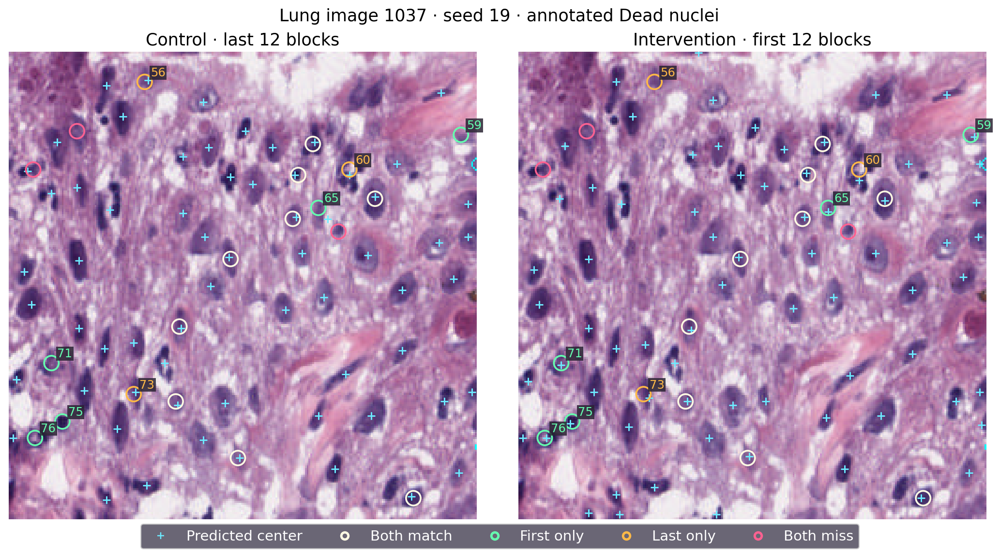

# 改变编码器更新位置之后，模型找到了哪些核

**同样更新 12 个块，位置有影响吗？** 有。两个种子分别多匹配 521 和 213 个核，同时少产生 502 和 696 个额外点。种子 19 的输出点总数只多了 19 个，因此它的收益主要体现为更多点落在标注附近。两个种子在训练图像上找到的核减少，在 522 张开发评估图像上找到的核增加。

**哪些结果相互印证？** 更新全部 24 个块时，两个种子多匹配 18 和 20 个内部死亡核，并各多匹配 700 多个总体细胞核。全层分层学习率也提高总体覆盖，但肺组织得到的新增匹配伴随结肠组织损失。只提高后 12 块学习率能减少额外点，死亡核效果则随种子变化。P27 固定了参数数量，将更新位置的影响单独拿出来比较。

**肺组织和结肠组织发生了什么？** 肺组织图像 1037 的种子 19 多配对两个内部死亡核，由找回五个、丢失三个组成。图像左下方的对象 71，最近预测点从距标注 21.02 像素变为 1.00 像素。结肠组织图像 776 的种子 1 丢失两个配对，对象 12 的最近距离从 1.00 增至 61.29 像素。匹配半径是 3 像素，且每个点只能与一个标注核配对。

**为什么继续测试分散更新？** 前 12 块更新的总体覆盖改善了，但两种子的内部死亡核召回只达到 53.79% 和 55.17%，低于预先规定的 60%。下一轮保持 12 块的参数预算，在整个深度隔一块更新一次，并保留最后一个块的更新。这样可以用同一个对照检查将预算分到不同深度的影响。

这里的数字来自反复用于方法开发的 PanNuke 第 1 折评估集。图中使用固定抽样，并与逐对象坐标核对。[中文详报](RESULTS_ZH.md) · [英文详报](RESULTS_EN.md)
