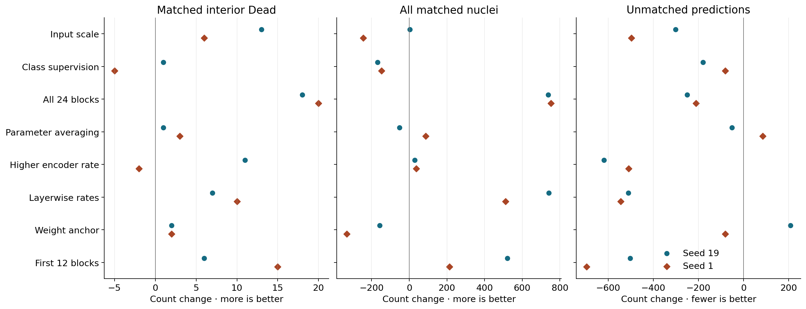
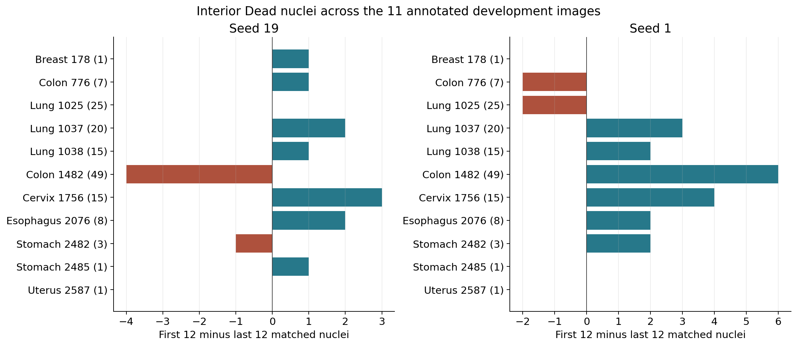
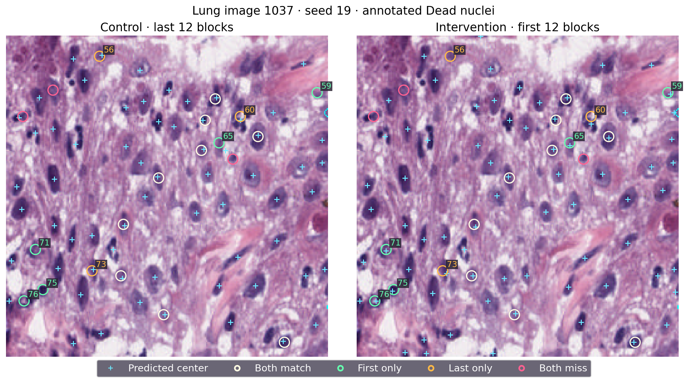
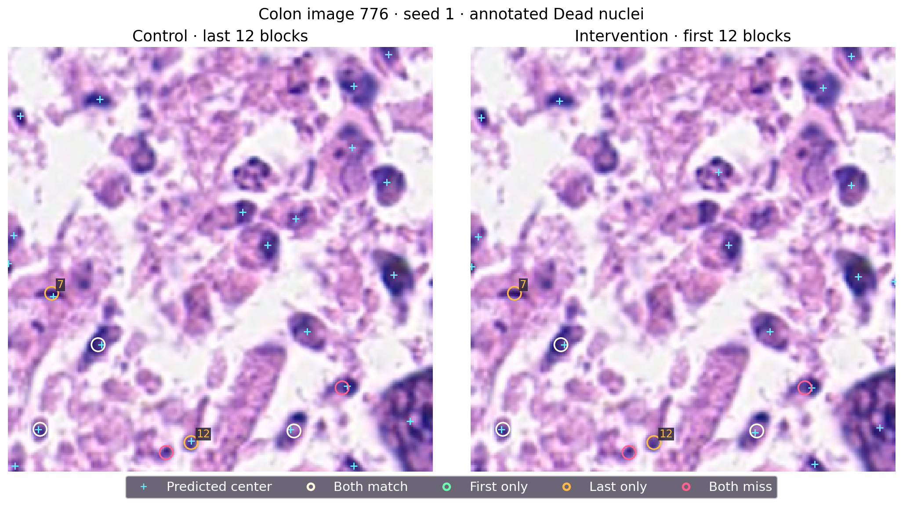

# Encoder update location and nucleus-center detection

This development series trains on 2,134 PanNuke fold-1 images and evaluates the epoch-130 models on 522 held-out images from that fold. A predicted center matches an annotated nucleus by one-to-one assignment within three native-image pixels. Recall uses all 12,250 annotated nuclei. Precision uses all predicted centers. Interior Dead nuclei are PanNuke Dead annotations whose outlines do not touch the image border. The evaluation set has 145 such objects on 11 images, including 32 smaller than 67 native pixels of area.

## Evidence across the stage

| Intervention | Interior Dead matches | All matches | Unmatched predictions |
|---|---:|---:|---:|
| Upscale input to 512 pixels (P20) | +13 / +6 | +3 / −244 | −302 / −497 |
| Add class-specific center supervision (P21) | +1 / −5 | −168 / −148 | −180 / −81 |
| Update all 24 encoder blocks (P22) | +18 / +20 | +738 / +753 | −250 / −211 |
| Exponentially average parameters (P23) | +1 / +3 | −51 / +87 | −52 / +85 |
| Raise the late-block learning rate (P24) | +11 / −2 | +29 / +38 | −618 / −509 |
| Use layerwise rates across all blocks (P25) | +7 / +10 | +741 / +512 | −510 / −544 |
| Anchor late blocks to pretrained weights (P26) | +2 / +2 | −157 / −331 | +208 / −82 |
| Update the first 12 encoder blocks (P27) | +6 / +15 | +521 / +213 | −502 / −696 |

The table shows seeds 19 and 1 in that order, with each change measured against the corresponding round's control. Input upscaling recovered some Dead nuclei but reduced broad coverage in seed 1 and took about 4.3 times as long to train. The class-specific head reduced unmatched points alongside broad matches. Exponential averaging produced mixed changes. Raising the late-block rate reduced unmatched predictions substantially, while its Dead effect switched signs between seeds. Full-depth adaptation produced the largest consistent gains for both Dead and all matches. The layerwise-rate version also improved aggregate coverage, with lung gaining 9/8 matches and colon losing 7/6. The weight anchor added two Dead matches per seed while training and development coverage fell.

P27 isolates one feature of the full-depth comparison by updating either the first or the last 12 blocks. Each arm updates exactly 151,179,264 encoder parameters and the same point head. The paired differences estimate the effect of those two allocations under a common budget. P27 reduced unmatched predictions more strongly than the other comparisons in the table, while full-depth updates had greater overall coverage gains.

## Equal-budget comparison

| Seed and allocation | Interior Dead | Small Dead | All matched / annotated | Precision | Unmatched |
|---|---:|---:|---:|---:|---:|
| 19, last 12 | 72/145 | 10/32 | 7,264/12,250 | 69.41% | 3,202 |
| 19, first 12 | 78/145 | 9/32 | 7,785/12,250 | 74.25% | 2,700 |
| 1, last 12 | 65/145 | 6/32 | 7,395/12,250 | 69.49% | 3,247 |
| 1, first 12 | 80/145 | 10/32 | 7,608/12,250 | 74.89% | 2,551 |

Seed 19 produced only 19 more points while matching 521 more nuclei. Seed 1 produced 483 fewer points while matching 213 more nuclei. Training-set recall fell from 97.72%/97.89% to 88.80%/87.82%, and final focal loss rose from 0.0563/0.0574 to 0.2643/0.2507. The first-block recipe fit fewer training centers and matched more development centers. Its gradients traverse the frozen later blocks, and measured pure training time increased by 21%/23%. Allocated GPU memory peaked at 4.84 GiB in the first-block runs and 4.05 GiB in controls.

Interior Dead recall gains were 4.14 and 10.34 percentage points. The paired, tissue-stratified image bootstrap gave 95% intervals of −0.57 to +15.38 and +1.85 to +15.49 points. Removing each Dead-positive image in turn gave ranges of +2.31 to +10.42 and +8.46 to +14.17 points. Final Dead recall was 53.79%/55.17% and precision was 74.25%/74.89%. The original rule requires at least 60% Dead recall and 75% precision among its criteria. Both seeds failed the complete rule, closing the fixed first-12 recipe. The same development split has been reused across rounds.

## Image and object changes

Lung gained three matches in each seed. Cervix image 1756 gained three and four, and esophagus image 2076 gained two in each seed. Colon image 1482 has 49 interior Dead annotations and moved from 17 to 13 matches in seed 19 and 10 to 16 in seed 1. The eight fixed images contain 53 interior Dead objects. In seed 19, the first-block recipe retained 26, gained 11, lost seven and missed nine in both arms. The corresponding seed-1 counts were 26, six, seven and 14. The fixed subset therefore gained four and lost one net, while the complete evaluation set gained six and 15.

Cyan crosses mark all predicted centers. Rings mark annotated interior Dead objects. Each ring has the same paired-outcome color in both panels. Lung image 1037 in seed 19 went from 12/20 to 14/20, with five newly matched objects and three lost. Object 65, at row 85 and column 169 beside a dark-stained region, gained a match as the nearest decoded point moved from 7.81 to 2.00 pixels away. Lower-left object 71 (170, 23) went from 21.02 to 1.00 pixel. Upper-left object 56 (16, 74) lost its match as the nearest point moved from 2.24 to 21.00 pixels away. For object 73 (187, 68), the distance changed from 1.41 to 3.61 pixels, crossing the match radius.

Colon image 776 went from 5/7 to 3/7 in seed 1. Nearest-point distances for objects 7 (148, 26) and 12 (238, 110) increased from 2.24 to 30.53 and from 1.00 to 61.29 pixels. These locations lack nearby decoded outputs in the first-block arm. Object 8 (179, 54) matched (179, 56) in both arms. Nearby crosses at object 9 (205, 201) are 3.16 and 4.00 pixels away and fall outside the matching radius. Decoded distances distinguish near-radius shifts from the absence of nearby outputs. Separating weak scores, peak displacements and peak filtering requires complete score maps.

Terra independently inspected the lung, colon and stage figures against the object coordinates. The final plots use larger point markers, explicit control and intervention headings and clear directions for count changes. The captions explain how repeated rings represent paired outcomes.

## Next comparison and provenance

P28 distributes the 12 trainable blocks across depth with odd zero-based indices 1, 3, 5, …, 23. It retains the last block and compares with the existing late-12 control. This fixed allocation tests whether distributing the equal budget across early and late stages improves coverage. The same seeds, training schedule, split, final checkpoint and decision criteria apply. The operational state is recorded separately.

All four runs of P27 array 55702167 reached epoch 130 and used 18:35:42 aggregate GPU time. Verification covered 495 sealed source files and 98 small artifacts, including 48 final images. The eight large checkpoints were checked against preserved byte counts and the original manifests. [Numerical evidence](p27_analysis.json) · [Fixed object matches](fixed_objects.csv)
