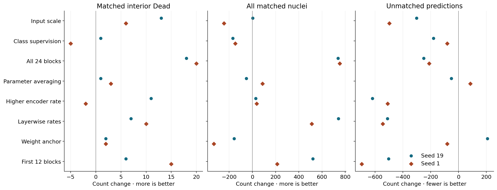
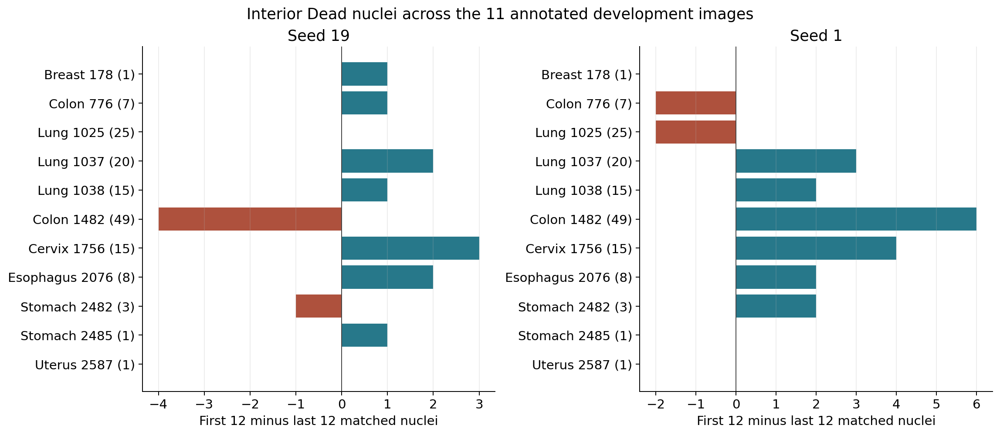
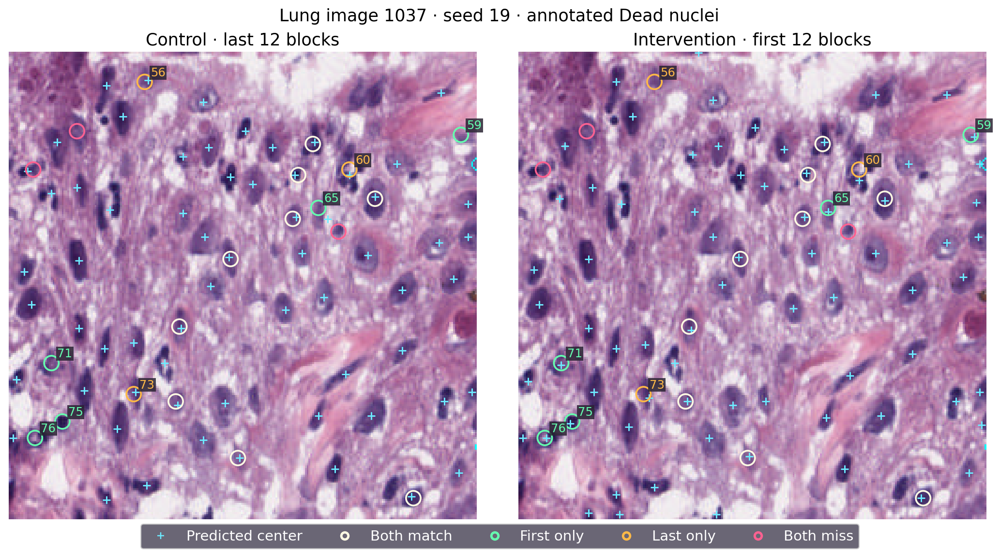
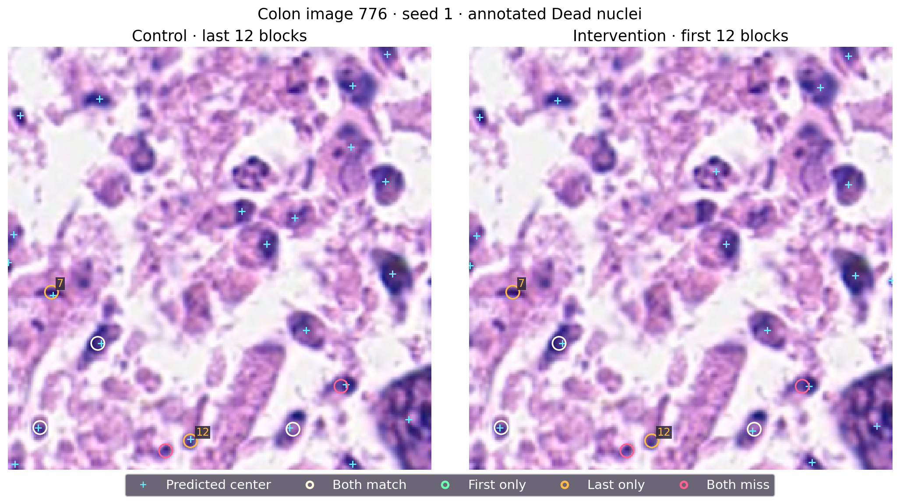

# 编码器更新位置与细胞核中心检测

这批比较在 PanNuke 第 1 折的 2,134 张图像上训练，在同一折留出的 522 张开发评估图像上比较第 130 轮模型。所有预测点都按原图 3 像素半径与标注中心一对一配对。总体召回按 12,250 个标注细胞核计算，精确率按全部输出点计算，额外点是未配对的输出点。死亡核使用 PanNuke 的 Dead 标注。内部死亡核的轮廓与图像边界不相接，共 145 个，分布于 11 张图像，其中 32 个面积小于 67 个原图像素。

## 从全层更新到同预算对照

| 干预 | 内部死亡核匹配变化 | 总体匹配变化 | 额外点变化 |
|---|---:|---:|---:|
| 输入放大到 512 像素（P20） | +13 / +6 | +3 / −244 | −302 / −497 |
| 训练时加入类别中心监督（P21） | +1 / −5 | −168 / −148 | −180 / −81 |
| 更新全部 24 个编码器块（P22） | +18 / +20 | +738 / +753 | −250 / −211 |
| 参数指数移动平均（P23） | +1 / +3 | −51 / +87 | −52 / +85 |
| 提高后 12 个块的学习率（P24） | +11 / −2 | +29 / +38 | −618 / −509 |
| 全层更新并使用分层学习率（P25） | +7 / +10 | +741 / +512 | −510 / −544 |
| 约束后 12 个块靠近预训练权重（P26） | +2 / +2 | −157 / −331 | +208 / −82 |
| 更新前 12 个块（P27） | +6 / +15 | +521 / +213 | −502 / −696 |

每列依次为种子 19 和 1。P20 获得死亡核匹配，但训练耗时约为原设置的 4.3 倍，种子 1 的总体匹配减少。P21 减少额外点时也丢失了有效点。P23 的平均参数对两种子产生不同的覆盖变化。P24 的精确率改善伴随死亡核结果随种子改变。P22 的全层更新给出本阶段最大且双种子同向的死亡核净增，并提高总体覆盖。P25 也稳定提高总体覆盖，但肺组织净增 9/8，结肠组织净减 7/6。P26 增加的两个死亡核伴随训练和开发评估总体覆盖收缩。

P22 同时改变了可更新的位置和参数数目。P27 将每组可更新的编码器参数固定为 151,179,264 个，对照更新最后 12 个块，干预更新最前 12 个块。两组共享检测头、初始权重、优化与评估流程。因此可以比较固定预算下这两种块位置。P27 相对本轮对照的额外点降幅是表中最大，整体匹配增益小于全层更新，组织间差异依然明显。

## P27 的训练和开发评估

| 种子与更新位置 | 内部死亡核匹配 | 小死亡核匹配 | 总体匹配 / 标注 | 总体精确率 | 额外点 |
|---|---:|---:|---:|---:|---:|
| 19，后 12 块 | 72/145 | 10/32 | 7,264/12,250 | 69.41% | 3,202 |
| 19，前 12 块 | 78/145 | 9/32 | 7,785/12,250 | 74.25% | 2,700 |
| 1，后 12 块 | 65/145 | 6/32 | 7,395/12,250 | 69.49% | 3,247 |
| 1，前 12 块 | 80/145 | 10/32 | 7,608/12,250 | 74.89% | 2,551 |

种子 19 的总输出点只增加 19 个，同时多配对 521 个核。种子 1 少输出 483 个点，同时多配对 213 个核。两组变化都显示输出点与标注位置的配对改善。训练集总体召回从 97.72%/97.89% 降至 88.80%/87.82%，最终中心预测损失从 0.0563/0.0574 升至 0.2643/0.2507。前层更新组在训练集上的覆盖更低，在本开发评估集上的覆盖更高。冻结后半段仍需将梯度传回前半段，观察到的纯训练时间增加 21%/23%，分配显存峰值从 4.05 增至 4.84 GiB。

两种子死亡核召回增加 4.14/10.34 个百分点。按组织分层、对图像配对重采样的 95% 区间为 −0.57 至 +15.38 和 +1.85 至 +15.49 个百分点。依次删除任意一张含死亡核图像后，增益范围仍为 +2.31 至 +10.42 和 +8.46 至 +14.17 个百分点。前层组绝对死亡核召回为 53.79%/55.17%，总体精确率为 74.25%/74.89%。原判定要求分别达到 60% 和 75%，两种子均未满足完整判定。关闭本次固定前 12 块设置。数据来自反复用于方法开发的第 1 折评估集。

## 哪些图像和对象发生改变

宫颈组织图像 1756 净增 3/4，食管组织图像 2076 净增 2/2，肺组织合计净增 3/3。含 49 个内部死亡核的结肠组织图像 1482，在种子 19 从 17 降到 13，在种子 1 从 10 升到 16。固定八张图的 53 个内部死亡核中，种子 19 保留 26、找回 11、丢失 7、两组都漏 9。种子 1 分别为 26、6、7、14。该子集净增 4、净减 1；种子 1 的总体净增主要来自固定示例以外的图像。

青色十字标出所有预测的细胞核中心。圆圈标出内部死亡核标注，两幅图重复相同的圆圈颜色来表示两组共同的配对结局。图像 1037 的种子 19 从 12/20 增至 14/20，实际找回 5 个并丢失 3 个。对象 65 的标注中心为（85，169，先行后列），处于图像中央深染组织边缘，最近输出点从 7.81 像素缩至 2.00 像素，形成匹配。左下方对象 71（170，23）从 21.02 像素缩至 1.00 像素。左上方对象 56（16，74）从 2.24 像素增至 21.00 像素，附近缺少输出点。下部对象 73（187，68）从 1.41 增至 3.61 像素，越过了半径界线。

图像 776 的种子 1 从 5/7 降到 3/7。对象 7（148，26）和对象 12（238，110）的最近输出距离分别从 2.24 增至 30.53、从 1.00 增至 61.29 像素。两者均表现为近处缺少解码后的预测点。对象 8（179，54）在两组都匹配到（179，56）。右下部对象 9（205，201）两组都有肉眼可见的近处十字，距离分别为 3.16 和 4.00 像素，均在半径外。坐标可以区分临界位置偏差与附近无输出。区分预测分数弱、峰位置偏移和峰值筛选的影响，需要保留完整分数图。

Terra 独立审阅了肺、结肠和阶段比较图，并以原始坐标核对上述例子。按审阅结果增大了预测点标记，明确了对照与干预方向，并在图注解释共享颜色和匹配口径。

## 下一轮

P28 的干预更新零起始编号 1、3、5、…、23 的 12 个块，在整个编码器深度分配相同的参数预算，并保留最后一个块的适配。对照仍更新后 12 个块。此次选择依据是前段更新与全层更新均改善过覆盖，而结肠变化及小死亡核收益随种子变化。原两种子、训练轮数、数据划分、最后检查点和判定规则保留。P28 运行状态单独记录在同目录。

## 核验记录

P27 数组 55702167 四次各完成 130 轮，累计 18:35:42 GPU 时间。核对了 495 个封存源码文件及 98 个小型产物，含 48 张最终图。八个大检查点核对了当前大小和原始保存清单。复算结果见 [数值记录](p27_analysis.json)，固定图像中的一对一配对见 [逐对象坐标](fixed_objects.csv)。
